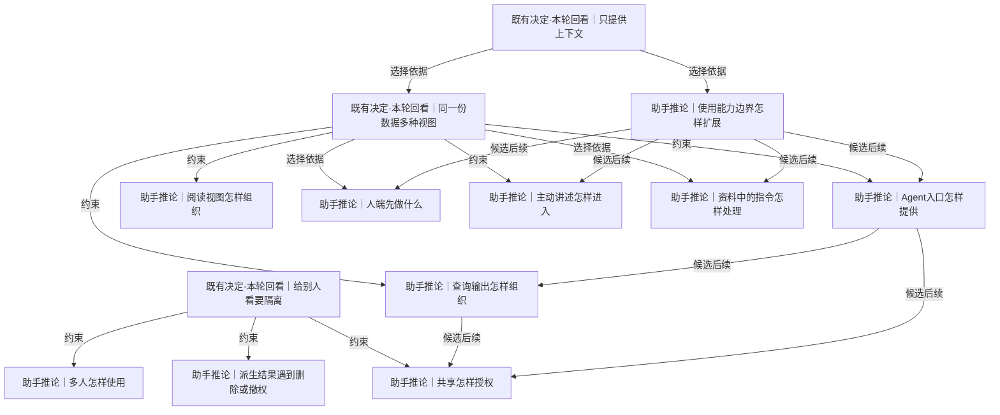

# 查询、界面与共享

Agent与人如何使用同一批材料，怎样控制共享与后续协助的边界。

[返回全景](../README.md) · [交互浏览](../index.html)

## 只提供上下文

**既有决定·本轮回看** · 既有产品边界是向外部Agent提供个人上下文，Orisumi可用模型整理，但行动交给Agent。本轮未来用途开放，这条作为可保留的路线而非收集成立的前提。

依据：

- [了解一个人靠观测](roots.md#n-fba65c991e31f19a)（选择依据）：观测支持上下文能力，产品只做到这里仍是一项选择
- [首先收集数据](roots.md#n-2c3dfbca22881d81)（约束）：收集本身已成立，后续能力独立选择

依据材料：[src/Docs/Orisumi.Docs/content/docs/requirements/belief.mdx](../../../../../src/Docs/Orisumi.Docs/content/docs/requirements/belief.mdx)。只提供上下文

依据材料：[.scratch/orisumi-roots/confirmations.md](../../../confirmations.md)。未来怎样理解和使用重审产品边界

可能需要回看：18 个下游节点（含所有候选路线）

[Agent入口怎样提供](#n-da5b4169050995d4)、[主动讲述怎样进入](#n-4bf3066db8e45d47)、[交付路线怎样排序](delivery.md#n-e93627fc1fab2325)、[人端先做什么](#n-9b3ff99aea342b48)、[从全景讨论怎样进入实现](delivery.md#n-473477a3b70f395c)、[使用能力边界怎样扩展](#n-ee3ad59eb9be5324)、[共享怎样授权](#n-4b3c6032607d1b5c)、[同一份数据多种视图](#n-309f702d88cb0e1d)、[后续读取怎样验收](delivery.md#n-9e39e29694bbe145)、[新旧理解怎样评测](delivery.md#n-cbfb97254da427c8)、[未验证能力怎样推进](delivery.md#n-b89d1395b983dd88)、[查询输出怎样组织](#n-83096b85d1cbe387)、[模型调用留下什么](understanding.md#n-97745ff5030f65f3)、[理解版本怎样使用](understanding.md#n-be7944dd96e1f491)、[第一阶段怎样验收](delivery.md#n-ae87acd40d922614)、[资料中的指令怎样处理](#n-61280889c3818aa0)、[长期恢复怎样验证](delivery.md#n-254f30d6e194be24)、[阅读视图怎样组织](#n-45c1a653f0eb56ac)

## 同一份数据多种视图

**既有决定·本轮回看** · 既有方向：Agent优先，能力可脱离界面调用；人与Agent使用相同材料。人自己写的话来自原有来源，聚合成视图。

依据：

- [只提供上下文](#n-bd00a565c69800cc)（选择依据）：既有上下文路线支持可调用接口
- [一件事散在多处](conditions.md#n-c7f6551688fc3ac5)（证据）：同一人的讲述分布于多个来源

依据材料：[src/Docs/Orisumi.Docs/content/docs/requirements/belief.mdx](../../../../../src/Docs/Orisumi.Docs/content/docs/requirements/belief.mdx)。同一份数据多种视图

依据材料：[.scratch/requirements/belief.md](../../../../requirements/belief.md)。讲述作为独立来源类已否决

可能需要回看：11 个下游节点（含所有候选路线）

[Agent入口怎样提供](#n-da5b4169050995d4)、[主动讲述怎样进入](#n-4bf3066db8e45d47)、[人端先做什么](#n-9b3ff99aea342b48)、[共享怎样授权](#n-4b3c6032607d1b5c)、[后续读取怎样验收](delivery.md#n-9e39e29694bbe145)、[新旧理解怎样评测](delivery.md#n-cbfb97254da427c8)、[查询输出怎样组织](#n-83096b85d1cbe387)、[模型调用留下什么](understanding.md#n-97745ff5030f65f3)、[理解版本怎样使用](understanding.md#n-be7944dd96e1f491)、[资料中的指令怎样处理](#n-61280889c3818aa0)、[阅读视图怎样组织](#n-45c1a653f0eb56ac)

## 给别人看要隔离

**既有决定·本轮回看** · 既有方向继续约束共享：自己的Agent处理自己的数据可以使用全部授权材料；给其他人看时依据明确可见范围。自己的云端模型服务与共享给他人是不同关系。

依据：

- [数据可以给别人看](roots.md#n-bd8bb6fe03ea2b58)（选择依据）：共享对象能看哪些内容需要约定
- [模型服务可处理自己的数据](roots.md#n-a1f1391de7cc4e5c)（约束）：不以自己数据交给云端模型为额外隐私门槛

依据材料：[src/Docs/Orisumi.Docs/content/docs/requirements/belief.mdx](../../../../../src/Docs/Orisumi.Docs/content/docs/requirements/belief.mdx)。数据可以给别人看、给别人看要隔离

依据材料：[AGENTS.md](../../../../../AGENTS.md)。模型服务处理与给其他人看的区别

可能需要回看：5 个下游节点（含所有候选路线）

[保存地是否需要加密封装](availability.md#n-5d0b7394b458d05a)、[共享怎样授权](#n-4b3c6032607d1b5c)、[多人怎样使用](#n-533f290602f41d06)、[派生结果遇到删除或撤权](#n-183194894919be77)、[连接信任与访问边界](availability.md#n-ca03d6309f6b9fd6)

## 使用能力边界怎样扩展

**助手推论** · 例如现在先保住会话，以后可查原文、回顾一天、让Agent理解近期目标，甚至请它准备一项行动；这些用途逐项形成，当前不用先选完。

**Agent采用 · 当前**

候选：按独立价值逐层增加能力。

理由与代价：先保存取回，随后检索、理解和可选协助各有独立价值，符合未来用途开放；接受暂不提供完整个人助理体验。

启动或重审条件：每加一层先跑一个真实输入到可用输出；行动能力只有具体场景授权后才进入实施。

依据：

- [首先收集数据](roots.md#n-2c3dfbca22881d81)（约束）：未来用途保持开放
- [只提供上下文](#n-bd00a565c69800cc)（选择依据）：既有路线作为一项候选

依据材料：[.scratch/orisumi-roots/confirmations.md](../../../confirmations.md)。未来用途开放；只提供上下文需回看

依据材料：[src/Docs/Orisumi.Docs/content/docs/requirements/belief.mdx](../../../../../src/Docs/Orisumi.Docs/content/docs/requirements/belief.mdx)。既有上下文边界

### 按独立价值逐层增加能力 · 助手推荐

保存取回→检索回顾→复用理解→可选协助，每层可独立使用并停止扩展。

收益：满足当前目标又保留开放用途。

代价：不能提前宣称尚未验证的完整个人助理体验。

适用条件：推荐全景路线。

继续展开：[Agent入口怎样提供](#n-da5b4169050995d4)、[人端先做什么](#n-9b3ff99aea342b48)、[主动讲述怎样进入](#n-4bf3066db8e45d47)

分支终点：每次新增能力选一个输入到可用输出的例子，通过本层验收才铺开。

检验：关闭全部理解和界面，原件采集仍有独立价值；每层失败不破坏前层。

### 长期限定为上下文基础设施 · 可选路线

查询、追溯与理解供外部Agent使用，行动由外部产品完成。

收益：职责集中，现有Agent直接受益。

代价：完整日常体验依赖外部Agent与整合。

适用条件：本轮重新确认长期只做上下文时。

继续展开：[Agent入口怎样提供](#n-da5b4169050995d4)

分支终点：提供检索、引用、范围与原件读取契约，用两个不同Agent完成同一任务。

检验：替换Agent后无需更改材料格式，仍可答题并追溯。

### 后续加入产品内主动协助 · 可选路线

在查询之外生成建议、草稿或发起授权行动。

收益：用户少切换工具，形成端到端体验。

代价：增加行动授权、失败处理和体验设计责任。

适用条件：用户已明确选择具体协助场景，且上下文能力验证有效。

继续展开：[资料中的指令怎样处理](#n-61280889c3818aa0)

分支终点：先做只产草稿的一个场景；发布、发送和执行分别要求场景授权。

检验：有依据的草稿可独立审阅；资料里的指令不会触发行动。

实现现状：候选设计尚未实现；已删除导洞只作为历史验证材料。

审阅重点：后续查询、理解、查看、共享与主动助理分别有条件。当前数据收集目标不要求先绑定其中一个用途。

可能需要回看：13 个下游节点（含所有候选路线）

[Agent入口怎样提供](#n-da5b4169050995d4)、[主动讲述怎样进入](#n-4bf3066db8e45d47)、[交付路线怎样排序](delivery.md#n-e93627fc1fab2325)、[人端先做什么](#n-9b3ff99aea342b48)、[从全景讨论怎样进入实现](delivery.md#n-473477a3b70f395c)、[共享怎样授权](#n-4b3c6032607d1b5c)、[后续读取怎样验收](delivery.md#n-9e39e29694bbe145)、[新旧理解怎样评测](delivery.md#n-cbfb97254da427c8)、[未验证能力怎样推进](delivery.md#n-b89d1395b983dd88)、[查询输出怎样组织](#n-83096b85d1cbe387)、[第一阶段怎样验收](delivery.md#n-ae87acd40d922614)、[资料中的指令怎样处理](#n-61280889c3818aa0)、[长期恢复怎样验证](delivery.md#n-254f30d6e194be24)

## Agent入口怎样提供

**助手推论** · 一个本地Agent能运行命令，另一个只能接工具协议，网页客户端需要网络接口。三者共享读取行为，但不必同时实现。

**Agent采用 · 当前**

候选：先命令行，按需加MCP。

理由与代价：已有 orisumi 入口适合本地保存和恢复，后续同一读取操作再适配 MCP；接受纯工具协议客户端暂不能连接。

启动或重审条件：第一个目标 Agent 无法使用本地命令时，才测检索到原件的 MCP 链路及分页取消。

依据：

- [同一份数据多种视图](#n-309f702d88cb0e1d)（约束）：核心能力可由Agent调用

依据材料：[src/Docs/Orisumi.Docs/content/docs/model/context.mdx](../../../../../src/Docs/Orisumi.Docs/content/docs/model/context.mdx)。旧五命令历史验证

依据材料：[src/Docs/Orisumi.Docs/content/docs/model/nodes.mdx](../../../../../src/Docs/Orisumi.Docs/content/docs/model/nodes.mdx)。既有命令行优先、MCP适配和Application API设计

依据材料：[src/Orisumi.Cli/Program.cs](../../../../../src/Orisumi.Cli/Program.cs)。当前仅采集和原件命令

### 先命令行，按需加MCP · 助手推荐

本机先提供稳定可组合命令；当某个Agent需要MCP时再适配相同应用操作。

收益：已有入口可延伸，能用真实Agent验收。

代价：纯工具协议客户端暂时接不了。

适用条件：当前开发与使用都在本机时推荐。

继续展开：[查询输出怎样组织](#n-83096b85d1cbe387)

分支终点：先重写sources/查询/around/raw；MCP适配调用共用操作而不解析给人看的终端文字。

检验：两个入口对同一查询返回同一出处和范围；删除/修改能力不混进只读读取工具。

### 先以MCP服务Agent · 可选路线

工具描述、结构化参数和结果作为第一入口，本地命令复用同一读取层。

收益：工具型Agent更容易发现能力。

代价：需验证目标Agent连接、长结果、错误和取消行为。

适用条件：实际首要使用者只支持MCP或调用命令不方便。

分支终点：在目标Agent完成一条检索→上下文→原件证据链，验证分页与超时。

检验：记录真实调用路径、遗漏与失败；协议支持未勘探前不视为已有能力。

### 先网络API服务多端 · 可选路线

本机或远端节点提供可查询、取回、分页的应用接口，CLI和工具协议为客户端。

收益：多个设备与Web可共用。

代价：增加网络认证、可用性和版本边界。

适用条件：实际需要远端访问或首个人端已选Web。

继续展开：[共享怎样授权](#n-4b3c6032607d1b5c)

分支终点：选一个远程查询样本，同时测试本机离线取回。

检验：远程失败和无权限与空结果分开；分页引用跨请求保持稳定。

实现现状：CLI 已提供文件/助手/前台采集以及 raw list/show/line/delete/restore/export；语义 context 命令、MCP 与网络查询尚未重写。（[src/Orisumi.Cli/Program.cs](../../../../../src/Orisumi.Cli/Program.cs)）

审阅重点：判断该能力什么时候需要、服务谁，以及是否接受对应代价。

可能需要回看：2 个下游节点（含所有候选路线）

[共享怎样授权](#n-4b3c6032607d1b5c)、[查询输出怎样组织](#n-83096b85d1cbe387)

## 查询输出怎样组织

**助手推论** · Agent先搜到若干候选，再逐层展开原文；人可以阅读相同证据。输出应知道筛选范围、截断、数据版本和下一步怎么读。

**暂后置 · 以后**

候选：结构化结果加简洁文本呈现。

理由与代价：共享结构化查询结果再渲染简洁文字，可明确范围、引用、截断与下一页；接受少量稳定结果语义设计。

启动或重审条件：第一次查询上线时用一页被截断结果核对游标和引用，around 按来源上下文展开。

依据：

- [同一份数据多种视图](#n-309f702d88cb0e1d)（约束）：读取能力共用底层材料
- [理解能追溯来源](understanding.md#n-299861624af1def3)（约束）：简短结果仍能展开依据

依据材料：[src/Docs/Orisumi.Docs/content/docs/model/context.mdx](../../../../../src/Docs/Orisumi.Docs/content/docs/model/context.mdx)。带位置文本、around默认前10后20、截断与时区

依据材料：[.scratch/modeling/benchmark.md](../../../../modeling/benchmark.md)。跨来源问答需逐层找依据

### 结构化结果加简洁文本呈现 · 助手推荐

共享查询结果包含条目、位置、范围、游标、已省略信息；CLI渲染文本，工具与API可用结构字段。

收益：组合与阅读都清楚，避免重新解析排版。

代价：要定义稳定且精简的结果语义。

适用条件：推荐默认。

分支终点：支持按来源、时间、对象原名和内容检索；结果分页，around保持来源内上下文并可沿明确关系跳转。

检验：同一游标下新采集不会导致重复/漏页；所有截断可继续展开到原件。

### 先只提供带引用文本 · 可选路线

延续导洞文字命令，范围和截断以可读说明表达。

收益：实现和Agent验证最直接。

代价：机器消费更依赖排版，后续接口要整理。

适用条件：第一条读取路径、单个Agent使用。

分支终点：明确标时间区间、时区、隐藏条数、总量未知和引用。

检验：基准Agent能只凭命令完成追溯；长结果未悄悄截断。

### 按任务导出上下文包 · 可选路线

一次选定材料和范围，生成可移交给任何Agent的文件包，带清单和位置。

收益：脱离在线服务仍可使用。

代价：内容会过时，导出副本需独立管理。

适用条件：外部Agent无法直连接口或离线协作。

继续展开：[共享怎样授权](#n-4b3c6032607d1b5c)

分支终点：导出被选材料、读法说明和引用解析信息，记录包的范围与时点。

检验：在空目录仅凭包答题；缺失材料显示为缺失而非静默补读。

实现现状：候选设计尚未实现；已删除导洞只作为历史验证材料。

审阅重点：判断该能力什么时候需要、服务谁，以及是否接受对应代价。

可能需要回看：1 个下游节点（含所有候选路线）

[共享怎样授权](#n-4b3c6032607d1b5c)

## 阅读视图怎样组织

**助手推论** · 查一句原话、看一段时间、追某个对象关系是三种任务；图形展示应服务导航，不能把所有关系推成一个唯一人生模型。

**暂后置 · 以后**

候选：先检索与时间线，证据侧栏展开。

理由与代价：检索与并排时间线直接服务找原话和回顾，证据可展开；关系图与叙事需要更多推断，接受初期关系探索多次查询。

启动或重审条件：确定性检索通过后，用查一句话和回顾一天两个真实任务比较操作路径。

依据：

- [同一份数据多种视图](#n-309f702d88cb0e1d)（约束）：同一材料容许多种任务视图
- [身份事后读出](understanding.md#n-5261a78fdee82c0f)（约束）：关系可变化，不能把视图当原件

依据材料：[src/Docs/Orisumi.Docs/content/docs/model/readings.mdx](../../../../../src/Docs/Orisumi.Docs/content/docs/model/readings.mdx)。人说的话、时间线、覆盖

依据材料：[src/Docs/Orisumi.Docs/content/docs/model/context.mdx](../../../../../src/Docs/Orisumi.Docs/content/docs/model/context.mdx)。查询及上下文读取

依据材料：[.scratch/modeling/benchmark.md](../../../../modeling/benchmark.md)。A2事实、A1跨来源叙述、C1思路演变

### 先检索与时间线，证据侧栏展开 · 助手推荐

明确词句用检索，回顾一天用并排时间线，点击看到出处与上下文。

收益：覆盖既有多数基准，视图含义容易解释。

代价：跨关系探索要多次查询。

适用条件：推荐第一批人可读视图。

分支终点：时间线区分前台/输入/会话/提交；时长聚合注明计算规则和重叠。

检验：A5/B4/B6不会把挂着的窗口当作人一直在用；原件可直接打开。

### 对象关系图作为主要导航 · 可选路线

以明确证据或带标记的推断边连接对象和事件，点击继续展开。

收益：适合不知道关键词但记得关联的探索。

代价：密图难读、错误关系易被视觉强化。

适用条件：真实任务表明关系导航更方便。

分支终点：先为一个项目和两类关系做小图，对比同任务搜索路径。

检验：每条边可查证据与有效范围，撤回身份对应后图随之更新。

### 先生成日记式回顾 · 可选路线

按一天或主题输出叙述，分开记录、推断与看不到的部分，逐段引用。

收益：阅读门槛低，易于回顾。

代价：需要语义理解，可能把同时发生误成因果。

适用条件：用户确实想看回顾且问答质量已可接受。

继续展开：[模型调用留下什么](understanding.md#n-97745ff5030f65f3)

分支终点：用两天基准产回顾，逐句检查支撑与未知。

检验：所有核心结论有引用；无法证明时长与动机时使用明确局限。

实现现状：候选设计尚未实现；已删除导洞只作为历史验证材料。

审阅重点：判断该能力什么时候需要、服务谁，以及是否接受对应代价。

可能需要回看：3 个下游节点（含所有候选路线）

[新旧理解怎样评测](delivery.md#n-cbfb97254da427c8)、[模型调用留下什么](understanding.md#n-97745ff5030f65f3)、[理解版本怎样使用](understanding.md#n-be7944dd96e1f491)

## 人端先做什么

**助手推论** · 人在电脑上核对一次采集、在手机上查看历史、调整来源权限，所需界面不同；各端不必同时建设。

**暂后置 · 以后**

候选：先最小查看界面，再按设备补原生能力。

理由与代价：现在沿命令入口，出现人查看需求后做采集清单和证据轻界面；原生平台成本更高，接受系统授权仍单独完成。

启动或重审条件：实际查看任务因 Agent/命令步骤过长时，先实现本机一条清单到原件路径，再评估远程和原生能力。

依据：

- [同一份数据多种视图](#n-309f702d88cb0e1d)（选择依据）：界面是共同能力的一种使用方式
- [首先收集数据](roots.md#n-2c3dfbca22881d81)（约束）：先能留下与取回再扩展界面

依据材料：[src/Docs/Orisumi.Docs/content/docs/model/nodes.mdx](../../../../../src/Docs/Orisumi.Docs/content/docs/model/nodes.mdx)。既有Swift、WinUI、Android、Web各端计划；均未实现

依据材料：[src/Docs/Orisumi.Docs/content/docs/model/index.mdx](../../../../../src/Docs/Orisumi.Docs/content/docs/model/index.mdx)。当前仅CLI原件功能

### 先最小查看界面，再按设备补原生能力 · 助手推荐

收集阶段用现有命令；需要人查看时先做采集清单、检索结果和证据查看的一套轻界面。

收益：先验证内容是否有用，减少多端维护。

代价：系统级采集授权和后台状态仍可能需要原生入口。

适用条件：推荐默认；Web只是待验证候选。

分支终点：先本机浏览器实现一条查看路径；远程访问和共享另接授权。

检验：从一条结果能看原件与出处；网络不可用时本机材料仍可取回。

### 从最需要的设备原生入口做起 · 可选路线

先选Mac、Windows或Android之一，实现系统授权、采集控制与查看。

收益：能贴近平台实际权限和后台方式。

代价：每个平台都要独立适配与发布。

适用条件：某来源确实只有原生入口才便于授权或采集。

分支终点：先勘探一种系统能力的授权、后台运行与重启行为，再做端到端样本。

检验：授权前后状态清楚，拒绝权限也保留已采原件；不以未验证的平台能力承诺多端。

### 长期以Agent和命令作为主要界面 · 可选路线

人通过现有Agent提问和查看证据，只为不可替代的授权步骤提供小入口。

收益：产品界面维护最少。

代价：使用质量依赖Agent，日常快速浏览可能繁琐。

适用条件：主要使用者已习惯Agent且问答足够稳定。

分支终点：观察连续一周的实际查看任务，记录无法完成和操作过长的步骤。

检验：同一原件无需专有界面可取回；需要图表的任务有具体补充方案。

实现现状：候选设计尚未实现；已删除导洞只作为历史验证材料。

审阅重点：判断该能力什么时候需要、服务谁，以及是否接受对应代价。

## 共享怎样授权

**助手推论** · 例如给朋友看一周旅行回顾，原件里同时有工作对话。回顾、索引、关联边和调用trace都可能包含超出范围的信息，授权需要覆盖实际交付内容。

**暂后置 · 以后**

候选：先按明确范围生成共享副本。

理由与代价：首个共享场景用明确范围可审阅副本较易核对，避免提前建设共享服务权限；接受交付副本无法保证撤回及更新需重发。

启动或重审条件：用户提出具体受众和内容后，列出包内材料/派生输入并检查所有证据可共享，再按授权交付。

依据：

- [给别人看要隔离](#n-25d958239f2a38ec)（约束）：共享必须明确受众与可见内容
- [理解能追溯来源](understanding.md#n-299861624af1def3)（约束）：追溯不能越过共享权限
- [导出与恢复](storage.md#n-da66683208852205)（选择依据）：静态共享需要可核对的材料闭包，受众范围仍须单独选择。

依据材料：[src/Docs/Orisumi.Docs/content/docs/requirements/belief.mdx](../../../../../src/Docs/Orisumi.Docs/content/docs/requirements/belief.mdx)。给别人看要隔离

依据材料：[src/Docs/Orisumi.Docs/content/docs/model/nodes.mdx](../../../../../src/Docs/Orisumi.Docs/content/docs/model/nodes.mdx)。私有网络目前只讨论自己节点之间信任，不能直接充当他人共享授权

### 先按明确范围生成共享副本 · 助手推荐

用户挑选内容或回顾，生成可审阅包；给别人的只有此包和许可的证据。

收益：边界可见，先不建设长期共享服务。

代价：副本交付后不能保证撤回，更新需重发。

适用条件：第一次共享，默认推荐。

分支终点：分享前列出实际包含的材料与派生内容；不允许的原件引用显示不可共享，或重新用可共享输入生成回顾。

检验：以混有工作与私人材料的回顾样本检查正文、标题、附件、索引和trace，接收者只能读选中内容。

### 共享服务按请求授权 · 可选路线

共享身份只查询允许的材料；检索、摘要、raw/around、附件和关系展开均检查同一范围。

收益：可更新授权并停止后续访问。

代价：增加身份、权限、缓存和派生结果范围维护。

适用条件：需要持续共享、不同受众或定期更新。

分支终点：先支持一个受众与一个来源/时间范围，默认所有派生输入都获授权才复用；否则针对可见材料重算。

检验：撤销后新查询和缓存都不再返回内容；已下载副本明确属于对方持有。

### 与其他拥有者互授数据访问 · 可选路线

每个人管理自己的资料库，跨库查询只读取对方授予的范围。

收益：支持协作而各自保有控制。

代价：涉及多方身份、授权组合、引用与撤销传播。

适用条件：双方明确需要长期互查且单库共享已验证。

分支终点：用两个人工样本库做只读联合查询，展示各来源拥有者与授权范围。

检验：双方同名对象不自动合并；一方撤销后跨库派生缓存重新计算或停止可见。

实现现状：候选设计尚未实现；已删除导洞只作为历史验证材料。

审阅重点：判断该能力什么时候需要、服务谁，以及是否接受对应代价。

## 多人怎样使用

**助手推论** · 用户是任何人意味着别人也能用产品；并不自动意味着所有人的数据要装进同一服务和同一数据库。

**Agent采用 · 当前**

候选：每个人独立资料库。

理由与代价：每人独立资料库足以支持别人使用产品且对应个人来源边界；接受托管和跨库协作后置。

启动或重审条件：真实多人托管或共享设备需求出现时，以两个人工样本核对归属和权限后选后续方案。

依据：

- [用户是任何人](roots.md#n-9397755aa6bf75fc)（选择依据）：产品使用者范围广，部署模式另选
- [给别人看要隔离](#n-25d958239f2a38ec)（约束）：不同拥有者数据需要明确边界

依据材料：[src/Docs/Orisumi.Docs/content/docs/requirements/belief.mdx](../../../../../src/Docs/Orisumi.Docs/content/docs/requirements/belief.mdx)。用户是任何人、自己看全部与共享隔离

依据材料：[.scratch/modeling/data.md](../../../../modeling/data.md)。旧数据源存在另一人的数据，勘探只读取本人范围

### 每个人独立资料库 · 助手推荐

一个资料库有明确拥有者，设备和来源授权归该库；别人也可自行建立一套。

收益：实现清楚，单人产品可先用。

代价：协作或托管需后续接口。

适用条件：推荐第一阶段和个人日常使用。

分支终点：配置明确当前资料库与来源账号，外部共享走独立出口。

检验：切换两个样本资料库，搜索、原件和缓存完全分开；路径或同名不能混入另一库。

### 托管多个拥有者资料库 · 可选路线

服务负责账号、资料归属与受众权限，每个请求都有拥有者范围。

收益：降低别人安装和维护的门槛。

代价：增加托管责任、账号恢复、计费及隔离测试。

适用条件：实际要面向多用户提供服务时。

分支终点：先以两个人工用户验证来源绑定、查询、导出和删除全过程，再选共享或独立数据库。

检验：跨账号猜测原件引用、查询、索引或任务ID都不能取出对方材料。

### 设备多人共用但资料按归属分开 · 可选路线

同一设备可能采到多人活动，来源账号和时间归属可不明；不强推为某个人。

收益：能对应家庭设备和共享账号的真实情况。

代价：需要来源权限和不确定归属设计。

适用条件：准备接共用设备来源之前。

分支终点：勘探系统用户切换、来源账号与共享窗口，决定哪些记录属于设备而非个人。

检验：身份不明的记录不静默归给默认拥有者，且共享前有明确可见范围。

实现现状：候选设计尚未实现；已删除导洞只作为历史验证材料。

审阅重点：判断该能力什么时候需要、服务谁，以及是否接受对应代价。

## 主动讲述怎样进入

**助手推论** · 自述可以来自IM、备忘录、助手对话；主动问一句为什么则是新交互能力，不是保存这些已有来源的前提。

**暂后置 · 以后**

候选：聚合已有自述。

理由与代价：先聚合已经亲自写下的内容，复用真实来源且不新增打扰；接受未说出的动机未知。

启动或重审条件：人类文本读出时核对注入和代写草稿与本人输入；用户实际补记需求出现再加快捷输入。

依据：

- [同一份数据多种视图](#n-309f702d88cb0e1d)（约束）：讲述是来自多来源的视图
- [首先收集数据](roots.md#n-2c3dfbca22881d81)（选择依据）：已有材料先保存，主动提问另作产品选择

依据材料：[.scratch/requirements/belief.md](../../../../requirements/belief.md)。讲述独立类被否决；主动请人讲述尚未定

依据材料：[src/Docs/Orisumi.Docs/content/docs/model/readings.mdx](../../../../../src/Docs/Orisumi.Docs/content/docs/model/readings.mdx)。said提取人亲自输入的内容

### 聚合已有自述 · 助手推荐

识别人亲自写的内容，按时间或主题查看。

收益：符合现有来源和已有决定。

代价：记录没说出的动机仍未知。

适用条件：推荐默认。

分支终点：从已采来源提取明确本人输入，注入内容与代写草稿分开。

检验：继承历史、系统提示和Agent汇报不误记为本人陈述。

### 用户主动补记 · 可选路线

提供快捷输入或接入已有记录工具，用户自己选择何时补充。

收益：补足未记录经历而不打断日常。

代价：仍依赖主动记下。

适用条件：用户需要补记某段材料。

分支终点：补记带记录时间、所指时段和关联原件；按一种来源保存。

检验：半年后补写上个月经历时，同时看得到补记时间与描述的发生时间。

### 根据缺口主动请人补充 · 可选路线

系统发现特定不确定问题后询问，用户回答成为新的来源材料。

收益：可补数据本身缺乏的理由。

代价：需要触发、频率、打扰与错误前提处理。

适用条件：用户明确想要该协助体验，并选择哪些问题值得问。

分支终点：先离线列几条可回答且有必要的候选问题，再试有限频率主动询问。

检验：用户能纠正提问前提；未回答不自动推断为确认。

实现现状：候选设计尚未实现；已删除导洞只作为历史验证材料。

审阅重点：判断该能力什么时候需要、服务谁，以及是否接受对应代价。

## 资料中的指令怎样处理

**助手推论** · 保存的会话含AGENTS正文、工具结果和历史命令。查询时这些是所读资料；执行新动作只来自当前用户的授权。

**Agent采用 · 当前**

候选：读取工具保持明确只读。

理由与代价：取得和读取接口只把资料当证据，历史命令及 AGENTS 正文不成为新执行授权；接受外部 Agent 行为仍需实际验证。

启动或重审条件：新增 Agent 读取工具时，用伪系统指令和历史删除命令样本检验只总结引用。

依据：

- [同一份数据多种视图](#n-309f702d88cb0e1d)（选择依据）：Agent可读原件，必须知道内容角色
- [留最原始的一层](roots.md#n-760744617270b5ce)（约束）：指令样文本也原样保存

依据材料：[.scratch/requirements/survey-assistant-sessions.md](../../../../requirements/survey-assistant-sessions.md)。注入AGENTS、skills、工具调用及历史上下文确实出现在来源中

依据材料：[src/Docs/Orisumi.Docs/content/docs/model/context.mdx](../../../../../src/Docs/Orisumi.Docs/content/docs/model/context.mdx)。导洞只开放读取命令

### 读取工具保持明确只读 · 助手推荐

资料包装有来源和角色，读取接口只查数据；执行和管理入口单独呈现。

收益：避免从检索跳到未授权行动，适配现有Agent。

代价：不能保证外部Agent完全遵守，仍要验证目标Agent行为。

适用条件：所有Agent读取路径的默认。

分支终点：放入包含伪系统指令与历史删除命令的测试材料，要求读者总结引用。

检验：只读身份无法调用写操作；读者未按材料要求向外发送或删除数据。

### 在协助入口单独授权动作 · 可选路线

当用户明确选择内建协助时，将草稿、请求授权和真正执行分开。

收益：支持后续行动能力而边界清楚。

代价：需要维护具体动作的授权与失败语义。

适用条件：产品范围已扩到具体协助任务。

分支终点：以一项实际动作验证预览、授权、执行结果，资料只参与提供证据。

检验：历史对话中的授权不能替代当前任务范围；未授权时只产生草稿。

实现现状：候选设计尚未实现；已删除导洞只作为历史验证材料。

审阅重点：判断该能力什么时候需要、服务谁，以及是否接受对应代价。

## 派生结果遇到删除或撤权

**助手推论** · 原件、模型调用包、摘要、索引和共享副本之间存在引用。删除原件或撤销某受众权限后，派生内容的可见性不能只看原件链接能否打开。

**暂后置 · 以后**

候选：交付副本作为独立产物管理。

理由与代价：与先共享导出包一致，已交付副本按独立产物管理，原件删除不声称撤回对方副本；接受需记录交付内容及后续处置。

启动或重审条件：首次生成共享包时保存输入与包含内容清单；开始持续授权查询后改为依赖可见性和重算规则。

依据：

- [给别人看要隔离](#n-25d958239f2a38ec)（约束）：撤权需影响当前提供的派生内容
- [理解能追溯来源](understanding.md#n-299861624af1def3)（约束）：材料缺失与派生记录残留需要说清
- [删除记录与回收](storage.md#n-0350116e746cba2c)（选择依据）：删除范围决定需处理哪些派生副本；撤权由共享授权独立触发。删一次重复取得不自动撤销其余取得。

依据材料：[src/Docs/Orisumi.Docs/content/docs/requirements/belief.mdx](../../../../../src/Docs/Orisumi.Docs/content/docs/requirements/belief.mdx)。原件删除和读出引用找不到的既有规则

依据材料：[src/Docs/Orisumi.Docs/content/docs/model/raw.mdx](../../../../../src/Docs/Orisumi.Docs/content/docs/model/raw.mdx)。删除记录与尚未实现的回收

依据材料：[AGENTS.md](../../../../../AGENTS.md)。原件删除前询问用户

### 按引用依赖处理可见性与重建 · 助手推荐

记录派生输入集合，撤权后停止向该受众暴露含未授权输入的产物；原件删除另按已选择删除范围处理。

收益：防止摘要和缓存旁路暴露，能解释材料缺失。

代价：需要可遍历依赖及重新生成。

适用条件：建立长期派生或持续共享时推荐。

分支终点：对一段含两类权限材料的摘要撤掉其中一种授权，缓存失效或仅用可见输入重算。

检验：正文、搜索摘要、附件、trace和关系边同时受控；原件删除是否连同复制内容删除由删除范围明确决定。

### 交付副本作为独立产物管理 · 可选路线

共享前用户确认具体内容，导出后作为独立记录；原件删除不自动宣称收回对方副本。

收益：适合静态分享与已交付文档。

代价：需要明确副本寿命和后续处置。

适用条件：选择静态导出路线时。

分支终点：导出清单记录哪些原件内容被复制到包里，原库删除时提示这些已产生副本。

检验：删除演练能列出仍持有内容的本地派生物与已交付副本，不作无法实现的撤回承诺。

实现现状：候选设计尚未实现；已删除导洞只作为历史验证材料。

审阅重点：判断该能力什么时候需要、服务谁，以及是否接受对应代价。
