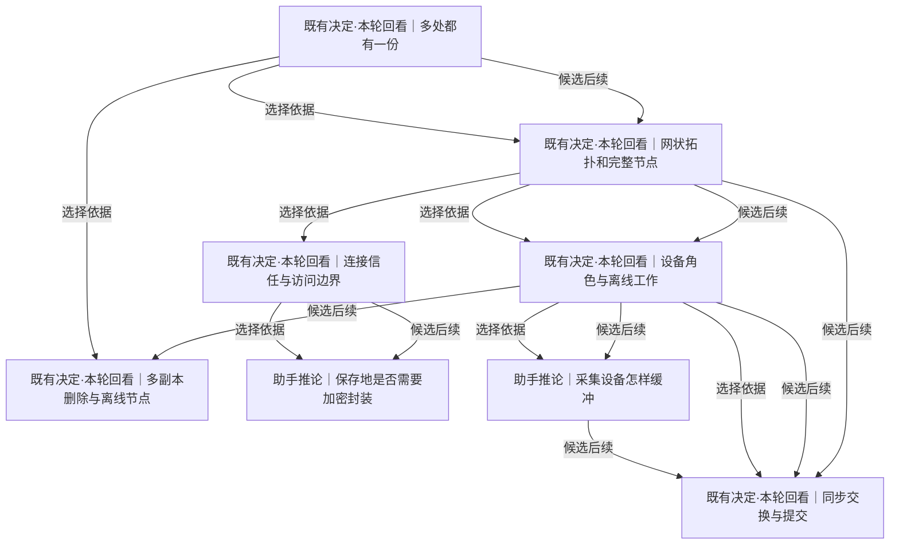

# 设备、持久保存与同步

把不丢已取得材料、跨设备查看和设备间交换分别处理，比较外部备份、中心服务与网状同步。

[返回全景](../README.md) · [交互浏览](../index.html)

## 多处都有一份

**既有决定·本轮回看** · 一台电脑损坏后材料是否还在，与能否在手机上查询是两个目标；二者都不能直接推出网状协议。

**Agent采用 · 当前**

候选：本地保存加外部有版本备份。

理由与代价：手动外部副本已在 Linux 独立恢复且逐项核对，与现有不可变存储配合即可形成第二份；接受下一次备份前的新采集仍只有本地一份。

启动或重审条件：当前手动执行；需要持续副本时再选择调度。存储加入回收或改写、复制规则变化后重验闭包和独立恢复。

依据：

- [数据比代码长寿](storage.md#n-de48cd5fab039fea)（选择依据）：已取得材料需要能跨设备故障保存。
- [保留采到的历史](roots.md#n-509f2d3467e7b121)（选择依据）：副本必须保留历史，不能只镜像来源当前状态。
- [存下的也会消失](conditions.md#n-eec8ee5eac1a2112)（证据）：现有持久化不保证未来一直存在。

依据材料：[src/Docs/Orisumi.Docs/content/docs/model/nodes.mdx](../../../../../src/Docs/Orisumi.Docs/content/docs/model/nodes.mdx)。现有设计与格式是需回看的选择，不自动成为本轮用户确认。

依据材料：[src/Docs/Orisumi.Docs/content/docs/model/validation.mdx#外部副本](../../../../../src/Docs/Orisumi.Docs/content/docs/model/validation.mdx#%E5%A4%96%E9%83%A8%E5%89%AF%E6%9C%AC)。一次手动 Linux 异机复制与独立恢复通过，含并发新增、删除、缺块与损坏样例；定时备份和长期运行尚未配置。

### 本地保存加外部有版本备份 · 助手推荐

先用独立位置保留完整存储快照/导出，并实际恢复；Orisumi继续本地采集。

收益：可获得异机保留能力，不先建设产品同步协议。

代价：备份窗口内的新采集仍只有本地一份；备份本身不提供跨设备查询。

适用条件：当前首先收集数据、同步未形成具体需求时。

继续展开：[导出与恢复](storage.md#n-da66683208852205)

分支终点：选已有或可用外部备份能力，以派生样本做完整备份、离线新采集、原目录不可用后的恢复演练。

检验：恢复点和未覆盖窗口说清；全部材料/记录校验通过，不仅验证任务运行成功。

### Orisumi内建副本交换 · 可选路线

通过应用协议把内容与记录复制到另一台长期在线设备，后续可支持按需读取。

收益：可把副本完成状态与清理/读取联动。

代价：协议、身份、删除、断点和副本状态都成为产品责任。

适用条件：跨设备持续交换或按需读取已有明确需求时。

继续展开：[网状拓扑和完整节点](#n-561838d4e083830d)

### 当前仅本地一份 · 可选路线

继续本地采集，异机保存阶段性暂缓。

收益：开发投入最少，立即积累材料。

代价：本机损坏或存储遗失会丢掉唯一已采历史。

适用条件：先抢救短窗口来源且暂时没有可用外部保存条件时。

分支终点：将尚未有异机副本明确列为当前状态；有可用外部目的地时做一次恢复实验证实路线。

检验：不把本机同盘另一目录当独立故障副本，不宣称已经满足异机恢复。

实现现状：已完成手动异机副本：当前固定481根、10,506存储文件、2,339,534,554编码字节。Linux全对象与引用核对通过，297个最新来源组实际恢复后重读5,667,166,836字节；复用旧版6,763块。固定之后的新采集仍等后续副本，未配置计划任务。（[src/Docs/Orisumi.Docs/content/docs/model/nodes.mdx](../../../../../src/Docs/Orisumi.Docs/content/docs/model/nodes.mdx)、[src/Docs/Orisumi.Docs/content/docs/model/validation.mdx](../../../../../src/Docs/Orisumi.Docs/content/docs/model/validation.mdx)）

审阅重点：建议先用外部有版本备份并验证恢复；内建交换等真实需求出现再选，网状不是长期保存的必然结果。

可能需要回看：10 个下游节点（含所有候选路线）

[保存地是否需要加密封装](#n-5d0b7394b458d05a)、[共享怎样授权](access.md#n-4b3c6032607d1b5c)、[同步交换与提交](#n-da173cb6e04759f8)、[多副本删除与离线节点](#n-19ed3ea2239e62f9)、[导出与恢复](storage.md#n-da66683208852205)、[网状拓扑和完整节点](#n-561838d4e083830d)、[设备角色与离线工作](#n-e56d1b0735fb0084)、[连接信任与访问边界](#n-ca03d6309f6b9fd6)、[采集设备怎样缓冲](#n-358b28d323bdbb8b)、[长期恢复怎样验证](delivery.md#n-254f30d6e194be24)

## 网状拓扑和完整节点

**既有决定·本轮回看** · Mac采到材料后，手机要看、服务器要长期留存：中心汇聚和任意节点互传都可满足一部分场景，投入和离线行为不同。

**Agent采用 · 当前**

候选：暂用外部复制与备份。

理由与代价：外部完整备份已完成一次手动异机恢复，满足当前第二份保存的验证；接受暂没有中心查询和节点按需交换。

启动或重审条件：外部恢复通过后，实际跨设备查询或外部工具无法满足的复制问题出现，先比较 star，再按实证考虑 mesh。

依据：

- [多处都有一份](#n-ae9194edde188509)（选择依据）：内建交换路线需要选择谁与谁交换。
- [采集保障先从简](roots.md#n-ffb6c54f0390b4e1)（约束）：无需为采集目标提前完成复杂分布式运行保障。

依据材料：[src/Docs/Orisumi.Docs/content/docs/model/nodes.mdx](../../../../../src/Docs/Orisumi.Docs/content/docs/model/nodes.mdx)。现有设计与格式是需回看的选择，不自动成为本轮用户确认。

依据材料：[src/Docs/Orisumi.Docs/content/docs/model/validation.mdx#外部副本](../../../../../src/Docs/Orisumi.Docs/content/docs/model/validation.mdx#%E5%A4%96%E9%83%A8%E5%89%AF%E6%9C%AC)。一次手动 Linux 异机复制与独立恢复通过，含并发新增、删除、缺块与损坏样例；定时备份和长期运行尚未配置。

### 有明确中心的汇聚 · 助手推荐

设备本地采集并向一个长期在线中心提交，其他设备向中心读取；中心离线时保留本地，重连后补传。

收益：职责与删除传播较集中，跨设备入口清楚。

代价：中心离线期间设备之间不能经中心交换，中心容量/可用性需单独安排。

适用条件：决定做内建多设备交换、且主要通过同一长期在线设备读取时。

继续展开：[设备角色与离线工作](#n-e56d1b0735fb0084)、[同步交换与提交](#n-da173cb6e04759f8)

### 任意节点直接交换 · 可选路线

节点可彼此直接提交记录和补内容，服务器是长期在线节点。

收益：中心不可达时，能相连的设备仍可互传。

代价：身份、进度、删除与部分数据状态需要覆盖更多配对；不因记录不可变就完全没有状态冲突。

适用条件：有真实的离线直连互传/多中心需求，且星形的限制实际造成问题时。

继续展开：[设备角色与离线工作](#n-e56d1b0735fb0084)、[同步交换与提交](#n-da173cb6e04759f8)

### 暂用外部复制与备份 · 可选路线

不实现应用节点协议，以外部保存系统运送完整存储/导出。

收益：可与当前本地实现组合。

代价：按需读取、记录完成状态和删除传播依赖外部流程。

适用条件：当前只需要副本恢复，不需要产品内跨设备服务时。

分支终点：复用“多处都有一份”的外部备份路线，暂不增加节点服务。

检验：空环境可恢复，且外部复制的快照边界、保留期和删除语义已说明。

实现现状：当前按 ADR0003 采用外部备份，已完成手动异机复制与恢复。节点查询、中心汇聚与网状交换仍由实际需要触发。（[src/Docs/Orisumi.Docs/content/docs/model/adr/0003-mesh-with-full-nodes.mdx](../../../../../src/Docs/Orisumi.Docs/content/docs/model/adr/0003-mesh-with-full-nodes.mdx)、[src/Docs/Orisumi.Docs/content/docs/model/nodes.mdx](../../../../../src/Docs/Orisumi.Docs/content/docs/model/nodes.mdx)、[src/Docs/Orisumi.Docs/content/docs/model/validation.mdx](../../../../../src/Docs/Orisumi.Docs/content/docs/model/validation.mdx)）

审阅重点：旧ADR的网状复杂度是否值得，由真实直连需求判断；星形也能使用同一协议并允许本地离线采集。

可能需要回看：6 个下游节点（含所有候选路线）

[保存地是否需要加密封装](#n-5d0b7394b458d05a)、[同步交换与提交](#n-da173cb6e04759f8)、[多副本删除与离线节点](#n-19ed3ea2239e62f9)、[设备角色与离线工作](#n-e56d1b0735fb0084)、[连接信任与访问边界](#n-ca03d6309f6b9fd6)、[采集设备怎样缓冲](#n-358b28d323bdbb8b)

## 设备角色与离线工作

**既有决定·本轮回看** · 手机可以只是查看入口，也可以本地采集并短期保留；无存储传感器只能在线发送。每种设备不必都拥有相同存储、计算和接口职责。

**暂后置 · 以后**

候选：长期完整保存点加本地采集/缓存。

理由与代价：未来倾向采集端本地保存加至少一个完整长期保存点，较每台全量或对象级副本跟踪简单；接受一个完整点仍需独立备份。

启动或重审条件：有实际第二设备后验证离线取得和目的地独立恢复；任何缓存清理须明确另行授权并有完整核验。

依据：

- [网状拓扑和完整节点](#n-561838d4e083830d)（选择依据）：拓扑确定后还要选择副本范围与设备职责。
- [尽量收集一切](roots.md#n-c3c6e7607f2c9805)（选择依据）：设备能力不同，取得和留存方式需对应现实。
- [离线与历史补取](capture.md#n-f116b26a22aa88eb)（选择依据）：来源能否事后补回与设备本地能否留存是两种条件，保存职责应对应实际能力。

依据材料：[src/Docs/Orisumi.Docs/content/docs/model/nodes.mdx](../../../../../src/Docs/Orisumi.Docs/content/docs/model/nodes.mdx)。现有设计与格式是需回看的选择，不自动成为本轮用户确认。

依据材料：[src/Docs/Orisumi.Docs/content/docs/model/validation.mdx#网络限制与重启](../../../../../src/Docs/Orisumi.Docs/content/docs/model/validation.mdx#%E7%BD%91%E7%BB%9C%E9%99%90%E5%88%B6%E4%B8%8E%E9%87%8D%E5%90%AF)。拒绝采集进程全部 IPv4/IPv6 通信并保留本机 IPC，两轮保存并恢复 40/40 份原件，实际 17 次激活和 17 次失活对应；两轮身份独立，停机空档不产生原件。

### 长期完整保存点加本地采集/缓存 · 助手推荐

至少一处负责完整保留；采集设备先本地留下材料，收到目的地完整核验确认后才按明确策略清理可再取缓存。

收益：覆盖完整保留和有限设备空间，符合既有节点角色目标。

代价：一个完整点仍是单一副本故障域；确认范围和清理规则需严谨。

适用条件：大部分设备容量有限且存在长期保存点。

继续展开：[同步交换与提交](#n-da173cb6e04759f8)、[多副本删除与离线节点](#n-19ed3ea2239e62f9)、[采集设备怎样缓冲](#n-358b28d323bdbb8b)

分支终点：让一台采集设备离线产生材料，重连复制后再清理缓存，随后断开本机并从保存点恢复。

检验：接收完成必须包含记录与依赖内容；未确认材料不被当缓存清掉。

### 每个选定设备都保留全量 · 可选路线

参与保存的设备都有完整材料和记录；纯浏览器不算保存节点。

收益：读取和恢复简单，不必设计按需缺块。

代价：空间和传输增长，各设备仍可能具有相关故障。

适用条件：数据规模能被每个参与设备接受时。

继续展开：[采集设备怎样缓冲](#n-358b28d323bdbb8b)

分支终点：把完整样本恢复到两台/两个隔离目的地，验证任一离线仍能列出全部历史。

检验：全量副本含出处与删除事实，不能只比文件数量。

### 按对象保证副本数量 · 可选路线

不设完整节点，跟踪每份内容与记录在若干设备上的已验证副本数，再允许清理。

收益：可分摊容量，无单台必须存全。

代价：需要副本位置、可达性、故障域与重放删除的一致状态，恢复更复杂。

适用条件：单节点容量不够且确有分布式保存需求。

继续展开：[采集设备怎样缓冲](#n-358b28d323bdbb8b)

分支终点：在派生对象集模拟节点丢失、离线和清理，验证任意目标故障范围内可恢复完整历史。

检验：每个保留根的依赖闭包都有可用副本；仅统计块份数不能漏掉记录。

实现现状：本机持续采集、受限 IP 网络下保存与进程重启恢复、一次 Linux 手动副本分别已验；应用内节点、自动传送、缓存清理与按需拉取继续后置。（[src/Docs/Orisumi.Docs/content/docs/model/nodes.mdx](../../../../../src/Docs/Orisumi.Docs/content/docs/model/nodes.mdx)、[src/Orisumi.Capturing/ForegroundCollector.cs](../../../../../src/Orisumi.Capturing/ForegroundCollector.cs)、[src/Docs/Orisumi.Docs/content/docs/model/validation.mdx](../../../../../src/Docs/Orisumi.Docs/content/docs/model/validation.mdx)）

审阅重点：采集端、保存端、查询端和浏览器入口可分别安排；默认所有设备同能力不必要。

可能需要回看：3 个下游节点（含所有候选路线）

[同步交换与提交](#n-da173cb6e04759f8)、[多副本删除与离线节点](#n-19ed3ea2239e62f9)、[采集设备怎样缓冲](#n-358b28d323bdbb8b)

## 同步交换与提交

**既有决定·本轮回看** · 把一份采集根先传到远端，内容尚未到齐时，远端只能称它为待完成；等全部依赖校验通过后才能据此清理本地唯一副本。

**Agent采用 · 当前**

候选：外部完整保存集复制。

理由与代价：现有存储先写内容后发布根、只追加且无 GC，先复制记录再复制块并校验后发布已通过并发和异机试验；接受按阶段选入记录，非全局事务快照。

启动或重审条件：加入物理回收、改写已发布对象或新记录依赖形态时重验；外部工具出现真实限制再比较内建交换。

依据：

- [设备角色与离线工作](#n-e56d1b0735fb0084)（选择依据）：远端完成状态决定可读性与清理。
- [写入完整性与校验](storage.md#n-b5d79d537671775b)（选择依据）：远端也需要完整依赖再发布的契约。

依据材料：[src/Docs/Orisumi.Docs/content/docs/model/nodes.mdx](../../../../../src/Docs/Orisumi.Docs/content/docs/model/nodes.mdx)。现有设计与格式是需回看的选择，不自动成为本轮用户确认。

依据材料：[src/Docs/Orisumi.Docs/content/docs/model/validation.mdx#外部副本](../../../../../src/Docs/Orisumi.Docs/content/docs/model/validation.mdx#%E5%A4%96%E9%83%A8%E5%89%AF%E6%9C%AC)。一次手动 Linux 异机复制与独立恢复通过，含并发新增、删除、缺块与损坏样例；定时备份和长期运行尚未配置。

### 清单对比加缺失对象复制 · 助手推荐

先确定要保留的记录和内容集合，复制缺失对象并核对哈希，完整后发布取得；初期用简单全集/分片对比。

收益：语义直接，重试和中断可从内容存在状态恢复。

代价：大集合列举成本可能高，后续可加进度索引。

适用条件：第一条内建交换导洞、规模尚未证明需要复杂增量协议时。

分支终点：用两个隔离实验存储传一份有共享内容的多版本采集，随机中断、重传和损坏一个对象。

检验：不会把半份采集标完成，重试不重复内容，源副本只在完整目的地可恢复后可清理。

### 来源存储序号加定期全集核对 · 可选路线

每个写入存储有随机实例ID和持久单调序号，按连续序号交换记录，内容另按名字补齐，另做反熵核对。

收益：大规模重复同步可减少列举。

代价：重建、乱序、序号空洞、记录已收但内容未齐都要独立处理。

适用条件：简单列举已成为实测瓶颈时。

分支终点：模拟接收第N条记录但缺内容、写入端重建换ID、乱序与删除先到。

检验：已收记录游标不被误当内容完成确认；完整性核对能补齐遗漏。

### 外部完整保存集复制 · 可选路线

外部工具先复制记录再复制内容，核对引用闭包后发布版本目录；应用不管理对象级网络进度。

收益：依赖少，适合备份。

代价：选入的记录集合按复制阶段确定；新采集可留到下次，完整性依赖当前不可变、无回收的存储契约。

适用条件：已有文件系统/备份能力能提供一致捕获时。

分支终点：检查实际外部工具对并发新增文件、原子重命名和删除的行为，用正在采集的派生存储做复制恢复。

检验：恢复的每个可见采集依赖齐全；不是仅以复制成功退出判断。

实现现状：外部工具先复制 config/records，再复制 blocks；独立校验后写完成记录并发布版本目录。并发新增根留到下一份、删除事实及缺块损坏均经验证；应用内交换协议尚未建立。（[src/Docs/Orisumi.Docs/content/docs/model/nodes.mdx](../../../../../src/Docs/Orisumi.Docs/content/docs/model/nodes.mdx)、[src/Docs/Orisumi.Docs/content/docs/model/validation.mdx](../../../../../src/Docs/Orisumi.Docs/content/docs/model/validation.mdx)）

审阅重点：旧序号方案是性能候选；接收记录、拥有内容与允许清理是三个独立状态。

## 多副本删除与离线节点

**既有决定·本轮回看** · 一个节点离线数月后带回旧采集，不能让已经主动删除的取得复活；外部备份可能仍保留旧字节，删除传播与备份过期须分别说明。

**暂后置 · 以后**

候选：外部备份按其保留规则处理。

理由与代价：当前外部备份自行管理保留期，恢复时重放应用删除事实；内建节点同步尚未选择，接受旧备份仍可保有字节。

启动或重审条件：确定真实备份服务后列保留/删除规则，以旧备份恢复测试逻辑删除不复活；要求全处物理删除时重审。

依据：

- [删除记录与回收](storage.md#n-0350116e746cba2c)（选择依据）：主动删除范围先确定，再落实到多处副本。
- [多处都有一份](#n-ae9194edde188509)（选择依据）：副本增加了删除目的地与回收条件。

依据材料：[src/Docs/Orisumi.Docs/content/docs/model/nodes.mdx](../../../../../src/Docs/Orisumi.Docs/content/docs/model/nodes.mdx)。现有设计与格式是需回看的选择，不自动成为本轮用户确认。

依据材料：[src/Docs/Orisumi.Docs/content/docs/model/validation.mdx#外部副本](../../../../../src/Docs/Orisumi.Docs/content/docs/model/validation.mdx#%E5%A4%96%E9%83%A8%E5%89%AF%E6%9C%AC)。一次手动 Linux 异机复制与独立恢复通过，含并发新增、删除、缺块与损坏样例；定时备份和长期运行尚未配置。

### 保存删除事实并阻止旧记录复活 · 助手推荐

每处保存删除意图，收到旧目标也不重新启用；回收仅删除不被任何有效记录引用的对象。

收益：不可变记录可复制，离线节点重连能应用同一删除范围。

代价：删除事实需长期可取得；旧备份/离线设备未处理前不能声称全部物理消除。

适用条件：存在应用副本交换时。

分支终点：A/B共享数据，B离线后A主动删除；恢复B及一份更旧备份，依次交换。

检验：目标不复活，仍被其他记录引用的内容保留；报告尚未处理的离线副本。

### 中心代次与离线重新加入 · 可选路线

中心维护有效保留集合与删除代次，过旧节点重新按当前集合加入，不直接推回全部历史记录。

收益：星形体系的有效集合较集中，旧节点行为更清楚。

代价：依赖中心，重新加入可能需更多复制，必须保留合法离线新采集。

适用条件：已经选择中心汇聚且希望限制长期墓碑维护时。

分支终点：旧节点同时带有应删除旧记录和离线新采集，按新代次重新加入。

检验：旧目标不复活，离线新取得不被误清；加入前输出具体差异。

### 外部备份按其保留规则处理 · 可选路线

应用记录逻辑删除，外部备份保留与到期清理由备份系统执行；恢复前重新应用当前删除事实。

收益：适合当前外部备份路线，职责清楚。

代价：历史备份可能继续含字节，不能立即满足全处物理删除。

适用条件：已有外部备份且没有立即全副本擦除要求时。

分支终点：写清备份覆盖目的地、保留期、删除处理和恢复后的删除重放步骤。

检验：用旧备份恢复后，目标取得不进入有效集合；物理残留状态准确可见。

实现现状：完整副本保留删除事实；旧副本合并最新记录后，产品不再列出已删除采集。只有旧备份仍可看到后来被删的记录，物理删除、保留期清理和离线节点传播后置。（[src/Docs/Orisumi.Docs/content/docs/model/nodes.mdx](../../../../../src/Docs/Orisumi.Docs/content/docs/model/nodes.mdx)、[src/Orisumi.Raw/RawStore.cs](../../../../../src/Orisumi.Raw/RawStore.cs)、[src/Docs/Orisumi.Docs/content/docs/model/validation.mdx](../../../../../src/Docs/Orisumi.Docs/content/docs/model/validation.mdx)）

审阅重点：副本数、删除事实、共享引用和备份保留共同决定“删到什么程度”，当前先不宣称未实现能力。

## 连接信任与访问边界

**既有决定·本轮回看** · 自己的两台机器交换材料，与把部分内容给别人查看是不同入口。私有网络可以限定设备接入，不能自动表达内容分享范围。

**暂后置 · 以后**

候选：自己的可信设备先经私有网络连接。

理由与代价：若将来连接自己的节点，可信设备私有网络是较小的起点；当前未建节点服务，接受共享范围仍需单独授权。

启动或重审条件：实际设备需要交换时核对网络成员和凭据拥有者，测试非成员不可访问；多主体访问再比较 application-auth。

依据：

- [网状拓扑和完整节点](#n-561838d4e083830d)（选择依据）：内建网络连接需要确定节点身份和信任范围。
- [给别人看要隔离](access.md#n-25d958239f2a38ec)（约束）：其他人的查看权限不能直接等同为可信保存节点。
- [数据可以给别人看](roots.md#n-bd8bb6fe03ea2b58)（选择依据）：自己的数据可交模型服务；这里讨论节点和其他读者的访问范围。

依据材料：[src/Docs/Orisumi.Docs/content/docs/model/nodes.mdx](../../../../../src/Docs/Orisumi.Docs/content/docs/model/nodes.mdx)。现有设计与格式是需回看的选择，不自动成为本轮用户确认。

### 自己的可信设备先经私有网络连接 · 助手推荐

节点只对已接入的本人设备提供交换；共享查看走单独授权入口，云端是否存明文依实际信任选择。

收益：当前个人设备范围下连接安排简单。

代价：私有网络成员可能拥有较大访问权；云提供方信任是条件，不是永久事实。

适用条件：全部保存节点由本人控制、既有私网能力可用时。

继续展开：[保存地是否需要加密封装](#n-5d0b7394b458d05a)

分支终点：列出实际设备、网络可达性和接入凭据的拥有者，演示非成员无法交换，分享用户只能经授权读取接口。

检验：设备信任与材料分享授权分开；不因允许模型处理数据而把全部节点接口开放。

### 应用层节点身份与权限 · 可选路线

每个交换端显式认证，按节点/来源/操作授权；传输保护与可选静态加密另定。

收益：可跨网络并表达不同节点权限。

代价：证书/密钥、撤销、恢复和授权范围成为产品能力。

适用条件：参与者或设备信任边界不同，私网成员权限过宽时。

继续展开：[保存地是否需要加密封装](#n-5d0b7394b458d05a)

分支终点：用两个权限不同的节点和一个被撤销节点，在派生数据上验证读取、写入、删除及恢复授权。

检验：未授权内容与操作确实拒绝；密钥恢复不能依赖唯一已丢设备。

实现现状：本轮外部备份使用已有 SSH 身份与本人可读写目录；应用内节点信任、网络认证与内容分享授权尚未实现。（[src/Docs/Orisumi.Docs/content/docs/model/nodes.mdx](../../../../../src/Docs/Orisumi.Docs/content/docs/model/nodes.mdx)、[src/Docs/Orisumi.Docs/content/docs/model/validation.mdx](../../../../../src/Docs/Orisumi.Docs/content/docs/model/validation.mdx)）

审阅重点：当前不以模型服务处理数据的隐私疑虑取舍；连接和分享权限只对应真实参与者边界。

可能需要回看：1 个下游节点（含所有候选路线）

[保存地是否需要加密封装](#n-5d0b7394b458d05a)

## 保存地是否需要加密封装

**助手推论** · 连接认证决定谁能接入；保存地是否能直接读到材料是另一项条件。可信自有设备和只托管字节的目的地可采用不同保存形式。

**Agent采用 · 当前**

候选：沿用可信设备的保存形式。

理由与代价：当前本人控制的本地目录沿既有原字节/无损编码，恢复路径清楚；接受有设备访问权的主体可读取。

启动或重审条件：外部保存目的地确定后按实际访问者和信任重新选择；只有目的地需隐藏内容时才验证加密及独立密钥恢复。

依据：

- [连接信任与访问边界](#n-ca03d6309f6b9fd6)（选择依据）：认证方式与保存地可读权限可以分别选择，不能用加密替代连接认证。

依据材料：[src/Docs/Orisumi.Docs/content/docs/model/nodes.mdx](../../../../../src/Docs/Orisumi.Docs/content/docs/model/nodes.mdx)。现有设计与格式是需回看的选择，不自动成为本轮用户确认。

### 沿用可信设备的保存形式 · 助手推荐

当前本人控制的本地存储沿用原字节或无损压缩；根据真实保存目的地安排其现有访问保护。

收益：保持现有可直接核验和恢复的路径。

代价：保存设备或具备访问权的主体可以读取材料。

适用条件：当前自有可信保存点满足实际边界时。

分支终点：记录当前实际保存位置与可访问主体，按既有格式验证导出恢复。

检验：离开原机器仍能根据格式和已授权的访问方式恢复原始字节及出处。

### 不可信保存地使用加密封装 · 可选路线

在上传前对可携带对象和元数据加密，独立保存密钥与恢复说明；评估明文哈希名称泄露的成员关系。

收益：可把保存介质与可读权限分开。

代价：跨用户去重、索引、恢复和密钥生命周期更复杂。

适用条件：确有不可信存储目的地的现实需求时。

分支终点：先确定真实保存服务、信任边界和必须保护的信息，再设计封装并做失去原设备后的恢复演练。

检验：仅拿到保存端对象不能读取内容，合法持钥者能恢复全部原字节与出处。

实现现状：当前 Raw 为本地原文或无损压缩；专用加密封装未实现。（[src/Orisumi.Raw/DirectoryBlockStore.cs](../../../../../src/Orisumi.Raw/DirectoryBlockStore.cs)）

审阅重点：只有真实保存目的地需要把托管与可读权限分开时，才展开加密与密钥恢复。

## 采集设备怎样缓冲

**助手推论** · 长期保存点和小传感器可以共存。先核对每台采集设备的实际存储能力，再选择离线期间能留下多少；不能把没有存储的设备描述成离线无损。

**Agent采用 · 当前**

候选：设备上先保存原件，再交长期保存点。

理由与代价：在当前有本地存储的电脑上，先保存成功取得的原件，再按外部副本路线交付另一保存点；受限 IP 网络实跑已验证本机保存与重启恢复，接受设备停机和容量失败仍有缺口。

启动或重审条件：接无本地存储的设备时重选；自动传送、空间回收与其他平台按实际需要分别验证。

依据：

- [设备角色与离线工作](#n-e56d1b0735fb0084)（选择依据）：保存角色安排后，还要按具体采集设备的能力选择本地留存。

依据材料：[src/Docs/Orisumi.Docs/content/docs/model/nodes.mdx](../../../../../src/Docs/Orisumi.Docs/content/docs/model/nodes.mdx)。现有设计与格式是需回看的选择，不自动成为本轮用户确认。

依据材料：[src/Docs/Orisumi.Docs/content/docs/model/validation.mdx#网络限制与重启](../../../../../src/Docs/Orisumi.Docs/content/docs/model/validation.mdx#%E7%BD%91%E7%BB%9C%E9%99%90%E5%88%B6%E4%B8%8E%E9%87%8D%E5%90%AF)。拒绝采集进程全部 IPv4/IPv6 通信并保留本机 IPC，两轮保存并恢复 40/40 份原件，实际 17 次激活和 17 次失活对应；两轮身份独立，停机空档不产生原件。

### 设备上先保存原件，再交长期保存点 · 助手推荐

复用设备上的原件存储或来源原生持久记录，联网后传送；已有长期保存点独立负责副本。

收益：网络断开时仍能保住本机成功取得的材料。

代价：需要本机确有空间与读写能力；设备停止观测期间仍没有新数据。

适用条件：普通电脑或具备持久存储的采集设备。

继续展开：[同步交换与提交](#n-da173cb6e04759f8)

分支终点：断网期间取得一组已知材料，重启后读回；联网传送后从目的地独立恢复。

检验：采集成功的记录与依赖内容完整；未验证交付前不删除本机唯一副本。

### 无本地存储采集端直接提交 · 可选路线

小设备直接把取得的原始事件发送给能连上的保存端；若有有限缓冲，明确大小和丢失行为。

收益：可接入资源很少的设备。

代价：断网时没有缓冲就无法留住事件，不能承诺离线照常保留。

适用条件：设备真实能力限制且来源需求接受该窗口时。

分支终点：选一种实际传感器测本地存储/缓冲和断网时事件行为，再定发送协议。

检验：拔网后产生已知序列，恢复后列出实际保留、缺失与顺序范围。

实现现状：当前电脑本地保存、受限 IP 网络下取得与重启恢复已验证；已有手动异机副本路线。自动传送、传感器缓冲及清理仍未实现。（[src/Orisumi.Raw/RawStore.cs](../../../../../src/Orisumi.Raw/RawStore.cs)、[src/Docs/Orisumi.Docs/content/docs/model/validation.mdx#网络限制与重启](../../../../../src/Docs/Orisumi.Docs/content/docs/model/validation.mdx#%E7%BD%91%E7%BB%9C%E9%99%90%E5%88%B6%E4%B8%8E%E9%87%8D%E5%90%AF)、[src/Docs/Orisumi.Docs/content/docs/model/nodes.mdx](../../../../../src/Docs/Orisumi.Docs/content/docs/model/nodes.mdx)）

审阅重点：以设备真实能力决定缓冲方式，保留未能观测或未能留住的边界。

可能需要回看：1 个下游节点（含所有候选路线）

[同步交换与提交](#n-da173cb6e04759f8)

