# 取得方式与采集调度

文件/数据库一致性、接口全量增量、瞬时事件、媒体分段、离线、权限、启动与当前保障边界。

[返回全景](../README.md) · [交互浏览](../index.html)

```mermaid
flowchart TD
  n_2c0e3b3ad774e034["既有决定·本轮回看｜收集不靠自觉"]
  n_a6470ed7ace260f0["既有决定·本轮回看｜能补的也定期采"]
  n_3077b006413df0eb["既有决定·本轮回看｜采集失败要通知"]
  n_b75cd5e6c6494099["助手推论｜浏览器事件传输"]
  n_6d6180cd980550cc["助手推论｜取得方式按来源形态选择"]
  n_a6463ad095322f24["助手推论｜文件读取一致性"]
  n_cba810bb05a18834["助手推论｜数据库取得一致性"]
  n_cc2fd44e41899000["助手推论｜跨材料的取得时刻"]
  n_6de65500ebbea77b["助手推论｜文件变化取得策略"]
  n_c68c6175d29abc5e["助手推论｜接口与导出取得方式"]
  n_76b9927e1c8393d5["助手推论｜接口全量与增量"]
  n_359653aed5ab9c59["助手推论｜瞬时事件接收方式"]
  n_0843f43438c1c4a1["助手推论｜事件时间与顺序"]
  n_84f109ff78f86572["助手推论｜连续媒体分段与编码"]
  n_4804bedf60d73204["助手推论｜调度频率与触发"]
  n_f116b26a22aa88eb["助手推论｜离线与历史补取"]
  n_55c7589ea4cd33f0["助手推论｜取得权限与资源条件"]
  n_f47170f9f44e3fc5["助手推论｜采集启动与执行位置"]
  n_5c39e84c8ee42507["助手推论｜采集单次结果与保障边界"]
  n_fd5e4f2373611f18["助手推论｜连续录制怎样分段"]
  n_8dbe7245f6450587["助手推论｜浏览器超大原响应怎样交付"]
  n_c1ef0a692ec80384["助手推论｜浏览器回填怎样并行"]
  n_aa199b18276f22a3["助手推论｜浏览器历史回填怎样遍历"]
  n_2c0e3b3ad774e034 -->|选择依据| n_a6470ed7ace260f0
  n_b75cd5e6c6494099 -->|候选后续| n_359653aed5ab9c59
  n_b75cd5e6c6494099 -->|候选后续| n_f116b26a22aa88eb
  n_6d6180cd980550cc -->|候选后续| n_a6463ad095322f24
  n_6d6180cd980550cc -->|候选后续| n_6de65500ebbea77b
  n_6d6180cd980550cc -->|候选后续| n_cba810bb05a18834
  n_6d6180cd980550cc -->|候选后续| n_c68c6175d29abc5e
  n_6d6180cd980550cc -->|候选后续| n_359653aed5ab9c59
  n_6d6180cd980550cc -->|候选后续| n_84f109ff78f86572
  n_a6463ad095322f24 -->|候选后续| n_5c39e84c8ee42507
  n_cba810bb05a18834 -->|候选后续| n_cc2fd44e41899000
  n_6de65500ebbea77b -->|候选后续| n_f116b26a22aa88eb
  n_6de65500ebbea77b -->|候选后续| n_a6463ad095322f24
  n_6de65500ebbea77b -->|候选后续| n_4804bedf60d73204
  n_c68c6175d29abc5e -->|候选后续| n_76b9927e1c8393d5
  n_c68c6175d29abc5e -->|候选后续| n_55c7589ea4cd33f0
  n_c68c6175d29abc5e -->|候选后续| n_4804bedf60d73204
  n_76b9927e1c8393d5 -->|候选后续| n_4804bedf60d73204
  n_76b9927e1c8393d5 -->|候选后续| n_5c39e84c8ee42507
  n_76b9927e1c8393d5 -->|候选后续| n_f116b26a22aa88eb
  n_359653aed5ab9c59 -->|候选后续| n_0843f43438c1c4a1
  n_359653aed5ab9c59 -->|候选后续| n_5c39e84c8ee42507
  n_359653aed5ab9c59 -->|候选后续| n_f116b26a22aa88eb
  n_359653aed5ab9c59 -->|候选后续| n_6de65500ebbea77b
  n_84f109ff78f86572 -->|候选后续| n_fd5e4f2373611f18
  n_a6470ed7ace260f0 -->|选择依据| n_4804bedf60d73204
  n_4804bedf60d73204 -->|候选后续| n_f116b26a22aa88eb
  n_4804bedf60d73204 -->|候选后续| n_f47170f9f44e3fc5
  n_2c0e3b3ad774e034 -->|选择依据| n_f47170f9f44e3fc5
  n_3077b006413df0eb -->|选择依据| n_5c39e84c8ee42507
  n_84f109ff78f86572 -->|选择依据| n_fd5e4f2373611f18
  n_b75cd5e6c6494099 -->|选择依据| n_8dbe7245f6450587
  n_359653aed5ab9c59 -->|选择依据| n_c1ef0a692ec80384
  click n_2c0e3b3ad774e034 href "#n-2c0e3b3ad774e034"
  click n_a6470ed7ace260f0 href "#n-a6470ed7ace260f0"
  click n_3077b006413df0eb href "#n-3077b006413df0eb"
  click n_b75cd5e6c6494099 href "#n-b75cd5e6c6494099"
  click n_6d6180cd980550cc href "#n-6d6180cd980550cc"
  click n_a6463ad095322f24 href "#n-a6463ad095322f24"
  click n_cba810bb05a18834 href "#n-cba810bb05a18834"
  click n_cc2fd44e41899000 href "#n-cc2fd44e41899000"
  click n_6de65500ebbea77b href "#n-6de65500ebbea77b"
  click n_c68c6175d29abc5e href "#n-c68c6175d29abc5e"
  click n_76b9927e1c8393d5 href "#n-76b9927e1c8393d5"
  click n_359653aed5ab9c59 href "#n-359653aed5ab9c59"
  click n_0843f43438c1c4a1 href "#n-0843f43438c1c4a1"
  click n_84f109ff78f86572 href "#n-84f109ff78f86572"
  click n_4804bedf60d73204 href "#n-4804bedf60d73204"
  click n_f116b26a22aa88eb href "#n-f116b26a22aa88eb"
  click n_55c7589ea4cd33f0 href "#n-55c7589ea4cd33f0"
  click n_f47170f9f44e3fc5 href "#n-f47170f9f44e3fc5"
  click n_5c39e84c8ee42507 href "#n-5c39e84c8ee42507"
  click n_fd5e4f2373611f18 href "#n-fd5e4f2373611f18"
  click n_8dbe7245f6450587 href "#n-8dbe7245f6450587"
  click n_c1ef0a692ec80384 href "#n-c1ef0a692ec80384"
  click n_aa199b18276f22a3 href "#n-aa199b18276f22a3"
```

## 收集不靠自觉

**既有决定·本轮回看** · 既有选择是尽量自动收集，减少长期依赖用户记得操作；导洞可先手动，无法自动的来源仍有导入路径。

依据：

- [尽量收集一切](roots.md#n-c3c6e7607f2c9805)（选择依据）：广泛且持续的来源支持减少日常人工投入，但各来源取得条件另定。

依据材料：[src/Docs/Orisumi.Docs/content/docs/requirements/belief.mdx#收集不靠自觉](../../../../../src/Docs/Orisumi.Docs/content/docs/requirements/belief.mdx#%E6%94%B6%E9%9B%86%E4%B8%8D%E9%9D%A0%E8%87%AA%E8%A7%89)。沿用既有需求的稳定名字；当前适用范围与替代方案在下游问题中重审。

可能需要回看：8 个下游节点（含所有候选路线）

[同步交换与提交](availability.md#n-da173cb6e04759f8)、[多副本删除与离线节点](availability.md#n-19ed3ea2239e62f9)、[离线与历史补取](#n-f116b26a22aa88eb)、[能补的也定期采](#n-a6470ed7ace260f0)、[设备角色与离线工作](availability.md#n-e56d1b0735fb0084)、[调度频率与触发](#n-4804bedf60d73204)、[采集启动与执行位置](#n-f47170f9f44e3fc5)、[采集设备怎样缓冲](availability.md#n-358b28d323bdbb8b)

## 能补的也定期采

**既有决定·本轮回看** · 既有选择为可回取来源也周期保存，避免来源清理后失去；定时、历史接口和变化通知仍有不同方案。

依据：

- [收集不靠自觉](#n-2c0e3b3ad774e034)（选择依据）：周期取得可降低对人工的持续要求。
- [存下的也会消失](conditions.md#n-eec8ee5eac1a2112)（选择依据）：来源现存不等于永久可回取。

依据材料：[src/Docs/Orisumi.Docs/content/docs/requirements/belief.mdx#能补的也定期采](../../../../../src/Docs/Orisumi.Docs/content/docs/requirements/belief.mdx#%E8%83%BD%E8%A1%A5%E7%9A%84%E4%B9%9F%E5%AE%9A%E6%9C%9F%E9%87%87)。沿用既有需求的稳定名字；当前适用范围与替代方案在下游问题中重审。

可能需要回看：7 个下游节点（含所有候选路线）

[同步交换与提交](availability.md#n-da173cb6e04759f8)、[多副本删除与离线节点](availability.md#n-19ed3ea2239e62f9)、[离线与历史补取](#n-f116b26a22aa88eb)、[设备角色与离线工作](availability.md#n-e56d1b0735fb0084)、[调度频率与触发](#n-4804bedf60d73204)、[采集启动与执行位置](#n-f47170f9f44e3fc5)、[采集设备怎样缓冲](availability.md#n-358b28d323bdbb8b)

## 采集失败要通知

**既有决定·本轮回看** · 单次取得的成功、部分完成和失败结果可查。当前保留结果与直接出处；持续探活按需要简单外置，内建恢复与告警后置。

依据：

- [采集会丢数据](conditions.md#n-5de3cb593b5de6a7)（选择依据）：来源可能遗漏支持评估结果可见性，并不唯一推出内建监控。
- [采集保障先从简](roots.md#n-ffb6c54f0390b4e1)（选择依据）：本轮建设边界约束旧通知需求如何落实。

依据材料：[src/Docs/Orisumi.Docs/content/docs/requirements/belief.mdx#采集失败要通知](../../../../../src/Docs/Orisumi.Docs/content/docs/requirements/belief.mdx#%E9%87%87%E9%9B%86%E5%A4%B1%E8%B4%A5%E8%A6%81%E9%80%9A%E7%9F%A5)。沿用既有需求的稳定名字；当前适用范围与替代方案在下游问题中重审。

可能需要回看：1 个下游节点（含所有候选路线）

[采集单次结果与保障边界](#n-5c39e84c8ee42507)

## 浏览器事件传输

**助手推论** · 扩展收到事件后需要把它留下。Chrome 官方文档说明 Service Worker 可终止且全局变量会丢，内存暂存不能代表已保存。

**Agent采用 · 当前**

候选：Native Messaging 交本机程序。

理由与代价：真实断连样本证明快照不能补回短暂标签，采用 storage.local 暂存与 Native 根回执；单 port 单 host，复用现有原件而无需新增 HTTP 常驻服务。

启动或重审条件：来源体量、真实磁盘限制或安装条件改变时重测；批量导出仅在即时通道不适合时重新比较。

依据：

- [数据所处的情况](roots.md#n-b450eb729c7db69e)（选择依据）：补回机会取决于材料是否已记录及何时消失，此处按真实处境选择取得方式。
- [采集保障先从简](roots.md#n-ffb6c54f0390b4e1)（选择依据）：当前内建保障暂缓，可简单外置；此处选择仍可独立完成的最小采集职责。

依据材料：[https://developer.chrome.com/docs/extensions/develop/concepts/service-workers/lifecycle](https://developer.chrome.com/docs/extensions/develop/concepts/service-workers/lifecycle)。Service Worker 会终止，全局变量会丢，官方建议持久保存。

依据材料：[.scratch/requirements/survey-browser.md](../../../../requirements/survey-browser.md)。CfT156 两个受控 Profile 的真实 callback/query 与完整 Native frame；host 断连期间短暂标签无法从重连快照补回。

依据材料：[src/Docs/Orisumi.Docs/content/docs/model/validation.mdx#浏览器观测](../../../../../src/Docs/Orisumi.Docs/content/docs/model/validation.mdx#%E6%B5%8F%E8%A7%88%E5%99%A8%E8%A7%82%E6%B5%8B)。正式扩展 119 入站帧、118 回执根逐字节恢复；Worker 重启、暂存重放、Profile 身份与快速关闭查询错误均核对。

### Native Messaging 交本机程序 · 助手推荐

扩展先用 storage.local 暂存，Native Messaging 按需启动本机接收器；原件根发布后回执，匹配回执后移除暂存。

收益：复用本机原件与恢复，断连期间已经暂存的瞬时事件可在 Worker 重启后继续补送。

代价：需要扩展与 host 登记；接受重复交付、未成功暂存的尾部及浏览器未运行缺口，磁盘容量仍有限。

适用条件：当前浏览器事件路线；主通道为 Native Messaging，暂存属于其发送职责。

继续展开：[瞬时事件接收方式](#n-359653aed5ab9c59)

分支终点：正常事件、Worker 重启、host 退出、Profile 身份及118份回执根恢复已验；消息边界由接收器测试覆盖，日常体量继续测。

检验：成功回执只在根发布后发出，恢复 payload 与入站字节一致；旧项清理与新项持久化的失败分别处理。

### 本机 HTTP 接收 · 可选路线

扩展将事件发到已运行的本地服务。

收益：多个浏览器可共用同一个接收入口。

代价：本机服务需存在；来源识别和页面误发边界要测。

适用条件：取得能力或范围尚未测清时，先取得一个可核验样本。

继续展开：[瞬时事件接收方式](#n-359653aed5ab9c59)

分支终点：用本机专用测试端口验证来源标识、服务关闭/恢复、跨 Profile 发送及大附件。

检验：只有实际接收并落地的数据算已取得；失败事件去向明确。

### 扩展持久保存后批量导出 · 可选路线

独立于即时接收器，在浏览器存储里积累，再按批次导出给 Orisumi 文件来源。

收益：短时不依赖本机接收器常开。

代价：浏览器存储额度、清理与导出延迟需测，未做内建保障体系。

适用条件：取得能力或范围尚未测清时，先取得一个可核验样本。

继续展开：[离线与历史补取](#n-f116b26a22aa88eb)

分支终点：按官方允许的存储写样本，结束 Worker 再启动，验证已写事件还在以及如何导出。

检验：Worker 全局变量清空后样本仍可读，额度耗尽时有可观察结果。

实现现状：标签/窗口与独立查询、扩展暂存和 Native 接收器已接通；受控 Profile 断连恢复通过，日常 Chrome 已加载，16份原件核验及三类代表材料恢复通过。长期体量另测。（[src/Orisumi.Browser/worker.js](../../../../../src/Orisumi.Browser/worker.js)、[src/Orisumi.Browser/delivery.js](../../../../../src/Orisumi.Browser/delivery.js)、[src/Orisumi.Capturing/NativeReceiver.cs](../../../../../src/Orisumi.Capturing/NativeReceiver.cs)、[src/Docs/Orisumi.Docs/content/docs/model/browser.mdx](../../../../../src/Docs/Orisumi.Docs/content/docs/model/browser.mdx)、[src/Docs/Orisumi.Docs/content/docs/model/validation.mdx#浏览器观测](../../../../../src/Docs/Orisumi.Docs/content/docs/model/validation.mdx#%E6%B5%8F%E8%A7%88%E5%99%A8%E8%A7%82%E6%B5%8B)）

审阅重点：按采用记录核对覆盖范围、接受的代价和实际证据；条件变化时沿触发条件重审。

可能需要回看：14 个下游节点（含所有候选路线）

[事件时间与顺序](#n-0843f43438c1c4a1)、[同步交换与提交](availability.md#n-da173cb6e04759f8)、[多副本删除与离线节点](availability.md#n-19ed3ea2239e62f9)、[文件变化取得策略](#n-6de65500ebbea77b)、[文件读取一致性](#n-a6463ad095322f24)、[浏览器回填怎样并行](#n-c1ef0a692ec80384)、[浏览器超大原响应怎样交付](#n-8dbe7245f6450587)、[瞬时事件接收方式](#n-359653aed5ab9c59)、[离线与历史补取](#n-f116b26a22aa88eb)、[设备角色与离线工作](availability.md#n-e56d1b0735fb0084)、[调度频率与触发](#n-4804bedf60d73204)、[采集单次结果与保障边界](#n-5c39e84c8ee42507)、[采集启动与执行位置](#n-f47170f9f44e3fc5)、[采集设备怎样缓冲](availability.md#n-358b28d323bdbb8b)

## 取得方式按来源形态选择

**助手推论** · 同一来源可组合文件、数据库、接口、事件和媒体；选择以实际可取得的原始材料为依据，取得层次写进出处。

**Agent采用 · 当前**

候选：已有文件字节、数据库一致副本或导出、发生时取得事件。

理由与代价：在已有授权下，Agent 组合已验证的文件、数据库与事件三条取得路径：Codex 文件和 state_5 保留已有材料，AppKit 逐条留下应用级瞬时观测；接受远端接口与媒体等形态仍待真实来源样本。

启动或重审条件：新形态只在真实来源交付样本、保存范围及恢复条件明确后扩展；当前三条路径分别保留各自取得语义。

候选可组合。同一来源可组合多种取得形态，例如 Codex 同时用文件与数据库；各形态继续到独立一致性和保存检验。

依据：

- [数据所处的情况](roots.md#n-b450eb729c7db69e)（选择依据）：补回机会取决于材料是否已记录及何时消失，此处按真实处境选择取得方式。
- [留最原始的一层](roots.md#n-760744617270b5ce)（选择依据）：保留来源交来的材料后再解释，此处明确来源交付层及取得是否改变内容。

依据材料：[.scratch/requirements/survey.md](../../../../requirements/survey.md)。来源清单列入候选；列入不等于已具备取得能力。

依据材料：[src/Docs/Orisumi.Docs/content/docs/model/validation.mdx#前台观测](../../../../../src/Docs/Orisumi.Docs/content/docs/model/validation.mdx#%E5%89%8D%E5%8F%B0%E8%A7%82%E6%B5%8B)。当前 macOS 图形用户会话手动观察：7 次约 1 秒切换与 15 次约 0.2 秒切换全部取得；22 条激活、22 条失活分别与测试应用自身回调的身份及顺序一致。49 条原件全部恢复并核对哈希、长度、LF 和出处；同应用 4 次切窗、1 次改标题期间无新增应用级通知。

### 已有文件字节 · 助手推荐

按目录/文件清单取得实际字节。

收益：最接近来源交付形态。

代价：正在改写或是数据库时需不同一致性。

适用条件：普通文件或已完成归档。

继续展开：[文件读取一致性](#n-a6463ad095322f24)、[文件变化取得策略](#n-6de65500ebbea77b)

### 数据库一致副本或导出 · 助手推荐

通过引擎允许的方式取得自洽内容。

收益：保留结构与已提交数据。

代价：快照和逻辑导出的原样层次不同。

适用条件：运行中数据库。

继续展开：[数据库取得一致性](#n-cba810bb05a18834)

### 接口响应或平台导出 · 助手推荐

保留交付响应/归档与请求范围和取得时刻。

收益：覆盖云端已有记录。

代价：分页、限流、权限和历史窗口需测。

适用条件：来源提供读取或导出能力。

继续展开：[接口与导出取得方式](#n-c68c6175d29abc5e)

### 发生时取得事件 · 助手推荐

直接记录来源实际交付的事件对象或协议帧。

收益：保留瞬时事实。

代价：来源停机/观测未运行期间无法凭空补回。

适用条件：来源没有持久历史。

继续展开：[瞬时事件接收方式](#n-359653aed5ab9c59)

### 采到的媒体流 · 助手推荐

保存实际采得的图像/音频/视频及设备和编码条件。

收益：后续理解可重做。

代价：编码与采样决定信息内容。

适用条件：声音和画面自身是来源。

继续展开：[连续媒体分段与编码](#n-84f109ff78f86572)

实现现状：普通文件稳定读取、SQLite online backup 与 AppKit 对象观察已按来源分开实现，统一交付完整字节给 Raw；前台事件路线通过真实切换和恢复验证。远端接口、连续媒体等形态尚待接入。（[src/Orisumi.Capturing/Collector.cs](../../../../../src/Orisumi.Capturing/Collector.cs)、[src/Orisumi.Capturing/SqliteSnapshotReader.cs](../../../../../src/Orisumi.Capturing/SqliteSnapshotReader.cs)、[src/Orisumi.Capturing/ForegroundCollector.cs](../../../../../src/Orisumi.Capturing/ForegroundCollector.cs)、[src/Docs/Orisumi.Docs/content/docs/model/validation.mdx#前台观测](../../../../../src/Docs/Orisumi.Docs/content/docs/model/validation.mdx#%E5%89%8D%E5%8F%B0%E8%A7%82%E6%B5%8B)）

审阅重点：按采用记录核对覆盖范围、接受的代价和实际证据；条件变化时沿触发条件重审。

可能需要回看：46 个下游节点（含所有候选路线）

[事件时间与顺序](#n-0843f43438c1c4a1)、[位置定位到哪里](records.md#n-d75a21e927a755bb)、[共享怎样授权](access.md#n-4b3c6032607d1b5c)、[分块策略与版本](storage.md#n-044919fef0bfc086)、[删除记录与回收](storage.md#n-0350116e746cba2c)、[压缩与存放表示](storage.md#n-d00cf82ac296b520)、[原件分单元和块两层](records.md#n-c2507b9e78d79f34)、[原件存成块](storage.md#n-1e55971a7ab3ff58)、[原样保存与一致性](records.md#n-49d755be3c14fe60)、[取得时间怎样记录](records.md#n-746612aae6ea6fde)、[取得权限与资源条件](#n-55c7589ea4cd33f0)、[各处原样都存](records.md#n-8e446efeb629f847)、[同步交换与提交](availability.md#n-da173cb6e04759f8)、[多副本删除与离线节点](availability.md#n-19ed3ea2239e62f9)、[完整内容的边界](records.md#n-26854bffbe13f18e)、[导出与恢复](storage.md#n-da66683208852205)、[屏幕观测粒度](sources-live.md#n-e5a27649574fb74b)、[接口与导出取得方式](#n-c68c6175d29abc5e)、[接口全量与增量](#n-76b9927e1c8393d5)、[数据库取得一致性](#n-cba810bb05a18834)、[文件变化取得策略](#n-6de65500ebbea77b)、[文件读取一致性](#n-a6463ad095322f24)、[新旧理解怎样评测](delivery.md#n-cbfb97254da427c8)、[时间含义怎样保留](understanding.md#n-e0bf0a291b892dad)、[来源原生增量怎样保存](storage.md#n-95be81155ce3d6b5)、[模型调用留下什么](understanding.md#n-97745ff5030f65f3)、[派生结果遇到删除或撤权](access.md#n-183194894919be77)、[浏览器事件传输](#n-b75cd5e6c6494099)、[浏览器回填怎样并行](#n-c1ef0a692ec80384)、[浏览器超大原响应怎样交付](#n-8dbe7245f6450587)、[浏览器页面内容范围](sources-live.md#n-a7ffdec9fe8bb5c3)、[理解版本怎样使用](understanding.md#n-be7944dd96e1f491)、[瞬时事件接收方式](#n-359653aed5ab9c59)、[离线与历史补取](#n-f116b26a22aa88eb)、[设备角色与离线工作](availability.md#n-e56d1b0735fb0084)、[读出引用到哪里](understanding.md#n-fe26af63a38ee976)、[调度频率与触发](#n-4804bedf60d73204)、[跨材料的取得时刻](#n-cc2fd44e41899000)、[连续媒体分段与编码](#n-84f109ff78f86572)、[连续录制怎样分段](#n-fd5e4f2373611f18)、[采集单次结果与保障边界](#n-5c39e84c8ee42507)、[采集启动与执行位置](#n-f47170f9f44e3fc5)、[采集幂等](storage.md#n-cbc00cff523393ab)、[采集设备怎样缓冲](availability.md#n-358b28d323bdbb8b)、[重复位置怎样归并](records.md#n-9034dc9f63983316)、[附件与依赖的收集边界](sources.md#n-128cbd6f1a6dfa45)

## 文件读取一致性

**助手推论** · 当前读取会先后比较大小和时间并复查路径，能发现常见改写；相同元数据的原地写可能漏过，跨文件也不构成共同快照。

**Agent采用 · 当前**

候选：共享读取加前后检查。

理由与代价：沿已有前后元数据检查与有限重试保护普通文件读取，尾部半行原样留存；接受同元数据改写检测不完备和跨文件不一致。

启动或重审条件：追加、截断、替换、失败和半行测试通过；发现需跨文件一致恢复的真实来源时再选快照。

依据：

- [首先收集数据](roots.md#n-2c3dfbca22881d81)（选择依据）：先让材料存在并留下，此处展开取得材料的可执行方式。
- [尽量完整留下](roots.md#n-77e7f6f84727e69e)（选择依据）：默认尽量留下选定范围内可得的信息，此处比较哪些材料会留下或丢失及实际代价。

依据材料：[src/Docs/Orisumi.Docs/content/docs/model/file-capture.mdx#文件字节](../../../../../src/Docs/Orisumi.Docs/content/docs/model/file-capture.mdx#%E6%96%87%E4%BB%B6%E5%AD%97%E8%8A%82)。当前准确保证与限制。

依据材料：[src/Orisumi.Capturing/StableFileReader.cs](../../../../../src/Orisumi.Capturing/StableFileReader.cs)。实现读取、临时文件、元数据检查和重试。

### 共享读取加前后检查 · 助手推荐

沿既有临时副本和有限重试，通过后入原件库，尾部半行保持原样。

收益：普通文件接入轻，来源可继续运行。

代价：部分同元数据改写仍无法识别，变化繁忙时可能始终读不到。

适用条件：推荐普通日志和一般文件；准确说明保证范围。

继续展开：[采集单次结果与保障边界](#n-5c39e84c8ee42507)

分支终点：覆盖追加、截断、路径替换、权限失败和半行尾部；用现有测试验证已实现边界。

检验：变化检测失败的临时结果不入库，成功字节与实际读到范围一致；不声称原子快照。

### 来源快照或文件系统快照 · 可选路线

从来源提供的一致快照/受控副本读取。

收益：可对一组相关文件建立更强一致边界。

代价：系统权限、额外空间和快照能力需证据。

适用条件：复合文件格式有明确一致要求。

分支终点：查目标系统/应用官方快照机制，用写入中的多文件样本验证恢复；快照边界与时刻写进出处。

检验：相关文件共同恢复可用，快照不包含哪些目录要明确。

### 来源短暂停写后复制 · 可选路线

协调来源完成写入再取得文件。

收益：取得窗口容易解释。

代价：会打断使用，常驻活动未必允许。

适用条件：来源支持自然完成/关闭，用户允许这种取得条件。

分支终点：优先采已关闭导出或来源自发生成的稳定文件；需要停止真实应用时另取得执行授权。

检验：复制前后的源状态可确认，未把停写作为每轮隐含动作。

实现现状：第一种已实现；来源/文件系统快照未实现。（[src/Orisumi.Capturing/StableFileReader.cs](../../../../../src/Orisumi.Capturing/StableFileReader.cs)、[tests/Orisumi.Capturing.Tests/StableFileReaderTests.cs](../../../../../tests/Orisumi.Capturing.Tests/StableFileReaderTests.cs)）

审阅重点：按采用记录核对覆盖范围、接受的代价和实际证据；条件变化时沿触发条件重审。

可能需要回看：1 个下游节点（含所有候选路线）

[采集单次结果与保障边界](#n-5c39e84c8ee42507)

## 数据库取得一致性

**助手推论** · WAL 模式的已提交内容可能尚未写回主文件。依次复制主库和 WAL 或逐表另开读取不能自动得到同一个一致时刻。

**Agent采用 · 当前**

候选：引擎提供一致快照。

理由与代价：state_5 是活跃 WAL SQLite，在线备份能交付独立一致数据库；逻辑导出增加类型契约，接受备份忙锁与耗时需验证。

启动或重审条件：并发更新且存在未 checkpoint 已提交行时执行测试备份，独立打开并检查关联数据；其他引擎接入时重新勘探。

依据：

- [留最原始的一层](roots.md#n-760744617270b5ce)（选择依据）：保留来源交来的材料后再解释，此处明确来源交付层及取得是否改变内容。
- [出处一起保存](roots.md#n-2ce85769c25073e7)（选择依据）：材料需连同直接知道的取得事实保存，此处确定可证明的来源与取得条件。

依据材料：[.scratch/requirements/survey-codex-20261106.md](../../../../requirements/survey-codex-20261106.md)。2026-11-06 只读盘点的日志格式、state_5 模式/计数及附件目录体量；计数对应当时观察，不代表持续来源的当前总量。

依据材料：[https://sqlite.org/isolation.html](https://sqlite.org/isolation.html)。WAL 内容、读事务 snapshot 语义。

依据材料：[https://sqlite.org/backup.html](https://sqlite.org/backup.html)。SQLite Online Backup 的一致快照能力。

依据材料：[src/Docs/Orisumi.Docs/content/docs/model/validation.mdx#codex-取得与恢复](../../../../../src/Docs/Orisumi.Docs/content/docs/model/validation.mdx#codex-%E5%8F%96%E5%BE%97%E4%B8%8E%E6%81%A2%E5%A4%8D)。实际快照可独立打开；WAL 已提交内容和并发关联一致性由确定性测试覆盖，整轮不提供跨文件原子一致性。

### 引擎提供一致快照 · 助手推荐

SQLite 用 Online Backup 等正式能力取得独立快照；其他引擎按其官方方案勘探。

收益：模式、数据和字段类型一起可读。

代价：备份期间繁忙/锁、快照时刻与耗时需测。

适用条件：推荐小型本地 SQLite 状态库。

继续展开：[跨材料的取得时刻](#n-cc2fd44e41899000)

分支终点：建 WAL 测试库，写入未 checkpoint 的已提交行并持续更新，取得备份后独立打开。

检验：快照结构检查通过，含预期已提交内容；锁失败和未完成备份不会标为成功。

### 同一读事务导出逻辑内容 · 助手推荐

在具有明确快照隔离语义的同一事务取得所选全部表/行及模式。

收益：可限定个人数据范围，易逐行比对。

代价：导出格式、BLOB、类型和排序需要契约；数据库隔离默认值未必符合。

适用条件：旧 Heartbeat 本人筛选或逻辑格式有实测需要。

分支终点：用同一事务读取关联表，在并发更新时验证关联不混时刻；记录查询、隔离条件、引擎/模式。

检验：关联字段符合一份快照，恢复后字段类型与原值一致；不能以多个独立查询声称一致。

### 把运行中数据库当普通文件分别复制 · 与当前前提冲突

只读主库或顺序读主库和边车。

收益：代码能直接复用文件采集器。

代价：可能漏 WAL 已提交内容或产生不可读组合。

适用条件：仅对已停写且引擎条件满足的完整文件组重新评估。

分支终点：本轮排除作为运行中数据库的一致取得方法，静止文件组须先证实完整可恢复。

检验：WAL 用例中裸主库缺行能直接复现该风险。

实现现状：SQLite online backup 已实现并覆盖 WAL 已提交内容、并发更新和忙锁失败；实际整库恢复通过 quick_check。结论限当前 SQLite 路线。（[src/Orisumi.Capturing/SqliteSnapshotReader.cs](../../../../../src/Orisumi.Capturing/SqliteSnapshotReader.cs)、[tests/Orisumi.Capturing.Tests/SqliteSnapshotReaderTests.cs](../../../../../tests/Orisumi.Capturing.Tests/SqliteSnapshotReaderTests.cs)、[src/Docs/Orisumi.Docs/content/docs/model/validation.mdx](../../../../../src/Docs/Orisumi.Docs/content/docs/model/validation.mdx)）

审阅重点：按采用记录核对覆盖范围、接受的代价和实际证据；条件变化时沿触发条件重审。

可能需要回看：8 个下游节点（含所有候选路线）

[位置定位到哪里](records.md#n-d75a21e927a755bb)、[取得时间怎样记录](records.md#n-746612aae6ea6fde)、[新旧理解怎样评测](delivery.md#n-cbfb97254da427c8)、[时间含义怎样保留](understanding.md#n-e0bf0a291b892dad)、[模型调用留下什么](understanding.md#n-97745ff5030f65f3)、[理解版本怎样使用](understanding.md#n-be7944dd96e1f491)、[读出引用到哪里](understanding.md#n-fe26af63a38ee976)、[跨材料的取得时刻](#n-cc2fd44e41899000)

## 跨材料的取得时刻

**助手推论** · 数据库 10:01 的状态、日志 10:02 的文件和附件 10:03 的内容可以组成一轮采集，但不是一个全局时间点。

**Agent采用 · 当前**

候选：逐材料观察并保留时间与方式。

理由与代价：日志、数据库和附件逐项取得，当前保留本轮窗口与每项方式，前台另保留 observedAt；接受尚无逐文件独立时间及跨材料共同快照。

启动或重审条件：在一轮中故意延后附件出现，结果明确未取得与稍后取得；来源有真实全局快照协议时再比较 coordinated。

依据：

- [出处一起保存](roots.md#n-2ce85769c25073e7)（选择依据）：材料需连同直接知道的取得事实保存，此处确定可证明的来源与取得条件。
- [尽量完整留下](roots.md#n-77e7f6f84727e69e)（选择依据）：默认尽量留下选定范围内可得的信息，此处比较哪些材料会留下或丢失及实际代价。

依据材料：[src/Docs/Orisumi.Docs/content/docs/model/file-capture.mdx](../../../../../src/Docs/Orisumi.Docs/content/docs/model/file-capture.mdx)。当前逐文件观察。

依据材料：[.scratch/requirements/survey-codex-20261106.md](../../../../requirements/survey-codex-20261106.md)。2026-11-06 只读盘点的日志格式、state_5 模式/计数及附件目录体量；计数对应当时观察，不代表持续来源的当前总量。

依据材料：[src/Docs/Orisumi.Docs/content/docs/model/validation.mdx#codex-取得与恢复](../../../../../src/Docs/Orisumi.Docs/content/docs/model/validation.mdx#codex-%E5%8F%96%E5%BE%97%E4%B8%8E%E6%81%A2%E5%A4%8D)。记录本轮与各材料取得条件；日志、库和附件在不同时间取得，恢复以保存清单为准。

### 逐材料观察并保留时间与方式 · 助手推荐

保留各取得事实和本轮范围；关系稍后按原来源标识解释。

收益：适配异构来源，采到部分也可保存。

代价：读出要面对稍晚出现的关联和暂时缺失。

适用条件：推荐默认，来源本身没有跨文件事务时。

分支终点：一轮中各材料记可直接取得的时间/方法与缺失；正文引用尚未出现的附件时保留未解析状态。

检验：模拟附件晚到，首轮仍保留日志，第二轮补附件且历史不改写。

### 要求相关材料共同快照 · 可选路线

仅采用来源支持的导出或一致快照，获得一个共同切面。

收益：内部关系更容易核对。

代价：可能需停止应用或额外接口，跨服务通常能力未知。

适用条件：明确场景依赖共同切面且来源能提供。

分支终点：检查来源是否有覆盖日志/库/附件的快照版本或导出协议，用并发写样本实测。

检验：能指出共同一致边界；不能只靠时间戳接近就宣称一致。

实现现状：capturedAt/completedAt 保留整轮窗口，清单 method 区分文件与 SQLite 快照；材料分别取得，未宣称跨文件原子一致性，逐文件时间尚未单独编码。（[src/Orisumi.Raw/Records.cs](../../../../../src/Orisumi.Raw/Records.cs)、[src/Orisumi.Capturing/Collector.cs](../../../../../src/Orisumi.Capturing/Collector.cs)、[src/Docs/Orisumi.Docs/content/docs/model/file-capture.mdx](../../../../../src/Docs/Orisumi.Docs/content/docs/model/file-capture.mdx)）

审阅重点：按采用记录核对覆盖范围、接受的代价和实际证据；条件变化时沿触发条件重审。

可能需要回看：2 个下游节点（含所有候选路线）

[取得时间怎样记录](records.md#n-746612aae6ea6fde)、[时间含义怎样保留](understanding.md#n-e0bf0a291b892dad)

## 文件变化取得策略

**助手推论** · A→B→C 若在两轮扫描之间完成，只能看到 C。文件通知可以更及时地触发读取，仍不保证能拿到每次短暂内容。

**Agent采用 · 当前**

候选：无原生历史时定期完整扫描。

理由与代价：现有文件采集已能完整扫描并保留各轮版本，Codex 未证明有文件级完整历史接口；先复用它完成保存，接受两轮间短暂版本缺失。

启动或重审条件：用 A/B/C 受控变化量出扫描缺口；真实损失窗口小于可接受扫描周期时，下一轮验证 events-current。

依据：

- [尽量采全变化](roots.md#n-cc33c5b227746d72)（选择依据）：尽量取每次可取得变化，此处需验证来源暴露的变化粒度和取得窗口。
- [保留采到的历史](roots.md#n-509f2d3467e7b121)（选择依据）：实际已采版本要保留，此处区分来源当前状态、来源历史和本次取得的版本。

依据材料：[src/Docs/Orisumi.Docs/content/docs/model/file-capture.mdx](../../../../../src/Docs/Orisumi.Docs/content/docs/model/file-capture.mdx)。启动立即扫、轮末等待、每轮全读，无法保证中间版本。

依据材料：[.scratch/requirements/survey-assistant-sessions.md](../../../../requirements/survey-assistant-sessions.md)。文件追加、迁移、压缩、清理。

### 只补来源原生历史及当前状态 · 可选路线

来源提供足够完整的版本日志时，按其保留期取得全部可得版本与当前状态，不另安装文件事件监听。

收益：可补程序离线期间变化。

代价：各来源历史是否完整和多细需要实测。

适用条件：已验证原生版本粒度、保留窗口足以覆盖目标变化。

继续展开：[离线与历史补取](#n-f116b26a22aa88eb)

分支终点：在测试来源做 A/B/C 修改和删除，查询当前/历史接口，记录能取回的版本与有效期限。

检验：能逐一恢复实际提供的 A/B/C；没有的版本明确未取得。

### 来源历史加事件读取与定期扫描 · 助手推荐

先取得来源原生历史，以变化事件触发更及时读取，再定期扫描当前内容；原生历史负责补可得版本，通知只帮助及时发现。

收益：降低纯轮询错过变化的机会。

代价：事件合并、丢失、路径替换和读取竞争仍有缺口。

适用条件：实际来源同时提供可读历史和可用变化通知，并值得增加监听。

继续展开：[文件读取一致性](#n-a6463ad095322f24)、[调度频率与触发](#n-4804bedf60d73204)、[离线与历史补取](#n-f116b26a22aa88eb)

分支终点：测试来源先保存 A/B/C 原生版本，再覆盖快速改写、重命名、通知端重启；分别核对历史补取、事件触发和扫描各拿到的内容。

检验：报告取得的版本数量和遗漏，而不以收到通知次数当保存次数。

### 来源历史加定期完整扫描 · 助手推荐

每轮先补可取得的原生版本，再扫描当前选中材料；保留各次真实取得内容，不要求变化监听。

收益：复用现有扫描循环，再补来源原生历史的取得；当前快照和历史各自可核验。

代价：两轮间版本可能永远丢失。

适用条件：来源有原生历史，通知不可用或引入后没有明确收益。

继续展开：[调度频率与触发](#n-4804bedf60d73204)、[文件读取一致性](#n-a6463ad095322f24)、[离线与历史补取](#n-f116b26a22aa88eb)

### 无原生历史时事件读取加扫描 · 助手推荐

来源只给当前状态时，用变化通知提前读取，定期扫描再取当前可见材料。

收益：比纯轮询更早发现变化。

代价：通知合并和读取竞争仍可能丢中间状态。

适用条件：样本证实没有原生历史且通知可用。

继续展开：[文件读取一致性](#n-a6463ad095322f24)、[调度频率与触发](#n-4804bedf60d73204)

分支终点：不借来源历史，受控生成 A/B/C、快速删除和路径替换；对照实际落地版本。

检验：以原件内容逐版本核对，而不是以通知数量声称所有变化已留。

### 无原生历史时定期完整扫描 · 助手推荐

沿当前文件采集实现，每轮保存现存选中文件，旧原件继续留存。

收益：可立即使用现有实现验证。

代价：两轮间出现又消失的状态可能永久缺失。

适用条件：来源只有当前文件且暂不接监听；明确这段覆盖边界。

继续展开：[文件读取一致性](#n-a6463ad095322f24)、[调度频率与触发](#n-4804bedf60d73204)

分支终点：用现有文件采集器运行 A/B/C 受控变化序列，分别让 B 存在短于和长于扫描周期。

检验：报告实际保存到哪些版本，不能把扫描完整当变化完整。

实现现状：无原生历史时定期扫描已实现；原生历史取得、变化监听及其组合均未实现。（[src/Orisumi.Capturing/Collector.cs](../../../../../src/Orisumi.Capturing/Collector.cs)）

审阅重点：按采用记录核对覆盖范围、接受的代价和实际证据；条件变化时沿触发条件重审。

可能需要回看：9 个下游节点（含所有候选路线）

[同步交换与提交](availability.md#n-da173cb6e04759f8)、[多副本删除与离线节点](availability.md#n-19ed3ea2239e62f9)、[文件读取一致性](#n-a6463ad095322f24)、[离线与历史补取](#n-f116b26a22aa88eb)、[设备角色与离线工作](availability.md#n-e56d1b0735fb0084)、[调度频率与触发](#n-4804bedf60d73204)、[采集单次结果与保障边界](#n-5c39e84c8ee42507)、[采集启动与执行位置](#n-f47170f9f44e3fc5)、[采集设备怎样缓冲](availability.md#n-358b28d323bdbb8b)

## 接口与导出取得方式

**助手推论** · 有的来源交付带分页的响应，有的只能生成归档。首次取得、之后变化、删除状态和附件期限需分别检验。

**条件成立再做 · 以后**

候选：授权读取接口、来源导出文件。

理由与代价：按来源真实交付同时允许原响应与原导出包，二者范围不同；界面观测是能力受限后的补充，接受分页、期限及人工等待成本。

启动或重审条件：每来源取得一条带附件响应或两个变化前后导出，核对范围、时间与缺项后选实际路径。

候选可组合。接口、导出和界面可互补；仅为弥补实际不同内容而组合，分别记录取得范围与时刻。

依据：

- [留最原始的一层](roots.md#n-760744617270b5ce)（选择依据）：保留来源交来的材料后再解释，此处明确来源交付层及取得是否改变内容。
- [出处一起保存](roots.md#n-2ce85769c25073e7)（选择依据）：材料需连同直接知道的取得事实保存，此处确定可证明的来源与取得条件。

依据材料：[.scratch/requirements/survey-local.md](../../../../requirements/survey-local.md)。联网或登录来源存在，但实际接口能力待查。

依据材料：[.scratch/requirements/survey.md](../../../../requirements/survey.md)。多类持久来源仅列候选。

### 授权读取接口 · 助手推荐

保存响应原文与请求范围、分页标识、版本和当次取得时间；附件单独取得。

收益：可按返回能力持续采变化。

代价：限流、历史窗口和权限范围是实际条件。

适用条件：接口已通过来源勘探。

继续展开：[接口全量与增量](#n-76b9927e1c8393d5)、[取得权限与资源条件](#n-55c7589ea4cd33f0)

### 来源导出文件 · 助手推荐

保留导出包本身和申请/取得时间、账号及范围；解析后置。

收益：能沿用来源官方归档并离线保存。

代价：可能需要人触发、等待，内容通常是当次快照。

适用条件：没有读接口或导出覆盖更完整。

继续展开：[调度频率与触发](#n-4804bedf60d73204)、[附件与依赖的收集边界](sources.md#n-128cbd6f1a6dfa45)

分支终点：两次导出之间新增/修改/删除一个测试条目，对比包覆盖和源端历史。

检验：列出每次导出真实内容、遗漏附件及时间范围，导出申请成功不算已保存。

### 通过界面读取或观测 · 可选路线

取得来源当下实际显示的内容和界面证据。

收益：可补无正式导出的可见信息。

代价：翻页/懒加载/变版容易漏，实际能力未测不能保证全量。

适用条件：可读接口和导出确实不足。

继续展开：[浏览器页面内容范围](sources-live.md#n-a7ffdec9fe8bb5c3)、[屏幕观测粒度](sources-live.md#n-e5a27649574fb74b)

实现现状：本轮仅展开决策，尚未实现此来源路线。

审阅重点：按采用记录核对覆盖范围、接受的代价和实际证据；条件变化时沿触发条件重审。

可能需要回看：38 个下游节点（含所有候选路线）

[事件时间与顺序](#n-0843f43438c1c4a1)、[位置定位到哪里](records.md#n-d75a21e927a755bb)、[共享怎样授权](access.md#n-4b3c6032607d1b5c)、[分块策略与版本](storage.md#n-044919fef0bfc086)、[删除记录与回收](storage.md#n-0350116e746cba2c)、[压缩与存放表示](storage.md#n-d00cf82ac296b520)、[原件存成块](storage.md#n-1e55971a7ab3ff58)、[取得权限与资源条件](#n-55c7589ea4cd33f0)、[各处原样都存](records.md#n-8e446efeb629f847)、[同步交换与提交](availability.md#n-da173cb6e04759f8)、[多副本删除与离线节点](availability.md#n-19ed3ea2239e62f9)、[导出与恢复](storage.md#n-da66683208852205)、[屏幕观测粒度](sources-live.md#n-e5a27649574fb74b)、[接口全量与增量](#n-76b9927e1c8393d5)、[文件变化取得策略](#n-6de65500ebbea77b)、[文件读取一致性](#n-a6463ad095322f24)、[新旧理解怎样评测](delivery.md#n-cbfb97254da427c8)、[来源原生增量怎样保存](storage.md#n-95be81155ce3d6b5)、[模型调用留下什么](understanding.md#n-97745ff5030f65f3)、[派生结果遇到删除或撤权](access.md#n-183194894919be77)、[浏览器事件传输](#n-b75cd5e6c6494099)、[浏览器回填怎样并行](#n-c1ef0a692ec80384)、[浏览器超大原响应怎样交付](#n-8dbe7245f6450587)、[浏览器页面内容范围](sources-live.md#n-a7ffdec9fe8bb5c3)、[理解版本怎样使用](understanding.md#n-be7944dd96e1f491)、[瞬时事件接收方式](#n-359653aed5ab9c59)、[离线与历史补取](#n-f116b26a22aa88eb)、[设备角色与离线工作](availability.md#n-e56d1b0735fb0084)、[读出引用到哪里](understanding.md#n-fe26af63a38ee976)、[调度频率与触发](#n-4804bedf60d73204)、[连续媒体分段与编码](#n-84f109ff78f86572)、[连续录制怎样分段](#n-fd5e4f2373611f18)、[采集单次结果与保障边界](#n-5c39e84c8ee42507)、[采集启动与执行位置](#n-f47170f9f44e3fc5)、[采集幂等](storage.md#n-cbc00cff523393ab)、[采集设备怎样缓冲](availability.md#n-358b28d323bdbb8b)、[重复位置怎样归并](records.md#n-9034dc9f63983316)、[附件与依赖的收集边界](sources.md#n-128cbd6f1a6dfa45)

## 接口全量与增量

**助手推论** · 游标并不天然代表完整历史；只有先测清来源的分页、修改时间、删除和游标过期语义，才能决定重采方式。

**条件成立再做 · 以后**

候选：每轮完整枚举可取得范围。

理由与代价：首次完整枚举更容易核对实际覆盖，先保留每页及完成状态；增量游标和修改时间语义未经验证，接受读取成本较高。

启动或重审条件：分页期间插入/修改样本并复核漏重；实际限流或费用构成问题且游标完整性试验通过后改用 cursor。

依据：

- [尽量采全变化](roots.md#n-cc33c5b227746d72)（选择依据）：尽量取每次可取得变化，此处需验证来源暴露的变化粒度和取得窗口。
- [尽量完整留下](roots.md#n-77e7f6f84727e69e)（选择依据）：默认尽量留下选定范围内可得的信息，此处比较哪些材料会留下或丢失及实际代价。

依据材料：[.scratch/requirements/survey.md](../../../../requirements/survey.md)。多个接口类候选尚未做分页与增量能力勘探。

### 每轮完整枚举可取得范围 · 助手推荐

逐页保存全部原响应与本轮完成情况。

收益：不依赖猜测增量字段，易核对全量范围。

代价：历史量大可能触及实际限流/费用。

适用条件：推荐先测全量，成本成为问题再优化。

继续展开：[调度频率与触发](#n-4804bedf60d73204)、[采集单次结果与保障边界](#n-5c39e84c8ee42507)

分支终点：在测试列表翻页期间插入/修改一项，观察是否漏项或重复；保存每页取回时刻。

检验：能说明本轮不是原子快照，页缺失不能当空列表或源删除。

### 首次全量加官方变化游标 · 可选路线

先完整取得可得范围，再保存官方变化游标返回；只有原响应成功保存才推进位置，游标失效时按已验证能力重新枚举当前/历史。

收益：更及时且少重复读取。

代价：要处理过期、撤回/删除、乱序和重复返回；来源是否承诺全变更需查。

适用条件：官方能力及样本共同支持。

继续展开：[离线与历史补取](#n-f116b26a22aa88eb)

分支终点：先建立全量基线，再测新增、修改、删除、重复页、游标过期与保存中断；区分重新全量能补回的内容和已消失中间版本。

检验：已保存响应不因游标更新丢失；未提供的中间版本不被宣称可补。

### 首次全量加重叠时间窗口 · 可选路线

先保留全量基线，再按已验证的修改时间语义重取有重叠窗口；定期核对当前范围，原响应全部保留。

收益：在没有游标时降低重复请求。

代价：时钟偏差、时间精度和不更新修改时间的变更可能漏。

适用条件：只有来源字段语义已验证才采用。

分支终点：在基线之后覆盖同时间多条、晚到记录、修改后时间不变和时区边界，并用再次全量找出增量漏项。

检验：明确窗口能覆盖的修改类别；通过不了样本则保持全量或另选来源。

实现现状：本轮仅展开决策，尚未实现此来源路线。

审阅重点：按采用记录核对覆盖范围、接受的代价和实际证据；条件变化时沿触发条件重审。

可能需要回看：8 个下游节点（含所有候选路线）

[同步交换与提交](availability.md#n-da173cb6e04759f8)、[多副本删除与离线节点](availability.md#n-19ed3ea2239e62f9)、[离线与历史补取](#n-f116b26a22aa88eb)、[设备角色与离线工作](availability.md#n-e56d1b0735fb0084)、[调度频率与触发](#n-4804bedf60d73204)、[采集单次结果与保障边界](#n-5c39e84c8ee42507)、[采集启动与执行位置](#n-f47170f9f44e3fc5)、[采集设备怎样缓冲](availability.md#n-358b28d323bdbb8b)

## 瞬时事件接收方式

**助手推论** · 原事件刚到时先留下，之后才解释它。持久接收的实现与“持续监控、自动恢复、告警”是不同建设范围。

**Agent采用 · 当前**

候选：设备上尽快持久记录。

理由与代价：在授权下采用当前 macOS 的本机逐条持久保存：真实切换、受限 IP 网络、正常收尾与重启恢复均已核对；接受未运行和未提交尾部的缺口。

启动或重审条件：来源形态、系统平台或写入量变化时，重新测接收与保存窗口；整机离线、断电和其他来源另有对应验收。

依据：

- [数据所处的情况](roots.md#n-b450eb729c7db69e)（选择依据）：补回机会取决于材料是否已记录及何时消失，此处按真实处境选择取得方式。
- [尽量采全变化](roots.md#n-cc33c5b227746d72)（选择依据）：尽量取每次可取得变化，此处需验证来源暴露的变化粒度和取得窗口。
- [采集保障先从简](roots.md#n-ffb6c54f0390b4e1)（选择依据）：当前内建保障暂缓，可简单外置；此处选择仍可独立完成的最小采集职责。

依据材料：[.scratch/requirements/survey-heartbeat.md](../../../../requirements/survey-heartbeat.md)。旧缓冲丢弃曾造成数周缺口，不能直接推成当前内建保障。

依据材料：[src/Docs/Orisumi.Docs/content/docs/model/validation.mdx#网络限制与重启](../../../../../src/Docs/Orisumi.Docs/content/docs/model/validation.mdx#%E7%BD%91%E7%BB%9C%E9%99%90%E5%88%B6%E4%B8%8E%E9%87%8D%E5%90%AF)。拒绝采集进程全部 IPv4/IPv6 通信并保留本机 IPC，两轮保存并恢复 40/40 份原件，实际 17 次激活和 17 次失活对应；两轮身份独立，停机空档不产生原件。

### 设备上尽快持久记录 · 助手推荐

事件对象/原帧到达时写本地原件或简单追加文件，并记可直接取得的来源时间与接收时间。

收益：网络断开时仍能留下本机观测。

代价：进程退出和本地盘满仍会造成缺口，具体吞吐需测。

适用条件：推荐实时来源最小路线。

继续展开：[事件时间与顺序](#n-0843f43438c1c4a1)、[采集单次结果与保障边界](#n-5c39e84c8ee42507)

分支终点：用带序号的固定测试流按实测峰值发送，暂停网络、重启接收进程，在隔离测试目录比较已落地前缀。

检验：报告最后已持久记录及确切丢失范围；不推导完整恢复或内建告警需求。

### 来源已有持久队列后补取 · 可选路线

事件先由来源保存，Orisumi 定期读取其日志。

收益：复用已有可靠材料，客户端可间歇运行。

代价：能补多少取决于来源保留期、事件粒度。

适用条件：样本已证明来源持续记录。

继续展开：[离线与历史补取](#n-f116b26a22aa88eb)、[文件变化取得策略](#n-6de65500ebbea77b)

### 直接发远端接收 · 可选路线

事件经网络交保存节点，本机只留有限在途状态。

收益：设备本地占用较小。

代价：离线时没有材料可补；需要改变离线保留目标或另加暂存。

适用条件：设备只能联网输出且实测条件允许。

分支终点：先测网络中断时设备的真实行为；若无本地存储，直接把离线丢失写明。

检验：断网十分钟后实际能补多少，不以发送成功日志代替远端持久确认。

实现现状：当前前台来源每行立即写本机原件；受限 IP 网络下两轮真实切换、40 条恢复与停机空档均核对通过。 浏览器先在扩展本地暂存，再逐条交给本机原件接收器，重启续传与恢复已验。（[src/Orisumi.Capturing/ForegroundCollector.cs](../../../../../src/Orisumi.Capturing/ForegroundCollector.cs)、[src/Docs/Orisumi.Docs/content/docs/model/validation.mdx#网络限制与重启](../../../../../src/Docs/Orisumi.Docs/content/docs/model/validation.mdx#%E7%BD%91%E7%BB%9C%E9%99%90%E5%88%B6%E4%B8%8E%E9%87%8D%E5%90%AF)、[src/Orisumi.Browser/delivery.js](../../../../../src/Orisumi.Browser/delivery.js)、[src/Orisumi.Capturing/NativeReceiver.cs](../../../../../src/Orisumi.Capturing/NativeReceiver.cs)、[src/Docs/Orisumi.Docs/content/docs/model/validation.mdx#浏览器观测](../../../../../src/Docs/Orisumi.Docs/content/docs/model/validation.mdx#%E6%B5%8F%E8%A7%88%E5%99%A8%E8%A7%82%E6%B5%8B)）

审阅重点：按采用记录核对覆盖范围、接受的代价和实际证据；条件变化时沿触发条件重审。

可能需要回看：12 个下游节点（含所有候选路线）

[事件时间与顺序](#n-0843f43438c1c4a1)、[同步交换与提交](availability.md#n-da173cb6e04759f8)、[多副本删除与离线节点](availability.md#n-19ed3ea2239e62f9)、[文件变化取得策略](#n-6de65500ebbea77b)、[文件读取一致性](#n-a6463ad095322f24)、[浏览器回填怎样并行](#n-c1ef0a692ec80384)、[离线与历史补取](#n-f116b26a22aa88eb)、[设备角色与离线工作](availability.md#n-e56d1b0735fb0084)、[调度频率与触发](#n-4804bedf60d73204)、[采集单次结果与保障边界](#n-5c39e84c8ee42507)、[采集启动与执行位置](#n-f47170f9f44e3fc5)、[采集设备怎样缓冲](availability.md#n-358b28d323bdbb8b)

## 事件时间与顺序

**助手推论** · 来源事件时间、设备时间、接收时间与保存时间各回答不同问题；真实 AppKit 通知与应用自身回调也会呈现不同的跨应用交错次序。各通道原值和交付顺序分别保留。

**Agent采用 · 当前**

候选：原时间和取得时间分别保留。

理由与代价：保留来源原时间与单位，另记本机取得时间和各通道交付顺序，才能核查不同回调语义。本轮真实交错顺序证明不能按应用回调重排 workspace 原件；接受来源时间缺失及跨设备顺序暂不统一。

启动或重审条件：新增事件或数据库来源时测试来源时间缺失、乱序、不同单位；统一表示只写入后续读出。

依据：

- [留最原始的一层](roots.md#n-760744617270b5ce)（选择依据）：保留来源交来的材料后再解释，此处明确来源交付层及取得是否改变内容。
- [出处一起保存](roots.md#n-2ce85769c25073e7)（选择依据）：材料需连同直接知道的取得事实保存，此处确定可证明的来源与取得条件。

依据材料：[.scratch/requirements/survey-assistant-sessions.md](../../../../requirements/survey-assistant-sessions.md)。时间精度、乱序、复制历史时间变化均有样本。

依据材料：[.scratch/requirements/survey-heartbeat.md](../../../../requirements/survey-heartbeat.md)。不同来源字段单位不同。

依据材料：[src/Docs/Orisumi.Docs/content/docs/model/validation.mdx#前台观测](../../../../../src/Docs/Orisumi.Docs/content/docs/model/validation.mdx#%E5%89%8D%E5%8F%B0%E8%A7%82%E6%B5%8B)。本轮 22 个切换区间，workspace 均先交付新应用激活、再交付旧应用失活；21 次测试应用间切换的自身回调先失活、后激活。22 条激活与 22 条失活的各类别及单应用内部顺序一致，49 条原件保留连续进程内序号；observedAt 表达回调读取时刻。

### 原时间和取得时间分别保留 · 助手推荐

原字段原值原单位不改，另记接收/取得事实与来源序号。

收益：以后可重算时区、排序和迟到解释。

代价：不同来源时钟仍可能不一致。

适用条件：推荐。

分支终点：保存来源事件原文与当次直接知道的时间；只在读出中统一时间，缺失来源时间不填造。

检验：使用秒/毫秒/浮点/无时间/乱序样本，原值可恢复；同一事件的原时间和接收时间可并列显示。

### 采集前统一时间并丢原字段 · 与当前前提冲突

以接收时间或统一 UTC 字段替换来源时间。

收益：采集结果较整齐。

代价：不能恢复来源时钟、单位和乱序证据。

适用条件：需改变原样与出处前提才可采用。

需要改变的前提：[留最原始的一层](roots.md#n-760744617270b5ce)、[出处一起保存](roots.md#n-2ce85769c25073e7)

分支终点：统一时间属于后续读出，原件保留原字段。

检验：读出重算不会改变原件时间字节。

实现现状：前台保存运行 UUID、连续 sequence 与本机 observedAt，来源未给出的事件时间保持缺失。本轮 workspace 的 22 次切换均先交付新应用激活、再交付旧应用失活；测试应用自身回调的跨应用交错次序不同。各类别及单应用内部顺序均匹配，产品原件保留 workspace 交付顺序，测试应用自身回调作为独立对照材料；采集根另记保存窗口。（[src/Orisumi.Capturing/Native/Foreground.swift](../../../../../src/Orisumi.Capturing/Native/Foreground.swift)、[src/Orisumi.Capturing/ForegroundCollector.cs](../../../../../src/Orisumi.Capturing/ForegroundCollector.cs)、[src/Docs/Orisumi.Docs/content/docs/model/foreground.mdx](../../../../../src/Docs/Orisumi.Docs/content/docs/model/foreground.mdx)、[src/Docs/Orisumi.Docs/content/docs/model/validation.mdx#前台观测](../../../../../src/Docs/Orisumi.Docs/content/docs/model/validation.mdx#%E5%89%8D%E5%8F%B0%E8%A7%82%E6%B5%8B)）

审阅重点：按采用记录核对覆盖范围、接受的代价和实际证据；条件变化时沿触发条件重审。

## 连续媒体分段与编码

**助手推论** · 选择媒体原件的取得表示：已有文件或来源已编码材料保留实际字节；新观测才选择采样和编码。新连续录制的短段/长文件另选，存储必须能恢复实际取得的原字节。

**Agent采用 · 当前**

候选：保留来源已交付的媒体字节。

理由与代价：附件已有图像和其他媒体文件，保留其实际字节即可恢复；新观测的像素/采样编码另做能力试验，接受当前没有统一新录制参数。

启动或重审条件：已有媒体离开来源目录逐字节恢复；新截图/录音开始时用无损样本与候选编码实测后重选适用表示。

依据：

- [留最原始的一层](roots.md#n-760744617270b5ce)（选择依据）：保留来源交来的材料后再解释，此处明确来源交付层及取得是否改变内容。
- [尽量完整留下](roots.md#n-77e7f6f84727e69e)（选择依据）：默认尽量留下选定范围内可得的信息，此处比较哪些材料会留下或丢失及实际代价。

依据材料：[.scratch/requirements/survey-binary.md](../../../../requirements/survey-binary.md)。媒体差异真实但音视频性能和编码节省尚未实测。

### 保留来源已交付的媒体字节 · 助手推荐

来源已有文件、已编码流或原生段时，保存实际交付字节及直接可得的容器/设备信息；已有文件完整保留。

收益：避免额外转码造成信息损失。

代价：格式可能不便直接播放或体积较大；读出可另建解码、修复和转码产物。

适用条件：来源已经交付媒体文件或有明确边界的编码材料；推荐默认保留其字节。

分支终点：为已有音视频文件和一段来源原生编码材料分别保存原件，脱离源目录读回；如需转码、重封装或截取，只建立有输入关联的另存产物。

检验：存储恢复的字节与实际取得字节逐字节一致；派生产物删除后原文件仍可取回，媒体损坏也不会被静默修复替换。

### 新观测以无损表示记录 · 助手推荐

来源仅交像素或声音采样时，在明确分辨率、采样率和声道后，选择能保留实际采得样本的无损记录表示；编码条件一起留下。

收益：为未来重算保留所选采样粒度内的信息。

代价：体量和设备负载必须实测；未采到的帧或声音仍无法恢复。

适用条件：正在创建新的屏幕/声音观测，来源没有现成媒体文件，先测试较完整表示。

继续展开：[连续录制怎样分段](#n-fd5e4f2373611f18)

分支终点：用已知像素图和音频脉冲测试取得到编码到解码，比较样本值、时间与负载；静态截图直接成为一份取得文件，不需要录制分段。

检验：可说明采样阶段缺口与编码阶段是否无损；所有实际取得的编码字节可从原件恢复，不能以解码相同掩盖原件已被替换。

### 新观测按明确参数压缩编码 · 可选路线

仅对新观测选择具体编码器、质量、帧率/采样率和声道，保存实际编码产物及参数；信息损失通过对照样本说明。

收益：可能减少持续录制的实际资源占用。

代价：有损编码或降采样会永久丢信息，不能凭原样保存原则自动批准任意参数。

适用条件：实际负载测量显示完整表示有问题，或选定观测形态本就需要这种编码；集中审阅参数及损失。

继续展开：[连续录制怎样分段](#n-fd5e4f2373611f18)

分支终点：同一受控小字画面与声音样本分别以完整表示和候选编码取得，比较可辨信息、实际耗电与字节量；既有文件在试验中保持原样。

检验：给出原样本到候选编码的具体损失和资源差异；存储恢复的是当次取得的编码字节，后续转码不覆盖原件。

### 只保存 OCR 或转写 · 与当前前提冲突

采集后丢掉图像/音频，仅留理解结果。

收益：存储极小。

代价：以后无法重做识别或检查漏字、语气和画面。

适用条件：需改变保留原材料前提才可采用。

需要改变的前提：[留最原始的一层](roots.md#n-760744617270b5ce)、[尽量完整留下](roots.md#n-77e7f6f84727e69e)

分支终点：本轮排除唯一保存文本的媒体采集方案，文本放读出。

检验：可从原媒体重算不同 OCR/ASR，而非只剩旧文本。

实现现状：本轮仅展开决策，尚未实现此来源路线。

审阅重点：判断取得层次、采样与编码是否留住所需信息；既有媒体字节保持原样，新录制参数和分段分别按样本验证后选择。

可能需要回看：6 个下游节点（含所有候选路线）

[位置定位到哪里](records.md#n-d75a21e927a755bb)、[新旧理解怎样评测](delivery.md#n-cbfb97254da427c8)、[模型调用留下什么](understanding.md#n-97745ff5030f65f3)、[理解版本怎样使用](understanding.md#n-be7944dd96e1f491)、[读出引用到哪里](understanding.md#n-fe26af63a38ee976)、[连续录制怎样分段](#n-fd5e4f2373611f18)

## 调度频率与触发

**助手推论** · 300 秒是现文件采集默认等待，不是所有来源的正确频率。轮末等待会使实际周期间隔包含采集耗时。

**Agent采用 · 当前**

候选：按来源丢失窗口与机制选触发。

理由与代价：前台沿实际通知持续取得；Codex 与 Claude Code 复用轮末等待 300 秒的循环。按两轮真实扫描成本和来源保留窗口继续判断频率，当前保留默认周期。

启动或重审条件：实际写入、CPU或来源损失窗口形成问题时调整对应来源频率；其他来源各用真实样本选择事件或扫描。

依据：

- [尽量采全变化](roots.md#n-cc33c5b227746d72)（选择依据）：尽量取每次可取得变化，此处需验证来源暴露的变化粒度和取得窗口。
- [采集保障先从简](roots.md#n-ffb6c54f0390b4e1)（选择依据）：当前内建保障暂缓，可简单外置；此处选择仍可独立完成的最小采集职责。
- [能补的也定期采](#n-a6470ed7ace260f0)（选择依据）：需要持续留下现存材料，具体定时或事件触发仍有选择。

依据材料：[src/Docs/Orisumi.Docs/content/docs/model/file-capture.mdx#自动运行](../../../../../src/Docs/Orisumi.Docs/content/docs/model/file-capture.mdx#%E8%87%AA%E5%8A%A8%E8%BF%90%E8%A1%8C)。现有默认 300 秒及串行语义。

依据材料：[src/Docs/Orisumi.Docs/content/docs/model/validation.mdx#持续采集](../../../../../src/Docs/Orisumi.Docs/content/docs/model/validation.mdx#%E6%8C%81%E7%BB%AD%E9%87%87%E9%9B%86)。发布自包含本机程序，由三个用户级 LaunchAgent 分别运行前台、Codex 与 Claude Code，显式共用同一原件目录；实际装载、停止、再装载与恢复分别验收，真实重新登录和全天运行另测。

### 按来源丢失窗口与机制选触发 · 助手推荐

版本日志按保留期读取，瞬时事件常驻观察，普通文件定期扫描并可加事件触发。

收益：每条来源可解释为什么及时。

代价：需实测保留窗口、峰值与单轮耗时。

适用条件：推荐；尚未测出的频率先作为实验变量。

继续展开：[离线与历史补取](#n-f116b26a22aa88eb)、[采集启动与执行位置](#n-f47170f9f44e3fc5)

分支终点：对一个来源测两种间隔与峰值耗时，比较可取版本和开销；若实际成本无问题先保持更完整。

检验：用受控变化序列计取得率，不仅检查定时器调用次数。

### 每轮结束后固定等待 · 可选路线

沿现实现，同一来源串行，启动立即采。

收益：不重叠，慢来源不会堆积同类任务。

代价：轮耗时越长采样越稀疏。

适用条件：持久文件且延迟可接受。

分支终点：保留可配置间隔，记录实际开始/结束与成功范围。

检验：一轮耗时大于间隔时仍无并发重叠，实际下一次开始符合轮末等待。

### 按钟点计划运行 · 可选路线

固定时刻触发；上一轮未完成时明确跳过、延后或合并。

收益：便于对齐周期导出和外部任务。

代价：必须处理重叠及设备睡眠。

适用条件：来源适合日/小时导出且所选调度器支持。

分支终点：外部调度器运行一个故意超过周期的测试任务，验证选定的串行规则与唤醒后行为。

检验：不会因重复启动产生并行读取风暴，跳过时间明确。

实现现状：前台和浏览器按事件取得，两种会话及两个Git仓库每轮结束后等待300秒；文件来源的真实两轮采集与恢复已验，系统启动复用现有循环。（[src/Orisumi.Capturing/Collector.cs](../../../../../src/Orisumi.Capturing/Collector.cs)、[src/Orisumi.Capturing/ForegroundCollector.cs](../../../../../src/Orisumi.Capturing/ForegroundCollector.cs)、[src/Docs/Orisumi.Docs/content/docs/model/validation.mdx#持续采集](../../../../../src/Docs/Orisumi.Docs/content/docs/model/validation.mdx#%E6%8C%81%E7%BB%AD%E9%87%87%E9%9B%86)）

审阅重点：按采用记录核对覆盖范围、接受的代价和实际证据；条件变化时沿触发条件重审。

可能需要回看：6 个下游节点（含所有候选路线）

[同步交换与提交](availability.md#n-da173cb6e04759f8)、[多副本删除与离线节点](availability.md#n-19ed3ea2239e62f9)、[离线与历史补取](#n-f116b26a22aa88eb)、[设备角色与离线工作](availability.md#n-e56d1b0735fb0084)、[采集启动与执行位置](#n-f47170f9f44e3fc5)、[采集设备怎样缓冲](availability.md#n-358b28d323bdbb8b)

## 离线与历史补取

**助手推论** · 离线十分钟后，来源自身保留历史可以补；只留当前值只能取恢复时状态；从未记录的事件无法补造。

**Agent采用 · 当前**

候选：离线继续本机记录，恢复后补来源历史。

理由与代价：当前本机原件保存不依赖网络，离线继续取得可减少数据损失；恢复时只能补来源实际保留的历史，接受设备停机事件不可补。

启动或重审条件：当前前台本机保存与进程重启已验证；远端来源的历史保留、游标过期与后续副本传送分别按真实接口验证。

依据：

- [保留采到的历史](roots.md#n-509f2d3467e7b121)（选择依据）：实际已采版本要保留，此处区分来源当前状态、来源历史和本次取得的版本。
- [尽量采全变化](roots.md#n-cc33c5b227746d72)（选择依据）：尽量取每次可取得变化，此处需验证来源暴露的变化粒度和取得窗口。
- [采集保障先从简](roots.md#n-ffb6c54f0390b4e1)（选择依据）：当前内建保障暂缓，可简单外置；此处选择仍可独立完成的最小采集职责。

依据材料：[.scratch/requirements/survey-heartbeat.md](../../../../requirements/survey-heartbeat.md)。真实长期缺口。

依据材料：[.scratch/requirements/survey-assistant-sessions.md](../../../../requirements/survey-assistant-sessions.md)。日志有可补窗口但会清理。

依据材料：[src/Docs/Orisumi.Docs/content/docs/model/validation.mdx#网络限制与重启](../../../../../src/Docs/Orisumi.Docs/content/docs/model/validation.mdx#%E7%BD%91%E7%BB%9C%E9%99%90%E5%88%B6%E4%B8%8E%E9%87%8D%E5%90%AF)。拒绝采集进程全部 IPv4/IPv6 通信并保留本机 IPC，两轮保存并恢复 40/40 份原件，实际 17 次激活和 17 次失活对应；两轮身份独立，停机空档不产生原件。

### 离线时依赖来源留史，连接后补取 · 助手推荐

Orisumi 暂停取得时依赖来源自己的持久历史；连接后按真实能力全量或用有效游标取回，同时保留取得发生在晚些时候的事实。

收益：无需先建设缺口监控也能补已有材料。

代价：游标过期或来源清理过的历史永远缺失。

适用条件：推荐已有记录的离线方案。

分支终点：让来源在采集暂停时产生 A/B/C，再恢复取得；分别测有历史与仅当前状态两类。

检验：A/B/C 中真实取得哪些、为何缺失可核对；不把恢复运行称历史已补全。

### 离线继续本机记录，恢复后补来源历史 · 助手推荐

网络离线期间本机采集继续持久写入；恢复后交给存储同步，来源还提供历史时一并补可取得部分。

收益：瞬时记录可跨网络离线保存。

代价：本地容量和设备丢失仍影响留存，后续传输属于存储/同步。

适用条件：实时来源需要离线工作。

分支终点：断网进行受控事件/录音并让来源产生可补历史，再联网；先验证本机原件存在，再核对来源补取的真实新增内容，远端同步由对应模块验收。

检验：本地原件先存在，传输前后字节一致；没有另建内置补采编排。

### 设备或采集停止时接受未观测区间 · 可选路线

重启后从当前状态继续，记录直接知道的启动事实。

收益：实施范围小。

代价：停机期间瞬时事实不可追回。

适用条件：设备无后台能力或用户当前只愿意运行时收集。

分支终点：在来源说明中写明仅运行期间观测；可从其他已有来源补充，但不推断成原观测。

检验：重启测试后间隔显示为未观测，不能按前后状态延长成连续活动。

实现现状：前台受限 IP 网络下继续保存，两次运行各自恢复；停机空档只在重启后重新查询当前状态。现有文件来源重扫仍保留的材料，来源已经丢失的历史保持缺口。（[src/Orisumi.Capturing/ForegroundCollector.cs](../../../../../src/Orisumi.Capturing/ForegroundCollector.cs)、[src/Orisumi.Capturing/Collector.cs](../../../../../src/Orisumi.Capturing/Collector.cs)、[src/Docs/Orisumi.Docs/content/docs/model/validation.mdx#网络限制与重启](../../../../../src/Docs/Orisumi.Docs/content/docs/model/validation.mdx#%E7%BD%91%E7%BB%9C%E9%99%90%E5%88%B6%E4%B8%8E%E9%87%8D%E5%90%AF)）

审阅重点：按采用记录核对覆盖范围、接受的代价和实际证据；条件变化时沿触发条件重审。

可能需要回看：4 个下游节点（含所有候选路线）

[同步交换与提交](availability.md#n-da173cb6e04759f8)、[多副本删除与离线节点](availability.md#n-19ed3ea2239e62f9)、[设备角色与离线工作](availability.md#n-e56d1b0735fb0084)、[采集设备怎样缓冲](availability.md#n-358b28d323bdbb8b)

## 取得权限与资源条件

**助手推论** · 读不到库可能是系统权限，接口空结果可能是账号范围；磁盘、耗电和频率代价需要真实测量，不能先按猜测删信息。

**Agent采用 · 当前**

候选：条件满足时按完整方案取得。

理由与代价：先核查实际路径、可读权限和空间，按选定完整范围取得；资源未知不先裁材料，接受受限部分明确失败。

启动或重审条件：真实读错误或容量负载测量构成障碍时，分别比较 alternate 或 budget-later 的具体损失。

依据：

- [尽量完整留下](roots.md#n-77e7f6f84727e69e)（选择依据）：默认尽量留下选定范围内可得的信息，此处比较哪些材料会留下或丢失及实际代价。
- [采集保障先从简](roots.md#n-ffb6c54f0390b4e1)（选择依据）：当前内建保障暂缓，可简单外置；此处选择仍可独立完成的最小采集职责。

依据材料：[.scratch/requirements/survey-local.md](../../../../requirements/survey-local.md)。受保护位置与加密库实际阻碍。

依据材料：[.scratch/requirements/survey-binary.md](../../../../requirements/survey-binary.md)。一张截图实测和日体量推论需要分开。

依据材料：[src/Docs/Orisumi.Docs/content/docs/model/validation.mdx#前台观测](../../../../../src/Docs/Orisumi.Docs/content/docs/model/validation.mdx#%E5%89%8D%E5%8F%B0%E8%A7%82%E6%B5%8B)。当前 macOS 图形用户会话手动观察：7 次约 1 秒切换与 15 次约 0.2 秒切换全部取得；22 条激活、22 条失活分别与测试应用自身回调的身份及顺序一致。49 条原件全部恢复并核对哈希、长度、LF 和出处；同应用 4 次切窗、1 次改标题期间无新增应用级通知。

### 条件满足时按完整方案取得 · 助手推荐

先核对设备、登录/权限、接口限制、网络与本地空间，再按选定完整范围采样；无实际资源问题时保持范围。

收益：区分来源无数据与当前取不到。

代价：某些条件只能由用户或管理员设置。

适用条件：推荐，实际执行时才提出必要的人手步骤。

分支终点：为所选来源做只读访问检查和短时体量测量，得到成功样本或明确错误；不申请宽于实际来源所需的权限。

检验：权限拒绝、源空、限流、离线、磁盘满分别在受控样本可分辨；成本估计标出样本范围。

### 当前路径受限时选其他可取得路径 · 可选路线

先确认权限、加密或可达性阻碍，再比较官方导出、已有文件和界面观测，选择覆盖与代价符合实际条件的完整路线。

收益：无需等某一种权限即可留下部分材料。

代价：可能失去原库独有字段，需要诚实标范围。

适用条件：权限暂时无法取得或另一途径覆盖更好。

分支终点：把路径差异列在来源范围表，采用可执行的一条；不以截图等同完整库。

检验：同一个样本通过两条路径得到的字段差异可见。

### 实际资源不足时比较预算方案 · 助手推荐

先完成访问条件核对，并用实测证明容量/耗电/费用已成为问题，再比较降频、压缩或范围变化的损失与收益。

收益：符合先尽量完整的已定方向。

代价：需届时明确损失与收益。

适用条件：已有测量显示容量/耗电/费用成为实际问题。

分支终点：保留负载样本、问题指标与候选信息损失，再交集中决策；当前不内建预算平台。

检验：每个缩减建议都附真实成本数据和遗漏内容，而非只写可能很大。

实现现状：文件/SQLite 读取错误和本地存储失败已有结果记录；前台已在现有 Mac 身份上完成 22 次真实切换和 49 条原件恢复。全新权限身份、长期耗电与容量负载尚待对应测量。（[src/Orisumi.Capturing/Collector.cs](../../../../../src/Orisumi.Capturing/Collector.cs)、[src/Orisumi.Capturing/ForegroundCollector.cs](../../../../../src/Orisumi.Capturing/ForegroundCollector.cs)、[.scratch/requirements/survey-macos-foreground.md](../../../../requirements/survey-macos-foreground.md)、[src/Docs/Orisumi.Docs/content/docs/model/validation.mdx#前台观测](../../../../../src/Docs/Orisumi.Docs/content/docs/model/validation.mdx#%E5%89%8D%E5%8F%B0%E8%A7%82%E6%B5%8B)）

审阅重点：按采用记录核对覆盖范围、接受的代价和实际证据；条件变化时沿触发条件重审。

## 采集启动与执行位置

**助手推论** · 程序启动后的循环已有实现；谁把它启动、能否在系统休眠时运行，是另一个选择。外部调度不等于内建恢复。

**Agent采用 · 当前**

候选：系统登录启动或现有外部调度。

理由与代价：新来源导洞已通过，而本机没有正在采集的 Orisumi 进程。采用固定发布程序和用户级系统任务，让已接入来源实际持续留下；构建与工作区从日常启动路径移出，系统负责进程重启。

启动或重审条件：当前会话的装载、停止与再装载已有实测；实际重新登录、其他机器和系统状态组合分别验收。

依据：

- [首先收集数据](roots.md#n-2c3dfbca22881d81)（选择依据）：先让材料存在并留下，此处展开取得材料的可执行方式。
- [采集保障先从简](roots.md#n-ffb6c54f0390b4e1)（选择依据）：当前内建保障暂缓，可简单外置；此处选择仍可独立完成的最小采集职责。
- [收集不靠自觉](#n-2c0e3b3ad774e034)（选择依据）：既有减少人工投入的选择支持自动启动；导洞阶段仍可手动验证。

依据材料：[src/Docs/Orisumi.Docs/content/docs/model/file-capture.mdx#自动运行](../../../../../src/Docs/Orisumi.Docs/content/docs/model/file-capture.mdx#%E8%87%AA%E5%8A%A8%E8%BF%90%E8%A1%8C)。已有命令内循环；日常启动由固定发布程序与用户级系统任务承担。

依据材料：[src/Docs/Orisumi.Docs/content/docs/requirements/belief.mdx#收集不靠自觉](../../../../../src/Docs/Orisumi.Docs/content/docs/requirements/belief.mdx#%E6%94%B6%E9%9B%86%E4%B8%8D%E9%9D%A0%E8%87%AA%E8%A7%89)。既有自动收集方向。

依据材料：[src/Docs/Orisumi.Docs/content/docs/model/validation.mdx#前台观测](../../../../../src/Docs/Orisumi.Docs/content/docs/model/validation.mdx#%E5%89%8D%E5%8F%B0%E8%A7%82%E6%B5%8B)。当前 macOS 图形用户会话手动观察：7 次约 1 秒切换与 15 次约 0.2 秒切换全部取得；22 条激活、22 条失活分别与测试应用自身回调的身份及顺序一致。49 条原件全部恢复并核对哈希、长度、LF 和出处；同应用 4 次切窗、1 次改标题期间无新增应用级通知。

依据材料：[src/Docs/Orisumi.Docs/content/docs/model/validation.mdx#持续采集](../../../../../src/Docs/Orisumi.Docs/content/docs/model/validation.mdx#%E6%8C%81%E7%BB%AD%E9%87%87%E9%9B%86)。发布自包含本机程序，由三个用户级 LaunchAgent 分别运行前台、Codex 与 Claude Code，显式共用同一原件目录；实际装载、停止、再装载与恢复分别验收，真实重新登录和全天运行另测。

### 系统登录启动或现有外部调度 · 助手推荐

由系统配置/已有运维工具启动采集命令，采集器保持单次或循环职责。

收益：降低每次手动启动负担，符合当前边界。

代价：设备未登录、休眠或权限失效仍影响覆盖。

适用条件：推荐需要日常自动收集时。

分支终点：先在一台设备验证登录启动、退出和再次登录，明确运行账号、配置和保存目录。

检验：用户无需每日操作；启动后真实产出原件，休眠期间不虚报运行。

### 暂时手动运行 · 可选路线

为导洞和偶发导出提供单次/临时循环，停止即停。

收益：无需系统配置，过程可控。

代价：忘记启动会漏瞬时记录。

适用条件：当前仅验证新来源能力。

分支终点：用 orisumi 运行已存在的采集入口；新命令只有进入实现阶段才设计。

检验：启动即有一轮结果，退出后没有隐藏常驻进程。

### 把可远程取得的来源放常开设备 · 可选路线

在有实际授权/网络条件的常开节点读取云接口或来源归档；本机瞬时观察仍须本机负责。

收益：减少个人电脑离线对云端来源的影响。

代价：凭据授权、网络与来源可达性需核实。

适用条件：有明确设备资源，不把它当所有来源的统一地点。

分支终点：选择一个云端读取来源测断开个人电脑后可否取得；本地剪贴板/屏幕不通过此方式臆造。

检验：按来源分别列实际执行设备及可达条件；不部署新服务，本任务仅设计。

实现现状：已发布独立程序并配置五项用户级任务，共用明确存储；实际运行、停止与再启动已验。真实退出登录再登录与全天覆盖仍待测。（[tools/Orisumi.Dev/Run/PublishCommand.cs](../../../../../tools/Orisumi.Dev/Run/PublishCommand.cs)、[src/Docs/Orisumi.Docs/content/docs/model/continuous-capture.mdx](../../../../../src/Docs/Orisumi.Docs/content/docs/model/continuous-capture.mdx)、[src/Docs/Orisumi.Docs/content/docs/model/validation.mdx#持续采集](../../../../../src/Docs/Orisumi.Docs/content/docs/model/validation.mdx#%E6%8C%81%E7%BB%AD%E9%87%87%E9%9B%86)）

审阅重点：按采用记录核对覆盖范围、接受的代价和实际证据；条件变化时沿触发条件重审。

## 采集单次结果与保障边界

**助手推论** · 保存成功、部分材料未取得和本轮失败是直接取得事实；持续探活、恢复编排、告警是额外系统。本轮用户已选择后者暂缓或简单外置。

**Agent采用 · 当前**

候选：保留单次结果与已成功材料。

理由与代价：单次成功、部分完成与失败继续独立保存；系统提供进程状态与重启。来源缺口和长期无新材料仍需要另行选择外部检查，当前接受该边界。

启动或重审条件：数据库失败但文件成功、空目录、缺目录和存储失败各有可重复结果；出现真实探活需求再加外部检查。

依据：

- [出处一起保存](roots.md#n-2ce85769c25073e7)（选择依据）：材料需连同直接知道的取得事实保存，此处确定可证明的来源与取得条件。
- [采集保障先从简](roots.md#n-ffb6c54f0390b4e1)（选择依据）：当前内建保障暂缓，可简单外置；此处选择仍可独立完成的最小采集职责。
- [采集失败要通知](#n-3077b006413df0eb)（选择依据）：原有通知要求在当前从简边界下回看，并与单次结果分开。

依据材料：[src/Docs/Orisumi.Docs/content/docs/model/file-capture.mdx#结果和失败](../../../../../src/Docs/Orisumi.Docs/content/docs/model/file-capture.mdx#%E7%BB%93%E6%9E%9C%E5%92%8C%E5%A4%B1%E8%B4%A5)。现代码保留部分完成、有限重试与单次结果；CLI 输出结果，--once 失败返回非零状态。

依据材料：[.scratch/orisumi-roots/confirmations.md#采集保障先从简](../../../confirmations.md#%E9%87%87%E9%9B%86%E4%BF%9D%E9%9A%9C%E5%85%88%E4%BB%8E%E7%AE%80)。直接确认的从简边界约束运行保障；当前外部探活尚未启用。

依据材料：[src/Docs/Orisumi.Docs/content/docs/model/validation.mdx#codex-取得与恢复](../../../../../src/Docs/Orisumi.Docs/content/docs/model/validation.mdx#codex-%E5%8F%96%E5%BE%97%E4%B8%8E%E6%81%A2%E5%A4%8D)。缺少索引和数据库的人工来源仍保留可读日志，记录缺项，--once 返回 1。

依据材料：[src/Docs/Orisumi.Docs/content/docs/model/validation.mdx#前台观测](../../../../../src/Docs/Orisumi.Docs/content/docs/model/validation.mdx#%E5%89%8D%E5%8F%B0%E8%A7%82%E6%B5%8B)。当前 macOS 图形用户会话手动观察：7 次约 1 秒切换与 15 次约 0.2 秒切换全部取得；22 条激活、22 条失活分别与测试应用自身回调的身份及顺序一致。49 条原件全部恢复并核对哈希、长度、LF 和出处；同应用 4 次切窗、1 次改标题期间无新增应用级通知。

依据材料：[src/Docs/Orisumi.Docs/content/docs/model/validation.mdx#持续采集](../../../../../src/Docs/Orisumi.Docs/content/docs/model/validation.mdx#%E6%8C%81%E7%BB%AD%E9%87%87%E9%9B%86)。发布自包含本机程序，由三个用户级 LaunchAgent 分别运行前台、Codex 与 Claude Code，显式共用同一原件目录；实际装载、停止、再装载与恢复分别验收，真实重新登录和全天运行另测。

### 保留单次结果与已成功材料 · 助手推荐

来源某部分失败时保留已成功原件及路径/原因，局部有限重试保持简单；当前先不增加持续探活。

收益：实际材料及已知缺口可追溯。

代价：没有记录的异常退出仍可能只有运行输出。

适用条件：推荐最小采集行为。

分支终点：沿现有部分完成规则；明确数据库失败但文件成功、目录不存在、空来源和存储失败的不同结果。

检验：四类受控失败各有对应结果；存储无法写时不假造已保存记录。

### 单次结果加简单外部探活 · 助手推荐

保留单次结果及成功材料，再由现有外部工具检查进程或最近运行产物；通知由外部负责。

收益：满足基本是否还活着的需要，系统边界清楚。

代价：不能证明每条来源无漏采或自动补全历史。

适用条件：实际需要探活时再选现成工具。

分支终点：沿单次结果保存已成功材料，另约定一个现有外部可观测信号，例如最近写出采集时间；外部工具检测信号是否更新。

检验：停止采集后外部检测失联；文案仅说运行信号而不声称完整性告警。

### 内建监控恢复补采和告警平台 · 与当前前提冲突

监测覆盖缺口、组织恢复、补采编排与告警。

收益：潜在提高持续运行可见性。

代价：建设成本超出用户当前取舍。

适用条件：需要用户明确重开建设范围才评估。

需要改变的前提：[采集保障先从简](roots.md#n-ffb6c54f0390b4e1)

分支终点：当前不实施，集中审阅中显示为受已确认边界排除。

检验：候选没有偷偷把来源缺口分析或恢复队列变成当前必做。

实现现状：文件采集保存成功、部分完成和失败，--once 失败返回非零；前台逐条保存并记录异常、半行及存储失败，正常 Ctrl+C 留下 stopped 后返回 130。持续探活与告警后置。（[src/Orisumi.Capturing/Collector.cs](../../../../../src/Orisumi.Capturing/Collector.cs)、[src/Orisumi.Capturing/ForegroundCollector.cs](../../../../../src/Orisumi.Capturing/ForegroundCollector.cs)、[src/Orisumi.Cli/Program.cs](../../../../../src/Orisumi.Cli/Program.cs)、[src/Orisumi.Raw/Records.cs](../../../../../src/Orisumi.Raw/Records.cs)）

审阅重点：按采用记录核对覆盖范围、接受的代价和实际证据；条件变化时沿触发条件重审。

## 连续录制怎样分段

**助手推论** · 仅针对新开始的连续录制选择输出边界。既有音视频或图片文件按原字节保存，切段、重封装、转码属于另有依据的读出或新增取得编码，不能悄悄替换来源文件。

**暂后置 · 以后**

候选：可独立读出的短分段。

理由与代价：新连续录制倾向可独立读取短段以缩小未完成窗口，已有文件仍完整原样保留；接受段边界、关键帧和容器依赖需验证。

启动或重审条件：实际开始新录制时用两个段长和连续计时/音频脉冲测边界与异常结束；无连续录制前不建设。

依据：

- [连续媒体分段与编码](#n-84f109ff78f86572)（选择依据）：取得表示确定之后，新连续录制仍需要选择输出边界；分段改变取得材料的组织，独立于媒体是否保留。

依据材料：[.scratch/requirements/survey-binary.md](../../../../requirements/survey-binary.md)。媒体差异真实但音视频性能和编码节省尚未实测。

### 可独立读出的短分段 · 助手推荐

新开始的连续录制在取得阶段形成短段，每段保存实际编码字节、起止时刻及编码关系；既有媒体文件不因此被改写。

收益：完成段及时可用，单段失败不拖住整个长录制。

代价：边界可能重叠、缺帧或需要关键帧，需测目标容器。

适用条件：连续运行且需要及时读到已完成媒体。

分支终点：针对一条新录制，用两个候选段长记录相同连续计时画面与音频脉冲，保留编码器实际交付的段字节；在边界和异常结束时读回。

检验：各完成段可独立解码，拼接时缺口/重叠可核对；存储读回每段字节与取得字节完全一致；尾段如未完成仍照实说明。

### 单个长媒体文件 · 可选路线

新录制在一次会话中持续写一个媒体文件，完成后将实际取得字节作为原件保存；长文件期间可读性由容器实测。

收益：结构与人工会话边界直观。

代价：结束前可读性及异常退出损失取决于格式。

适用条件：短时手动录制或格式支持增量可读。

分支终点：在专用测试录制中正常结束一次、提前终止一次；分别原样保存实际产生文件，在另一目录读回。

检验：已取得文件字节完全恢复，实测可播放范围及未完成尾部；后续重封装或修复产物另存，不能替代原文件。

实现现状：仅展开候选和检验，尚未实现此能力。

审阅重点：选择新录制的短段还是一次会话长文件；用真实样本验证边界损失和异常尾段行为。

## 浏览器超大原响应怎样交付

**助手推论** · 已选bookmarks API实际返回过超过64MiB的完整内容；Native限制单条消息，原件完整边界另行选择。

**Agent采用 · 当前**

候选：传输分片，完整原件才确认。

理由与代价：真实API压力样本已超过Native上限；完整本地暂存与重放已有基础，传输分片能保持原件边界，接受重传与编码成本。

启动或重审条件：固定响应编码、身份、长度/hash和完整ACK；实际重传成本或内存成为问题时再比较分片根。

依据：

- [浏览器事件传输](#n-b75cd5e6c6494099)（选择依据）：已采用Native连接，需要尊重其真实单帧上限。
- [完整内容的边界](records.md#n-26854bffbe13f18e)（选择依据）：API完整返回是一份内容，传输片段与原件身份分别确定。
- [留最原始的一层](roots.md#n-760744617270b5ce)（选择依据）：传输之后仍须恢复原始完整响应。

依据材料：[src/Docs/Orisumi.Docs/content/docs/model/browser-persistent.mdx](../../../../../src/Docs/Orisumi.Docs/content/docs/model/browser-persistent.mdx)。明确API原件、双通道、查询计划、回执与Worker中断范围。

依据材料：[src/Docs/Orisumi.Docs/content/docs/model/browser.mdx](../../../../../src/Docs/Orisumi.Docs/content/docs/model/browser.mdx)。真实70MiB API返回触发Native上限；精确分片格式、完整ACK与失败前缀留证。

### 传输分片，完整原件才确认 · 助手推荐

大响应按固定编码分片；接收端重组、校验并保存完整observation.json后才ACK。

收益：复用现有原件与恢复格式，片段不增加业务身份。

代价：重连需重发整份已暂存原件，base64增大传输量；完整校验的成本需实测。

适用条件：Native交付单份大响应，来源已有完整本地暂存。

分支终点：对已取得的70MiB原返回完成持久化、分片、断连重放和独立恢复。

检验：逐字节恢复；完整发布前无ACK；失败前缀可取回；帧均在上限内。

### 每片成为独立原件并逐片确认 · 可选路线

各片先发布根，再由完整清单组织它们并表达结束。

收益：能把已确认片作为断点，减少重发。

代价：增加片段身份、完整标记及跨进程恢复关系；原API返回需再组装。

适用条件：实际巨大原件重发成本已形成问题。

分支终点：用同一真实输入比较断点收益、保存集大小和实现状态。

检验：只有取得全部关联及完成事实后才可声称响应完整；缺片准确显示。

### 超限只留下未取得说明 · 与当前前提冲突

保留超限事实，响应正文留在来源等待其他取得方式。

收益：暂时维持原传输实现。

代价：会漏掉已经能从API取得的完整材料。

适用条件：接收端确实无法更新时仅作为明确缺口。

分支终点：本轮已有可实施分片路线，不采用主动舍弃正文。

检验：不得把失败说明计作完整响应原件。

实现现状：实现与行为测试通过。未改发布扩展的三API/Worker重启70份原件全恢复；另以70MiB原响应验证中断重传、live继续发送与31份完整原件。日常加载尚待执行。（[src/Docs/Orisumi.Docs/content/docs/model/browser-persistent.mdx](../../../../../src/Docs/Orisumi.Docs/content/docs/model/browser-persistent.mdx)、[src/Docs/Orisumi.Docs/content/docs/model/browser.mdx](../../../../../src/Docs/Orisumi.Docs/content/docs/model/browser.mdx)、[src/Docs/Orisumi.Docs/content/docs/model/validation.mdx#持久记录与重启](../../../../../src/Docs/Orisumi.Docs/content/docs/model/validation.mdx#%E6%8C%81%E4%B9%85%E8%AE%B0%E5%BD%95%E4%B8%8E%E9%87%8D%E5%90%AF)、[src/Docs/Orisumi.Docs/content/docs/model/validation.mdx#大响应与独立发送](../../../../../src/Docs/Orisumi.Docs/content/docs/model/validation.mdx#%E5%A4%A7%E5%93%8D%E5%BA%94%E4%B8%8E%E7%8B%AC%E7%AB%8B%E5%8F%91%E9%80%81)）

审阅重点：按真实来源和恢复证据核对范围、成本与失效条件；采用与实现分别记录。

## 浏览器回填怎样并行

**助手推论** · 持久API回填会产生大响应和大量请求，必须与已有tabs/windows观测区分发送阻塞和持久化结果。

**Agent采用 · 当前**

候选：两个固定发送通道。

理由与代价：两个固定通道以额外host换取较少的ACK与调度状态，避免一个回填项堵住现有live；不引入通道注册平台。

启动或重审条件：实测进程成本、共享事件循环延后和写盘失败；若成本成为问题，再比较单连接交错。

依据：

- [浏览器持久记录取得](sources-live.md#n-0a1e75558e92bd10)（选择依据）：新增持久API视图需要回填与变化取得。
- [瞬时事件接收方式](#n-359653aed5ab9c59)（选择依据）：已有瞬时观测继续即时暂存，等待回填不能代替收集。

依据材料：[src/Docs/Orisumi.Docs/content/docs/model/browser-persistent.mdx](../../../../../src/Docs/Orisumi.Docs/content/docs/model/browser-persistent.mdx)。明确API原件、双通道、查询计划、回执与Worker中断范围。

### 两个固定发送通道 · 助手推荐

live与persistent各用一个Native连接和单inFlight，共享安装instance；回填逐份等完整ACK。

收益：隔离发送阻塞，接收端仍是顺序单原件状态。

代价：多一个host进程；Worker事件循环与storage仍共享。

适用条件：当前实时观测和持久回填并行。

分支终点：在persistent超大响应/断连/写盘失败期间继续产生live观测。

检验：live落盘与ACK继续；共同instance唯一初始化；旧暂存可恢复；内存与延迟实测。

### 一个连接交错两类消息 · 可选路线

在传输片之间插入live消息，匹配多份同时待确认的身份。

收益：少一个host进程。

代价：增加交错调度、多个ACK及传输中断的关系。

适用条件：额外host的实际成本值得换取更多状态时。

分支终点：与双通道在相同压力和中断序列下比较成本。

检验：任何ACK都不能删除另一份原件，实时消息与分片身份可独立追溯。

### 继续单队列顺序发送 · 可选路线

所有响应和观测使用原来的一个inFlight。

收益：状态最少。

代价：实际超限或被拒项会挡后续live发送；回填产生等待。

适用条件：来源已明确没有大响应或愿意接受这项延迟时。

分支终点：用已证实的巨大响应与失败项说明队头行为。

检验：原件仍暂存且缺口/延迟明确，不能称为实时发送持续通畅。

实现现状：实现与行为测试通过。未改发布扩展的三API/Worker重启70份原件全恢复；另以70MiB原响应验证中断重传、live继续发送与31份完整原件。日常加载尚待执行。（[src/Docs/Orisumi.Docs/content/docs/model/browser-persistent.mdx](../../../../../src/Docs/Orisumi.Docs/content/docs/model/browser-persistent.mdx)、[src/Docs/Orisumi.Docs/content/docs/model/validation.mdx#持久记录与重启](../../../../../src/Docs/Orisumi.Docs/content/docs/model/validation.mdx#%E6%8C%81%E4%B9%85%E8%AE%B0%E5%BD%95%E4%B8%8E%E9%87%8D%E5%90%AF)、[src/Docs/Orisumi.Docs/content/docs/model/validation.mdx#大响应与独立发送](../../../../../src/Docs/Orisumi.Docs/content/docs/model/validation.mdx#%E5%A4%A7%E5%93%8D%E5%BA%94%E4%B8%8E%E7%8B%AC%E7%AB%8B%E5%8F%91%E9%80%81)）

审阅重点：按真实来源和恢复证据核对范围、成本与失效条件；采用与实现分别记录。

## 浏览器历史回填怎样遍历

**助手推论** · search按请求时间筛选，但返回lastVisitTime可在区间外；同一时刻多项与隐藏重定向使覆盖必须按实际查询解释。

**Agent采用 · 当前**

候选：固定时间区间逐步细分。

理由与代价：真实边界实验与固定版源码支持请求区间细分；逐份确认后推进，接受重复查询和非原子视图，不把搜索当完整数据库。

启动或重审条件：新版本接口变化、反复Worker中断或真实成本显著时重审；finished只表示计划结束并附缺口。

依据：

- [浏览器持久记录取得](sources-live.md#n-0a1e75558e92bd10)（选择依据）：采用API可见历史视图，需要说明搜索与访问查询覆盖。
- [出处一起保存](roots.md#n-2ce85769c25073e7)（选择依据）：每次真实参数、返回、错误及本轮过程状态分别留下。

依据材料：[src/Docs/Orisumi.Docs/content/docs/model/browser-persistent.mdx](../../../../../src/Docs/Orisumi.Docs/content/docs/model/browser-persistent.mdx)。明确API原件、双通道、查询计划、回执与Worker中断范围。

依据材料：[.scratch/requirements/survey-browser-persistent.md](../../../../requirements/survey-browser-persistent.md)。API视图与数据库的字段、重定向、版本及真实权限边界。

### 固定时间区间逐步细分 · 助手推荐

固定整数毫秒[0,T)，按原数组长度判饱和；二分区间，单毫秒桶扩大limit，已发现URL查询全部visits。

收益：逐批保存已取得返回，同时间戳项有明确处理方式。

代价：增加请求和Worker内工作表；不是共同事务，隐藏/404记录仍可能不可得。

适用条件：接口只有时间筛选与maxResults，没有稳定页游标。

分支终点：复用同微秒/同毫秒、窗口外lastVisitTime、同URL多项和来源错误反例。

检验：不减一毫秒跳项，不按去重数量判饱和；结束记录列真实未解决区间与错误。

### 一次请求最大结果数 · 可选路线

固定时间范围，直接申请接口可表达的最大maxResults，然后逐URL取得visits。

收益：查询计划简单、请求少。

代价：完整返回前没有部分结果，大返回及来源失败的代价需实测；仍不等于全库。

适用条件：真实规模和单次成本已经证明适合。

分支终点：对同一受控和真实来源比较结果、内存、耗时与中途停止后的已保存覆盖。

检验：返回原样保存，最大参数不被称为无限，隐藏记录边界保持。

### 用返回的lastVisitTime作游标 · 与当前前提冲突

每页取最早返回时间后向前跳。

收益：表面上请求计划简单。

代价：真实反例表明返回时间可在查询窗外；同时间戳跳转也会漏项。

适用条件：本次接口语义不支持。

分支终点：保留窗口内旧访问、窗口外新访问的来源反例。

检验：算法不得用此字段证明分页推进或完整。

实现现状：实现与行为测试通过。未改发布扩展的三API/Worker重启70份原件全恢复；另以70MiB原响应验证中断重传、live继续发送与31份完整原件。日常加载尚待执行。（[src/Docs/Orisumi.Docs/content/docs/model/browser-persistent.mdx](../../../../../src/Docs/Orisumi.Docs/content/docs/model/browser-persistent.mdx)、[.scratch/requirements/survey-browser-persistent.md](../../../../requirements/survey-browser-persistent.md)、[src/Docs/Orisumi.Docs/content/docs/model/validation.mdx#持久记录与重启](../../../../../src/Docs/Orisumi.Docs/content/docs/model/validation.mdx#%E6%8C%81%E4%B9%85%E8%AE%B0%E5%BD%95%E4%B8%8E%E9%87%8D%E5%90%AF)、[src/Docs/Orisumi.Docs/content/docs/model/validation.mdx#大响应与独立发送](../../../../../src/Docs/Orisumi.Docs/content/docs/model/validation.mdx#%E5%A4%A7%E5%93%8D%E5%BA%94%E4%B8%8E%E7%8B%AC%E7%AB%8B%E5%8F%91%E9%80%81)）

审阅重点：按真实来源和恢复证据核对范围、成本与失效条件；采用与实现分别记录。
