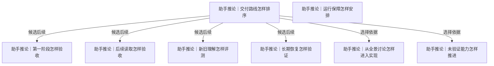

# 阶段、验证与运行

每阶段独立有用，以真实材料检验保存与使用；长期读回和运行保障分别安排。

[返回全景](../README.md) · [交互浏览](../index.html)

## 交付路线怎样排序

**助手推论** · 每一步产物都可独立使用。例如第一阶段先让一类会消失的材料留下且取回；后续加入查询，并不要求先完成所有视图、模型、同步和共享。

**Agent采用 · 当前**

候选：按可独立使用的能力推进。

理由与代价：收集与恢复先独立交付，读取、理解、人端/共享按实际需要逐层增加，副本与来源按损失窗口穿插；接受长期全景多数分支尚未实施。

启动或重审条件：每层验收通过才铺开；新证据揭示更急的来源损失窗口时调整下一段。

依据：

- [首先收集数据](roots.md#n-2c3dfbca22881d81)（约束）：当前第一价值是让材料留下
- [采集保障先从简](roots.md#n-ffb6c54f0390b4e1)（约束）：阶段一不装入完整运行体系
- [使用能力边界怎样扩展](access.md#n-ee3ad59eb9be5324)（选择依据）：能力各有价值与触发条件

依据材料：[.scratch/orisumi-roots/confirmations.md](../../../confirmations.md)。新根与当前建设边界

依据材料：[src/Docs/Orisumi.Docs/content/docs/model/index.mdx](../../../../../src/Docs/Orisumi.Docs/content/docs/model/index.mdx)。当前Raw/通用采集/Claude来源存在，其他为计划

依据材料：[src/Docs/Orisumi.Docs/content/docs/model/validation.mdx#前台观测](../../../../../src/Docs/Orisumi.Docs/content/docs/model/validation.mdx#%E5%89%8D%E5%8F%B0%E8%A7%82%E6%B5%8B)。当前 macOS 图形用户会话手动观察：7 次约 1 秒切换与 15 次约 0.2 秒切换全部取得；22 条激活、22 条失活分别与测试应用自身回调的身份及顺序一致。49 条原件全部恢复并核对哈希、长度、LF 和出处；同应用 4 次切窗、1 次改标题期间无新增应用级通知。

依据材料：[src/Docs/Orisumi.Docs/content/docs/model/validation.mdx#持续采集](../../../../../src/Docs/Orisumi.Docs/content/docs/model/validation.mdx#%E6%8C%81%E7%BB%AD%E9%87%87%E9%9B%86)。发布自包含本机程序，由三个用户级 LaunchAgent 分别运行前台、Codex 与 Claude Code，显式共用同一原件目录；实际装载、停止、再装载与恢复分别验收，真实重新登录和全天运行另测。

### 按可独立使用的能力推进 · 助手推荐

阶段一收集与历史取回；阶段二确定性检索/引用；阶段三按失败题加理解；阶段四按需要加人端/共享。副本和来源扩展按真实丢失窗口穿插。

收益：先解决数据缺失，再用真实使用选择下一步。

代价：完整体验分阶段形成。

适用条件：推荐路线。

继续展开：[第一阶段怎样验收](#n-ae87acd40d922614)、[后续读取怎样验收](#n-9e39e29694bbe145)、[新旧理解怎样评测](#n-cbfb97254da427c8)、[长期恢复怎样验证](#n-254f30d6e194be24)

分支终点：一：一种来源保存-出处-版本-取回；二：一个问题从检索到原件；三：一种理解与旧读法比较；四：一个人端查看或一个受众共享。每层可以停下继续使用。

检验：每一层单独关闭后续能力仍可使用；每层各留一次端到端验收记录。

### 先围绕一项使用做纵向样例 · 可选路线

保住基础收集后，选明确问题接少量来源，形成查询或回顾成品，再扩采集。

收益：能较早验证材料用途和交互。

代价：开发资源会暂时离开其他易丢来源。

适用条件：出现明确且高价值使用需求，且来源损失窗口已得到处理。

继续展开：[后续读取怎样验收](#n-9e39e29694bbe145)

分支终点：保留独立采集路径，挑一个基准题做读取与交互样例，新增来源仍不要求先证明用途。

检验：样例能追到真实原件，同时列清尚未接入来源的损失窗口与下一步。

### 第一阶段同时建设完整平台 · 与当前前提冲突

采集、网状同步、双数据库、模型理解、多端界面和共享一起完成才交付。

收益：若全部完成可立即呈现完整体验。

代价：延迟持续收集并扩大首次验证面。

适用条件：只有用户改变“首先收集、保障从简”的阶段选择才重新打开。

需要改变的前提：[首先收集数据](roots.md#n-2c3dfbca22881d81)、[采集保障先从简](roots.md#n-ffb6c54f0390b4e1)

分支终点：本轮不采用；若前提改变，先列最小共同依赖和单阶段能独立验证的价值。

检验：未改变前提时不得把这些能力列作收集完成的必要条件。

实现现状：Codex/Claude Code 文件采集、macOS 前台逐条观察、原件恢复与一次手动异机副本已有证据；五项用户级任务覆盖前台、两种会话和两个显式Git仓库，日常浏览器由扩展与Native host持续取得。受限 IP 网络与进程重启已验，其他来源及读取理解按真实需要进入。（[src/Orisumi.Cli/Program.cs](../../../../../src/Orisumi.Cli/Program.cs)、[src/Docs/Orisumi.Docs/content/docs/model/index.mdx](../../../../../src/Docs/Orisumi.Docs/content/docs/model/index.mdx)、[src/Docs/Orisumi.Docs/content/docs/model/validation.mdx](../../../../../src/Docs/Orisumi.Docs/content/docs/model/validation.mdx)、[src/Docs/Orisumi.Docs/content/docs/model/validation.mdx#前台观测](../../../../../src/Docs/Orisumi.Docs/content/docs/model/validation.mdx#%E5%89%8D%E5%8F%B0%E8%A7%82%E6%B5%8B)）

审阅重点：建议先完成收集与历史取回，再按真实问题补查询与理解。判断这样的独立阶段是否符合当前目标。

可能需要回看：6 个下游节点（含所有候选路线）

[从全景讨论怎样进入实现](#n-473477a3b70f395c)、[后续读取怎样验收](#n-9e39e29694bbe145)、[新旧理解怎样评测](#n-cbfb97254da427c8)、[未验证能力怎样推进](#n-b89d1395b983dd88)、[第一阶段怎样验收](#n-ae87acd40d922614)、[长期恢复怎样验证](#n-254f30d6e194be24)

## 第一阶段怎样验收

**助手推论** · 原来源消失后，实际采到的内容、版本和出处还在，才证明收集阶段有用。Agent能否回答复杂问题作为另一阶段的证据。

**Agent采用 · 当前**

候选：用可重复的小来源验证留下与取回。

理由与代价：采后移走测试来源仍能还原实际字节、历史与出处才证明收集价值；接受此验证不能证明未取得变化及长期介质寿命。

启动或重审条件：文本、zst、SQLite、附件、A/B 变化、相同字节不同出处和部分失败样本全部从保存区恢复。

依据：

- [首先收集数据](roots.md#n-2c3dfbca22881d81)（约束）：验收先看是否留下可用材料
- [保留采到的历史](roots.md#n-509f2d3467e7b121)（约束）：历史版本可取回
- [出处一起保存](roots.md#n-2ce85769c25073e7)（约束）：保存内容须能查取得事实

依据材料：[.scratch/orisumi-roots/confirmations.md](../../../confirmations.md)。收集阶段可从来源消失后取回形成完成标准

依据材料：[src/Orisumi.Cli/Program.cs](../../../../../src/Orisumi.Cli/Program.cs)。当前有list/show/line，完整取回路径仍须验证

依据材料：[src/Docs/Orisumi.Docs/content/docs/model/file-capture.mdx](../../../../../src/Docs/Orisumi.Docs/content/docs/model/file-capture.mdx)。当前循环、读取变化、部分成功

依据材料：[src/Docs/Orisumi.Docs/content/docs/model/validation.mdx#codex-取得与恢复](../../../../../src/Docs/Orisumi.Docs/content/docs/model/validation.mdx#codex-%E5%8F%96%E5%BE%97%E4%B8%8E%E6%81%A2%E5%A4%8D)。本机真实取得和隔离目录恢复通过；来源消失、变化版本和部分失败由测试覆盖。

依据材料：[src/Docs/Orisumi.Docs/content/docs/model/validation.mdx#外部副本](../../../../../src/Docs/Orisumi.Docs/content/docs/model/validation.mdx#%E5%A4%96%E9%83%A8%E5%89%AF%E6%9C%AC)。一次手动 Linux 异机复制与独立恢复通过，含并发新增、删除、缺块与损坏样例；定时备份和长期运行尚未配置。

依据材料：[src/Docs/Orisumi.Docs/content/docs/model/validation.mdx#前台观测](../../../../../src/Docs/Orisumi.Docs/content/docs/model/validation.mdx#%E5%89%8D%E5%8F%B0%E8%A7%82%E6%B5%8B)。当前 macOS 图形用户会话手动观察：7 次约 1 秒切换与 15 次约 0.2 秒切换全部取得；22 条激活、22 条失活分别与测试应用自身回调的身份及顺序一致。49 条原件全部恢复并核对哈希、长度、LF 和出处；同应用 4 次切窗、1 次改标题期间无新增应用级通知。

### 用可重复的小来源验证留下与取回 · 助手推荐

创建含文本、附件和变化历史的副本样本，采集后只删除测试来源，再从保存区恢复所有实际采到的版本。

收益：直接检验本轮目标。

代价：不能证明尚未采到的变化或十年后可靠。

适用条件：推荐每种新形态的第一验收。

分支终点：样本经历A→B→来源移走，另有相同字节不同出处、一次读取失败；逐一核对恢复字节、取得时间位置和部分成功。

检验：测试来源不可访问时仍能恢复A/B和附件；未采到的中间状态明确列作未知；不删除真实原件。

### 先做只读清单核对 · 可选路线

与当次来源清单比对保存范围、数量、内容指纹和出处；保留复核材料。

收益：可在真实来源上低干扰验证采集范围。

代价：只看清单不足以证明完整内容可恢复。

适用条件：真实来源变化快或暂时不适合恢复演练。

分支终点：选固定时间窗口和来源样本，比较遗漏、空文件、编码和附件。

检验：列出未核对项；至少抽样读回字节，恢复验证作为下一明确终点。

### 只用答题成功判断收集完成 · 与当前前提冲突

答得出某组问题就认为采集足够。

收益：能快速证明一个使用场景。

代价：会漏掉未来用途所需、当前没被问到的材料。

适用条件：仅适合作为后续读取能力验收，当前不作为收集完成标准。

需要改变的前提：[首先收集数据](roots.md#n-2c3dfbca22881d81)、[尽量完整留下](roots.md#n-77e7f6f84727e69e)

分支终点：保留问答作为附加证据，收集仍执行保存/取回验收。

检验：问答全对但附件或旧版本丢失的样本必须判收集验收失败。

实现现状：Codex 真实材料通过本机与 Linux 独立恢复；前台 22 次受控切换产生的 49 条原件全部恢复并核对。变化版本、部分失败、源不可用、删除事实及缺块损坏由确定性样例覆盖；来源完整性按各次实测范围说明。（[src/Docs/Orisumi.Docs/content/docs/model/validation.mdx](../../../../../src/Docs/Orisumi.Docs/content/docs/model/validation.mdx)、[src/Orisumi.Raw/CaptureRecovery.cs](../../../../../src/Orisumi.Raw/CaptureRecovery.cs)、[tests/Orisumi.Raw.Tests/CaptureRecoveryTests.cs](../../../../../tests/Orisumi.Raw.Tests/CaptureRecoveryTests.cs)、[src/Docs/Orisumi.Docs/content/docs/model/validation.mdx#前台观测](../../../../../src/Docs/Orisumi.Docs/content/docs/model/validation.mdx#%E5%89%8D%E5%8F%B0%E8%A7%82%E6%B5%8B)）

审阅重点：建议从测试来源消失后仍能恢复原件、已采版本和出处来验收；问答成绩另验。

## 后续读取怎样验收

**助手推论** · 已有基准覆盖两天、四来源及跨天演变，能检查事实、出处、推断和盲区。它验证过已删除导洞，不能直接证明新实现和新来源。

**暂后置 · 以后**

候选：用新实现重跑既有题并抽查证据、增加未参与设计的新问题、先验证确定性行为。

理由与代价：已知题验证历史问题，新题防止过拟合，确定性小例能定位实现错；接受三类证据各有范围，质量仍须用户判断。

启动或重审条件：读取实现时先匹配改动跑最小契约及关键旧题；接新形态再增一组事实/关联/不可知题，不一次铺全部测试。

候选可组合。既有题、新题和确定性行为检查分别覆盖不同风险，按实际改动组合。

依据：

- [理解能追溯来源](understanding.md#n-299861624af1def3)（约束）：答案需能核查依据
- [同一份数据多种视图](access.md#n-309f702d88cb0e1d)（选择依据）：更换读取入口仍应回答同样问题

依据材料：[.scratch/modeling/benchmark.md](../../../../modeling/benchmark.md)。14题及助手起草、用户看过的参考要点；推论有明确标记

依据材料：[.scratch/modeling/benchmark-run-1.md](../../../../modeling/benchmark-run-1.md)。旧导洞14题作答和调用记录；不等于均被用户评为正确

依据材料：[.scratch/modeling/open.md](../../../../modeling/open.md)。C1已补跑，仍待用户判断；模型形状未定

### 用新实现重跑既有题并抽查证据 · 助手推荐

固定同批输入、读法和Agent配置，先做关键题，之后完整回归；记录答案和工具调用。

收益：可对照已有失败与成本。

代价：基准范围有限且需人判质量。

适用条件：推荐后续读取验收。

分支终点：优先A2事实、A3/A7缺口、A5/B4/B6活动错觉、C1演变；再覆盖全部14题；参考要点与模型推断分开。

检验：结论引用可打开；没有的内容明确未知；报告命令数、读取量、等待和费用，最终好坏由用户判。

### 增加未参与设计的新问题 · 可选路线

从新来源和新时期选少量真实问题，先形成独立参考，再评价。

收益：减少围绕两天材料过拟合。

代价：需新材料和参考答案核实。

适用条件：已有基准稳定后或接入新形态时。

分支终点：每种新形态选一个事实题、一个关联题和一个不可知题。

检验：系统能说明未知，且新问题结果与来源人工核对一致；没有新材料时明确为待执行实验。

### 先验证确定性行为 · 可选路线

针对位置解析、复制折叠、时区与分页作精简输入输出验证。

收益：定位实现缺陷快且可重复。

代价：不能证明叙述理解质量。

适用条件：实现确定性读出时与问答互补。

分支终点：每种规则取一个真实最小样本和一个误判反例。

检验：曾出现的误归属、重复和时区问题均能被最小样本检出，问答另验。

实现现状：此项读出或模型比较能力仍待实现；当前采集、恢复与副本验证不替代其验收。

审阅重点：判断阶段边界、验收证据与替代路线触发条件；采用记录表达 Agent 选择，用户确认保留原证据。

## 新旧理解怎样评测

**助手推论** · 新模型读同批材料后，文字更流畅可能同时漏了关键事实。用户注意力有限，应把变化和证据集中展示，而不是把自动评分当最终判断。

**暂后置 · 以后**

候选：完整盲评两版。

理由与代价：首次建立新旧理解质量标准采用代表题盲评，减少模型名和文风影响；接受人工注意力投入高于只看差异。

启动或重审条件：出现两版可比较正式读出后，固定输入选择代表题盲评并保存判据；标准稳定再试 diff 减少日常负担。

依据：

- [留下观测重算理解](understanding.md#n-77f980be4039dd0a)（选择依据）：理解会更新，需要比较是否更好
- [理解版本怎样使用](understanding.md#n-be7944dd96e1f491)（选择依据）：采用哪版需要可解释依据
- [模型越来越强](conditions.md#n-8cda5b6eb0b65f2e)（约束）：总体进步假设不保证一次具体输出更好

依据材料：[.scratch/requirements/belief.md](../../../../requirements/belief.md)。新旧版本比较仍待定；只看差异是助手候选

依据材料：[.scratch/modeling/open.md](../../../../modeling/open.md)。模型读出形状等基准结果

依据材料：[.scratch/modeling/benchmark.md](../../../../modeling/benchmark.md)。事实、原因、盲区与推断可分别核查

### 展示实质差异和对应证据 · 助手推荐

先列新增/删除/改判的结论、引用变化和未知范围，再让人判断关键变化。

收益：把注意力花在有差异的地方。

代价：差异抽取也可能漏，需保留全文与抽样。

适用条件：推荐模型读出初期。

分支终点：固定输入比较两版；程序检查引用可达，模型可辅助归类差异，人工看关键结论并抽查未变部分。

检验：差异报告覆盖刻意植入的漏事实、错归属和无依据确定化；用户可打开全文和原文。

### 完整盲评两版 · 可选路线

隐藏模型和版本信息，以相同问题逐项判断事实、引用、完整性与未知表述。

收益：减少偏好新模型的影响。

代价：人工时间更高。

适用条件：首次建立质量标准或读法变化大。

分支终点：从14题选代表题做盲评，记录判据与分歧再解盲。

检验：同一来源事实不因模型名不同改变评分；保留判断依据。

### 自动评测先筛选再抽审 · 可选路线

引用检查与有据评分先筛掉明确退步，边界问题和高影响变化交人审。

收益：规模变大后减少注意力消耗。

代价：评审模型会偏，评分不等同事实。

适用条件：已有足够人工判例且自动规则与人较一致。

分支终点：用人工判例测误放行、误拦截，先只作推荐，不直接替用户选版。

检验：已知错答案不能仅因表述好得高分；保留人工推翻自动结果入口。

实现现状：此项读出或模型比较能力仍待实现；当前采集、恢复与副本验证不替代其验收。

审阅重点：判断阶段边界、验收证据与替代路线触发条件；采用记录表达 Agent 选择，用户确认保留原证据。

## 长期恢复怎样验证

**助手推论** · 十年无法提前跑完，但可以验证离开当前投影、机器与可执行程序后，是否仍能读回材料及其解释方法。副本拓扑由存储分支决定。

**Agent采用 · 当前**

候选：定期在干净目录读回一份保存集、用第二份最小读者验证格式。

理由与代价：干净目录加第二份最小读者直接检验格式说明和独立恢复，覆盖当前原件事实；接受维护一个只列出/取回的小工具。

启动或重审条件：首段以及以后格式改动时恢复文本、压缩、数据库和附件；模型调用/纠正尚未产生，待其上线扩入恢复集。

候选可组合。干净目录恢复、独立读者与通用导出可以先后或共同验证。

依据：

- [以十年为尺度](roots.md#n-06933e934f4d562b)（选择依据）：长期尺度需要可执行的代理验证
- [留最原始的一层](roots.md#n-760744617270b5ce)（约束）：原件是重读基础
- [出处一起保存](roots.md#n-2ce85769c25073e7)（约束）：恢复后仍要知道材料来源
- [多处都有一份](availability.md#n-ae9194edde188509)（选择依据）：副本数量需要配合离开原机器后的实际恢复验证。

依据材料：[src/Docs/Orisumi.Docs/content/docs/requirements/belief.mdx](../../../../../src/Docs/Orisumi.Docs/content/docs/requirements/belief.mdx)。数据比代码长寿、不绑定某种存储

依据材料：[src/Docs/Orisumi.Docs/content/docs/model/raw.mdx](../../../../../src/Docs/Orisumi.Docs/content/docs/model/raw.mdx)。格式、切块器与位置说明

依据材料：[src/Docs/Orisumi.Docs/content/docs/model/adr/0005-projection-databases.mdx](../../../../../src/Docs/Orisumi.Docs/content/docs/model/adr/0005-projection-databases.mdx)。投影应从长期材料重建

依据材料：[src/Docs/Orisumi.Docs/content/docs/model/validation.mdx#codex-取得与恢复](../../../../../src/Docs/Orisumi.Docs/content/docs/model/validation.mdx#codex-%E5%8F%96%E5%BE%97%E4%B8%8E%E6%81%A2%E5%A4%8D)。已做本机干净目录恢复与独立读者复核；尚未验证异机、外部副本或十年介质寿命。

依据材料：[src/Docs/Orisumi.Docs/content/docs/model/validation.mdx#外部副本](../../../../../src/Docs/Orisumi.Docs/content/docs/model/validation.mdx#%E5%A4%96%E9%83%A8%E5%89%AF%E6%9C%AC)。一次手动 Linux 异机复制与独立恢复通过，含并发新增、删除、缺块与损坏样例；定时备份和长期运行尚未配置。

### 定期在干净目录读回一份保存集 · 助手推荐

只给保存集、格式说明和必要解码资源，恢复原件并重建一类读出；不要依赖工作目录里的隐含状态。

收益：验证可携带、可理解和投影可删。

代价：需要整理说明和恢复工具；仍不证明十年介质寿命。

适用条件：推荐在首个可用保存格式和重大格式变化后。

分支终点：覆盖原件、采集/删除记录、模型调用包和人工纠正；用字节与引用比对；解码依赖列出版本和取得方式。

检验：新目录能列出处、恢复附件与历史、重建所选读出；缺依赖有明确清单。

### 用第二份最小读者验证格式 · 可选路线

从格式说明独立编写只做列出与取回的读者，不依赖当前业务实现。

收益：直接发现格式说明遗漏和实现耦合。

代价：额外实现需要维护，收益要对应长期风险。

适用条件：格式准备稳定或更换存储后。

分支终点：只支持一种已定格式与一种压缩来源，核对真实保存样本。

检验：两份读者恢复的字节完全一致，出错样本给出可定位原因。

### 提供通用导出作为恢复入口 · 可选路线

导出来源原件、目录清单、出处与版本索引，便于现成工具读取。

收益：人可以直接拿走材料，降低理解门槛。

代价：导出可能增加空间，内部去重和关系需明确表示。

适用条件：需要交给别的工具或当前独立读者成本高。

分支终点：用一次历史含重复附件的保存集生成自足导出，包含机器可读清单。

检验：在没有Orisumi代码的目录打开原件，并能从清单分清同内容的不同出处。

实现现状：已用独立 Python 读者在本机及 Linux 恢复当前保存格式，原字节、清单、链接和 SQLite 完整性通过核对。定期演练、断电与长期介质寿命尚待验证。（[src/Docs/Orisumi.Docs/content/docs/model/validation.mdx](../../../../../src/Docs/Orisumi.Docs/content/docs/model/validation.mdx)、[src/Docs/Orisumi.Docs/content/docs/model/raw.mdx](../../../../../src/Docs/Orisumi.Docs/content/docs/model/raw.mdx)、[src/Docs/Orisumi.Docs/content/docs/model/nodes.mdx](../../../../../src/Docs/Orisumi.Docs/content/docs/model/nodes.mdx)）

审阅重点：判断阶段边界、验收证据与替代路线触发条件；采用记录表达 Agent 选择，用户确认保留原证据。

## 运行保障怎样安排

**助手推论** · 当前可先不建设持续探活，或由外部工具简单查看进程和最近一次结果。记录单次采集结果、检查采集是否活着、恢复和告警是不同责任。

**Agent采用 · 当前**

候选：当前连探活也暂缓。

理由与代价：单次结果和失败保留在原件与运行输出中；外部系统只管理五项采集任务的启动和重启。来源遗漏、长期未更新与告警仍无内建判定，接受这部分可见性边界。

启动或重审条件：需要发现进程存活但长期没有新结果时，再加简单外部探活；来源缺口恢复与告警平台继续按从简边界后置。

依据：

- [采集保障先从简](roots.md#n-ffb6c54f0390b4e1)（约束）：当前不内建复杂监控恢复告警
- [出处一起保存](roots.md#n-2ce85769c25073e7)（约束）：单次取得事实仍需保留

依据材料：[.scratch/orisumi-roots/confirmations.md](../../../confirmations.md)。用户本轮的保障边界

依据材料：[src/Orisumi.Cli/Program.cs](../../../../../src/Orisumi.Cli/Program.cs)。Scan/Watch 保留并输出单次结果；--once 失败返回非零，当前外部探活尚未启用。

依据材料：[src/Docs/Orisumi.Docs/content/docs/model/validation.mdx#持续采集](../../../../../src/Docs/Orisumi.Docs/content/docs/model/validation.mdx#%E6%8C%81%E7%BB%AD%E9%87%87%E9%9B%86)。发布自包含本机程序，由三个用户级 LaunchAgent 分别运行前台、Codex 与 Claude Code，显式共用同一原件目录；实际装载、停止、再装载与恢复分别验收，真实重新登录和全天运行另测。

### 先保留单次结果，需要时外部探活 · 助手推荐

当前采集命令能启动、停止、输出结果；外部可查看退出状态或最近成功时间。

收益：不拖延来源接入，责任清楚。

代价：停机或长时间未采不保证自动发现。

适用条件：推荐当前阶段。

分支终点：说明运行入口与结果位置，探活若有真实需求先由外部计划任务实现一次简单检查。

检验：停止采集后外部检查可报告停止或过期；没有探活时验收不宣称自动发现。

### 当前连探活也暂缓 · 可选路线

使用时查看保存结果和系统进程状态；来源结果的新鲜度与完整性探活留到实际需要。

收益：最少建设投入。

代价：更依赖人偶尔检查，可能错过材料。

适用条件：当前接受来源缺口仍需按实际问题核查；系统进程启动与重启由启动路线负责。

分支终点：保留运行命令与查看结果步骤，列出未覆盖的停机时段。

检验：报告准确区分已采范围与未知窗口，阶段验收不借缺口要求补监控。

### 内建调度恢复告警平台 · 与当前前提冲突

统一管理任务、重试、补齐、监控和通知。

收益：长期大量来源可能受益。

代价：当前范围扩大且引入状态与运维责任。

适用条件：只有用户改变当前保障范围且实际故障证明必要时。

需要改变的前提：[采集保障先从简](roots.md#n-ffb6c54f0390b4e1)

分支终点：本轮不建设；未来先以一个已发生故障比较外部负责与内建的成本。

检验：未改变前提前，此分支不进入任何当前阶段依赖。

实现现状：现有有限重试与失败记录保留，用户级 launchd 管进程重启；实际停止与再运行已验证。来源完整性探活、定时备份和告警平台继续后置。（[src/Orisumi.Capturing/Collector.cs](../../../../../src/Orisumi.Capturing/Collector.cs)、[src/Docs/Orisumi.Docs/content/docs/model/continuous-capture.mdx](../../../../../src/Docs/Orisumi.Docs/content/docs/model/continuous-capture.mdx)、[src/Docs/Orisumi.Docs/content/docs/model/validation.mdx#持续采集](../../../../../src/Docs/Orisumi.Docs/content/docs/model/validation.mdx#%E6%8C%81%E7%BB%AD%E9%87%87%E9%9B%86)）

审阅重点：判断阶段边界、验收证据与替代路线触发条件；采用记录表达 Agent 选择，用户确认保留原证据。

## 从全景讨论怎样进入实现

**助手推论** · 用户已授权 Agent 审阅全部候选并选择实现。当前按独立交付推进，具体采用、实施现状和验证范围分别记录；格式、身份与原件内容保持可审阅。

**Agent采用 · 当前**

候选：集中确认后选一个独立交付。

理由与代价：用户已明确授权 Agent 自主选择及实现，本项采用小而独立交付的范围：Codex 取得到恢复；候选旧文中的等待确认前提由本次授权替代，接受其他能力后置。

启动或重审条件：先将格式、身份、原件范围写成具体样例并执行验证；此为 Agent 选择，不改写成逐项用户确认。

依据：

- [首先收集数据](roots.md#n-2c3dfbca22881d81)（选择依据）：下一步实现先围绕收集价值
- [交付路线怎样排序](#n-e93627fc1fab2325)（选择依据）：阶段顺序要转化为可执行边界

依据材料：[AGENTS.md](../../../../../AGENTS.md)。谁实现由用户指定；实现前列新格式、身份和原件内容；当前不部署；提交和推送由用户授权

依据材料：[.scratch/orisumi-roots/confirmations.md](../../../confirmations.md)。确认内容整理进模型区，替换被取代内容

依据材料：[src/Docs/Orisumi.Docs/content/docs/model/validation.mdx#前台观测](../../../../../src/Docs/Orisumi.Docs/content/docs/model/validation.mdx#%E5%89%8D%E5%8F%B0%E8%A7%82%E6%B5%8B)。当前 macOS 图形用户会话手动观察：7 次约 1 秒切换与 15 次约 0.2 秒切换全部取得；22 条激活、22 条失活分别与测试应用自身回调的身份及顺序一致。49 条原件全部恢复并核对哈希、长度、LF 和出处；同应用 4 次切窗、1 次改标题期间无新增应用级通知。

依据材料：[src/Docs/Orisumi.Docs/content/docs/model/validation.mdx#持续采集](../../../../../src/Docs/Orisumi.Docs/content/docs/model/validation.mdx#%E6%8C%81%E7%BB%AD%E9%87%87%E9%9B%86)。发布自包含本机程序，由三个用户级 LaunchAgent 分别运行前台、Codex 与 Claude Code，显式共用同一原件目录；实际装载、停止、再装载与恢复分别验收，真实重新登录和全天运行另测。

### 集中确认后选一个独立交付 · 助手推荐

确认根、影响大的候选及替代触发条件后，选一个来源或一个能力，列具体样例再实现。

收益：把全景判断落实为小而可验证的范围。

代价：完整全景会保留许多尚未启动的分支。

适用条件：推荐当前讨论完成后的交接。

分支终点：交接列目标、输入样例、保存内容/身份/格式、结果入口、验收方法和明确实现者；正式文档只写确认部分。

检验：推荐没有被误记为确认；代码与被替代文档同步清理；完成后经orisumi tidy/verify并报告未验部分。

### 先执行一个能力勘探 · 可选路线

对于技术条件未查明的候选，先做最小只读调查或可丢弃试验，结果回到决策条件。

收益：减少用猜测定格式。

代价：多一步获取证据，但不提前建产品结构。

适用条件：涉及尚未勘探来源、平台权限、模型或协议能力。

分支终点：按来源勘探规范保留原始样本、采样时间位置；试验只验证一个条件，结束删除专用程序。

检验：报告能力成立的样本范围、未核实条件及条件失败时应走哪条现成替代。

实现现状：Codex/Claude Code 文件采集、macOS 前台逐条观察、原件恢复与一次手动异机副本已有证据；五项用户级任务覆盖前台、两种会话和两个显式Git仓库，日常浏览器由扩展与Native host持续取得。受限 IP 网络与进程重启已验，其他来源及读取理解按真实需要进入。（[src/Orisumi.Capturing/CodexSource.cs](../../../../../src/Orisumi.Capturing/CodexSource.cs)、[src/Orisumi.Capturing/ForegroundCollector.cs](../../../../../src/Orisumi.Capturing/ForegroundCollector.cs)、[src/Orisumi.Raw/CaptureRecovery.cs](../../../../../src/Orisumi.Raw/CaptureRecovery.cs)、[src/Orisumi.Cli/Program.cs](../../../../../src/Orisumi.Cli/Program.cs)、[src/Docs/Orisumi.Docs/content/docs/model/validation.mdx](../../../../../src/Docs/Orisumi.Docs/content/docs/model/validation.mdx)、[src/Docs/Orisumi.Docs/content/docs/model/validation.mdx#前台观测](../../../../../src/Docs/Orisumi.Docs/content/docs/model/validation.mdx#%E5%89%8D%E5%8F%B0%E8%A7%82%E6%B5%8B)）

审阅重点：在本次授权内采用具体方案，列出格式、身份、原件样例和验收，完成一段独立交付；选择与实施进展分别记录。

## 未验证能力怎样推进

**助手推论** · 图中网络协议、数据库能力、跨设备行为、模型质量和新来源支持都还需要具体证据。技术未知不应把全部分支截在“待用户确认”。

**Agent采用 · 当前**

候选：每个未知给一个最小试验及分流条件。

理由与代价：每个未知都对应最小输入、成功标准和失败分流，先验证影响当前交付的条件；接受远期试验仍未执行。

启动或重审条件：当前来源、恢复、受限 IP 网络和用户级任务的装载/停止已测；真实重新登录、全天运行、系统状态和新来源按各自最小实验推进。

依据：

- [尽量收集一切](roots.md#n-c3c6e7607f2c9805)（选择依据）：来源范围广，能力要逐项查证
- [交付路线怎样排序](#n-e93627fc1fab2325)（选择依据）：按当前阶段选择最小验证范围

依据材料：[AGENTS.md](../../../../../AGENTS.md)。新形态先一个例子端到端跑通，未勘探来源先勘探

依据材料：[.scratch/modeling/open.md](../../../../modeling/open.md)。模型读出形状待评测

依据材料：[src/Docs/Orisumi.Docs/content/docs/model/nodes.mdx](../../../../../src/Docs/Orisumi.Docs/content/docs/model/nodes.mdx)。API、多端和节点仅有设计

依据材料：[src/Docs/Orisumi.Docs/content/docs/model/validation.mdx#前台观测](../../../../../src/Docs/Orisumi.Docs/content/docs/model/validation.mdx#%E5%89%8D%E5%8F%B0%E8%A7%82%E6%B5%8B)。当前 macOS 图形用户会话手动观察：7 次约 1 秒切换与 15 次约 0.2 秒切换全部取得；22 条激活、22 条失活分别与测试应用自身回调的身份及顺序一致。49 条原件全部恢复并核对哈希、长度、LF 和出处；同应用 4 次切窗、1 次改标题期间无新增应用级通知。

依据材料：[src/Docs/Orisumi.Docs/content/docs/model/validation.mdx#持续采集](../../../../../src/Docs/Orisumi.Docs/content/docs/model/validation.mdx#%E6%8C%81%E7%BB%AD%E9%87%87%E9%9B%86)。发布自包含本机程序，由三个用户级 LaunchAgent 分别运行前台、Codex 与 Claude Code，显式共用同一原件目录；实际装载、停止、再装载与恢复分别验收，真实重新登录和全天运行另测。

### 每个未知给一个最小试验及分流条件 · 助手推荐

写清输入样本、待验证主张、成功标准及失败后路线；先验证真正影响下一步的未知。

收益：全景能够继续推演而不冒充已实现。

代价：试验后仍可能发现新的限制。

适用条件：推荐默认。

分支终点：例如远端MCP连接先测一条检索→引用；数据库先测时间/分页/重建；新媒体先测原样恢复和引用定位。

检验：结果明确成立/不成立/样本不足；失败能切换CLI、单库或整件引用等已列替代。

### 未知对应能力整体后置 · 可选路线

先用已知能力完成独立阶段，保留触发它的实际需求和需补证据。

收益：不让远期能力拖住当前收集。

代价：将来开始该能力时仍需调查。

适用条件：不影响当前留下材料和恢复，且尚无使用需求。

分支终点：为该分支注明触发条件，例如第一次持续共享或首次跨设备查询，再指向对应试验。

检验：当前阶段不依赖此能力；将来触发时能找到明确试验，不把它默认为已解决。

实现现状：Codex/Claude Code 文件采集、macOS 前台逐条观察、原件恢复与一次手动异机副本已有证据；五项用户级任务覆盖前台、两种会话和两个显式Git仓库，日常浏览器由扩展与Native host持续取得。受限 IP 网络与进程重启已验，其他来源及读取理解按真实需要进入。（[src/Docs/Orisumi.Docs/content/docs/model/validation.mdx](../../../../../src/Docs/Orisumi.Docs/content/docs/model/validation.mdx)、[.scratch/requirements/survey-macos-foreground.md](../../../../requirements/survey-macos-foreground.md)、[src/Docs/Orisumi.Docs/content/docs/model/validation.mdx#前台观测](../../../../../src/Docs/Orisumi.Docs/content/docs/model/validation.mdx#%E5%89%8D%E5%8F%B0%E8%A7%82%E6%B5%8B)）

审阅重点：判断阶段边界、验收证据与替代路线触发条件；采用记录表达 Agent 选择，用户确认保留原证据。
