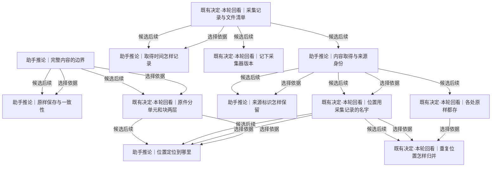

# 内容、出处、身份与版本

一份材料以什么边界保存，怎样区分内容、取得事实与来源里的东西，未来怎样准确回到当时的原样。

[返回全景](../README.md) · [交互浏览](../index.html)

## 完整内容的边界

**助手推论** · 一份日志交付本次读取的完整字节，SQLite 交付一致快照，前台交付 Swift 实际输出的一条观察行。来源的交付边界、可定位单元与物理分块各有用途。

**Agent采用 · 当前**

候选：按来源已有边界交付。

理由与代价：文件字节、SQLite 在线备份和 Swift 实际输出的每条观察行都有结束边界；前台采用一行一 capture 立即持久保存。接受小对象数量和回调到提交的短窗口，材料边界独立于物理分块。

启动或重审条件：只有实际观察数量或写入成本成为问题时，再比较先持久追加、随后封批；当前逐条完整内容继续复用 Raw，不提前建设封批机制。

依据：

- [留最原始的一层](roots.md#n-760744617270b5ce)（选择依据）：边界必须保留这次实际取得的形态。
- [尽量采全变化](roots.md#n-cc33c5b227746d72)（选择依据）：有界交付不能被误解为只取最新状态。
- [取得方式按来源形态选择](capture.md#n-6d6180cd980550cc)（选择依据）：取得的是文件、响应、数据库快照还是事件，决定原件边界能够怎样表达。

依据材料：[src/Docs/Orisumi.Docs/content/docs/model/raw.mdx](../../../../../src/Docs/Orisumi.Docs/content/docs/model/raw.mdx)。现有设计与格式是需回看的选择，不自动成为本轮用户确认。

依据材料：[src/Docs/Orisumi.Docs/content/docs/model/validation.mdx#前台观测](../../../../../src/Docs/Orisumi.Docs/content/docs/model/validation.mdx#%E5%89%8D%E5%8F%B0%E8%A7%82%E6%B5%8B)。当前 macOS 图形用户会话手动观察：7 次约 1 秒切换与 15 次约 0.2 秒切换全部取得；22 条激活、22 条失活分别与测试应用自身回调的身份及顺序一致。49 条原件全部恢复并核对哈希、长度、LF 和出处；同应用 4 次切窗、1 次改标题期间无新增应用级通知。

依据材料：[src/Docs/Orisumi.Docs/content/docs/model/adr/0006-observations-as-received.mdx](../../../../../src/Docs/Orisumi.Docs/content/docs/model/adr/0006-observations-as-received.mdx)。当前沿用 source-bounded，每条实际观察行立即独立提交；实际数量或写入成本触发持久追加与封批比较。

### 按来源已有边界交付 · 助手推荐

文件按本次取得字节、接口按原始响应、数据库按一致快照、前台按原生程序实际输出的完整观察行交付。

收益：直接保留实际取得的材料，完整性容易核验。

代价：大文件变化可能重读；逐条前台观测增加小对象数量，回调到提交之间仍有短窗口。

适用条件：来源提供有限、可读完的材料时。

继续展开：[原样保存与一致性](#n-49d755be3c14fe60)、[原件分单元和块两层](#n-c2507b9e78d79f34)

### 把连续观测组成有界批次 · 条件成立后再做

事件先持久追加，再按来源约定的时间或大小封批，保留原始字段、顺序和连续性标识；连续媒体另按实际容器验证。

收益：持续发生的材料可以不断落盘。

代价：批次编码和崩溃前未封批窗口要按真实来源确定。

适用条件：实际事件数量或写入成本需要优化，或来源没有自然结束边界时。

分支终点：选一种持续观测，记录来源交出的事件形态、顺序与缺口标记；比较按时间封批和按大小封批，产出原样实例。

检验：用跨批次的同一事件序列读回，确认没有丢字段、重排或把批次误当真实事件边界。

### 保存前只留统一语义对象 · 与当前前提冲突

先解析、合并并只留下统一消息或摘要。

收益：后续查询入口更统一。

代价：未知字段、原始编码与未理解内容可能消失。

适用条件：只有改变先原样保存的前提才可重新开放。

需要改变的前提：[留最原始的一层](roots.md#n-760744617270b5ce)、[尽量完整留下](roots.md#n-77e7f6f84727e69e)

分支终点：当前保留完整来源材料，统一语义对象由读出生成。

检验：能从保留材料重新使用另一版解析器。

实现现状：CaptureWriter.Add 接收有结束边界的 Stream；文件交付读取字节、SQLite 交付完整快照、前台交付一条完整观察行，统一切块保存。（[src/Orisumi.Raw/CaptureWriter.cs](../../../../../src/Orisumi.Raw/CaptureWriter.cs)、[src/Orisumi.Capturing/SqliteSnapshotReader.cs](../../../../../src/Orisumi.Capturing/SqliteSnapshotReader.cs)、[src/Orisumi.Capturing/ForegroundCollector.cs](../../../../../src/Orisumi.Capturing/ForegroundCollector.cs)、[src/Docs/Orisumi.Docs/content/docs/model/raw.mdx](../../../../../src/Docs/Orisumi.Docs/content/docs/model/raw.mdx)）

审阅重点：确认完整内容是本次取得的有界材料，而不是预先规定所有来源都必须变成文件或事件。

可能需要回看：16 个下游节点（含所有候选路线）

[位置定位到哪里](#n-d75a21e927a755bb)、[共享怎样授权](access.md#n-4b3c6032607d1b5c)、[分块策略与版本](storage.md#n-044919fef0bfc086)、[删除记录与回收](storage.md#n-0350116e746cba2c)、[压缩与存放表示](storage.md#n-d00cf82ac296b520)、[原件分单元和块两层](#n-c2507b9e78d79f34)、[原件存成块](storage.md#n-1e55971a7ab3ff58)、[原样保存与一致性](#n-49d755be3c14fe60)、[多副本删除与离线节点](availability.md#n-19ed3ea2239e62f9)、[导出与恢复](storage.md#n-da66683208852205)、[新旧理解怎样评测](delivery.md#n-cbfb97254da427c8)、[来源原生增量怎样保存](storage.md#n-95be81155ce3d6b5)、[模型调用留下什么](understanding.md#n-97745ff5030f65f3)、[派生结果遇到删除或撤权](access.md#n-183194894919be77)、[理解版本怎样使用](understanding.md#n-be7944dd96e1f491)、[读出引用到哪里](understanding.md#n-fe26af63a38ee976)

## 原样保存与一致性

**助手推论** · 例如复制活跃数据库主文件不等于取得了一致数据库；把查询结果导成JSON也不等于保存了数据库文件字节。原样指忠实保留实际取得的那一层，并说明取得方法。

**Agent采用 · 当前**

候选：保留取得字节并说明一致性范围。

理由与代价：保存实际取得层并说明方法：文件字节与数据库备份分别忠实，快照不冒充裸库文件副本；接受每种新来源都需边界证据。

启动或重审条件：首段样本明确文件与 Online Backup 的原件路径、时间和一致性；新取得方法变更时更新契约。

依据：

- [完整内容的边界](#n-26854bffbe13f18e)（选择依据）：来源决定交付的内容，随后要说明它代表什么状态。
- [出处一起保存](roots.md#n-2ce85769c25073e7)（选择依据）：取得方法与可直接知道的一致性范围属于出处事实。

依据材料：[src/Docs/Orisumi.Docs/content/docs/model/sources.mdx](../../../../../src/Docs/Orisumi.Docs/content/docs/model/sources.mdx)。旧Heartbeat行已是现可取得最原始层；Codex SQLite按查询导出；来源交付形态不同。

依据材料：[.scratch/requirements/survey-assistant-sessions.md](../../../../requirements/survey-assistant-sessions.md)。压缩日志、SQLite和原始JSONL并存，读出表示不等于取得表示。

### 保留取得字节并说明一致性范围 · 助手推荐

文件保留成功读到的全部字节；数据库/API按来源支持的只读快照、事务导出或原始响应保存，查询与范围随材料记录。

收益：不把读取快照误称事件全历史；可核验保存的是哪一层。

代价：每种新来源都要勘探可取得边界。

适用条件：现有文件以及能提供有界导出的来源。

分支终点：对一种来源写明内容编码、读取范围、取得时间、一致性方法；未能取得的字段/版本明确留作缺口。

检验：读回与当次输入逐字节比较；对数据库另核对快照内相关表是否来自同一读取视图。

### 保留来源原生变化序列和必要基线 · 可选路线

来源若交来可重放变化事件，保存原事件与起点快照，按原始顺序保留每个已取得版本。

收益：可能避免反复全量读取，也更细地覆盖变化。

代价：需验证事件是否完整、保留窗口、恢复依赖以及版本更替。

适用条件：来源已经提供原生变化记录，且可以真实样本重放时。

继续展开：[来源原生增量怎样保存](storage.md#n-95be81155ce3d6b5)

### 用规范化结果替换取得材料 · 与当前前提冲突

改字段、去重、解压后重编码，只保存整理结果。

收益：读取方便、部分内容更容易复用。

代价：原取得表示和未识别字段被覆盖，无法精确还原。

适用条件：只有重新选择保存形态才成立。

需要改变的前提：[留最原始的一层](roots.md#n-760744617270b5ce)

分支终点：需要规范化时保留原样材料，规范化结果另作读出。

检验：压缩来源仍能导出原压缩文件本身，而不只是等价解压内容。

实现现状：文件原字节、SQLite 一致快照与 AppKit 观察行原字节已实现；系统对象保存选定公开属性的忠实编码。旧 Heartbeat、Git 及其他形态尚待正式接入。（[src/Orisumi.Raw/CaptureWriter.cs](../../../../../src/Orisumi.Raw/CaptureWriter.cs)、[src/Orisumi.Capturing/SqliteSnapshotReader.cs](../../../../../src/Orisumi.Capturing/SqliteSnapshotReader.cs)、[src/Orisumi.Capturing/ForegroundCollector.cs](../../../../../src/Orisumi.Capturing/ForegroundCollector.cs)、[src/Docs/Orisumi.Docs/content/docs/model/sources.mdx](../../../../../src/Docs/Orisumi.Docs/content/docs/model/sources.mdx)）

审阅重点：确认各来源实际取得的是字节、导出行还是事件；一致性承诺逐来源说明。

可能需要回看：4 个下游节点（含所有候选路线）

[新旧理解怎样评测](delivery.md#n-cbfb97254da427c8)、[来源原生增量怎样保存](storage.md#n-95be81155ce3d6b5)、[模型调用留下什么](understanding.md#n-97745ff5030f65f3)、[理解版本怎样使用](understanding.md#n-be7944dd96e1f491)

## 原件分单元和块两层

**既有决定·本轮回看** · 同一行JSONL可以跨物理块，图片根本没有行。可追溯的内容位置需要独立于压缩和分块，至于是否统一命名为单元仍有选择。

**Agent采用 · 当前**

候选：完整材料加独立定位器。

理由与代价：完整材料和独立定位器适用于压缩日志、数据库及附件，物理块只负责恢复；接受细定位按格式逐步提供。

启动或重审条件：现在文本行与整件引用可用；第一类需要内部定位的读出上线时给解析版本和原件锚点。

依据：

- [完整内容的边界](#n-26854bffbe13f18e)（选择依据）：完整材料与内部定位边界不同。
- [理解能追溯来源](understanding.md#n-299861624af1def3)（选择依据）：引用要能回到实际证据，不能跟着物理切块改变。
- [不绑定某种存储](storage.md#n-9e024cb39c60031e)（选择依据）：改变介质或分块不应改变材料中的位置。

依据材料：[src/Docs/Orisumi.Docs/content/docs/model/raw.mdx](../../../../../src/Docs/Orisumi.Docs/content/docs/model/raw.mdx)。现有设计与格式是需回看的选择，不自动成为本轮用户确认。

### 完整材料加独立定位器 · 助手推荐

材料保留完整字节，位置用字节范围或带格式版本的来源定位器；物理块只负责保存和搬运。

收益：二进制、压缩、文本都能表达，不必每类材料先切统一单元。

代价：读取内部对象时需对应格式的定位器。

适用条件：面向多种来源形态时。

继续展开：[位置定位到哪里](#n-d75a21e927a755bb)、[原件存成块](storage.md#n-1e55971a7ab3ff58)

### 来源原生单元加物理块 · 可选路线

来源直接交出的行、事件、记录保留各自边界；必要时批量编码，之后再切物理块。

收益：事件来源能直接引用来源单元。

代价：需要区分来源给出的单元与解析器后来推断的语义单元。

适用条件：来源原生提供稳定单元，边界不需要语义推断时。

分支终点：选一组来源原生事件，保存单元边界编码与顺序；块边界独立确定。

检验：更换物理切块器后，同一个单元位置仍读到相同原始内容。

实现现状：完整流与物理分块分离已实现；Position目前只有行号。二进制与压缩内部定位尚无正式接口。（[src/Orisumi.Raw/CaptureWriter.cs](../../../../../src/Orisumi.Raw/CaptureWriter.cs)、[src/Orisumi.Raw/Position.cs](../../../../../src/Orisumi.Raw/Position.cs)、[src/Docs/Orisumi.Docs/content/docs/model/adr/0001-two-layer-chunking.mdx](../../../../../src/Docs/Orisumi.Docs/content/docs/model/adr/0001-two-layer-chunking.mdx)）

审阅重点：两层的必要性是逻辑定位与物理保存独立；不预先要求所有内容都能用行作为单元。

可能需要回看：14 个下游节点（含所有候选路线）

[位置定位到哪里](#n-d75a21e927a755bb)、[共享怎样授权](access.md#n-4b3c6032607d1b5c)、[分块策略与版本](storage.md#n-044919fef0bfc086)、[删除记录与回收](storage.md#n-0350116e746cba2c)、[压缩与存放表示](storage.md#n-d00cf82ac296b520)、[原件存成块](storage.md#n-1e55971a7ab3ff58)、[多副本删除与离线节点](availability.md#n-19ed3ea2239e62f9)、[导出与恢复](storage.md#n-da66683208852205)、[新旧理解怎样评测](delivery.md#n-cbfb97254da427c8)、[来源原生增量怎样保存](storage.md#n-95be81155ce3d6b5)、[模型调用留下什么](understanding.md#n-97745ff5030f65f3)、[派生结果遇到删除或撤权](access.md#n-183194894919be77)、[理解版本怎样使用](understanding.md#n-be7944dd96e1f491)、[读出引用到哪里](understanding.md#n-fe26af63a38ee976)

## 采集记录与文件清单

**既有决定·本轮回看** · 同一目录今天与明天内容相同，也有两次取得事实；1271文件的清单可以复用，取得时间、出处和结果另存。

**Agent采用 · 当前**

候选：小采集记录加可复用清单。

理由与代价：既有小根加清单能分别保留每次取得事实并复用同内容清单，适合当前目录批次；接受读取多跳并需清楚格式说明。

启动或重审条件：在新增快照出处和取得时段时保持根/清单职责，独立读者按说明恢复多个版本与部分失败。

依据：

- [出处一起保存](roots.md#n-2ce85769c25073e7)（选择依据）：每次直接知道的取得事实要留住。
- [保留采到的历史](roots.md#n-509f2d3467e7b121)（选择依据）：清单应能还原各次实际取得的内容组合。

依据材料：[src/Docs/Orisumi.Docs/content/docs/model/raw.mdx](../../../../../src/Docs/Orisumi.Docs/content/docs/model/raw.mdx)。现有设计与格式是需回看的选择，不自动成为本轮用户确认。

### 小采集记录加可复用清单 · 助手推荐

每次记录来源、采集器、设备、时间、出处、结果；文件清单列路径、内容标识与存放引用。内容相同清单可共用。

收益：重采不重复大清单，部分完成和失败也有明确记录。

代价：读取需要从根走到清单再走到内容；格式需独立版本。

适用条件：一次采集包含许多文件/对象时，尤其当前文件采集。

继续展开：[取得时间怎样记录](#n-746612aae6ea6fde)、[记下采集器版本](#n-b260468ee1981b5f)、[内容取得与来源身份](#n-15c7ee1513e29577)

### 逐材料记录取得事实 · 可选路线

每个文件/事件有独立取得记录，以一次运行标识关联本轮结果；数据库事务或日志表达这些记录。

收益：单个材料的时间、失败与查询更直接。

代价：记录数更大；批次结束及缺失判定需要运行汇总。

适用条件：各材料独立到达、没有天然目录快照时。

分支终点：用一组异步事件和一个部分失败文件批次，各写逐项记录与运行汇总。

检验：既能列出一次运行实际保存的完整集合，也能准确区分未出现、未尝试与读取失败。

### 每次输出完整自足包 · 可选路线

每轮保存一份包含全部内容与出处的归档包。

收益：单份包容易导出、检查与独立保管。

代价：重采和保留历史会重复内容，后续外部备份可能再做去重。

适用条件：规模小、采集稀疏或交换自足文件优先时。

分支终点：把同一十版本样本导成十份自足包，测量总字节与独立恢复步骤。

检验：任一包脱离其他包和原系统后能重建本轮全部材料及出处。

实现现状：紧凑UTF-8 JSON根、JSONL清单、成功/部分完成/失败均已实现。每次无变化仍写根。（[src/Orisumi.Raw/Records.cs](../../../../../src/Orisumi.Raw/Records.cs)、[src/Orisumi.Raw/CaptureWriter.cs](../../../../../src/Orisumi.Raw/CaptureWriter.cs)、[src/Orisumi.Raw/RawStore.cs](../../../../../src/Orisumi.Raw/RawStore.cs)）

审阅重点：确认记录取得事实与重复内容复用分开；小根/清单是推荐的当前实现，不是唯一模型。

可能需要回看：27 个下游节点（含所有候选路线）

[位置定位到哪里](#n-d75a21e927a755bb)、[位置用采集记录的名字](#n-17f75f43a19b2bcb)、[共享怎样授权](access.md#n-4b3c6032607d1b5c)、[内容取得与来源身份](#n-15c7ee1513e29577)、[内容索引与事实边界](storage.md#n-52a4e60764c152e9)、[写入完整性与校验](storage.md#n-b5d79d537671775b)、[分块策略与版本](storage.md#n-044919fef0bfc086)、[删除记录与回收](storage.md#n-0350116e746cba2c)、[压缩与存放表示](storage.md#n-d00cf82ac296b520)、[原件存成块](storage.md#n-1e55971a7ab3ff58)、[取得时间怎样记录](#n-746612aae6ea6fde)、[各处原样都存](#n-8e446efeb629f847)、[同步交换与提交](availability.md#n-da173cb6e04759f8)、[多副本删除与离线节点](availability.md#n-19ed3ea2239e62f9)、[导出与恢复](storage.md#n-da66683208852205)、[新旧理解怎样评测](delivery.md#n-cbfb97254da427c8)、[时间含义怎样保留](understanding.md#n-e0bf0a291b892dad)、[来源原生增量怎样保存](storage.md#n-95be81155ce3d6b5)、[来源标识怎样保留](#n-35c210bea72e9af7)、[模型调用留下什么](understanding.md#n-97745ff5030f65f3)、[派生结果遇到删除或撤权](access.md#n-183194894919be77)、[理解版本怎样使用](understanding.md#n-be7944dd96e1f491)、[记下采集器版本](#n-b260468ee1981b5f)、[读出引用到哪里](understanding.md#n-fe26af63a38ee976)、[身份对应怎样形成](understanding.md#n-3dd56ca36a38bda1)、[采集幂等](storage.md#n-cbc00cff523393ab)、[重复位置怎样归并](#n-9034dc9f63983316)

## 取得时间怎样记录

**助手推论** · 今天采到上月会话，两个时间都成立；一次扫描可能持续数秒，跨设备时钟也不能自动代表全局顺序。

**Agent采用 · 当前**

候选：取得时段与来源时间分别保留。

理由与代价：文件与数据库异步取得需表达本轮及材料读取时段，来源时间仍在原件；接受新增时间元数据，精度只承诺实际记录值。

启动或重审条件：当前根起止窗口与前台观察时间已有样例；需要逐文件读取时段或更细对齐时再加元数据，保持既有时间字段含义。

依据：

- [采集记录与文件清单](#n-1d8f2faf261d23a6)（选择依据）：取得事实需要准确的时间语义。
- [出处一起保存](roots.md#n-2ce85769c25073e7)（选择依据）：只写直接知道的时间，未知精度和时钟关系不补造。
- [跨材料的取得时刻](capture.md#n-cc2fd44e41899000)（选择依据）：逐项观察与共同快照提供不同的时间保证，记录应准确表达。

依据材料：[src/Docs/Orisumi.Docs/content/docs/model/raw.mdx](../../../../../src/Docs/Orisumi.Docs/content/docs/model/raw.mdx)。现有设计与格式是需回看的选择，不自动成为本轮用户确认。

### 取得时段与来源时间分别保留 · 助手推荐

保存采集开始/结束或逐对象读取时段；来源事件时间按原样留在内容或来源字段，时区/序号可取得时记录。

收益：能区分事件发生、导出范围与实际取得，避免用一个capturedAt解释一切。

代价：逐对象时间增加元数据，实际需要的精度须随来源选择。

适用条件：批量扫描、长导出、跨设备或时间敏感来源。

分支终点：为下一来源约定时间字段的语义与精度；既有格式若改，明确版本并保留旧字段原义。

检验：用昨天发生今天取得、跨午夜扫描、两设备时钟不同三例核对时间查询解释。

### 每轮保留一个取得时间 · 可选路线

使用本机在开始采集时的UTC时间；来源时间仍在原件中，查询只称其为采集起点。

收益：元数据简单，现有代码可直接继续。

代价：无法精确表示本轮每个材料的取得时刻，也不能单凭时间排跨设备因果。

适用条件：当前文件收藏只需知道哪一轮取得，精度要求尚低时。

分支终点：保留当前capturedAt为BeginCapture的时间，文档直接写清其范围。

检验：大文件慢扫描时，不把capturedAt当作文件内容发生时间或全体文件的同时快照时刻。

实现现状：采集根记录 capturedAt/completedAt 的本机 UTC 毫秒窗口，from/to 保持来源筛选含义；前台原件另含 observedAt 和应用 launchDate，逐文件取得时间尚未独立编码。（[src/Orisumi.Raw/RawStore.cs](../../../../../src/Orisumi.Raw/RawStore.cs)、[src/Orisumi.Raw/Records.cs](../../../../../src/Orisumi.Raw/Records.cs)、[src/Orisumi.Raw/CaptureWriter.cs](../../../../../src/Orisumi.Raw/CaptureWriter.cs)、[src/Orisumi.Capturing/Native/Foreground.swift](../../../../../src/Orisumi.Capturing/Native/Foreground.swift)）

审阅重点：选择需要多精细的取得时间；UTC编码与真正的时间准确度分别说明。

可能需要回看：1 个下游节点（含所有候选路线）

[时间含义怎样保留](understanding.md#n-e0bf0a291b892dad)

## 记下采集器版本

**既有决定·本轮回看** · 例如同一日志曾由多版来源软件写过。保留采集器身份有助于解释导出方式，文件内容里的来源版本还应原样保留。

**Agent采用 · 当前**

候选：采集器精确版本及可取得来源版本。

理由与代价：采集器构建身份与可得来源版本有助解释取得差异，仅格式名无法定位行为变化；接受来源版本缺失和混合版本。

启动或重审条件：首段列实际版本获取位置，未提供就保持未知；采集器行为改变后用样本验证差异。

依据：

- [出处一起保存](roots.md#n-2ce85769c25073e7)（选择依据）：程序与来源版本是可能直接取得的出处事实。
- [格式随版本变化](conditions.md#n-4c18fe2430707f02)（推导）：以后重读需要知道字段与编码来自哪版。
- [来源版本与观测条件](sources.md#n-a4f8682d76dcd71d)（选择依据）：来源现场能直接取得的版本与采集器版本，在记录中分别编码。

依据材料：[src/Docs/Orisumi.Docs/content/docs/model/raw.mdx](../../../../../src/Docs/Orisumi.Docs/content/docs/model/raw.mdx)。现有设计与格式是需回看的选择，不自动成为本轮用户确认。

### 采集器精确版本及可取得来源版本 · 助手推荐

记采集器构建/提交标识、格式版本与可直接获得的来源版本；混合版本内容仍按原样保存，不猜单一版本。

收益：未来读者能区分采集规则和来源规则变化。

代价：无法询问的版本只能留未知；代码版本本身不代替格式说明。

适用条件：所有正式采集，来源有版本入口时补充。

分支终点：为每个采集器列版本获取方法、内容格式版本与未知表示。

检验：把两个来源版本写入同一日志，确认根版本不覆盖内容中真实版本。

### 依靠自描述格式和原内容版本 · 可选路线

采集记录只保存稳定格式标识和取得方法，来源与采集器版本靠内容或外部发布归档。

收益：记录更少，减少运行环境探测。

代价：外部归档失联或采集器有行为变化时，较难追查当时如何取得。

适用条件：内容有完整自描述且取得行为版本无实际解释差异时再考虑。

分支终点：拿旧新两版采集器输出，用格式说明和记录自身尝试解释所有差异。

检验：若必须追查程序版本才能解释差异，转回明确记录版本。

实现现状：CaptureRecord已有collector/sourceVersion，文件内部版本原字节保留；来源版本可为null。（[src/Orisumi.Raw/Records.cs](../../../../../src/Orisumi.Raw/Records.cs)、[src/Docs/Orisumi.Docs/content/docs/model/sources.mdx](../../../../../src/Docs/Orisumi.Docs/content/docs/model/sources.mdx)）

审阅重点：保留版本的目标是以后读懂取得事实，字段粒度随来源决定。

## 内容取得与来源身份

**助手推论** · 相同字节出现在两台设备两个路径：内容可以相同，取得事实不同，来源里是否同一会话又是另一问题。

**Agent采用 · 当前**

候选：分开内容标识、取得标识与来源标识。

理由与代价：内容哈希、独立取得记录和原生来源标识承担不同职责，相同字节不能抹掉不同路径与时间；接受标识语义需文档说明。

启动或重审条件：两处相同字节及同一路径两版的恢复样本验证区分；来源 ID 初期保留在原件中，跨源对应后置。

依据：

- [出处一起保存](roots.md#n-2ce85769c25073e7)（选择依据）：不同来处不能被内容复用抹掉。
- [保留采到的历史](roots.md#n-509f2d3467e7b121)（选择依据）：版本关系不能仅按当前路径或时间替代。
- [来源实例与身份边界](sources.md#n-84d06d961ef222fd)（选择依据）：同一字节可以来自不同设备或账号，内容相等不能抹掉取得事实。

依据材料：[src/Docs/Orisumi.Docs/content/docs/model/raw.mdx](../../../../../src/Docs/Orisumi.Docs/content/docs/model/raw.mdx)。现有设计与格式是需回看的选择，不自动成为本轮用户确认。

### 分开内容标识、取得标识与来源标识 · 助手推荐

内容按字节哈希；取得记录有独立身份；来源提供的ID、设备/账户命名空间及版本标识照实保留。跨来源对应由读出解释。

收益：既能复用字节，又能保留重命名、复制、重复采到和历史版本事实。

代价：需要清楚区分三类标识的用途。

适用条件：多来源、多设备和历史保留的默认候选。

继续展开：[来源标识怎样保留](#n-35c210bea72e9af7)、[位置用采集记录的名字](#n-17f75f43a19b2bcb)、[各处原样都存](#n-8e446efeb629f847)

### 每次取得用独立随机标识 · 可选路线

材料随一次取得的随机ID保存，字节哈希作为校验及可选索引，不把哈希写进外部引用。

收益：取得身份不因记录格式重编码而改变。

代价：需要显式维护ID与内容/出处的映射，复制时也要带映射。

适用条件：希望外部引用长期与序列化格式独立时。

分支终点：并排实现一份哈希根和一份随机ID记录的导出样本，模拟复制、重编码和丢索引恢复。

检验：能在没有旧索引的情况下恢复每个取得ID，并避免把两次相同内容采集合并。

### 只凭内容哈希认定同一取得/事件 · 与当前前提冲突

相同字节只留下一个来处和一个时间。

收益：记录较少。

代价：重复取得事实与不同来源出处消失；内容相同不能证明事件身份相同。

适用条件：改变保留出处或完整取得事实的前提才可开放。

需要改变的前提：[出处一起保存](roots.md#n-2ce85769c25073e7)、[尽量完整留下](roots.md#n-77e7f6f84727e69e)

分支终点：保留不同取得记录，内容哈希只负责字节相等。

检验：两个路径相同内容仍各有出处。

实现现状：完整内容哈希、采集根哈希、source/host/origin/path 分开保留；前台运行另有 UUID 与 sequence。文件根仍无独立随机运行 ID，账户实例与跨源版本链尚无通用结构。（[src/Orisumi.Raw/Records.cs](../../../../../src/Orisumi.Raw/Records.cs)、[src/Orisumi.Raw/CaptureWriter.cs](../../../../../src/Orisumi.Raw/CaptureWriter.cs)、[src/Orisumi.Capturing/Native/Foreground.swift](../../../../../src/Orisumi.Capturing/Native/Foreground.swift)）

审阅重点：建议内容相等、同一次取得、同一来源对象三件事分别表示，避免复用字节时抹掉出处。

可能需要回看：20 个下游节点（含所有候选路线）

[位置定位到哪里](#n-d75a21e927a755bb)、[位置用采集记录的名字](#n-17f75f43a19b2bcb)、[共享怎样授权](access.md#n-4b3c6032607d1b5c)、[分块策略与版本](storage.md#n-044919fef0bfc086)、[删除记录与回收](storage.md#n-0350116e746cba2c)、[压缩与存放表示](storage.md#n-d00cf82ac296b520)、[原件存成块](storage.md#n-1e55971a7ab3ff58)、[各处原样都存](#n-8e446efeb629f847)、[多副本删除与离线节点](availability.md#n-19ed3ea2239e62f9)、[导出与恢复](storage.md#n-da66683208852205)、[新旧理解怎样评测](delivery.md#n-cbfb97254da427c8)、[来源原生增量怎样保存](storage.md#n-95be81155ce3d6b5)、[来源标识怎样保留](#n-35c210bea72e9af7)、[模型调用留下什么](understanding.md#n-97745ff5030f65f3)、[派生结果遇到删除或撤权](access.md#n-183194894919be77)、[理解版本怎样使用](understanding.md#n-be7944dd96e1f491)、[读出引用到哪里](understanding.md#n-fe26af63a38ee976)、[身份对应怎样形成](understanding.md#n-3dd56ca36a38bda1)、[采集幂等](storage.md#n-cbc00cff523393ab)、[重复位置怎样归并](#n-9034dc9f63983316)

## 来源标识怎样保留

**助手推论** · 同一会话搬家或归档后路径改变；不同账户也可能使用相同数字ID。保存可直接取得的原生ID，同时保留当次路径，随后再判断对应关系。

**Agent采用 · 当前**

候选：原生ID加取得命名空间。

理由与代价：原文里的线程等 ID 原样保留，出处记实际实例路径和设备；无需先解析身份才能采集，接受缺少原生 ID 时只知道本次位置。

启动或重审条件：后续解析移动/归档/续接样本时核对哪些 ID 稳定；需要单独存新命名空间字段前先以真实样本定义。

依据：

- [内容取得与来源身份](#n-15c7ee1513e29577)（选择依据）：来源对象身份应独立于内容与取得身份。
- [一个东西有多个名字](conditions.md#n-f8edb5f34401fec3)（证据）：路径/应用名/来源ID都不能先验当全局身份。

依据材料：[.scratch/requirements/survey-assistant-sessions.md](../../../../requirements/survey-assistant-sessions.md)。续接跨文件、归档移动、父子ID和复制历史说明路径与来源身份不可混同。

### 原生ID加取得命名空间 · 助手推荐

来源交来账户、会话、事件或版本ID时照实保留；命名空间用能直接知道的来源实例。路径继续是当次出处。

收益：重命名和跨文件续接时有真实线索，未识别的身份仍保留原材料。

代价：来源实例和账户字段必须按勘探确定，不能编造稳定性。

适用条件：来源有可取得标识时。

分支终点：对一个会话执行移动/归档/续接，在采到的字节与出处里列出哪些ID稳定、哪些变化。

检验：同ID不同账户不误合并；路径变化后原位置仍能回读旧内容。

### 先只记录本次位置与内容 · 可选路线

没有可靠原生ID时保留路径、设备、取得记录和字节，身份对应留待读出。

收益：不会为接入强加猜测身份。

代价：跨路径历史串联可能不完整。

适用条件：文件或观测本身没有稳定对象标识时。

分支终点：明确标记这是当次位置，不宣称同路径就是同一对象，也不宣称换路径一定是新对象。

检验：用路径被删除后新建另一文件的例子验证身份不会静默合并。

实现现状：Claude Code/Codex 原路径与原文 ID 保留；前台保存 bundle ID、安装路径、PID、可得启动日期和独立运行身份。跨来源身份归并仍留给读出。（[src/Orisumi.Capturing/ClaudeCodeSource.cs](../../../../../src/Orisumi.Capturing/ClaudeCodeSource.cs)、[src/Orisumi.Capturing/CodexSource.cs](../../../../../src/Orisumi.Capturing/CodexSource.cs)、[src/Orisumi.Capturing/Native/Foreground.swift](../../../../../src/Orisumi.Capturing/Native/Foreground.swift)、[src/Docs/Orisumi.Docs/content/docs/model/sources.mdx](../../../../../src/Docs/Orisumi.Docs/content/docs/model/sources.mdx)）

审阅重点：按来源证明标识适用范围，后续跨来源解释归身份读出。

可能需要回看：4 个下游节点（含所有候选路线）

[新旧理解怎样评测](delivery.md#n-cbfb97254da427c8)、[模型调用留下什么](understanding.md#n-97745ff5030f65f3)、[理解版本怎样使用](understanding.md#n-be7944dd96e1f491)、[身份对应怎样形成](understanding.md#n-3dd56ca36a38bda1)

## 各处原样都存

**既有决定·本轮回看** · 同一段会话在主日志、子日志和索引里出现，分别保留各自内容与出处；物理字节能否共用是另一项决定。

**Agent采用 · 当前**

候选：逻辑各存一份，相同字节共用。

理由与代价：每处材料和取得事实都保留，相同字节可共用对象；延用既有存储减少历史成本，接受主动删除需检查共享引用。

启动或重审条件：恢复相同内容不同出处的两份材料；未来回收上线前用交叉引用样本验证只删无引用对象。

依据：

- [留最原始的一层](roots.md#n-760744617270b5ce)（选择依据）：每处实际取得的形态都应保留。
- [一件事散在多处](conditions.md#n-c7f6551688fc3ac5)（证据）：多个副本也可能带着不同字段、位置和时间。
- [出处一起保存](roots.md#n-2ce85769c25073e7)（选择依据）：即使字节相同，也留各处取得事实。
- [附件与依赖的收集边界](sources.md#n-128cbd6f1a6dfa45)（选择依据）：相同附件可能由多条来源取得，逻辑出处和物理复用分别处理。

依据材料：[src/Docs/Orisumi.Docs/content/docs/model/raw.mdx](../../../../../src/Docs/Orisumi.Docs/content/docs/model/raw.mdx)。现有设计与格式是需回看的选择，不自动成为本轮用户确认。

### 逻辑各存一份，相同字节共用 · 助手推荐

每处材料各有清单项与出处；内容对象可按哈希共享，历史和引用分别存在。

收益：保留证据来源，又减少无意义字节重复。

代价：删除要计算所有仍保留的引用。

适用条件：内容复用可验证逐字节相同时。

继续展开：[采集幂等](storage.md#n-cbc00cff523393ab)、[删除记录与回收](storage.md#n-0350116e746cba2c)

### 每处保存独立完整副本 · 可选路线

来源分目录或归档包，相同内容也重复存。

收益：拷贝与独立导出直观，删除某处少受共享引用影响。

代价：同内容多份占空间，不能解决同盘故障。

适用条件：规模小或自足包优先时。

分支终点：对静态集按来源打独立包并算压缩后体积，和共享内容方案比较。

检验：每份包自身能恢复出处与内容；额外空间对应实际便利。

### 采集时按同一件事合并 · 与当前前提冲突

推测是同一会话/事件就只存合并结果。

收益：去掉界面上的重复。

代价：推测错误或字段差异会丢失，原始出处关系被覆盖。

适用条件：改变原样与完整保留前提时才重新讨论。

需要改变的前提：[留最原始的一层](roots.md#n-760744617270b5ce)、[出处一起保存](roots.md#n-2ce85769c25073e7)、[尽量完整留下](roots.md#n-77e7f6f84727e69e)

分支终点：合并视图放在读出，原材料各处留存。

检验：换一套身份规则能重新生成另一种合并结果。

实现现状：文件清单每路径一项；相同块跨路径共用。语义去重没有放入Raw。（[src/Orisumi.Raw/CaptureWriter.cs](../../../../../src/Orisumi.Raw/CaptureWriter.cs)、[src/Docs/Orisumi.Docs/content/docs/model/raw.mdx](../../../../../src/Docs/Orisumi.Docs/content/docs/model/raw.mdx)）

审阅重点：逻辑上保留所有来处，与字节复用同时成立。

可能需要回看：11 个下游节点（含所有候选路线）

[共享怎样授权](access.md#n-4b3c6032607d1b5c)、[分块策略与版本](storage.md#n-044919fef0bfc086)、[删除记录与回收](storage.md#n-0350116e746cba2c)、[压缩与存放表示](storage.md#n-d00cf82ac296b520)、[原件存成块](storage.md#n-1e55971a7ab3ff58)、[多副本删除与离线节点](availability.md#n-19ed3ea2239e62f9)、[导出与恢复](storage.md#n-da66683208852205)、[来源原生增量怎样保存](storage.md#n-95be81155ce3d6b5)、[派生结果遇到删除或撤权](access.md#n-183194894919be77)、[采集幂等](storage.md#n-cbc00cff523393ab)、[重复位置怎样归并](#n-9034dc9f63983316)

## 位置用采集记录的名字

**既有决定·本轮回看** · 一次理解引用某轮某文件的一段内容，需要在历史中准确找回；采集记录哈希只是三种可行锚点之一。

**Agent采用 · 当前**

候选：采集记录身份加材料路径加定位器。

理由与代价：沿已有根身份、材料路径和定位器可精确回到当次取得，避免重做外部引用模型；接受删除该取得后引用应报告失效。

启动或重审条件：重复采集与两处同内容保持各自精确引用；后续代表位置只能作为读出，不能偷偷替换历史锚点。

依据：

- [内容取得与来源身份](#n-15c7ee1513e29577)（选择依据）：位置要明确引用取得还是内容。
- [理解能追溯来源](understanding.md#n-299861624af1def3)（选择依据）：从结论回到实际保存证据。
- [保留采到的历史](roots.md#n-509f2d3467e7b121)（选择依据）：引用应绑定版本，不能只指向会变化的现路径。

依据材料：[src/Docs/Orisumi.Docs/content/docs/model/raw.mdx](../../../../../src/Docs/Orisumi.Docs/content/docs/model/raw.mdx)。现有设计与格式是需回看的选择，不自动成为本轮用户确认。

### 采集记录身份加材料路径加定位器 · 助手推荐

现有根哈希标识本轮，清单内路径标识材料，定位器选内部范围；完整ID存储、唯一短前缀只供交互。

收益：直接保留本次出处；现有实现已有基础。

代价：删除被引用采集后锚点失效；根重编码会换哈希。

适用条件：取得事实是引用的一部分时。

继续展开：[位置定位到哪里](#n-d75a21e927a755bb)、[重复位置怎样归并](#n-9034dc9f63983316)

### 内容哈希加定位器，出处另关联 · 可选路线

相同字节共用稳定内容锚点，另外列出所有取得记录。

收益：重复采集或搬家不改变内容位置。

代价：必须明确引用依赖哪次取得；内容仍在而一处出处删除时语义不同。

适用条件：内容复用与长期引用优先、出处关系能单独维护时。

分支终点：同一内容从两处取得，删除其中一次取得；分别展示内容锚点和仍有效出处。

检验：结论若依赖被删取得事实，不能仅因字节还在就宣称原依据完整。

### 来源对象ID加原生版本加定位器 · 可选路线

引用来源提供的稳定对象和版本，映射到保存内容。

收益：贴近来源历史与事件语义。

代价：来源版本可能缺失或复用；需连同映射导出。

适用条件：来源确有稳定且可核验版本ID时。

分支终点：用真实对象经历修改、重命名、删除再建，验证对象/版本ID组合的唯一性和可取回性。

检验：每个旧引用都回到相同已保存字节，ID复用能被发现。

实现现状：根hash、路径、正行号及完整/短前缀解析已实现；根未含独立随机运行ID；更一般定位器尚未实现。（[src/Docs/Orisumi.Docs/content/docs/model/adr/0002-position-by-record-name.mdx](../../../../../src/Docs/Orisumi.Docs/content/docs/model/adr/0002-position-by-record-name.mdx)、[src/Orisumi.Raw/Position.cs](../../../../../src/Orisumi.Raw/Position.cs)、[src/Orisumi.Raw/RawStore.cs](../../../../../src/Orisumi.Raw/RawStore.cs)）

审阅重点：保留当前根哈希锚点是低改动候选；时间戳可用于排序，单独作身份不够。

可能需要回看：6 个下游节点（含所有候选路线）

[位置定位到哪里](#n-d75a21e927a755bb)、[新旧理解怎样评测](delivery.md#n-cbfb97254da427c8)、[模型调用留下什么](understanding.md#n-97745ff5030f65f3)、[理解版本怎样使用](understanding.md#n-be7944dd96e1f491)、[读出引用到哪里](understanding.md#n-fe26af63a38ee976)、[重复位置怎样归并](#n-9034dc9f63983316)

## 位置定位到哪里

**助手推论** · 明文JSONL能数行；压缩日志、图片、数据库导出和音频需要不同内部选择方式。物理块编号不应成为用户引用。

**Agent采用 · 当前**

候选：当前先支持文件行号。

理由与代价：当前保存与恢复无需压缩内部或数据库行定位；文本沿行号，压缩/二进制/快照先整件引用，接受大件核查成本。

启动或重审条件：确定性读出实际需要 SQLite 行、解码文本或媒体时间定位时，以一个样本补带版本类型定位器。

依据：

- [位置用采集记录的名字](#n-17f75f43a19b2bcb)（选择依据）：先定完整材料锚点，再选内部位置。
- [原件分单元和块两层](#n-c2507b9e78d79f34)（选择依据）：内部定位不能依赖物理切块。
- [Codex日志表示](sources-local.md#n-654ef3908ee1adec)（选择依据）：保存压缩原文件之后，内部消息的定位需要解码方式与位置类型。
- [数据库取得一致性](capture.md#n-cba810bb05a18834)（选择依据）：一致数据库快照的内部引用不能直接复用文本行号。
- [连续媒体分段与编码](capture.md#n-84f109ff78f86572)（选择依据）：取得的媒体表示决定时间定位与解码条件，物理分块仍可重组原字节。

依据材料：[src/Docs/Orisumi.Docs/content/docs/model/raw.mdx](../../../../../src/Docs/Orisumi.Docs/content/docs/model/raw.mdx)。现有设计与格式是需回看的选择，不自动成为本轮用户确认。

### 字节范围与带版本的类型定位器 · 助手推荐

通用原字节范围作精确后备；文本行、压缩成员/解码后范围、来源记录键、音视频时间段作为明确版本的定位器。

收益：能覆盖多种材料并说明解析步骤。

代价：格式定位需要解析器，须保留其版本和解码链。

适用条件：新增非纯文本来源时逐种补充。

分支终点：各取明文JSONL、已压缩日志和二进制附件，生成引用后更换物理分块并读回。

检验：原字节完全一致；格式引用能解释如何从原字节得到相应内容，失败时保留原材料入口。

### 当前先支持文件行号 · 可选路线

只为适用的文本原件提供行引用，其他材料暂时引用整个文件。

收益：现有CLI路径可用，接口数量少。

代价：大文件局部读取慢，二进制与压缩内部暂时不能细指。

适用条件：当前消费主要是明文日志、需要立即翻原件时。

分支终点：明确行号只属于对应不可变文件字节的文本解码；二进制返回整文件引用。

检验：空行、CRLF、尾部半行和非法编码不会被误说成完整事件；压缩文件不直接按压缩字节数文本行。

实现现状：明文材料可按行定位；raw export/restore 可导出完整原字节、数据库快照和附件。压缩内部与数据库行定位尚待具体读法。（[src/Orisumi.Raw/Position.cs](../../../../../src/Orisumi.Raw/Position.cs)、[src/Orisumi.Raw/RawStore.cs](../../../../../src/Orisumi.Raw/RawStore.cs)、[src/Orisumi.Raw/CaptureRecovery.cs](../../../../../src/Orisumi.Raw/CaptureRecovery.cs)、[src/Orisumi.Cli/Program.cs](../../../../../src/Orisumi.Cli/Program.cs)）

审阅重点：无需为所有未来来源一次完成定位器，但保存材料要允许以后增补。

可能需要回看：4 个下游节点（含所有候选路线）

[新旧理解怎样评测](delivery.md#n-cbfb97254da427c8)、[模型调用留下什么](understanding.md#n-97745ff5030f65f3)、[理解版本怎样使用](understanding.md#n-be7944dd96e1f491)、[读出引用到哪里](understanding.md#n-fe26af63a38ee976)

## 重复位置怎样归并

**既有决定·本轮回看** · 同一行在两轮或两个文件中出现，引用可以保留每次取得，也可以展示一个代表位置。相同文本不自动证明相同事件。

**暂后置 · 以后**

候选：精确引用保留，代表位置作为读出。

理由与代价：精确出处保持稳定，只有读出证实等价后才给代表位置；最早引用会随删除变化，接受重复出现暂多。

启动或重审条件：开始重复折叠时，用同文本不同事件 ID 与同文件重复采集测试，代表关系可展开全部出处。

依据：

- [位置用采集记录的名字](#n-17f75f43a19b2bcb)（选择依据）：每个位置先绑定准确的取得材料。
- [各处原样都存](#n-8e446efeb629f847)（选择依据）：多处出处关系应能继续访问。

依据材料：[src/Docs/Orisumi.Docs/content/docs/model/raw.mdx](../../../../../src/Docs/Orisumi.Docs/content/docs/model/raw.mdx)。现有设计与格式是需回看的选择，不自动成为本轮用户确认。

### 精确引用保留，代表位置作为读出 · 助手推荐

结论保存实际引用位置；展示时可按已知内容/来源版本对应列一个代表位置和全部出处。

收益：删除、重排或重复文本不会悄悄改变已引用的事实。

代价：读出需表达等价关系与代表选择。

适用条件：审计和来源关系重要时。

分支终点：用两份相同文本但不同事件ID的日志，以及同文件重复采集，分别建立精确引用与内容等价视图。

检验：前者不误合并事件，后者可折叠展示且能展开所有出处。

### 以最早仍保留的等价位置代表 · 可选路线

同一来源单元被证明相同后选最早采集；该采集删除时改指向下一保留位置。

收益：界面上重复采集位置较稳定。

代价：最早由本机时钟或规则决定；删除会改位置，文本相同判等仍可能错。

适用条件：只需要展示代表位置，且原始引用与等价证据另存时。

分支终点：构造乱序取得、时钟偏差、重复同文本和最早采集删除，检查代表位置的变化。

检验：用户能看见代表为何变化；原结论的取得依据不会被无提示替换。

实现现状：当前保存精确采集引用；代表位置和重复折叠尚未实现，由实际读出需求触发。（[src/Docs/Orisumi.Docs/content/docs/model/raw.mdx](../../../../../src/Docs/Orisumi.Docs/content/docs/model/raw.mdx)、[src/Orisumi.Raw/RawStore.cs](../../../../../src/Orisumi.Raw/RawStore.cs)）

审阅重点：现有“最早出现”应是可重算展示规则，是否要把它变成唯一身份需要明确取舍。
