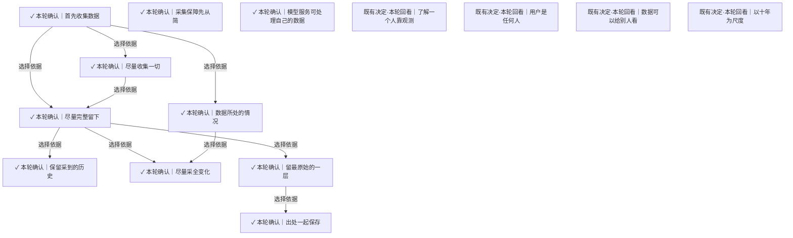

# 目标、立场与确认

用户已确认的起点，以及既有立场的适用范围。

[返回全景](../README.md) · [交互浏览](../index.html)

## 首先收集数据

**✓ 本轮确认** · 先收集关于人的数据，让数据存在并留下，未来的查询、理解和使用保持开放。

依据材料：用户原话：我想做的首先就是数据收集。。用户用已有会话、邮件与没有留下的应用使用情况说明当前首先要解决的缺口。

依据材料：[src/Docs/Orisumi.Docs/content/docs/requirements/belief.mdx#首先收集数据](../../../../../src/Docs/Orisumi.Docs/content/docs/requirements/belief.mdx#%E9%A6%96%E5%85%88%E6%94%B6%E9%9B%86%E6%95%B0%E6%8D%AE)。正式需求沿本轮用户直接确认的范围表达；具体 Agent 采用方案另记。

可能需要回看：139 个下游节点（含所有候选路线）

[Agent入口怎样提供](access.md#n-da5b4169050995d4)、[ClaudeCode目录范围](sources-local.md#n-e1a2a790d5d446a9)、[Codex其他数据库范围](sources-local.md#n-212a8d9d321fc8c3)、[Codex日志表示](sources-local.md#n-654ef3908ee1adec)、[Codex状态数据库范围](sources-local.md#n-bb8086babda89015)、[Codex附件与产物范围](sources-local.md#n-c8cf6296fafacb06)、[Git保存内容层次](sources-local.md#n-4b833bed1e02c780)、[Git当前工作与历史边界](sources-local.md#n-0654de3735dd2271)、[Magpie实际统计范围](sources-local.md#n-50f8d69c2eb8779a)、[Shell历史与执行事件](sources-local.md#n-118a4b0d856abce8)、[VRChat实时与历史](sources-live.md#n-2eb015571c56fd7e)、[不绑定某种存储](storage.md#n-9e024cb39c60031e)、[主动讲述怎样进入](access.md#n-4bf3066db8e45d47)、[事件时间与顺序](capture.md#n-0843f43438c1c4a1)、[交付路线怎样排序](delivery.md#n-e93627fc1fab2325)、[人端先做什么](access.md#n-9b3ff99aea342b48)、[从全景讨论怎样进入实现](delivery.md#n-473477a3b70f395c)、[位置定位到哪里](records.md#n-d75a21e927a755bb)、[位置用采集记录的名字](records.md#n-17f75f43a19b2bcb)、[使用能力边界怎样扩展](access.md#n-ee3ad59eb9be5324)、[保存地是否需要加密封装](availability.md#n-5d0b7394b458d05a)、[保留采到的历史](#n-509f2d3467e7b121)、[共享怎样授权](access.md#n-4b3c6032607d1b5c)、[内容取得与来源身份](records.md#n-15c7ee1513e29577)、[内容索引与事实边界](storage.md#n-52a4e60764c152e9)、[写入完整性与校验](storage.md#n-b5d79d537671775b)、[出处一起保存](#n-2ce85769c25073e7)、[分块策略与版本](storage.md#n-044919fef0bfc086)、[删除记录与回收](storage.md#n-0350116e746cba2c)、[前台应用与键鼠观测](sources-live.md#n-356bb4ec11f181f1)、[剪贴板观测范围](sources-live.md#n-618e04ed24bb7e60)、[助手会话来源范围](sources-local.md#n-48c68baae38d62c6)、[即时通信取得路径](sources-services.md#n-ba0ab57a2e6cc230)、[压缩与存放表示](storage.md#n-d00cf82ac296b520)、[原件分单元和块两层](records.md#n-c2507b9e78d79f34)、[原件存成块](storage.md#n-1e55971a7ab3ff58)、[原样保存与一致性](records.md#n-49d755be3c14fe60)、[取得方式按来源形态选择](capture.md#n-6d6180cd980550cc)、[取得时间怎样记录](records.md#n-746612aae6ea6fde)、[取得权限与资源条件](capture.md#n-55c7589ea4cd33f0)、[只提供上下文](access.md#n-bd00a565c69800cc)、[各处原样都存](records.md#n-8e446efeb629f847)、[同一份数据多种视图](access.md#n-309f702d88cb0e1d)、[同步交换与提交](availability.md#n-da173cb6e04759f8)、[后续读取怎样验收](delivery.md#n-9e39e29694bbe145)、[听歌记录取得范围](sources-services.md#n-c28b5bf691b86cb8)、[基本读出怎样重写](understanding.md#n-d34b5c062cf781c5)、[多副本删除与离线节点](availability.md#n-19ed3ea2239e62f9)、[多处都有一份](availability.md#n-ae9194edde188509)、[完整内容的边界](records.md#n-26854bffbe13f18e)、[容量增长怎样应对](storage.md#n-01be9fac862067ae)、[导出与恢复](storage.md#n-da66683208852205)、[尽量完整留下](#n-77e7f6f84727e69e)、[尽量收集一切](#n-c3c6e7607f2c9805)、[尽量采全变化](#n-cc33c5b227746d72)、[屏幕观测粒度](sources-live.md#n-e5a27649574fb74b)、[录音观测范围](sources-live.md#n-97b5d1da3ef7cad3)、[手机来源分项勘探](sources-live.md#n-fa86213d600d0954)、[投影库只放投影](understanding.md#n-0a185e82d7e59da2)、[投影库怎样选择](understanding.md#n-929aa0a735a703a6)、[接口与导出取得方式](capture.md#n-c68c6175d29abc5e)、[接口全量与增量](capture.md#n-76b9927e1c8393d5)、[收藏夹内容范围](sources-services.md#n-585bf03f3064852a)、[收集不靠自觉](capture.md#n-2c0e3b3ad774e034)、[数据库取得一致性](capture.md#n-cba810bb05a18834)、[数据所处的情况](#n-b450eb729c7db69e)、[数据比代码长寿](storage.md#n-de48cd5fab039fea)、[整文件与分块样本对照](storage.md#n-3d409be394226c3e)、[整理何时计算](understanding.md#n-922a57e91c6742aa)、[文件变化取得策略](capture.md#n-6de65500ebbea77b)、[文件读取一致性](capture.md#n-a6463ad095322f24)、[新旧理解怎样评测](delivery.md#n-cbfb97254da427c8)、[日历与待办取得范围](sources-services.md#n-07a8001bf589f81f)、[旧Heartbeat历史材料](sources-local.md#n-32da8b7037cad0ce)、[时间含义怎样保留](understanding.md#n-e0bf0a291b892dad)、[未验证能力怎样推进](delivery.md#n-b89d1395b983dd88)、[本地文件选择边界](sources-local.md#n-8448d9854b79d7b9)、[来源候选按处境展开](sources.md#n-755aaa26c94f3014)、[来源原生增量怎样保存](storage.md#n-95be81155ce3d6b5)、[来源实例与身份边界](sources.md#n-84d06d961ef222fd)、[来源接入顺序](sources.md#n-821855273f39bc59)、[来源标识怎样保留](records.md#n-35c210bea72e9af7)、[来源版本与观测条件](sources.md#n-a4f8682d76dcd71d)、[查询输出怎样组织](access.md#n-83096b85d1cbe387)、[模型读出存成不可变记录](understanding.md#n-ceb36910cb6e88ef)、[模型调用留下什么](understanding.md#n-97745ff5030f65f3)、[派生结果遇到删除或撤权](access.md#n-183194894919be77)、[浏览器事件传输](capture.md#n-b75cd5e6c6494099)、[浏览器历史回填怎样遍历](capture.md#n-aa199b18276f22a3)、[浏览器回填怎样并行](capture.md#n-c1ef0a692ec80384)、[浏览器媒体与网络观测](sources-live.md#n-e5f6dc441264494e)、[浏览器持久记录取得](sources-live.md#n-0a1e75558e92bd10)、[浏览器焦点与标签观测](sources-live.md#n-6a613b885484430f)、[浏览器观测层次](sources-live.md#n-bba0514698b64e45)、[浏览器超大原响应怎样交付](capture.md#n-8dbe7245f6450587)、[浏览器页面内容范围](sources-live.md#n-a7ffdec9fe8bb5c3)、[消费账单取得范围](sources-services.md#n-092e0cb48561c63b)、[理解版本怎样使用](understanding.md#n-be7944dd96e1f491)、[理解能追溯来源](understanding.md#n-299861624af1def3)、[留下观测重算理解](understanding.md#n-77f980be4039dd0a)、[留最原始的一层](#n-760744617270b5ce)、[瞬时事件接收方式](capture.md#n-359653aed5ab9c59)、[硬件传感数据取得](sources-live.md#n-403c19b83fbf57ee)、[离线与历史补取](capture.md#n-f116b26a22aa88eb)、[程序和模型怎样分工](understanding.md#n-9b5d1c252325594d)、[第一阶段怎样验收](delivery.md#n-ae87acd40d922614)、[系统状态观测](sources-live.md#n-4f3376baa1dbe8cf)、[索引怎样增长](understanding.md#n-f3ee89d07892466b)、[缺口怎样呈现](understanding.md#n-99d2d4d1188e8e92)、[网状拓扑和完整节点](availability.md#n-561838d4e083830d)、[网页AI对话取得路径](sources-services.md#n-0a2683066e8d303e)、[能补的也定期采](capture.md#n-a6470ed7ace260f0)、[自述笔记与语音备忘录](sources-services.md#n-cb83ef0ee8e5fb1a)、[观看历史取得范围](sources-services.md#n-8919d7670c9b28bc)、[记下采集器版本](records.md#n-b260468ee1981b5f)、[设备角色与离线工作](availability.md#n-e56d1b0735fb0084)、[读出引用到哪里](understanding.md#n-fe26af63a38ee976)、[读取哪些历史](understanding.md#n-84f3f41f467386f7)、[调度频率与触发](capture.md#n-4804bedf60d73204)、[资料中的指令怎样处理](access.md#n-61280889c3818aa0)、[跨材料的取得时刻](capture.md#n-cc2fd44e41899000)、[身份事后读出](understanding.md#n-5261a78fdee82c0f)、[身份对应怎样形成](understanding.md#n-3dd56ca36a38bda1)、[输入内容是否观测](sources-live.md#n-f3ba2a41f71f6997)、[运行保障怎样安排](delivery.md#n-19250ebbdde649cf)、[连接信任与访问边界](availability.md#n-ca03d6309f6b9fd6)、[连续媒体分段与编码](capture.md#n-84f109ff78f86572)、[连续录制怎样分段](capture.md#n-fd5e4f2373611f18)、[邮件取得范围](sources-services.md#n-9d1e8d5b919786ae)、[采集单次结果与保障边界](capture.md#n-5c39e84c8ee42507)、[采集启动与执行位置](capture.md#n-f47170f9f44e3fc5)、[采集幂等](storage.md#n-cbc00cff523393ab)、[采集记录与文件清单](records.md#n-1d8f2faf261d23a6)、[采集设备怎样缓冲](availability.md#n-358b28d323bdbb8b)、[重复位置怎样归并](records.md#n-9034dc9f63983316)、[重复材料怎样呈现](understanding.md#n-68f660987b59d242)、[长期恢复怎样验证](delivery.md#n-254f30d6e194be24)、[阅读视图怎样组织](access.md#n-45c1a653f0eb56ac)、[附件与依赖的收集边界](sources.md#n-128cbd6f1a6dfa45)

## 尽量收集一切

**✓ 本轮确认** · 关于一个人、能够取得或观测到的数据都进入候选范围；具体来源按补回机会、取得成本等条件安排。

依据：

- [首先收集数据](#n-2c3dfbca22881d81)（选择依据）：这一前提支持当前选择，具体取舍由用户明确选定。

依据材料：用户原话：对的。。用户确认上一轮提出的广泛候选范围；范围不等于立即接入所有来源。

依据材料：[src/Docs/Orisumi.Docs/content/docs/requirements/belief.mdx#尽量收集一切](../../../../../src/Docs/Orisumi.Docs/content/docs/requirements/belief.mdx#%E5%B0%BD%E9%87%8F%E6%94%B6%E9%9B%86%E4%B8%80%E5%88%87)。正式需求沿本轮用户直接确认的范围表达；具体 Agent 采用方案另记。

可能需要回看：129 个下游节点（含所有候选路线）

[ClaudeCode目录范围](sources-local.md#n-e1a2a790d5d446a9)、[Codex其他数据库范围](sources-local.md#n-212a8d9d321fc8c3)、[Codex日志表示](sources-local.md#n-654ef3908ee1adec)、[Codex状态数据库范围](sources-local.md#n-bb8086babda89015)、[Codex附件与产物范围](sources-local.md#n-c8cf6296fafacb06)、[Git保存内容层次](sources-local.md#n-4b833bed1e02c780)、[Git当前工作与历史边界](sources-local.md#n-0654de3735dd2271)、[Magpie实际统计范围](sources-local.md#n-50f8d69c2eb8779a)、[Shell历史与执行事件](sources-local.md#n-118a4b0d856abce8)、[VRChat实时与历史](sources-live.md#n-2eb015571c56fd7e)、[不绑定某种存储](storage.md#n-9e024cb39c60031e)、[事件时间与顺序](capture.md#n-0843f43438c1c4a1)、[位置定位到哪里](records.md#n-d75a21e927a755bb)、[位置用采集记录的名字](records.md#n-17f75f43a19b2bcb)、[保存地是否需要加密封装](availability.md#n-5d0b7394b458d05a)、[保留采到的历史](#n-509f2d3467e7b121)、[共享怎样授权](access.md#n-4b3c6032607d1b5c)、[内容取得与来源身份](records.md#n-15c7ee1513e29577)、[内容索引与事实边界](storage.md#n-52a4e60764c152e9)、[写入完整性与校验](storage.md#n-b5d79d537671775b)、[出处一起保存](#n-2ce85769c25073e7)、[分块策略与版本](storage.md#n-044919fef0bfc086)、[删除记录与回收](storage.md#n-0350116e746cba2c)、[前台应用与键鼠观测](sources-live.md#n-356bb4ec11f181f1)、[剪贴板观测范围](sources-live.md#n-618e04ed24bb7e60)、[助手会话来源范围](sources-local.md#n-48c68baae38d62c6)、[即时通信取得路径](sources-services.md#n-ba0ab57a2e6cc230)、[压缩与存放表示](storage.md#n-d00cf82ac296b520)、[原件分单元和块两层](records.md#n-c2507b9e78d79f34)、[原件存成块](storage.md#n-1e55971a7ab3ff58)、[原样保存与一致性](records.md#n-49d755be3c14fe60)、[取得方式按来源形态选择](capture.md#n-6d6180cd980550cc)、[取得时间怎样记录](records.md#n-746612aae6ea6fde)、[取得权限与资源条件](capture.md#n-55c7589ea4cd33f0)、[各处原样都存](records.md#n-8e446efeb629f847)、[同步交换与提交](availability.md#n-da173cb6e04759f8)、[后续读取怎样验收](delivery.md#n-9e39e29694bbe145)、[听歌记录取得范围](sources-services.md#n-c28b5bf691b86cb8)、[基本读出怎样重写](understanding.md#n-d34b5c062cf781c5)、[多副本删除与离线节点](availability.md#n-19ed3ea2239e62f9)、[多处都有一份](availability.md#n-ae9194edde188509)、[完整内容的边界](records.md#n-26854bffbe13f18e)、[容量增长怎样应对](storage.md#n-01be9fac862067ae)、[导出与恢复](storage.md#n-da66683208852205)、[尽量完整留下](#n-77e7f6f84727e69e)、[尽量采全变化](#n-cc33c5b227746d72)、[屏幕观测粒度](sources-live.md#n-e5a27649574fb74b)、[录音观测范围](sources-live.md#n-97b5d1da3ef7cad3)、[手机来源分项勘探](sources-live.md#n-fa86213d600d0954)、[投影库只放投影](understanding.md#n-0a185e82d7e59da2)、[投影库怎样选择](understanding.md#n-929aa0a735a703a6)、[接口与导出取得方式](capture.md#n-c68c6175d29abc5e)、[接口全量与增量](capture.md#n-76b9927e1c8393d5)、[收藏夹内容范围](sources-services.md#n-585bf03f3064852a)、[收集不靠自觉](capture.md#n-2c0e3b3ad774e034)、[数据库取得一致性](capture.md#n-cba810bb05a18834)、[数据比代码长寿](storage.md#n-de48cd5fab039fea)、[整文件与分块样本对照](storage.md#n-3d409be394226c3e)、[整理何时计算](understanding.md#n-922a57e91c6742aa)、[文件变化取得策略](capture.md#n-6de65500ebbea77b)、[文件读取一致性](capture.md#n-a6463ad095322f24)、[新旧理解怎样评测](delivery.md#n-cbfb97254da427c8)、[日历与待办取得范围](sources-services.md#n-07a8001bf589f81f)、[旧Heartbeat历史材料](sources-local.md#n-32da8b7037cad0ce)、[时间含义怎样保留](understanding.md#n-e0bf0a291b892dad)、[未验证能力怎样推进](delivery.md#n-b89d1395b983dd88)、[本地文件选择边界](sources-local.md#n-8448d9854b79d7b9)、[来源候选按处境展开](sources.md#n-755aaa26c94f3014)、[来源原生增量怎样保存](storage.md#n-95be81155ce3d6b5)、[来源实例与身份边界](sources.md#n-84d06d961ef222fd)、[来源接入顺序](sources.md#n-821855273f39bc59)、[来源标识怎样保留](records.md#n-35c210bea72e9af7)、[来源版本与观测条件](sources.md#n-a4f8682d76dcd71d)、[查询输出怎样组织](access.md#n-83096b85d1cbe387)、[模型读出存成不可变记录](understanding.md#n-ceb36910cb6e88ef)、[模型调用留下什么](understanding.md#n-97745ff5030f65f3)、[派生结果遇到删除或撤权](access.md#n-183194894919be77)、[浏览器事件传输](capture.md#n-b75cd5e6c6494099)、[浏览器历史回填怎样遍历](capture.md#n-aa199b18276f22a3)、[浏览器回填怎样并行](capture.md#n-c1ef0a692ec80384)、[浏览器媒体与网络观测](sources-live.md#n-e5f6dc441264494e)、[浏览器持久记录取得](sources-live.md#n-0a1e75558e92bd10)、[浏览器焦点与标签观测](sources-live.md#n-6a613b885484430f)、[浏览器观测层次](sources-live.md#n-bba0514698b64e45)、[浏览器超大原响应怎样交付](capture.md#n-8dbe7245f6450587)、[浏览器页面内容范围](sources-live.md#n-a7ffdec9fe8bb5c3)、[消费账单取得范围](sources-services.md#n-092e0cb48561c63b)、[理解版本怎样使用](understanding.md#n-be7944dd96e1f491)、[理解能追溯来源](understanding.md#n-299861624af1def3)、[留下观测重算理解](understanding.md#n-77f980be4039dd0a)、[留最原始的一层](#n-760744617270b5ce)、[瞬时事件接收方式](capture.md#n-359653aed5ab9c59)、[硬件传感数据取得](sources-live.md#n-403c19b83fbf57ee)、[离线与历史补取](capture.md#n-f116b26a22aa88eb)、[程序和模型怎样分工](understanding.md#n-9b5d1c252325594d)、[第一阶段怎样验收](delivery.md#n-ae87acd40d922614)、[系统状态观测](sources-live.md#n-4f3376baa1dbe8cf)、[索引怎样增长](understanding.md#n-f3ee89d07892466b)、[缺口怎样呈现](understanding.md#n-99d2d4d1188e8e92)、[网状拓扑和完整节点](availability.md#n-561838d4e083830d)、[网页AI对话取得路径](sources-services.md#n-0a2683066e8d303e)、[能补的也定期采](capture.md#n-a6470ed7ace260f0)、[自述笔记与语音备忘录](sources-services.md#n-cb83ef0ee8e5fb1a)、[观看历史取得范围](sources-services.md#n-8919d7670c9b28bc)、[记下采集器版本](records.md#n-b260468ee1981b5f)、[设备角色与离线工作](availability.md#n-e56d1b0735fb0084)、[读出引用到哪里](understanding.md#n-fe26af63a38ee976)、[读取哪些历史](understanding.md#n-84f3f41f467386f7)、[调度频率与触发](capture.md#n-4804bedf60d73204)、[资料中的指令怎样处理](access.md#n-61280889c3818aa0)、[跨材料的取得时刻](capture.md#n-cc2fd44e41899000)、[身份事后读出](understanding.md#n-5261a78fdee82c0f)、[身份对应怎样形成](understanding.md#n-3dd56ca36a38bda1)、[输入内容是否观测](sources-live.md#n-f3ba2a41f71f6997)、[运行保障怎样安排](delivery.md#n-19250ebbdde649cf)、[连接信任与访问边界](availability.md#n-ca03d6309f6b9fd6)、[连续媒体分段与编码](capture.md#n-84f109ff78f86572)、[连续录制怎样分段](capture.md#n-fd5e4f2373611f18)、[邮件取得范围](sources-services.md#n-9d1e8d5b919786ae)、[采集单次结果与保障边界](capture.md#n-5c39e84c8ee42507)、[采集启动与执行位置](capture.md#n-f47170f9f44e3fc5)、[采集幂等](storage.md#n-cbc00cff523393ab)、[采集记录与文件清单](records.md#n-1d8f2faf261d23a6)、[采集设备怎样缓冲](availability.md#n-358b28d323bdbb8b)、[重复位置怎样归并](records.md#n-9034dc9f63983316)、[重复材料怎样呈现](understanding.md#n-68f660987b59d242)、[长期恢复怎样验证](delivery.md#n-254f30d6e194be24)、[阅读视图怎样组织](access.md#n-45c1a653f0eb56ac)、[附件与依赖的收集边界](sources.md#n-128cbd6f1a6dfa45)

## 数据所处的情况

**✓ 本轮确认** · 未记录的活动需要当时观测；会消失的记录需要及时取得保存；已有记录从来源取得。同一来源可处于多种情况。

依据：

- [首先收集数据](#n-2c3dfbca22881d81)（选择依据）：这一前提支持当前选择，具体取舍由用户明确选定。

依据材料：用户原话：对。第一层关系就是这样。对应用户确认的第一层数据处境及取得动作。

依据材料：[src/Docs/Orisumi.Docs/content/docs/requirements/belief.mdx#数据所处的情况](../../../../../src/Docs/Orisumi.Docs/content/docs/requirements/belief.mdx#%E6%95%B0%E6%8D%AE%E6%89%80%E5%A4%84%E7%9A%84%E6%83%85%E5%86%B5)。正式需求沿本轮用户直接确认的范围表达；具体 Agent 采用方案另记。

可能需要回看：86 个下游节点（含所有候选路线）

[ClaudeCode目录范围](sources-local.md#n-e1a2a790d5d446a9)、[Codex其他数据库范围](sources-local.md#n-212a8d9d321fc8c3)、[Codex日志表示](sources-local.md#n-654ef3908ee1adec)、[Codex状态数据库范围](sources-local.md#n-bb8086babda89015)、[Codex附件与产物范围](sources-local.md#n-c8cf6296fafacb06)、[Git保存内容层次](sources-local.md#n-4b833bed1e02c780)、[Git当前工作与历史边界](sources-local.md#n-0654de3735dd2271)、[Magpie实际统计范围](sources-local.md#n-50f8d69c2eb8779a)、[Shell历史与执行事件](sources-local.md#n-118a4b0d856abce8)、[VRChat实时与历史](sources-live.md#n-2eb015571c56fd7e)、[事件时间与顺序](capture.md#n-0843f43438c1c4a1)、[位置定位到哪里](records.md#n-d75a21e927a755bb)、[共享怎样授权](access.md#n-4b3c6032607d1b5c)、[分块策略与版本](storage.md#n-044919fef0bfc086)、[删除记录与回收](storage.md#n-0350116e746cba2c)、[前台应用与键鼠观测](sources-live.md#n-356bb4ec11f181f1)、[剪贴板观测范围](sources-live.md#n-618e04ed24bb7e60)、[助手会话来源范围](sources-local.md#n-48c68baae38d62c6)、[即时通信取得路径](sources-services.md#n-ba0ab57a2e6cc230)、[压缩与存放表示](storage.md#n-d00cf82ac296b520)、[原件分单元和块两层](records.md#n-c2507b9e78d79f34)、[原件存成块](storage.md#n-1e55971a7ab3ff58)、[原样保存与一致性](records.md#n-49d755be3c14fe60)、[取得方式按来源形态选择](capture.md#n-6d6180cd980550cc)、[取得时间怎样记录](records.md#n-746612aae6ea6fde)、[取得权限与资源条件](capture.md#n-55c7589ea4cd33f0)、[各处原样都存](records.md#n-8e446efeb629f847)、[同步交换与提交](availability.md#n-da173cb6e04759f8)、[听歌记录取得范围](sources-services.md#n-c28b5bf691b86cb8)、[多副本删除与离线节点](availability.md#n-19ed3ea2239e62f9)、[完整内容的边界](records.md#n-26854bffbe13f18e)、[导出与恢复](storage.md#n-da66683208852205)、[尽量采全变化](#n-cc33c5b227746d72)、[屏幕观测粒度](sources-live.md#n-e5a27649574fb74b)、[录音观测范围](sources-live.md#n-97b5d1da3ef7cad3)、[手机来源分项勘探](sources-live.md#n-fa86213d600d0954)、[接口与导出取得方式](capture.md#n-c68c6175d29abc5e)、[接口全量与增量](capture.md#n-76b9927e1c8393d5)、[收藏夹内容范围](sources-services.md#n-585bf03f3064852a)、[数据库取得一致性](capture.md#n-cba810bb05a18834)、[文件变化取得策略](capture.md#n-6de65500ebbea77b)、[文件读取一致性](capture.md#n-a6463ad095322f24)、[新旧理解怎样评测](delivery.md#n-cbfb97254da427c8)、[日历与待办取得范围](sources-services.md#n-07a8001bf589f81f)、[旧Heartbeat历史材料](sources-local.md#n-32da8b7037cad0ce)、[时间含义怎样保留](understanding.md#n-e0bf0a291b892dad)、[本地文件选择边界](sources-local.md#n-8448d9854b79d7b9)、[来源候选按处境展开](sources.md#n-755aaa26c94f3014)、[来源原生增量怎样保存](storage.md#n-95be81155ce3d6b5)、[来源接入顺序](sources.md#n-821855273f39bc59)、[来源版本与观测条件](sources.md#n-a4f8682d76dcd71d)、[模型调用留下什么](understanding.md#n-97745ff5030f65f3)、[派生结果遇到删除或撤权](access.md#n-183194894919be77)、[浏览器事件传输](capture.md#n-b75cd5e6c6494099)、[浏览器历史回填怎样遍历](capture.md#n-aa199b18276f22a3)、[浏览器回填怎样并行](capture.md#n-c1ef0a692ec80384)、[浏览器媒体与网络观测](sources-live.md#n-e5f6dc441264494e)、[浏览器持久记录取得](sources-live.md#n-0a1e75558e92bd10)、[浏览器焦点与标签观测](sources-live.md#n-6a613b885484430f)、[浏览器观测层次](sources-live.md#n-bba0514698b64e45)、[浏览器超大原响应怎样交付](capture.md#n-8dbe7245f6450587)、[浏览器页面内容范围](sources-live.md#n-a7ffdec9fe8bb5c3)、[消费账单取得范围](sources-services.md#n-092e0cb48561c63b)、[理解版本怎样使用](understanding.md#n-be7944dd96e1f491)、[瞬时事件接收方式](capture.md#n-359653aed5ab9c59)、[硬件传感数据取得](sources-live.md#n-403c19b83fbf57ee)、[离线与历史补取](capture.md#n-f116b26a22aa88eb)、[系统状态观测](sources-live.md#n-4f3376baa1dbe8cf)、[网页AI对话取得路径](sources-services.md#n-0a2683066e8d303e)、[自述笔记与语音备忘录](sources-services.md#n-cb83ef0ee8e5fb1a)、[观看历史取得范围](sources-services.md#n-8919d7670c9b28bc)、[记下采集器版本](records.md#n-b260468ee1981b5f)、[设备角色与离线工作](availability.md#n-e56d1b0735fb0084)、[读出引用到哪里](understanding.md#n-fe26af63a38ee976)、[调度频率与触发](capture.md#n-4804bedf60d73204)、[跨材料的取得时刻](capture.md#n-cc2fd44e41899000)、[输入内容是否观测](sources-live.md#n-f3ba2a41f71f6997)、[连续媒体分段与编码](capture.md#n-84f109ff78f86572)、[连续录制怎样分段](capture.md#n-fd5e4f2373611f18)、[邮件取得范围](sources-services.md#n-9d1e8d5b919786ae)、[采集单次结果与保障边界](capture.md#n-5c39e84c8ee42507)、[采集启动与执行位置](capture.md#n-f47170f9f44e3fc5)、[采集幂等](storage.md#n-cbc00cff523393ab)、[采集设备怎样缓冲](availability.md#n-358b28d323bdbb8b)、[重复位置怎样归并](records.md#n-9034dc9f63983316)、[附件与依赖的收集边界](sources.md#n-128cbd6f1a6dfa45)

## 尽量完整留下

**✓ 本轮确认** · 在选定范围内先尽量完整留下信息，成本实际成为问题时再引入预算机制。

依据：

- [首先收集数据](#n-2c3dfbca22881d81)（选择依据）：这一前提支持当前选择，具体取舍由用户明确选定。
- [尽量收集一切](#n-c3c6e7607f2c9805)（选择依据）：这一前提支持当前选择，具体取舍由用户明确选定。

依据材料：用户原话：我倾向先尽量完整留下，成本真的成问题了再加预算机制。确认完整性与成本的默认取舍；没有预先授权复杂预算体系。

依据材料：[src/Docs/Orisumi.Docs/content/docs/requirements/belief.mdx#尽量完整留下](../../../../../src/Docs/Orisumi.Docs/content/docs/requirements/belief.mdx#%E5%B0%BD%E9%87%8F%E5%AE%8C%E6%95%B4%E7%95%99%E4%B8%8B)。正式需求沿本轮用户直接确认的范围表达；具体 Agent 采用方案另记。

可能需要回看：123 个下游节点（含所有候选路线）

[ClaudeCode目录范围](sources-local.md#n-e1a2a790d5d446a9)、[Codex其他数据库范围](sources-local.md#n-212a8d9d321fc8c3)、[Codex日志表示](sources-local.md#n-654ef3908ee1adec)、[Codex状态数据库范围](sources-local.md#n-bb8086babda89015)、[Codex附件与产物范围](sources-local.md#n-c8cf6296fafacb06)、[Git保存内容层次](sources-local.md#n-4b833bed1e02c780)、[Git当前工作与历史边界](sources-local.md#n-0654de3735dd2271)、[Magpie实际统计范围](sources-local.md#n-50f8d69c2eb8779a)、[Shell历史与执行事件](sources-local.md#n-118a4b0d856abce8)、[VRChat实时与历史](sources-live.md#n-2eb015571c56fd7e)、[不绑定某种存储](storage.md#n-9e024cb39c60031e)、[事件时间与顺序](capture.md#n-0843f43438c1c4a1)、[位置定位到哪里](records.md#n-d75a21e927a755bb)、[位置用采集记录的名字](records.md#n-17f75f43a19b2bcb)、[保存地是否需要加密封装](availability.md#n-5d0b7394b458d05a)、[保留采到的历史](#n-509f2d3467e7b121)、[共享怎样授权](access.md#n-4b3c6032607d1b5c)、[内容取得与来源身份](records.md#n-15c7ee1513e29577)、[内容索引与事实边界](storage.md#n-52a4e60764c152e9)、[写入完整性与校验](storage.md#n-b5d79d537671775b)、[出处一起保存](#n-2ce85769c25073e7)、[分块策略与版本](storage.md#n-044919fef0bfc086)、[删除记录与回收](storage.md#n-0350116e746cba2c)、[前台应用与键鼠观测](sources-live.md#n-356bb4ec11f181f1)、[剪贴板观测范围](sources-live.md#n-618e04ed24bb7e60)、[助手会话来源范围](sources-local.md#n-48c68baae38d62c6)、[即时通信取得路径](sources-services.md#n-ba0ab57a2e6cc230)、[压缩与存放表示](storage.md#n-d00cf82ac296b520)、[原件分单元和块两层](records.md#n-c2507b9e78d79f34)、[原件存成块](storage.md#n-1e55971a7ab3ff58)、[原样保存与一致性](records.md#n-49d755be3c14fe60)、[取得方式按来源形态选择](capture.md#n-6d6180cd980550cc)、[取得时间怎样记录](records.md#n-746612aae6ea6fde)、[取得权限与资源条件](capture.md#n-55c7589ea4cd33f0)、[各处原样都存](records.md#n-8e446efeb629f847)、[同步交换与提交](availability.md#n-da173cb6e04759f8)、[后续读取怎样验收](delivery.md#n-9e39e29694bbe145)、[听歌记录取得范围](sources-services.md#n-c28b5bf691b86cb8)、[基本读出怎样重写](understanding.md#n-d34b5c062cf781c5)、[多副本删除与离线节点](availability.md#n-19ed3ea2239e62f9)、[多处都有一份](availability.md#n-ae9194edde188509)、[完整内容的边界](records.md#n-26854bffbe13f18e)、[容量增长怎样应对](storage.md#n-01be9fac862067ae)、[导出与恢复](storage.md#n-da66683208852205)、[尽量采全变化](#n-cc33c5b227746d72)、[屏幕观测粒度](sources-live.md#n-e5a27649574fb74b)、[录音观测范围](sources-live.md#n-97b5d1da3ef7cad3)、[手机来源分项勘探](sources-live.md#n-fa86213d600d0954)、[投影库只放投影](understanding.md#n-0a185e82d7e59da2)、[投影库怎样选择](understanding.md#n-929aa0a735a703a6)、[接口与导出取得方式](capture.md#n-c68c6175d29abc5e)、[接口全量与增量](capture.md#n-76b9927e1c8393d5)、[收藏夹内容范围](sources-services.md#n-585bf03f3064852a)、[数据库取得一致性](capture.md#n-cba810bb05a18834)、[数据比代码长寿](storage.md#n-de48cd5fab039fea)、[整文件与分块样本对照](storage.md#n-3d409be394226c3e)、[整理何时计算](understanding.md#n-922a57e91c6742aa)、[文件变化取得策略](capture.md#n-6de65500ebbea77b)、[文件读取一致性](capture.md#n-a6463ad095322f24)、[新旧理解怎样评测](delivery.md#n-cbfb97254da427c8)、[日历与待办取得范围](sources-services.md#n-07a8001bf589f81f)、[旧Heartbeat历史材料](sources-local.md#n-32da8b7037cad0ce)、[时间含义怎样保留](understanding.md#n-e0bf0a291b892dad)、[本地文件选择边界](sources-local.md#n-8448d9854b79d7b9)、[来源原生增量怎样保存](storage.md#n-95be81155ce3d6b5)、[来源实例与身份边界](sources.md#n-84d06d961ef222fd)、[来源接入顺序](sources.md#n-821855273f39bc59)、[来源标识怎样保留](records.md#n-35c210bea72e9af7)、[来源版本与观测条件](sources.md#n-a4f8682d76dcd71d)、[查询输出怎样组织](access.md#n-83096b85d1cbe387)、[模型读出存成不可变记录](understanding.md#n-ceb36910cb6e88ef)、[模型调用留下什么](understanding.md#n-97745ff5030f65f3)、[派生结果遇到删除或撤权](access.md#n-183194894919be77)、[浏览器事件传输](capture.md#n-b75cd5e6c6494099)、[浏览器历史回填怎样遍历](capture.md#n-aa199b18276f22a3)、[浏览器回填怎样并行](capture.md#n-c1ef0a692ec80384)、[浏览器媒体与网络观测](sources-live.md#n-e5f6dc441264494e)、[浏览器持久记录取得](sources-live.md#n-0a1e75558e92bd10)、[浏览器焦点与标签观测](sources-live.md#n-6a613b885484430f)、[浏览器超大原响应怎样交付](capture.md#n-8dbe7245f6450587)、[浏览器页面内容范围](sources-live.md#n-a7ffdec9fe8bb5c3)、[消费账单取得范围](sources-services.md#n-092e0cb48561c63b)、[理解版本怎样使用](understanding.md#n-be7944dd96e1f491)、[理解能追溯来源](understanding.md#n-299861624af1def3)、[留下观测重算理解](understanding.md#n-77f980be4039dd0a)、[留最原始的一层](#n-760744617270b5ce)、[瞬时事件接收方式](capture.md#n-359653aed5ab9c59)、[硬件传感数据取得](sources-live.md#n-403c19b83fbf57ee)、[离线与历史补取](capture.md#n-f116b26a22aa88eb)、[程序和模型怎样分工](understanding.md#n-9b5d1c252325594d)、[第一阶段怎样验收](delivery.md#n-ae87acd40d922614)、[系统状态观测](sources-live.md#n-4f3376baa1dbe8cf)、[索引怎样增长](understanding.md#n-f3ee89d07892466b)、[缺口怎样呈现](understanding.md#n-99d2d4d1188e8e92)、[网状拓扑和完整节点](availability.md#n-561838d4e083830d)、[网页AI对话取得路径](sources-services.md#n-0a2683066e8d303e)、[自述笔记与语音备忘录](sources-services.md#n-cb83ef0ee8e5fb1a)、[观看历史取得范围](sources-services.md#n-8919d7670c9b28bc)、[记下采集器版本](records.md#n-b260468ee1981b5f)、[设备角色与离线工作](availability.md#n-e56d1b0735fb0084)、[读出引用到哪里](understanding.md#n-fe26af63a38ee976)、[读取哪些历史](understanding.md#n-84f3f41f467386f7)、[调度频率与触发](capture.md#n-4804bedf60d73204)、[资料中的指令怎样处理](access.md#n-61280889c3818aa0)、[跨材料的取得时刻](capture.md#n-cc2fd44e41899000)、[身份事后读出](understanding.md#n-5261a78fdee82c0f)、[身份对应怎样形成](understanding.md#n-3dd56ca36a38bda1)、[输入内容是否观测](sources-live.md#n-f3ba2a41f71f6997)、[运行保障怎样安排](delivery.md#n-19250ebbdde649cf)、[连接信任与访问边界](availability.md#n-ca03d6309f6b9fd6)、[连续媒体分段与编码](capture.md#n-84f109ff78f86572)、[连续录制怎样分段](capture.md#n-fd5e4f2373611f18)、[邮件取得范围](sources-services.md#n-9d1e8d5b919786ae)、[采集单次结果与保障边界](capture.md#n-5c39e84c8ee42507)、[采集启动与执行位置](capture.md#n-f47170f9f44e3fc5)、[采集幂等](storage.md#n-cbc00cff523393ab)、[采集记录与文件清单](records.md#n-1d8f2faf261d23a6)、[采集设备怎样缓冲](availability.md#n-358b28d323bdbb8b)、[重复位置怎样归并](records.md#n-9034dc9f63983316)、[重复材料怎样呈现](understanding.md#n-68f660987b59d242)、[长期恢复怎样验证](delivery.md#n-254f30d6e194be24)、[阅读视图怎样组织](access.md#n-45c1a653f0eb56ac)、[附件与依赖的收集边界](sources.md#n-128cbd6f1a6dfa45)

## 保留采到的历史

**✓ 本轮确认** · 已采到的历史版本继续保存，即使原应用随后修改或删除内容。

依据：

- [尽量完整留下](#n-77e7f6f84727e69e)（选择依据）：这一前提支持当前选择，具体取舍由用户明确选定。

依据材料：用户原话：对的。我希望。回应“默认把这些历史版本都留下，即使原应用后来修改或删除了它们”。

依据材料：[src/Docs/Orisumi.Docs/content/docs/requirements/belief.mdx#保留采到的历史](../../../../../src/Docs/Orisumi.Docs/content/docs/requirements/belief.mdx#%E4%BF%9D%E7%95%99%E9%87%87%E5%88%B0%E7%9A%84%E5%8E%86%E5%8F%B2)。正式需求沿本轮用户直接确认的范围表达；具体 Agent 采用方案另记。

可能需要回看：73 个下游节点（含所有候选路线）

[ClaudeCode目录范围](sources-local.md#n-e1a2a790d5d446a9)、[Codex其他数据库范围](sources-local.md#n-212a8d9d321fc8c3)、[Codex日志表示](sources-local.md#n-654ef3908ee1adec)、[Codex状态数据库范围](sources-local.md#n-bb8086babda89015)、[Codex附件与产物范围](sources-local.md#n-c8cf6296fafacb06)、[Git当前工作与历史边界](sources-local.md#n-0654de3735dd2271)、[事件时间与顺序](capture.md#n-0843f43438c1c4a1)、[位置定位到哪里](records.md#n-d75a21e927a755bb)、[位置用采集记录的名字](records.md#n-17f75f43a19b2bcb)、[保存地是否需要加密封装](availability.md#n-5d0b7394b458d05a)、[共享怎样授权](access.md#n-4b3c6032607d1b5c)、[内容取得与来源身份](records.md#n-15c7ee1513e29577)、[内容索引与事实边界](storage.md#n-52a4e60764c152e9)、[写入完整性与校验](storage.md#n-b5d79d537671775b)、[分块策略与版本](storage.md#n-044919fef0bfc086)、[删除记录与回收](storage.md#n-0350116e746cba2c)、[助手会话来源范围](sources-local.md#n-48c68baae38d62c6)、[压缩与存放表示](storage.md#n-d00cf82ac296b520)、[原件分单元和块两层](records.md#n-c2507b9e78d79f34)、[原件存成块](storage.md#n-1e55971a7ab3ff58)、[原样保存与一致性](records.md#n-49d755be3c14fe60)、[取得方式按来源形态选择](capture.md#n-6d6180cd980550cc)、[取得时间怎样记录](records.md#n-746612aae6ea6fde)、[取得权限与资源条件](capture.md#n-55c7589ea4cd33f0)、[各处原样都存](records.md#n-8e446efeb629f847)、[同步交换与提交](availability.md#n-da173cb6e04759f8)、[多副本删除与离线节点](availability.md#n-19ed3ea2239e62f9)、[多处都有一份](availability.md#n-ae9194edde188509)、[完整内容的边界](records.md#n-26854bffbe13f18e)、[容量增长怎样应对](storage.md#n-01be9fac862067ae)、[导出与恢复](storage.md#n-da66683208852205)、[屏幕观测粒度](sources-live.md#n-e5a27649574fb74b)、[接口与导出取得方式](capture.md#n-c68c6175d29abc5e)、[接口全量与增量](capture.md#n-76b9927e1c8393d5)、[数据库取得一致性](capture.md#n-cba810bb05a18834)、[整文件与分块样本对照](storage.md#n-3d409be394226c3e)、[文件变化取得策略](capture.md#n-6de65500ebbea77b)、[文件读取一致性](capture.md#n-a6463ad095322f24)、[新旧理解怎样评测](delivery.md#n-cbfb97254da427c8)、[时间含义怎样保留](understanding.md#n-e0bf0a291b892dad)、[本地文件选择边界](sources-local.md#n-8448d9854b79d7b9)、[来源原生增量怎样保存](storage.md#n-95be81155ce3d6b5)、[来源标识怎样保留](records.md#n-35c210bea72e9af7)、[模型调用留下什么](understanding.md#n-97745ff5030f65f3)、[派生结果遇到删除或撤权](access.md#n-183194894919be77)、[浏览器事件传输](capture.md#n-b75cd5e6c6494099)、[浏览器回填怎样并行](capture.md#n-c1ef0a692ec80384)、[浏览器超大原响应怎样交付](capture.md#n-8dbe7245f6450587)、[浏览器页面内容范围](sources-live.md#n-a7ffdec9fe8bb5c3)、[理解版本怎样使用](understanding.md#n-be7944dd96e1f491)、[瞬时事件接收方式](capture.md#n-359653aed5ab9c59)、[离线与历史补取](capture.md#n-f116b26a22aa88eb)、[第一阶段怎样验收](delivery.md#n-ae87acd40d922614)、[网状拓扑和完整节点](availability.md#n-561838d4e083830d)、[记下采集器版本](records.md#n-b260468ee1981b5f)、[设备角色与离线工作](availability.md#n-e56d1b0735fb0084)、[读出引用到哪里](understanding.md#n-fe26af63a38ee976)、[读取哪些历史](understanding.md#n-84f3f41f467386f7)、[调度频率与触发](capture.md#n-4804bedf60d73204)、[跨材料的取得时刻](capture.md#n-cc2fd44e41899000)、[身份对应怎样形成](understanding.md#n-3dd56ca36a38bda1)、[连接信任与访问边界](availability.md#n-ca03d6309f6b9fd6)、[连续媒体分段与编码](capture.md#n-84f109ff78f86572)、[连续录制怎样分段](capture.md#n-fd5e4f2373611f18)、[采集单次结果与保障边界](capture.md#n-5c39e84c8ee42507)、[采集启动与执行位置](capture.md#n-f47170f9f44e3fc5)、[采集幂等](storage.md#n-cbc00cff523393ab)、[采集记录与文件清单](records.md#n-1d8f2faf261d23a6)、[采集设备怎样缓冲](availability.md#n-358b28d323bdbb8b)、[重复位置怎样归并](records.md#n-9034dc9f63983316)、[重复材料怎样呈现](understanding.md#n-68f660987b59d242)、[长期恢复怎样验证](delivery.md#n-254f30d6e194be24)、[附件与依赖的收集边界](sources.md#n-128cbd6f1a6dfa45)

## 尽量采全变化

**✓ 本轮确认** · 对于有明确版本或变化事件的数据，尽量留下每次可取得的变化；取得粒度和方法按来源勘探。

依据：

- [尽量完整留下](#n-77e7f6f84727e69e)（选择依据）：这一前提支持当前选择，具体取舍由用户明确选定。
- [数据所处的情况](#n-b450eb729c7db69e)（选择依据）：这一前提支持当前选择，具体取舍由用户明确选定。

依据材料：用户原话：对的。。回应尽量采全可取得变化的目标；连续媒体的观测粒度仍需按来源确定。

依据材料：[src/Docs/Orisumi.Docs/content/docs/requirements/belief.mdx#尽量采全变化](../../../../../src/Docs/Orisumi.Docs/content/docs/requirements/belief.mdx#%E5%B0%BD%E9%87%8F%E9%87%87%E5%85%A8%E5%8F%98%E5%8C%96)。正式需求沿本轮用户直接确认的范围表达；具体 Agent 采用方案另记。

可能需要回看：54 个下游节点（含所有候选路线）

[Git当前工作与历史边界](sources-local.md#n-0654de3735dd2271)、[事件时间与顺序](capture.md#n-0843f43438c1c4a1)、[位置定位到哪里](records.md#n-d75a21e927a755bb)、[共享怎样授权](access.md#n-4b3c6032607d1b5c)、[分块策略与版本](storage.md#n-044919fef0bfc086)、[删除记录与回收](storage.md#n-0350116e746cba2c)、[前台应用与键鼠观测](sources-live.md#n-356bb4ec11f181f1)、[压缩与存放表示](storage.md#n-d00cf82ac296b520)、[原件分单元和块两层](records.md#n-c2507b9e78d79f34)、[原件存成块](storage.md#n-1e55971a7ab3ff58)、[原样保存与一致性](records.md#n-49d755be3c14fe60)、[取得方式按来源形态选择](capture.md#n-6d6180cd980550cc)、[取得时间怎样记录](records.md#n-746612aae6ea6fde)、[取得权限与资源条件](capture.md#n-55c7589ea4cd33f0)、[各处原样都存](records.md#n-8e446efeb629f847)、[同步交换与提交](availability.md#n-da173cb6e04759f8)、[多副本删除与离线节点](availability.md#n-19ed3ea2239e62f9)、[完整内容的边界](records.md#n-26854bffbe13f18e)、[导出与恢复](storage.md#n-da66683208852205)、[屏幕观测粒度](sources-live.md#n-e5a27649574fb74b)、[接口与导出取得方式](capture.md#n-c68c6175d29abc5e)、[接口全量与增量](capture.md#n-76b9927e1c8393d5)、[数据库取得一致性](capture.md#n-cba810bb05a18834)、[文件变化取得策略](capture.md#n-6de65500ebbea77b)、[文件读取一致性](capture.md#n-a6463ad095322f24)、[新旧理解怎样评测](delivery.md#n-cbfb97254da427c8)、[时间含义怎样保留](understanding.md#n-e0bf0a291b892dad)、[本地文件选择边界](sources-local.md#n-8448d9854b79d7b9)、[来源原生增量怎样保存](storage.md#n-95be81155ce3d6b5)、[来源接入顺序](sources.md#n-821855273f39bc59)、[来源版本与观测条件](sources.md#n-a4f8682d76dcd71d)、[模型调用留下什么](understanding.md#n-97745ff5030f65f3)、[派生结果遇到删除或撤权](access.md#n-183194894919be77)、[浏览器事件传输](capture.md#n-b75cd5e6c6494099)、[浏览器回填怎样并行](capture.md#n-c1ef0a692ec80384)、[浏览器超大原响应怎样交付](capture.md#n-8dbe7245f6450587)、[浏览器页面内容范围](sources-live.md#n-a7ffdec9fe8bb5c3)、[理解版本怎样使用](understanding.md#n-be7944dd96e1f491)、[瞬时事件接收方式](capture.md#n-359653aed5ab9c59)、[离线与历史补取](capture.md#n-f116b26a22aa88eb)、[记下采集器版本](records.md#n-b260468ee1981b5f)、[设备角色与离线工作](availability.md#n-e56d1b0735fb0084)、[读出引用到哪里](understanding.md#n-fe26af63a38ee976)、[调度频率与触发](capture.md#n-4804bedf60d73204)、[跨材料的取得时刻](capture.md#n-cc2fd44e41899000)、[输入内容是否观测](sources-live.md#n-f3ba2a41f71f6997)、[连续媒体分段与编码](capture.md#n-84f109ff78f86572)、[连续录制怎样分段](capture.md#n-fd5e4f2373611f18)、[采集单次结果与保障边界](capture.md#n-5c39e84c8ee42507)、[采集启动与执行位置](capture.md#n-f47170f9f44e3fc5)、[采集幂等](storage.md#n-cbc00cff523393ab)、[采集设备怎样缓冲](availability.md#n-358b28d323bdbb8b)、[重复位置怎样归并](records.md#n-9034dc9f63983316)、[附件与依赖的收集边界](sources.md#n-128cbd6f1a6dfa45)

## 留最原始的一层

**✓ 本轮确认** · 取得的数据按来源交来的形态原样保存，整理和理解在之后进行。

依据：

- [尽量完整留下](#n-77e7f6f84727e69e)（选择依据）：这一前提支持当前选择，具体取舍由用户明确选定。

依据材料：用户原话：原样存下来，整理和理解之后再做。。本轮明确选择了保留来源形态；具体来源的取得和记录编码仍是下游选择。

依据材料：[src/Docs/Orisumi.Docs/content/docs/requirements/belief.mdx#留最原始的一层](../../../../../src/Docs/Orisumi.Docs/content/docs/requirements/belief.mdx#%E7%95%99%E6%9C%80%E5%8E%9F%E5%A7%8B%E7%9A%84%E4%B8%80%E5%B1%82)。正式需求沿本轮用户直接确认的范围表达；具体 Agent 采用方案另记。

可能需要回看：93 个下游节点（含所有候选路线）

[ClaudeCode目录范围](sources-local.md#n-e1a2a790d5d446a9)、[Codex其他数据库范围](sources-local.md#n-212a8d9d321fc8c3)、[Codex日志表示](sources-local.md#n-654ef3908ee1adec)、[Codex状态数据库范围](sources-local.md#n-bb8086babda89015)、[Codex附件与产物范围](sources-local.md#n-c8cf6296fafacb06)、[不绑定某种存储](storage.md#n-9e024cb39c60031e)、[事件时间与顺序](capture.md#n-0843f43438c1c4a1)、[位置定位到哪里](records.md#n-d75a21e927a755bb)、[位置用采集记录的名字](records.md#n-17f75f43a19b2bcb)、[保存地是否需要加密封装](availability.md#n-5d0b7394b458d05a)、[共享怎样授权](access.md#n-4b3c6032607d1b5c)、[内容取得与来源身份](records.md#n-15c7ee1513e29577)、[内容索引与事实边界](storage.md#n-52a4e60764c152e9)、[写入完整性与校验](storage.md#n-b5d79d537671775b)、[出处一起保存](#n-2ce85769c25073e7)、[分块策略与版本](storage.md#n-044919fef0bfc086)、[删除记录与回收](storage.md#n-0350116e746cba2c)、[助手会话来源范围](sources-local.md#n-48c68baae38d62c6)、[压缩与存放表示](storage.md#n-d00cf82ac296b520)、[原件分单元和块两层](records.md#n-c2507b9e78d79f34)、[原件存成块](storage.md#n-1e55971a7ab3ff58)、[原样保存与一致性](records.md#n-49d755be3c14fe60)、[取得方式按来源形态选择](capture.md#n-6d6180cd980550cc)、[取得时间怎样记录](records.md#n-746612aae6ea6fde)、[取得权限与资源条件](capture.md#n-55c7589ea4cd33f0)、[各处原样都存](records.md#n-8e446efeb629f847)、[同步交换与提交](availability.md#n-da173cb6e04759f8)、[后续读取怎样验收](delivery.md#n-9e39e29694bbe145)、[基本读出怎样重写](understanding.md#n-d34b5c062cf781c5)、[多副本删除与离线节点](availability.md#n-19ed3ea2239e62f9)、[多处都有一份](availability.md#n-ae9194edde188509)、[完整内容的边界](records.md#n-26854bffbe13f18e)、[导出与恢复](storage.md#n-da66683208852205)、[屏幕观测粒度](sources-live.md#n-e5a27649574fb74b)、[投影库只放投影](understanding.md#n-0a185e82d7e59da2)、[投影库怎样选择](understanding.md#n-929aa0a735a703a6)、[接口与导出取得方式](capture.md#n-c68c6175d29abc5e)、[接口全量与增量](capture.md#n-76b9927e1c8393d5)、[数据库取得一致性](capture.md#n-cba810bb05a18834)、[数据比代码长寿](storage.md#n-de48cd5fab039fea)、[整文件与分块样本对照](storage.md#n-3d409be394226c3e)、[整理何时计算](understanding.md#n-922a57e91c6742aa)、[文件变化取得策略](capture.md#n-6de65500ebbea77b)、[文件读取一致性](capture.md#n-a6463ad095322f24)、[新旧理解怎样评测](delivery.md#n-cbfb97254da427c8)、[旧Heartbeat历史材料](sources-local.md#n-32da8b7037cad0ce)、[时间含义怎样保留](understanding.md#n-e0bf0a291b892dad)、[来源原生增量怎样保存](storage.md#n-95be81155ce3d6b5)、[来源实例与身份边界](sources.md#n-84d06d961ef222fd)、[来源标识怎样保留](records.md#n-35c210bea72e9af7)、[来源版本与观测条件](sources.md#n-a4f8682d76dcd71d)、[查询输出怎样组织](access.md#n-83096b85d1cbe387)、[模型读出存成不可变记录](understanding.md#n-ceb36910cb6e88ef)、[模型调用留下什么](understanding.md#n-97745ff5030f65f3)、[派生结果遇到删除或撤权](access.md#n-183194894919be77)、[浏览器事件传输](capture.md#n-b75cd5e6c6494099)、[浏览器历史回填怎样遍历](capture.md#n-aa199b18276f22a3)、[浏览器回填怎样并行](capture.md#n-c1ef0a692ec80384)、[浏览器超大原响应怎样交付](capture.md#n-8dbe7245f6450587)、[浏览器页面内容范围](sources-live.md#n-a7ffdec9fe8bb5c3)、[理解版本怎样使用](understanding.md#n-be7944dd96e1f491)、[理解能追溯来源](understanding.md#n-299861624af1def3)、[留下观测重算理解](understanding.md#n-77f980be4039dd0a)、[瞬时事件接收方式](capture.md#n-359653aed5ab9c59)、[离线与历史补取](capture.md#n-f116b26a22aa88eb)、[程序和模型怎样分工](understanding.md#n-9b5d1c252325594d)、[第一阶段怎样验收](delivery.md#n-ae87acd40d922614)、[索引怎样增长](understanding.md#n-f3ee89d07892466b)、[缺口怎样呈现](understanding.md#n-99d2d4d1188e8e92)、[网状拓扑和完整节点](availability.md#n-561838d4e083830d)、[记下采集器版本](records.md#n-b260468ee1981b5f)、[设备角色与离线工作](availability.md#n-e56d1b0735fb0084)、[读出引用到哪里](understanding.md#n-fe26af63a38ee976)、[读取哪些历史](understanding.md#n-84f3f41f467386f7)、[调度频率与触发](capture.md#n-4804bedf60d73204)、[资料中的指令怎样处理](access.md#n-61280889c3818aa0)、[跨材料的取得时刻](capture.md#n-cc2fd44e41899000)、[身份事后读出](understanding.md#n-5261a78fdee82c0f)、[身份对应怎样形成](understanding.md#n-3dd56ca36a38bda1)、[运行保障怎样安排](delivery.md#n-19250ebbdde649cf)、[连接信任与访问边界](availability.md#n-ca03d6309f6b9fd6)、[连续媒体分段与编码](capture.md#n-84f109ff78f86572)、[连续录制怎样分段](capture.md#n-fd5e4f2373611f18)、[采集单次结果与保障边界](capture.md#n-5c39e84c8ee42507)、[采集启动与执行位置](capture.md#n-f47170f9f44e3fc5)、[采集幂等](storage.md#n-cbc00cff523393ab)、[采集记录与文件清单](records.md#n-1d8f2faf261d23a6)、[采集设备怎样缓冲](availability.md#n-358b28d323bdbb8b)、[重复位置怎样归并](records.md#n-9034dc9f63983316)、[重复材料怎样呈现](understanding.md#n-68f660987b59d242)、[长期恢复怎样验证](delivery.md#n-254f30d6e194be24)、[阅读视图怎样组织](access.md#n-45c1a653f0eb56ac)、[附件与依赖的收集边界](sources.md#n-128cbd6f1a6dfa45)

## 出处一起保存

**✓ 本轮确认** · 原样内容与当次直接知道的出处一起保存，包括来源、设备或位置、取得时间。跨来源关联的解释留给后续。

依据：

- [留最原始的一层](#n-760744617270b5ce)（选择依据）：这一前提支持当前选择，具体取舍由用户明确选定。

依据材料：用户原话：对的，这些出处也一起保存。。回应来源、设备或位置、取得时间等出处随材料保存。

依据材料：[src/Docs/Orisumi.Docs/content/docs/requirements/belief.mdx#出处一起保存](../../../../../src/Docs/Orisumi.Docs/content/docs/requirements/belief.mdx#%E5%87%BA%E5%A4%84%E4%B8%80%E8%B5%B7%E4%BF%9D%E5%AD%98)。正式需求沿本轮用户直接确认的范围表达；具体 Agent 采用方案另记。

可能需要回看：62 个下游节点（含所有候选路线）

[事件时间与顺序](capture.md#n-0843f43438c1c4a1)、[位置定位到哪里](records.md#n-d75a21e927a755bb)、[位置用采集记录的名字](records.md#n-17f75f43a19b2bcb)、[共享怎样授权](access.md#n-4b3c6032607d1b5c)、[内容取得与来源身份](records.md#n-15c7ee1513e29577)、[内容索引与事实边界](storage.md#n-52a4e60764c152e9)、[写入完整性与校验](storage.md#n-b5d79d537671775b)、[分块策略与版本](storage.md#n-044919fef0bfc086)、[删除记录与回收](storage.md#n-0350116e746cba2c)、[压缩与存放表示](storage.md#n-d00cf82ac296b520)、[原件存成块](storage.md#n-1e55971a7ab3ff58)、[原样保存与一致性](records.md#n-49d755be3c14fe60)、[取得时间怎样记录](records.md#n-746612aae6ea6fde)、[取得权限与资源条件](capture.md#n-55c7589ea4cd33f0)、[各处原样都存](records.md#n-8e446efeb629f847)、[同步交换与提交](availability.md#n-da173cb6e04759f8)、[多副本删除与离线节点](availability.md#n-19ed3ea2239e62f9)、[导出与恢复](storage.md#n-da66683208852205)、[屏幕观测粒度](sources-live.md#n-e5a27649574fb74b)、[接口与导出取得方式](capture.md#n-c68c6175d29abc5e)、[接口全量与增量](capture.md#n-76b9927e1c8393d5)、[数据库取得一致性](capture.md#n-cba810bb05a18834)、[文件变化取得策略](capture.md#n-6de65500ebbea77b)、[文件读取一致性](capture.md#n-a6463ad095322f24)、[新旧理解怎样评测](delivery.md#n-cbfb97254da427c8)、[旧Heartbeat历史材料](sources-local.md#n-32da8b7037cad0ce)、[时间含义怎样保留](understanding.md#n-e0bf0a291b892dad)、[来源原生增量怎样保存](storage.md#n-95be81155ce3d6b5)、[来源实例与身份边界](sources.md#n-84d06d961ef222fd)、[来源标识怎样保留](records.md#n-35c210bea72e9af7)、[来源版本与观测条件](sources.md#n-a4f8682d76dcd71d)、[模型调用留下什么](understanding.md#n-97745ff5030f65f3)、[派生结果遇到删除或撤权](access.md#n-183194894919be77)、[浏览器事件传输](capture.md#n-b75cd5e6c6494099)、[浏览器历史回填怎样遍历](capture.md#n-aa199b18276f22a3)、[浏览器回填怎样并行](capture.md#n-c1ef0a692ec80384)、[浏览器超大原响应怎样交付](capture.md#n-8dbe7245f6450587)、[浏览器页面内容范围](sources-live.md#n-a7ffdec9fe8bb5c3)、[理解版本怎样使用](understanding.md#n-be7944dd96e1f491)、[瞬时事件接收方式](capture.md#n-359653aed5ab9c59)、[离线与历史补取](capture.md#n-f116b26a22aa88eb)、[第一阶段怎样验收](delivery.md#n-ae87acd40d922614)、[缺口怎样呈现](understanding.md#n-99d2d4d1188e8e92)、[记下采集器版本](records.md#n-b260468ee1981b5f)、[设备角色与离线工作](availability.md#n-e56d1b0735fb0084)、[读出引用到哪里](understanding.md#n-fe26af63a38ee976)、[读取哪些历史](understanding.md#n-84f3f41f467386f7)、[调度频率与触发](capture.md#n-4804bedf60d73204)、[跨材料的取得时刻](capture.md#n-cc2fd44e41899000)、[身份对应怎样形成](understanding.md#n-3dd56ca36a38bda1)、[运行保障怎样安排](delivery.md#n-19250ebbdde649cf)、[连续媒体分段与编码](capture.md#n-84f109ff78f86572)、[连续录制怎样分段](capture.md#n-fd5e4f2373611f18)、[采集单次结果与保障边界](capture.md#n-5c39e84c8ee42507)、[采集启动与执行位置](capture.md#n-f47170f9f44e3fc5)、[采集幂等](storage.md#n-cbc00cff523393ab)、[采集记录与文件清单](records.md#n-1d8f2faf261d23a6)、[采集设备怎样缓冲](availability.md#n-358b28d323bdbb8b)、[重复位置怎样归并](records.md#n-9034dc9f63983316)、[重复材料怎样呈现](understanding.md#n-68f660987b59d242)、[长期恢复怎样验证](delivery.md#n-254f30d6e194be24)、[附件与依赖的收集边界](sources.md#n-128cbd6f1a6dfa45)

## 采集保障先从简

**✓ 本轮确认** · 运行保障当前可以暂缓，或需要时做简单外部探活。内置缺口监测、恢复编排与告警体系暂缓建设。

依据材料：用户原话：我局的这个可以先不做或者做简单的。比如简单的外部探活。先不弄到系统里面。做这个成本太高了。用户因建设成本收缩当前范围；已有采集结果记录与有限重试单独审视。

依据材料：[src/Docs/Orisumi.Docs/content/docs/requirements/belief.mdx#采集保障先从简](../../../../../src/Docs/Orisumi.Docs/content/docs/requirements/belief.mdx#%E9%87%87%E9%9B%86%E4%BF%9D%E9%9A%9C%E5%85%88%E4%BB%8E%E7%AE%80)。正式需求沿本轮用户直接确认的范围表达；具体 Agent 采用方案另记。

可能需要回看：30 个下游节点（含所有候选路线）

[事件时间与顺序](capture.md#n-0843f43438c1c4a1)、[交付路线怎样排序](delivery.md#n-e93627fc1fab2325)、[从全景讨论怎样进入实现](delivery.md#n-473477a3b70f395c)、[保存地是否需要加密封装](availability.md#n-5d0b7394b458d05a)、[写入完整性与校验](storage.md#n-b5d79d537671775b)、[取得权限与资源条件](capture.md#n-55c7589ea4cd33f0)、[同步交换与提交](availability.md#n-da173cb6e04759f8)、[后续读取怎样验收](delivery.md#n-9e39e29694bbe145)、[多副本删除与离线节点](availability.md#n-19ed3ea2239e62f9)、[文件变化取得策略](capture.md#n-6de65500ebbea77b)、[文件读取一致性](capture.md#n-a6463ad095322f24)、[新旧理解怎样评测](delivery.md#n-cbfb97254da427c8)、[未验证能力怎样推进](delivery.md#n-b89d1395b983dd88)、[浏览器事件传输](capture.md#n-b75cd5e6c6494099)、[浏览器回填怎样并行](capture.md#n-c1ef0a692ec80384)、[浏览器超大原响应怎样交付](capture.md#n-8dbe7245f6450587)、[瞬时事件接收方式](capture.md#n-359653aed5ab9c59)、[离线与历史补取](capture.md#n-f116b26a22aa88eb)、[第一阶段怎样验收](delivery.md#n-ae87acd40d922614)、[缺口怎样呈现](understanding.md#n-99d2d4d1188e8e92)、[网状拓扑和完整节点](availability.md#n-561838d4e083830d)、[设备角色与离线工作](availability.md#n-e56d1b0735fb0084)、[调度频率与触发](capture.md#n-4804bedf60d73204)、[运行保障怎样安排](delivery.md#n-19250ebbdde649cf)、[连接信任与访问边界](availability.md#n-ca03d6309f6b9fd6)、[采集单次结果与保障边界](capture.md#n-5c39e84c8ee42507)、[采集启动与执行位置](capture.md#n-f47170f9f44e3fc5)、[采集失败要通知](capture.md#n-3077b006413df0eb)、[采集设备怎样缓冲](availability.md#n-358b28d323bdbb8b)、[长期恢复怎样验证](delivery.md#n-254f30d6e194be24)

## 模型服务可处理自己的数据

**✓ 本轮确认** · 用户自己的数据可以交给外部模型服务处理；给其他人看另有权限边界。

依据材料：用户原话：数据交给模型服务不设防：数据属于用户自己，可以交给云端模型处理，讨论模型处理时不以隐私风险作为取舍的理由。。当前用户提供的 AGENTS.md 约定；与对其他人的共享权限分别处理。

依据材料：[src/Docs/Orisumi.Docs/content/docs/requirements/belief.mdx#模型服务可处理自己的数据](../../../../../src/Docs/Orisumi.Docs/content/docs/requirements/belief.mdx#%E6%A8%A1%E5%9E%8B%E6%9C%8D%E5%8A%A1%E5%8F%AF%E5%A4%84%E7%90%86%E8%87%AA%E5%B7%B1%E7%9A%84%E6%95%B0%E6%8D%AE)。正式需求沿本轮用户直接确认的范围表达；具体 Agent 采用方案另记。

可能需要回看：14 个下游节点（含所有候选路线）

[保存地是否需要加密封装](availability.md#n-5d0b7394b458d05a)、[共享怎样授权](access.md#n-4b3c6032607d1b5c)、[基本读出怎样重写](understanding.md#n-d34b5c062cf781c5)、[多人怎样使用](access.md#n-533f290602f41d06)、[新旧理解怎样评测](delivery.md#n-cbfb97254da427c8)、[时间含义怎样保留](understanding.md#n-e0bf0a291b892dad)、[模型调用留下什么](understanding.md#n-97745ff5030f65f3)、[派生结果遇到删除或撤权](access.md#n-183194894919be77)、[理解版本怎样使用](understanding.md#n-be7944dd96e1f491)、[程序和模型怎样分工](understanding.md#n-9b5d1c252325594d)、[给别人看要隔离](access.md#n-25d958239f2a38ec)、[缺口怎样呈现](understanding.md#n-99d2d4d1188e8e92)、[身份对应怎样形成](understanding.md#n-3dd56ca36a38bda1)、[连接信任与访问边界](availability.md#n-ca03d6309f6b9fd6)

## 了解一个人靠观测

**既有决定·本轮回看** · 关于人的观测能为未来理解提供材料。它支持收集的价值，产品提供哪些后续能力仍是选择。

依据材料：[src/Docs/Orisumi.Docs/content/docs/requirements/belief.mdx#了解一个人靠观测](../../../../../src/Docs/Orisumi.Docs/content/docs/requirements/belief.mdx#%E4%BA%86%E8%A7%A3%E4%B8%80%E4%B8%AA%E4%BA%BA%E9%9D%A0%E8%A7%82%E6%B5%8B)。既有需求中的立场；本轮重新审视其下游。

可能需要回看：19 个下游节点（含所有候选路线）

[Agent入口怎样提供](access.md#n-da5b4169050995d4)、[主动讲述怎样进入](access.md#n-4bf3066db8e45d47)、[交付路线怎样排序](delivery.md#n-e93627fc1fab2325)、[人端先做什么](access.md#n-9b3ff99aea342b48)、[从全景讨论怎样进入实现](delivery.md#n-473477a3b70f395c)、[使用能力边界怎样扩展](access.md#n-ee3ad59eb9be5324)、[共享怎样授权](access.md#n-4b3c6032607d1b5c)、[只提供上下文](access.md#n-bd00a565c69800cc)、[同一份数据多种视图](access.md#n-309f702d88cb0e1d)、[后续读取怎样验收](delivery.md#n-9e39e29694bbe145)、[新旧理解怎样评测](delivery.md#n-cbfb97254da427c8)、[未验证能力怎样推进](delivery.md#n-b89d1395b983dd88)、[查询输出怎样组织](access.md#n-83096b85d1cbe387)、[模型调用留下什么](understanding.md#n-97745ff5030f65f3)、[理解版本怎样使用](understanding.md#n-be7944dd96e1f491)、[第一阶段怎样验收](delivery.md#n-ae87acd40d922614)、[资料中的指令怎样处理](access.md#n-61280889c3818aa0)、[长期恢复怎样验证](delivery.md#n-254f30d6e194be24)、[阅读视图怎样组织](access.md#n-45c1a653f0eb56ac)

## 用户是任何人

**既有决定·本轮回看** · 既有使用者范围包括用户本人和其他人；当前先做个人实例或直接建设多用户产品需要另选。

依据材料：[src/Docs/Orisumi.Docs/content/docs/requirements/belief.mdx#用户是任何人](../../../../../src/Docs/Orisumi.Docs/content/docs/requirements/belief.mdx#%E7%94%A8%E6%88%B7%E6%98%AF%E4%BB%BB%E4%BD%95%E4%BA%BA)。既有需求中的立场；本轮重新审视其下游。

可能需要回看：1 个下游节点（含所有候选路线）

[多人怎样使用](access.md#n-533f290602f41d06)

## 数据可以给别人看

**既有决定·本轮回看** · 既有需求容许给其他人看部分数据；共享能力何时建设与可见边界另行确定。

依据材料：[src/Docs/Orisumi.Docs/content/docs/requirements/belief.mdx#数据可以给别人看](../../../../../src/Docs/Orisumi.Docs/content/docs/requirements/belief.mdx#%E6%95%B0%E6%8D%AE%E5%8F%AF%E4%BB%A5%E7%BB%99%E5%88%AB%E4%BA%BA%E7%9C%8B)。既有需求中的立场；本轮重新审视其下游。

可能需要回看：6 个下游节点（含所有候选路线）

[保存地是否需要加密封装](availability.md#n-5d0b7394b458d05a)、[共享怎样授权](access.md#n-4b3c6032607d1b5c)、[多人怎样使用](access.md#n-533f290602f41d06)、[派生结果遇到删除或撤权](access.md#n-183194894919be77)、[给别人看要隔离](access.md#n-25d958239f2a38ec)、[连接信任与访问边界](availability.md#n-ca03d6309f6b9fd6)

## 以十年为尺度

**既有决定·本轮回看** · 既有目标按10到20年考虑，关注数据寿命与实现可替换；具体存储和多节点方案需要独立比较。

依据材料：[src/Docs/Orisumi.Docs/content/docs/requirements/belief.mdx#以十年为尺度](../../../../../src/Docs/Orisumi.Docs/content/docs/requirements/belief.mdx#%E4%BB%A5%E5%8D%81%E5%B9%B4%E4%B8%BA%E5%B0%BA%E5%BA%A6)。既有需求中的立场；本轮重新审视其下游。

可能需要回看：26 个下游节点（含所有候选路线）

[不绑定某种存储](storage.md#n-9e024cb39c60031e)、[位置定位到哪里](records.md#n-d75a21e927a755bb)、[保存地是否需要加密封装](availability.md#n-5d0b7394b458d05a)、[共享怎样授权](access.md#n-4b3c6032607d1b5c)、[内容索引与事实边界](storage.md#n-52a4e60764c152e9)、[分块策略与版本](storage.md#n-044919fef0bfc086)、[删除记录与回收](storage.md#n-0350116e746cba2c)、[压缩与存放表示](storage.md#n-d00cf82ac296b520)、[原件分单元和块两层](records.md#n-c2507b9e78d79f34)、[原件存成块](storage.md#n-1e55971a7ab3ff58)、[同步交换与提交](availability.md#n-da173cb6e04759f8)、[多副本删除与离线节点](availability.md#n-19ed3ea2239e62f9)、[多处都有一份](availability.md#n-ae9194edde188509)、[导出与恢复](storage.md#n-da66683208852205)、[数据比代码长寿](storage.md#n-de48cd5fab039fea)、[新旧理解怎样评测](delivery.md#n-cbfb97254da427c8)、[来源原生增量怎样保存](storage.md#n-95be81155ce3d6b5)、[模型调用留下什么](understanding.md#n-97745ff5030f65f3)、[派生结果遇到删除或撤权](access.md#n-183194894919be77)、[理解版本怎样使用](understanding.md#n-be7944dd96e1f491)、[网状拓扑和完整节点](availability.md#n-561838d4e083830d)、[设备角色与离线工作](availability.md#n-e56d1b0735fb0084)、[读出引用到哪里](understanding.md#n-fe26af63a38ee976)、[连接信任与访问边界](availability.md#n-ca03d6309f6b9fd6)、[采集设备怎样缓冲](availability.md#n-358b28d323bdbb8b)、[长期恢复怎样验证](delivery.md#n-254f30d6e194be24)

