# 实时观测、媒体与设备

前台键鼠、浏览器、屏幕声音、系统剪贴板、VRChat、手机和硬件的观测深度。

[返回全景](../README.md) · [交互浏览](../index.html)

```mermaid
flowchart TD
  n_356bb4ec11f181f1["助手推论｜前台应用与键鼠观测"]
  n_bba0514698b64e45["助手推论｜浏览器观测层次"]
  n_6a613b885484430f["助手推论｜浏览器焦点与标签观测"]
  n_0a1e75558e92bd10["助手推论｜浏览器持久记录取得"]
  n_a7ffdec9fe8bb5c3["助手推论｜浏览器页面内容范围"]
  n_e5f6dc441264494e["助手推论｜浏览器媒体与网络观测"]
  n_e5a27649574fb74b["助手推论｜屏幕观测粒度"]
  n_97b5d1da3ef7cad3["助手推论｜录音观测范围"]
  n_4f3376baa1dbe8cf["助手推论｜系统状态观测"]
  n_618e04ed24bb7e60["助手推论｜剪贴板观测范围"]
  n_2eb015571c56fd7e["助手推论｜VRChat实时与历史"]
  n_fa86213d600d0954["助手推论｜手机来源分项勘探"]
  n_403c19b83fbf57ee["助手推论｜硬件传感数据取得"]
  n_f3ba2a41f71f6997["助手推论｜输入内容是否观测"]
  n_356bb4ec11f181f1 -->|候选后续| n_f3ba2a41f71f6997
  n_bba0514698b64e45 -->|候选后续| n_6a613b885484430f
  n_bba0514698b64e45 -->|候选后续| n_0a1e75558e92bd10
  n_bba0514698b64e45 -->|候选后续| n_a7ffdec9fe8bb5c3
  n_bba0514698b64e45 -->|候选后续| n_e5f6dc441264494e
  click n_356bb4ec11f181f1 href "#n-356bb4ec11f181f1"
  click n_bba0514698b64e45 href "#n-bba0514698b64e45"
  click n_6a613b885484430f href "#n-6a613b885484430f"
  click n_0a1e75558e92bd10 href "#n-0a1e75558e92bd10"
  click n_a7ffdec9fe8bb5c3 href "#n-a7ffdec9fe8bb5c3"
  click n_e5f6dc441264494e href "#n-e5f6dc441264494e"
  click n_e5a27649574fb74b href "#n-e5a27649574fb74b"
  click n_97b5d1da3ef7cad3 href "#n-97b5d1da3ef7cad3"
  click n_4f3376baa1dbe8cf href "#n-4f3376baa1dbe8cf"
  click n_618e04ed24bb7e60 href "#n-618e04ed24bb7e60"
  click n_2eb015571c56fd7e href "#n-2eb015571c56fd7e"
  click n_fa86213d600d0954 href "#n-fa86213d600d0954"
  click n_403c19b83fbf57ee href "#n-403c19b83fbf57ee"
  click n_f3ba2a41f71f6997 href "#n-f3ba2a41f71f6997"
```

## 前台应用与键鼠观测

**助手推论** · 当前 macOS 的 AppKit 通知可留下应用级激活与失活。受控三应用切换已有实际证据；同应用切窗、标题、键鼠位置、输入文字与窗口内容各是独立的观测范围。

**Agent采用 · 当前**

候选：第一条导洞只观察前台应用。

理由与代价：在已有授权下，Agent 采用当前 macOS 应用级观测。三应用正常与快速切换、逐条保存和独立恢复已经端到端核对，能留下这一路径直接交付的瞬时事实；接受手动未运行时段、未取得事件和未落地尾部仍有缺口，活动含义留给读出。

启动或重审条件：改变平台、启动方式、应用级范围或需要全天覆盖时，以对应真实操作重新验收；锁屏/睡眠组合和全新权限身份按实际需要单独验证。

依据：

- [数据所处的情况](roots.md#n-b450eb729c7db69e)（选择依据）：补回机会取决于材料是否已记录及何时消失，此处按真实处境选择取得方式。
- [尽量采全变化](roots.md#n-cc33c5b227746d72)（选择依据）：尽量取每次可取得变化，此处需验证来源暴露的变化粒度和取得窗口。

依据材料：[.scratch/requirements/survey-heartbeat.md](../../../../requirements/survey-heartbeat.md)。真实短时段、多设备重合、键鼠仅位置与长期空档。

依据材料：[src/Docs/Orisumi.Docs/content/docs/model/validation.mdx#前台观测](../../../../../src/Docs/Orisumi.Docs/content/docs/model/validation.mdx#%E5%89%8D%E5%8F%B0%E8%A7%82%E6%B5%8B)。当前 macOS 图形用户会话手动观察：7 次约 1 秒切换与 15 次约 0.2 秒切换全部取得；22 条激活、22 条失活分别与测试应用自身回调的身份及顺序一致。49 条原件全部恢复并核对哈希、长度、LF 和出处；同应用 4 次切窗、1 次改标题期间无新增应用级通知。

依据材料：[src/Docs/Orisumi.Docs/content/docs/model/validation.mdx#网络限制与重启](../../../../../src/Docs/Orisumi.Docs/content/docs/model/validation.mdx#%E7%BD%91%E7%BB%9C%E9%99%90%E5%88%B6%E4%B8%8E%E9%87%8D%E5%90%AF)。拒绝采集进程全部 IPv4/IPv6 通信并保留本机 IPC，两轮保存并恢复 40/40 份原件，实际 17 次激活和 17 次失活对应；两轮身份独立，停机空档不产生原件。

依据材料：[src/Docs/Orisumi.Docs/content/docs/model/validation.mdx#持续采集](../../../../../src/Docs/Orisumi.Docs/content/docs/model/validation.mdx#%E6%8C%81%E7%BB%AD%E9%87%87%E9%9B%86)。发布自包含本机程序，由三个用户级 LaunchAgent 分别运行前台、Codex 与 Claude Code，显式共用同一原件目录；实际装载、停止、再装载与恢复分别验收，真实重新登录和全天运行另测。

### 第一条导洞只观察前台应用 · 助手推荐

在当前 macOS 图形用户会话中接收 AppKit 应用级通知与初始查询，逐条保存公开属性；由手动命令或用户级系统任务启动，窗口内容与键鼠另开范围。

收益：以小范围开始积累事后无法补回的前台活动，原事件以后再解释成时段。

代价：只能说明观察到的前台切换，不能推出用户注意力或键鼠活动。

适用条件：当前 macOS 应用级观察；按实际受控切换、受限 IP 网络与系统任务运行结果限定覆盖。

继续展开：[瞬时事件接收方式](capture.md#n-359653aed5ab9c59)、[来源版本与观测条件](sources.md#n-a4f8682d76dcd71d)

分支终点：通过 orisumi 手动观察三个专用应用：7 次约 1 秒切换、15 次约 0.2 秒切换，再在同应用内切窗与改标题；将通知与应用自身回调分别对账，并逐份恢复原件。

检验：本轮 22 次激活及 22 次失活按身份、各类别顺序和单应用顺序匹配；49 条原件哈希、长度、LF 与出处核对通过。同应用 4 次切窗、1 次改标题期间为 0 条应用通知。新平台、系统状态组合与全天覆盖需另有对应证据。

### 应用和窗口事件加键鼠位置 · 可选路线

按平台原样记录可取得的焦点/标题变化、设备与键鼠位置事件；活动时段在后续计算。

收益：保留更细的事件及解释空间。

代价：平台 API、权限与键位定义尚需新导洞。

适用条件：明确把基础键鼠动作一起纳入范围后，与前台事件分别核验。

继续展开：[瞬时事件接收方式](capture.md#n-359653aed5ab9c59)、[来源版本与观测条件](sources.md#n-a4f8682d76dcd71d)、[输入内容是否观测](#n-f3ba2a41f71f6997)

分支终点：在一台设备上运行专用观测样本，脚本化切换两个窗口、改标题、锁屏并按键，原样写事件。

检验：对照人工时间表找出遗漏和额外事件；键位不被解释为输入文字，前台不等于正在投入。

### 前台定期状态加独立键鼠事件 · 可选路线

前台应用与窗口按间隔读取当前状态；键鼠仍从实际可用事件接口记录动作元信息，采集时不合并成时段。

收益：实现和平台适配可能更小。

代价：两次读取之间的短切换可能漏掉。

适用条件：事件 API 不可用或先做可控探测。

继续展开：[输入内容是否观测](#n-f3ba2a41f71f6997)

分支终点：在 1 秒、5 秒两个前台轮询间隔下重放包含 2 秒切换的同一序列，另用固定键鼠序列核对独立事件流。

检验：实测漏掉哪些状态、耗电与 CPU，再选择间隔；未见事件不填补成已知活动。

实现现状：当前 macOS 应用级路线已实现，手动受控切换与受限 IP 网络重启恢复均通过；用户级任务持续运行并保存真实切换。窗口内容、键鼠、其他平台与全天覆盖各有独立范围。（[src/Orisumi.Capturing/ForegroundCollector.cs](../../../../../src/Orisumi.Capturing/ForegroundCollector.cs)、[src/Orisumi.Capturing/Native/Foreground.swift](../../../../../src/Orisumi.Capturing/Native/Foreground.swift)、[src/Docs/Orisumi.Docs/content/docs/model/foreground.mdx](../../../../../src/Docs/Orisumi.Docs/content/docs/model/foreground.mdx)、[src/Docs/Orisumi.Docs/content/docs/model/validation.mdx#前台观测](../../../../../src/Docs/Orisumi.Docs/content/docs/model/validation.mdx#%E5%89%8D%E5%8F%B0%E8%A7%82%E6%B5%8B)）

审阅重点：按采用记录核对覆盖范围、接受的代价和实际证据；条件变化时沿触发条件重审。

可能需要回看：16 个下游节点（含所有候选路线）

[事件时间与顺序](capture.md#n-0843f43438c1c4a1)、[取得权限与资源条件](capture.md#n-55c7589ea4cd33f0)、[同步交换与提交](availability.md#n-da173cb6e04759f8)、[多副本删除与离线节点](availability.md#n-19ed3ea2239e62f9)、[文件变化取得策略](capture.md#n-6de65500ebbea77b)、[文件读取一致性](capture.md#n-a6463ad095322f24)、[来源版本与观测条件](sources.md#n-a4f8682d76dcd71d)、[瞬时事件接收方式](capture.md#n-359653aed5ab9c59)、[离线与历史补取](capture.md#n-f116b26a22aa88eb)、[记下采集器版本](records.md#n-b260468ee1981b5f)、[设备角色与离线工作](availability.md#n-e56d1b0735fb0084)、[调度频率与触发](capture.md#n-4804bedf60d73204)、[输入内容是否观测](#n-f3ba2a41f71f6997)、[采集单次结果与保障边界](capture.md#n-5c39e84c8ee42507)、[采集启动与执行位置](capture.md#n-f47170f9f44e3fc5)、[采集设备怎样缓冲](availability.md#n-358b28d323bdbb8b)

## 浏览器观测层次

**助手推论** · 标签、窗口、浏览历史、页面内容和媒体分别形成材料。当前先保存 tabs/windows 原始回调与状态，按来源事实解释后台活动。

**Agent采用 · 当前**

候选：标签与窗口焦点事件。

理由与代价：真实样本证实瞬时标签与窗口事实无法由后来的快照补回；当前采用事件和独立查询，持久历史、导航专用接口、页面内容各按后续来源验证。

启动或重审条件：日常 Profile 持续量、睡眠和权限范围另测；实际需要补过去或网页内容时分别进入 history/page 路线。

候选可组合。事件、持久记录、页面/媒体是可叠加的观测层，不是三选一。

依据：

- [尽量收集一切](roots.md#n-c3c6e7607f2c9805)（选择依据）：凡关于个人且可取得或观测的材料均可候选，此处明确实际覆盖范围。
- [数据所处的情况](roots.md#n-b450eb729c7db69e)（选择依据）：补回机会取决于材料是否已记录及何时消失，此处按真实处境选择取得方式。

依据材料：[.scratch/requirements/survey-browser.md](../../../../requirements/survey-browser.md)。CfT156 两个受控 Profile 的真实 callback/query 与完整 Native frame；host 断连期间短暂标签无法从重连快照补回。

依据材料：[src/Docs/Orisumi.Docs/content/docs/model/validation.mdx#浏览器观测](../../../../../src/Docs/Orisumi.Docs/content/docs/model/validation.mdx#%E6%B5%8F%E8%A7%88%E5%99%A8%E8%A7%82%E6%B5%8B)。正式扩展 119 入站帧、118 回执根逐字节恢复；Worker 重启、暂存重放、Profile 身份与快速关闭查询错误均核对。

### 标签与窗口焦点事件 · 助手推荐

分别保存原始事件和可取得状态，后续才推导用户看了什么。

收益：纠正把后台活动标签直接当注意力的问题。

代价：每个 Profile 安装；Worker 与本机接收器间先暂存后回执，未取得或未暂存的内容仍有缺口。

适用条件：推荐首个浏览器实时导洞。

继续展开：[浏览器焦点与标签观测](#n-6a613b885484430f)、[浏览器事件传输](capture.md#n-b75cd5e6c6494099)

### 浏览器持久记录 · 助手推荐

取得历史、书签、下载、会话等可返回的历史状态。

收益：可补过去并与实时事件互证。

代价：期限、字段和设备同步覆盖不确定。

适用条件：与实时观测组合。

继续展开：[浏览器持久记录取得](#n-0a1e75558e92bd10)

### 页面、媒体和网络材料 · 助手推荐

进一步取得页面呈现、内容脚本事件与网络元数据。

收益：保留实际内容与媒体过程。

代价：权限、负载和不可见区域都需实测。

适用条件：用户选择更深观测层次。

继续展开：[浏览器页面内容范围](#n-a7ffdec9fe8bb5c3)、[浏览器媒体与网络观测](#n-e5f6dc441264494e)

实现现状：标签/窗口与独立查询、扩展暂存和 Native 接收器已接通；受控 Profile 断连恢复通过，日常 Chrome 已加载，16份原件核验及三类代表材料恢复通过。长期体量另测。（[src/Orisumi.Browser/worker.js](../../../../../src/Orisumi.Browser/worker.js)、[src/Orisumi.Browser/delivery.js](../../../../../src/Orisumi.Browser/delivery.js)、[src/Orisumi.Capturing/NativeReceiver.cs](../../../../../src/Orisumi.Capturing/NativeReceiver.cs)、[src/Docs/Orisumi.Docs/content/docs/model/browser.mdx](../../../../../src/Docs/Orisumi.Docs/content/docs/model/browser.mdx)、[src/Docs/Orisumi.Docs/content/docs/model/validation.mdx#浏览器观测](../../../../../src/Docs/Orisumi.Docs/content/docs/model/validation.mdx#%E6%B5%8F%E8%A7%88%E5%99%A8%E8%A7%82%E6%B5%8B)）

审阅重点：按采用记录核对覆盖范围、接受的代价和实际证据；条件变化时沿触发条件重审。

可能需要回看：44 个下游节点（含所有候选路线）

[事件时间与顺序](capture.md#n-0843f43438c1c4a1)、[位置定位到哪里](records.md#n-d75a21e927a755bb)、[共享怎样授权](access.md#n-4b3c6032607d1b5c)、[分块策略与版本](storage.md#n-044919fef0bfc086)、[删除记录与回收](storage.md#n-0350116e746cba2c)、[压缩与存放表示](storage.md#n-d00cf82ac296b520)、[原件存成块](storage.md#n-1e55971a7ab3ff58)、[取得时间怎样记录](records.md#n-746612aae6ea6fde)、[取得权限与资源条件](capture.md#n-55c7589ea4cd33f0)、[各处原样都存](records.md#n-8e446efeb629f847)、[同步交换与提交](availability.md#n-da173cb6e04759f8)、[多副本删除与离线节点](availability.md#n-19ed3ea2239e62f9)、[导出与恢复](storage.md#n-da66683208852205)、[屏幕观测粒度](#n-e5a27649574fb74b)、[接口与导出取得方式](capture.md#n-c68c6175d29abc5e)、[接口全量与增量](capture.md#n-76b9927e1c8393d5)、[数据库取得一致性](capture.md#n-cba810bb05a18834)、[文件变化取得策略](capture.md#n-6de65500ebbea77b)、[文件读取一致性](capture.md#n-a6463ad095322f24)、[新旧理解怎样评测](delivery.md#n-cbfb97254da427c8)、[时间含义怎样保留](understanding.md#n-e0bf0a291b892dad)、[来源原生增量怎样保存](storage.md#n-95be81155ce3d6b5)、[模型调用留下什么](understanding.md#n-97745ff5030f65f3)、[派生结果遇到删除或撤权](access.md#n-183194894919be77)、[浏览器事件传输](capture.md#n-b75cd5e6c6494099)、[浏览器媒体与网络观测](#n-e5f6dc441264494e)、[浏览器持久记录取得](#n-0a1e75558e92bd10)、[浏览器焦点与标签观测](#n-6a613b885484430f)、[浏览器页面内容范围](#n-a7ffdec9fe8bb5c3)、[理解版本怎样使用](understanding.md#n-be7944dd96e1f491)、[瞬时事件接收方式](capture.md#n-359653aed5ab9c59)、[离线与历史补取](capture.md#n-f116b26a22aa88eb)、[设备角色与离线工作](availability.md#n-e56d1b0735fb0084)、[读出引用到哪里](understanding.md#n-fe26af63a38ee976)、[调度频率与触发](capture.md#n-4804bedf60d73204)、[跨材料的取得时刻](capture.md#n-cc2fd44e41899000)、[连续媒体分段与编码](capture.md#n-84f109ff78f86572)、[连续录制怎样分段](capture.md#n-fd5e4f2373611f18)、[采集单次结果与保障边界](capture.md#n-5c39e84c8ee42507)、[采集启动与执行位置](capture.md#n-f47170f9f44e3fc5)、[采集幂等](storage.md#n-cbc00cff523393ab)、[采集设备怎样缓冲](availability.md#n-358b28d323bdbb8b)、[重复位置怎样归并](records.md#n-9034dc9f63983316)、[附件与依赖的收集边界](sources.md#n-128cbd6f1a6dfa45)

## 浏览器焦点与标签观测

**助手推论** · 两个浏览器窗口各有活动标签，但只有一个窗口有焦点，系统前台又可能是另一个应用。三个事实分开保存。

**Agent采用 · 当前**

候选：分别保留标签、窗口与系统前台。

理由与代价：双窗口与最小化样本确认 active、focused 与系统前台各有语义；异步 tabs.get 实际出现标签已关闭错误，因此回调和查询各自保留。

启动或重审条件：浏览器或接口版本、Profile 范围和系统状态变化时，重跑受控序列；睡眠及长期体量另验。

依据：

- [首先收集数据](roots.md#n-2c3dfbca22881d81)（选择依据）：先让材料存在并留下，此处展开取得材料的可执行方式。
- [尽量完整留下](roots.md#n-77e7f6f84727e69e)（选择依据）：默认尽量留下选定范围内可得的信息，此处比较哪些材料会留下或丢失及实际代价。

依据材料：[.scratch/requirements/survey-browser.md](../../../../requirements/survey-browser.md)。CfT156 两个受控 Profile 的真实 callback/query 与完整 Native frame；host 断连期间短暂标签无法从重连快照补回。

依据材料：[src/Docs/Orisumi.Docs/content/docs/model/validation.mdx#浏览器观测](../../../../../src/Docs/Orisumi.Docs/content/docs/model/validation.mdx#%E6%B5%8F%E8%A7%88%E5%99%A8%E8%A7%82%E6%B5%8B)。正式扩展 119 入站帧、118 回执根逐字节恢复；Worker 重启、暂存重放、Profile 身份与快速关闭查询错误均核对。

### 分别保留标签、窗口与系统前台 · 助手推荐

订阅 tabs/windows 当前事件，完整保存回调参数；启动窗口与活动标签查询、激活后的 tabs.get 分开保存请求/返回时间。

收益：未来可按不同规则算可见性和使用。

代价：跨进程时间顺序与焦点语义需测。

适用条件：取得能力或范围尚未测清时，先取得一个可核验样本。

继续展开：[瞬时事件接收方式](capture.md#n-359653aed5ab9c59)、[浏览器事件传输](capture.md#n-b75cd5e6c6494099)

分支终点：受控双窗口、后台标签、最小化、SPA、缩放、快速关闭、两个 Profile 已核对；继续测日常 Profile 和系统状态组合。

检验：背景 onUpdated 原样保存；激活的两 ID 与随后 URL 查询或错误分开；不从 active 推断人在阅读。

### 采集时合并成浏览时段 · 与当前前提冲突

URL 相同就延长时段，直接保留汇总结果。

收益：体量小、时间线立即可用。

代价：丢掉事件细节；规范化 URL 可能合并不同页面。

适用条件：若汇总作为另存读出可用；作为唯一原件需要改变原样目标。

需要改变的前提：[留最原始的一层](roots.md#n-760744617270b5ce)

分支终点：原事件先保存，时段和 URL 规范化放在读出。

检验：可用另一套焦点/URL 规则重算时段而无需重采。

实现现状：标签/窗口与独立查询、扩展暂存和 Native 接收器已接通；受控 Profile 断连恢复通过，日常 Chrome 已加载，16份原件核验及三类代表材料恢复通过。长期体量另测。（[src/Orisumi.Browser/worker.js](../../../../../src/Orisumi.Browser/worker.js)、[src/Orisumi.Browser/delivery.js](../../../../../src/Orisumi.Browser/delivery.js)、[src/Orisumi.Capturing/NativeReceiver.cs](../../../../../src/Orisumi.Capturing/NativeReceiver.cs)、[src/Docs/Orisumi.Docs/content/docs/model/browser.mdx](../../../../../src/Docs/Orisumi.Docs/content/docs/model/browser.mdx)、[src/Docs/Orisumi.Docs/content/docs/model/validation.mdx#浏览器观测](../../../../../src/Docs/Orisumi.Docs/content/docs/model/validation.mdx#%E6%B5%8F%E8%A7%88%E5%99%A8%E8%A7%82%E6%B5%8B)）

审阅重点：按采用记录核对覆盖范围、接受的代价和实际证据；条件变化时沿触发条件重审。

可能需要回看：13 个下游节点（含所有候选路线）

[事件时间与顺序](capture.md#n-0843f43438c1c4a1)、[同步交换与提交](availability.md#n-da173cb6e04759f8)、[多副本删除与离线节点](availability.md#n-19ed3ea2239e62f9)、[文件变化取得策略](capture.md#n-6de65500ebbea77b)、[文件读取一致性](capture.md#n-a6463ad095322f24)、[浏览器事件传输](capture.md#n-b75cd5e6c6494099)、[瞬时事件接收方式](capture.md#n-359653aed5ab9c59)、[离线与历史补取](capture.md#n-f116b26a22aa88eb)、[设备角色与离线工作](availability.md#n-e56d1b0735fb0084)、[调度频率与触发](capture.md#n-4804bedf60d73204)、[采集单次结果与保障边界](capture.md#n-5c39e84c8ee42507)、[采集启动与执行位置](capture.md#n-f47170f9f44e3fc5)、[采集设备怎样缓冲](availability.md#n-358b28d323bdbb8b)

## 浏览器持久记录取得

**助手推论** · History 文件、扩展历史接口和账号同步可能提供不同字段；旧勘探中的“90 天”未通过本机实测，不作为统一保留保证。

**条件成立再做 · 以后**

候选：读取获准的浏览器数据库。

理由与代价：本机已发现浏览器持久库；获准后取一致副本有望保留 API 未返回的字段，接受系统权限与格式变化需实测。

启动或重审条件：先复核实际读取权限，取一份测试 Profile 的 History 一致副本，对照访问/下载/书签界面与 API；不可读则改走 api。

候选可组合。扩展接口和本地数据库可并取，用样本证明字段差异；同一 Profile 的两份表示保留各自出处。

依据：

- [首先收集数据](roots.md#n-2c3dfbca22881d81)（选择依据）：先让材料存在并留下，此处展开取得材料的可执行方式。
- [尽量完整留下](roots.md#n-77e7f6f84727e69e)（选择依据）：默认尽量留下选定范围内可得的信息，此处比较哪些材料会留下或丢失及实际代价。

依据材料：[.scratch/requirements/survey-browser.md](../../../../requirements/survey-browser.md)。数据库读取被拒；扩展能力尚未采样。

依据材料：[.scratch/requirements/survey-local.md](../../../../requirements/survey-local.md)。多浏览器目录与受保护状态只在 11 月 3 日核对。

### 扩展/API 全量首取再跟变化 · 助手推荐

取得 history、bookmarks、downloads、sessions 等实际允许的返回，保留每轮响应和原对象标识。

收益：少依赖内部数据库结构。

代价：各 API 可得时间、搜索词和停留字段可能不同。

适用条件：取得能力或范围尚未测清时，先取得一个可核验样本。

继续展开：[接口与导出取得方式](capture.md#n-c68c6175d29abc5e)

分支终点：先读现行官方文档，然后在一个 Profile 上对照界面和一个受控下载/书签/访问样本。

检验：逐项列最早日期、字段、分页与权限，不把所有项目都声称有 90 天可补。

### 读取获准的浏览器数据库 · 可选路线

对真实 History 等库制作一致副本，保留其模式和所有选定内容。

收益：可获得接口未暴露的字段。

代价：系统授权、加密、锁与格式变更需查；完整磁盘权限尚未授予的旧事实需现场复核。

适用条件：取得能力或范围尚未测清时，先取得一个可核验样本。

继续展开：[数据库取得一致性](capture.md#n-cba810bb05a18834)、[取得权限与资源条件](capture.md#n-55c7589ea4cd33f0)

分支终点：在获准环境取一份 History 副本，与同一 Profile 的 API 数据逐字段比。

检验：只保留样本证明存在的字段；副本含 WAL 已提交内容且可独立打开。

实现现状：本轮仅展开决策，尚未实现此来源路线。

审阅重点：按采用记录核对覆盖范围、接受的代价和实际证据；条件变化时沿触发条件重审。

可能需要回看：41 个下游节点（含所有候选路线）

[事件时间与顺序](capture.md#n-0843f43438c1c4a1)、[位置定位到哪里](records.md#n-d75a21e927a755bb)、[共享怎样授权](access.md#n-4b3c6032607d1b5c)、[分块策略与版本](storage.md#n-044919fef0bfc086)、[删除记录与回收](storage.md#n-0350116e746cba2c)、[压缩与存放表示](storage.md#n-d00cf82ac296b520)、[原件存成块](storage.md#n-1e55971a7ab3ff58)、[取得时间怎样记录](records.md#n-746612aae6ea6fde)、[取得权限与资源条件](capture.md#n-55c7589ea4cd33f0)、[各处原样都存](records.md#n-8e446efeb629f847)、[同步交换与提交](availability.md#n-da173cb6e04759f8)、[多副本删除与离线节点](availability.md#n-19ed3ea2239e62f9)、[导出与恢复](storage.md#n-da66683208852205)、[屏幕观测粒度](#n-e5a27649574fb74b)、[接口与导出取得方式](capture.md#n-c68c6175d29abc5e)、[接口全量与增量](capture.md#n-76b9927e1c8393d5)、[数据库取得一致性](capture.md#n-cba810bb05a18834)、[文件变化取得策略](capture.md#n-6de65500ebbea77b)、[文件读取一致性](capture.md#n-a6463ad095322f24)、[新旧理解怎样评测](delivery.md#n-cbfb97254da427c8)、[时间含义怎样保留](understanding.md#n-e0bf0a291b892dad)、[来源原生增量怎样保存](storage.md#n-95be81155ce3d6b5)、[模型调用留下什么](understanding.md#n-97745ff5030f65f3)、[派生结果遇到删除或撤权](access.md#n-183194894919be77)、[浏览器事件传输](capture.md#n-b75cd5e6c6494099)、[浏览器页面内容范围](#n-a7ffdec9fe8bb5c3)、[理解版本怎样使用](understanding.md#n-be7944dd96e1f491)、[瞬时事件接收方式](capture.md#n-359653aed5ab9c59)、[离线与历史补取](capture.md#n-f116b26a22aa88eb)、[设备角色与离线工作](availability.md#n-e56d1b0735fb0084)、[读出引用到哪里](understanding.md#n-fe26af63a38ee976)、[调度频率与触发](capture.md#n-4804bedf60d73204)、[跨材料的取得时刻](capture.md#n-cc2fd44e41899000)、[连续媒体分段与编码](capture.md#n-84f109ff78f86572)、[连续录制怎样分段](capture.md#n-fd5e4f2373611f18)、[采集单次结果与保障边界](capture.md#n-5c39e84c8ee42507)、[采集启动与执行位置](capture.md#n-f47170f9f44e3fc5)、[采集幂等](storage.md#n-cbc00cff523393ab)、[采集设备怎样缓冲](availability.md#n-358b28d323bdbb8b)、[重复位置怎样归并](records.md#n-9034dc9f63983316)、[附件与依赖的收集边界](sources.md#n-128cbd6f1a6dfa45)

## 浏览器页面内容范围

**助手推论** · 只留 URL、保留加载时正文、保存每次可取得 DOM 变化和截图/MHTML，分别保留不同程度的页面内容。

**条件成立再做 · 以后**

候选：关键时刻取得原页面材料。

理由与代价：先留加载和导航时实际取得的页面材料，验证动态资源与跨域边界；持续 DOM 变化尚无吞吐证据，接受短暂变化暂未覆盖。

启动或重审条件：静态页、SPA 和跨域媒体各一例，核对离线可读正文及缺失资源；出现关键中间变化漏失再测 changes。

依据：

- [首先收集数据](roots.md#n-2c3dfbca22881d81)（选择依据）：先让材料存在并留下，此处展开取得材料的可执行方式。
- [尽量完整留下](roots.md#n-77e7f6f84727e69e)（选择依据）：默认尽量留下选定范围内可得的信息，此处比较哪些材料会留下或丢失及实际代价。

依据材料：[.scratch/requirements/survey-browser.md](../../../../requirements/survey-browser.md)。内容脚本和页面快照仅为能力整理与候选方案。

### 关键时刻取得原页面材料 · 助手推荐

在加载、导航或可观测变化时保存来源可交付的 DOM/文本/MHTML 与可见图，保留当时 URL。

收益：可离线查看实际见到的内容。

代价：动态资源、跨域框架、懒加载和登录页面可能缺失。

适用条件：取得能力或范围尚未测清时，先取得一个可核验样本。

继续展开：[附件与依赖的收集边界](sources.md#n-128cbd6f1a6dfa45)、[浏览器事件传输](capture.md#n-b75cd5e6c6494099)

分支终点：选一页静态正文、一页单页应用、一页带跨域媒体；查官方能力并采样。

检验：断网打开样本，对照当时页面列出缺失区域；快照不被称为完整网络档案。

### 页面快照加持续内容变化 · 助手推荐

先保存实际可取得的页面起始材料，再留内容脚本可得的选择、复制、滚动、可见性和 DOM 变化；每次事件原样保存。

收益：留下加载之后的变化过程。

代价：事件量、输入范围和页面注入限制需实测。

适用条件：取得能力或范围尚未测清时，先取得一个可核验样本。

继续展开：[瞬时事件接收方式](capture.md#n-359653aed5ab9c59)

分支终点：先在专用测试页面保存起始快照，再做异步加载、编辑、滚动、选中/复制与导航，记录原事件和日体量。

检验：可核对每个受控动作留下何种材料；网络/脚本不可见内容列成边界。

### 只保留标题与地址 · 可选路线

页面正文依赖未来重新访问。

收益：成本最低，访问轨迹明确。

代价：页面改写或消失后原内容不可得。

适用条件：只选访问行为来源，正文由独立网页归档来源承担。

分支终点：在范围写明 URL/标题并给内容归档节点留空缺，不把它称网页原件。

检验：样本离线只剩地址时，恢复报告与声明一致。

实现现状：本轮仅展开决策，尚未实现此来源路线。

审阅重点：按采用记录核对覆盖范围、接受的代价和实际证据；条件变化时沿触发条件重审。

可能需要回看：25 个下游节点（含所有候选路线）

[事件时间与顺序](capture.md#n-0843f43438c1c4a1)、[共享怎样授权](access.md#n-4b3c6032607d1b5c)、[分块策略与版本](storage.md#n-044919fef0bfc086)、[删除记录与回收](storage.md#n-0350116e746cba2c)、[压缩与存放表示](storage.md#n-d00cf82ac296b520)、[原件存成块](storage.md#n-1e55971a7ab3ff58)、[各处原样都存](records.md#n-8e446efeb629f847)、[同步交换与提交](availability.md#n-da173cb6e04759f8)、[多副本删除与离线节点](availability.md#n-19ed3ea2239e62f9)、[导出与恢复](storage.md#n-da66683208852205)、[文件变化取得策略](capture.md#n-6de65500ebbea77b)、[文件读取一致性](capture.md#n-a6463ad095322f24)、[来源原生增量怎样保存](storage.md#n-95be81155ce3d6b5)、[派生结果遇到删除或撤权](access.md#n-183194894919be77)、[浏览器事件传输](capture.md#n-b75cd5e6c6494099)、[瞬时事件接收方式](capture.md#n-359653aed5ab9c59)、[离线与历史补取](capture.md#n-f116b26a22aa88eb)、[设备角色与离线工作](availability.md#n-e56d1b0735fb0084)、[调度频率与触发](capture.md#n-4804bedf60d73204)、[采集单次结果与保障边界](capture.md#n-5c39e84c8ee42507)、[采集启动与执行位置](capture.md#n-f47170f9f44e3fc5)、[采集幂等](storage.md#n-cbc00cff523393ab)、[采集设备怎样缓冲](availability.md#n-358b28d323bdbb8b)、[重复位置怎样归并](records.md#n-9034dc9f63983316)、[附件与依赖的收集边界](sources.md#n-128cbd6f1a6dfa45)

## 浏览器媒体与网络观测

**助手推论** · 播放状态与 HTTP 请求不是同一种行为。网络请求量大，但一次请求也不能证明内容已经被人看见。

**条件成立再做 · 以后**

候选：媒体播放状态事件。

理由与代价：媒体事件直接补播放行为，网络请求并不能证明看过且体量未测；接受不暴露事件的播放器暂不覆盖。

启动或重审条件：普通 audio/video 与实际平台播放器对照播放/暂停/跳转；只有独立网络事实需求出现再测 network。

候选可组合。媒体状态和请求元数据可独立选入，也可组合；组合后仍保留两类原件，不把网络请求视作观看事实。

依据：

- [首先收集数据](roots.md#n-2c3dfbca22881d81)（选择依据）：先让材料存在并留下，此处展开取得材料的可执行方式。
- [尽量完整留下](roots.md#n-77e7f6f84727e69e)（选择依据）：默认尽量留下选定范围内可得的信息，此处比较哪些材料会留下或丢失及实际代价。

依据材料：[.scratch/requirements/survey-browser.md](../../../../requirements/survey-browser.md)。媒体脚本与只观察 webRequest 候选，未做一天体量实测。

### 媒体播放状态事件 · 助手推荐

取得页面可得的播放、暂停、跳转、进度和元信息，原对象先留。

收益：支撑实际媒体过程而不靠访问推断。

代价：播放器和跨域嵌入可能不暴露，后台播放与前台观看不同。

适用条件：取得能力或范围尚未测清时，先取得一个可核验样本。

继续展开：[瞬时事件接收方式](capture.md#n-359653aed5ab9c59)

分支终点：选普通 audio/video 与实际平台播放器，按脚本操作并对照可见进度。

检验：记录成功事件与遗漏；不以请求次数推算播放时长。

### 网络请求元数据 · 可选路线

在官方支持与权限范围内采 URL、方法、状态、时间等实际提供字段，先不承诺响应正文。

收益：补充加载失败、请求与页面依赖线索。

代价：体量和请求权限需实测；正文能否取得是另一能力。

适用条件：取得能力或范围尚未测清时，先取得一个可核验样本。

继续展开：[瞬时事件接收方式](capture.md#n-359653aed5ab9c59)、[取得权限与资源条件](capture.md#n-55c7589ea4cd33f0)

分支终点：在一个 Profile 做一天或等量脚本负载，保存 API 原事件并量体积/CPU/耗电。

检验：按字段能力表列清请求头、正文、响应体哪些真正可得；成本有实际问题才引入预算。

实现现状：本轮仅展开决策，尚未实现此来源路线。

审阅重点：按采用记录核对覆盖范围、接受的代价和实际证据；条件变化时沿触发条件重审。

可能需要回看：13 个下游节点（含所有候选路线）

[事件时间与顺序](capture.md#n-0843f43438c1c4a1)、[取得权限与资源条件](capture.md#n-55c7589ea4cd33f0)、[同步交换与提交](availability.md#n-da173cb6e04759f8)、[多副本删除与离线节点](availability.md#n-19ed3ea2239e62f9)、[文件变化取得策略](capture.md#n-6de65500ebbea77b)、[文件读取一致性](capture.md#n-a6463ad095322f24)、[瞬时事件接收方式](capture.md#n-359653aed5ab9c59)、[离线与历史补取](capture.md#n-f116b26a22aa88eb)、[设备角色与离线工作](availability.md#n-e56d1b0735fb0084)、[调度频率与触发](capture.md#n-4804bedf60d73204)、[采集单次结果与保障边界](capture.md#n-5c39e84c8ee42507)、[采集启动与执行位置](capture.md#n-f47170f9f44e3fc5)、[采集设备怎样缓冲](availability.md#n-358b28d323bdbb8b)

## 屏幕观测粒度

**助手推论** · 一张主屏截图是现成样本；多屏十秒一次的日体量是推算。固定间隔、变化触发与连续录屏不能同时完整覆盖所有短暂画面。

**暂后置 · 以后**

候选：固定间隔保存各屏图像。

理由与代价：固定间隔各屏截图是有现成样本的起点，但多屏体量和短暂画面损失只是假设；接受当前暂不观测屏幕。

启动或重审条件：前台导洞完成且开始屏幕来源时，以两种间隔采一小时三屏受控内容，对照短弹窗与可读性再定参数。

依据：

- [数据所处的情况](roots.md#n-b450eb729c7db69e)（选择依据）：补回机会取决于材料是否已记录及何时消失，此处按真实处境选择取得方式。
- [尽量完整留下](roots.md#n-77e7f6f84727e69e)（选择依据）：默认尽量留下选定范围内可得的信息，此处比较哪些材料会留下或丢失及实际代价。
- [留最原始的一层](roots.md#n-760744617270b5ce)（选择依据）：保留来源交来的材料后再解释，此处明确来源交付层及取得是否改变内容。

依据材料：[.scratch/requirements/survey-binary.md](../../../../requirements/survey-binary.md)。只实测一次截图和 OCR；视频及日体量都是推论。

### 固定间隔保存各屏图像 · 助手推荐

按可配置间隔取得每个显示器图像，保存设备/显示器信息与采样时刻。

收益：实现直观，原图可用于未来视觉理解。

代价：采样之间画面会漏，多屏负载需实测。

适用条件：取得能力或范围尚未测清时，先取得一个可核验样本。

继续展开：[连续媒体分段与编码](capture.md#n-84f109ff78f86572)、[取得权限与资源条件](capture.md#n-55c7589ea4cd33f0)

分支终点：对三屏运行一小时，分别试两个间隔，包含短弹窗、视频、分辨率变化。

检验：测实际字节/小时、CPU/电量和短画面命中率，明确单次截图不等于三屏齐全。

### 变化触发并保留采到图像 · 可选路线

用能取得的屏幕/窗口变化信号或比较结果触发截图。

收益：静态画面少重复，仍保留原始采样图。

代价：阈值和触发延迟会改变观测内容；需对照连续基准。

适用条件：取得能力或范围尚未测清时，先取得一个可核验样本。

继续展开：[连续媒体分段与编码](capture.md#n-84f109ff78f86572)

分支终点：与固定采样同录一段受控内容，包含细小文字变化和短通知。

检验：统计漏掉的可见变化与存储下降，成本确有问题后才确定阈值。

### 连续屏幕视频 · 可选路线

按实际屏幕捕获能力连续编码并保存分段原视频。

收益：覆盖采样之间画面，时间序列完整度更高。

代价：编码损失、帧率和耗电需要测，仍可能掉帧。

适用条件：取得能力或范围尚未测清时，先取得一个可核验样本。

继续展开：[连续媒体分段与编码](capture.md#n-84f109ff78f86572)

分支终点：查目标系统官方屏幕捕获能力，录一段滚动文字、短弹窗和视频，比较截图/录屏可读性。

检验：记录真实帧率、丢帧和小字读回效果，视频压缩优势不得只靠估算。

实现现状：本轮仅展开决策，尚未实现此来源路线。

审阅重点：按采用记录核对覆盖范围、接受的代价和实际证据；条件变化时沿触发条件重审。

可能需要回看：8 个下游节点（含所有候选路线）

[位置定位到哪里](records.md#n-d75a21e927a755bb)、[取得权限与资源条件](capture.md#n-55c7589ea4cd33f0)、[新旧理解怎样评测](delivery.md#n-cbfb97254da427c8)、[模型调用留下什么](understanding.md#n-97745ff5030f65f3)、[理解版本怎样使用](understanding.md#n-be7944dd96e1f491)、[读出引用到哪里](understanding.md#n-fe26af63a38ee976)、[连续媒体分段与编码](capture.md#n-84f109ff78f86572)、[连续录制怎样分段](capture.md#n-fd5e4f2373611f18)

## 录音观测范围

**助手推论** · 麦克风、系统输出和会议软件现有录音/转写提供不同材料。音频一小时体量目前只是估计，尚未验证实际权限与设备。

**条件成立再做 · 以后**

候选：先取得会议/语音应用的现有文件。

理由与代价：应用现有音频和转写可以按原交付形态保留；连续麦克风和系统录音尚无设备及负载样本，接受未开始录制的音轨没有历史。

启动或重审条件：取得一份现有录音及转写并独立恢复；实际录制需求出现后再分别验证麦克风/系统音轨、切换和休眠。

候选可组合。麦克风、系统输出和应用已有材料是三个可组合来源；共同录制时明确音轨关系，既有文件保留原字节。

依据：

- [首先收集数据](roots.md#n-2c3dfbca22881d81)（选择依据）：先让材料存在并留下，此处展开取得材料的可执行方式。
- [尽量完整留下](roots.md#n-77e7f6f84727e69e)（选择依据）：默认尽量留下选定范围内可得的信息，此处比较哪些材料会留下或丢失及实际代价。

依据材料：[.scratch/requirements/survey-binary.md](../../../../requirements/survey-binary.md)。录音未测；WAV/Opus 和转写体量为估算。

依据材料：[.scratch/requirements/survey-assistant-sessions.md](../../../../requirements/survey-assistant-sessions.md)。Codex 语音线程有转写，是否留原音未核实。

### 麦克风连续或按会话录音 · 助手推荐

把麦克风实际交付的音频保存，记录设备、格式和开始结束。

收益：保留线下声音，可重做转写。

代价：权限、续航、静音和硬件切换需测。

适用条件：取得能力或范围尚未测清时，先取得一个可核验样本。

继续展开：[连续媒体分段与编码](capture.md#n-84f109ff78f86572)、[取得权限与资源条件](capture.md#n-55c7589ea4cd33f0)

分支终点：用测试录音覆盖说话、静音、切换耳机和设备休眠，量实际体积与录到的声道。

检验：回放对照已知语句和静音时段，原音不被转写替代。

### 取得系统输出音频 · 可选路线

核实系统能否交付应用输出音频并独立保存；若同时选麦克风，两者按实际声道和时钟关联，混音不能替代已取得的独立原音轨。

收益：保留远端会议与自己讲话。

代价：回声、音量不同与平台权限造成额外工作。

适用条件：取得能力或范围尚未测清时，先取得一个可核验样本。

继续展开：[连续媒体分段与编码](capture.md#n-84f109ff78f86572)

分支终点：查目标系统官方 API，用可控系统播放验证输出采样、设备切换与时间；同时选麦克风时比较独立轨的对齐和重复声，混音作为另外的派生产物。

检验：各轨是否有重复声、丢声、延迟可量化，区分原输出和麦克风再录声音。

### 先取得会议/语音应用的现有文件 · 助手推荐

保存应用已经交付的音频文件原字节及来源自身转写，两层分别保留；未来切段、重封装或转码另建读出，不替换来源文件。

收益：复用已有录音，能立即补历史。

代价：来源可能只提供转写或有有限保留期。

适用条件：已有应用产出这些材料。

继续展开：[附件与依赖的收集边界](sources.md#n-128cbd6f1a6dfa45)、[本地文件选择边界](sources-local.md#n-8448d9854b79d7b9)

实现现状：本轮仅展开决策，尚未实现此来源路线。

审阅重点：按采用记录核对覆盖范围、接受的代价和实际证据；条件变化时沿触发条件重审。

可能需要回看：35 个下游节点（含所有候选路线）

[位置定位到哪里](records.md#n-d75a21e927a755bb)、[共享怎样授权](access.md#n-4b3c6032607d1b5c)、[分块策略与版本](storage.md#n-044919fef0bfc086)、[删除记录与回收](storage.md#n-0350116e746cba2c)、[压缩与存放表示](storage.md#n-d00cf82ac296b520)、[原件存成块](storage.md#n-1e55971a7ab3ff58)、[取得时间怎样记录](records.md#n-746612aae6ea6fde)、[取得权限与资源条件](capture.md#n-55c7589ea4cd33f0)、[各处原样都存](records.md#n-8e446efeb629f847)、[同步交换与提交](availability.md#n-da173cb6e04759f8)、[多副本删除与离线节点](availability.md#n-19ed3ea2239e62f9)、[导出与恢复](storage.md#n-da66683208852205)、[数据库取得一致性](capture.md#n-cba810bb05a18834)、[文件变化取得策略](capture.md#n-6de65500ebbea77b)、[文件读取一致性](capture.md#n-a6463ad095322f24)、[新旧理解怎样评测](delivery.md#n-cbfb97254da427c8)、[时间含义怎样保留](understanding.md#n-e0bf0a291b892dad)、[本地文件选择边界](sources-local.md#n-8448d9854b79d7b9)、[来源原生增量怎样保存](storage.md#n-95be81155ce3d6b5)、[模型调用留下什么](understanding.md#n-97745ff5030f65f3)、[派生结果遇到删除或撤权](access.md#n-183194894919be77)、[理解版本怎样使用](understanding.md#n-be7944dd96e1f491)、[离线与历史补取](capture.md#n-f116b26a22aa88eb)、[设备角色与离线工作](availability.md#n-e56d1b0735fb0084)、[读出引用到哪里](understanding.md#n-fe26af63a38ee976)、[调度频率与触发](capture.md#n-4804bedf60d73204)、[跨材料的取得时刻](capture.md#n-cc2fd44e41899000)、[连续媒体分段与编码](capture.md#n-84f109ff78f86572)、[连续录制怎样分段](capture.md#n-fd5e4f2373611f18)、[采集单次结果与保障边界](capture.md#n-5c39e84c8ee42507)、[采集启动与执行位置](capture.md#n-f47170f9f44e3fc5)、[采集幂等](storage.md#n-cbc00cff523393ab)、[采集设备怎样缓冲](availability.md#n-358b28d323bdbb8b)、[重复位置怎样归并](records.md#n-9034dc9f63983316)、[附件与依赖的收集边界](sources.md#n-128cbd6f1a6dfa45)

## 系统状态观测

**助手推论** · 锁屏、休眠、离开、开关机和系统使用记录是不同事实。旧前台空档不足以证明离开。

**条件成立再做 · 以后**

候选：系统通知与可读状态。

理由与代价：锁屏和休眠等系统事件可帮助解释运行条件，不能从前台空档推断离开；专有历史库可读性未知，接受先不补全系统历史。

启动或重审条件：目标系统按官方接口进行锁屏、休眠、唤醒和程序退出试验，记录真实字段与时钟。

候选可组合。实时系统通知和系统已有使用记录可以一起取得，后者的历史能力必须由实际样本证明。

依据：

- [首先收集数据](roots.md#n-2c3dfbca22881d81)（选择依据）：先让材料存在并留下，此处展开取得材料的可执行方式。
- [尽量完整留下](roots.md#n-77e7f6f84727e69e)（选择依据）：默认尽量留下选定范围内可得的信息，此处比较哪些材料会留下或丢失及实际代价。

依据材料：[.scratch/requirements/survey-heartbeat.md](../../../../requirements/survey-heartbeat.md)。前台无法单独判断离开。

依据材料：[.scratch/requirements/survey-local.md](../../../../requirements/survey-local.md)。Knowledge/Biome 受保护，仅候选猜测。

### 系统通知与可读状态 · 助手推荐

按目标系统官方可用接口记录锁/解锁、睡眠/唤醒、启动/关机及接口直接提供的空闲状态。

收益：把活动解释所需的边界保存下来。

代价：正常关机与突然断电能留下的事件不同，空闲阈值来自接口。

适用条件：取得能力或范围尚未测清时，先取得一个可核验样本。

继续展开：[瞬时事件接收方式](capture.md#n-359653aed5ab9c59)

分支终点：在测试设备上做锁屏、休眠、恢复及退出观测程序序列，记录原事件与时钟。

检验：分别说明实际事件、启动后可读状态与未知间隔，程序中断不被推成用户离开。

### 补取系统既有使用记录 · 可选路线

获准后查看 Knowledge/Biome 等实际可读内容或官方导出；不把目录名当成稳定接口。

收益：可能补部分过去应用、网页和媒体记录。

代价：访问限制、加密、格式和保留期都未核实。

适用条件：取得能力或范围尚未测清时，先取得一个可核验样本。

继续展开：[取得权限与资源条件](capture.md#n-55c7589ea4cd33f0)、[数据库取得一致性](capture.md#n-cba810bb05a18834)

分支终点：先权限核查，再取得最小可读副本和模式/字段样本；列最早时间与可理解字段。

检验：只有样本实际证明的活动被写成覆盖能力，未知结构原样保存待读出。

实现现状：本轮仅展开决策，尚未实现此来源路线。

审阅重点：按采用记录核对覆盖范围、接受的代价和实际证据；条件变化时沿触发条件重审。

可能需要回看：22 个下游节点（含所有候选路线）

[事件时间与顺序](capture.md#n-0843f43438c1c4a1)、[位置定位到哪里](records.md#n-d75a21e927a755bb)、[取得时间怎样记录](records.md#n-746612aae6ea6fde)、[取得权限与资源条件](capture.md#n-55c7589ea4cd33f0)、[同步交换与提交](availability.md#n-da173cb6e04759f8)、[多副本删除与离线节点](availability.md#n-19ed3ea2239e62f9)、[数据库取得一致性](capture.md#n-cba810bb05a18834)、[文件变化取得策略](capture.md#n-6de65500ebbea77b)、[文件读取一致性](capture.md#n-a6463ad095322f24)、[新旧理解怎样评测](delivery.md#n-cbfb97254da427c8)、[时间含义怎样保留](understanding.md#n-e0bf0a291b892dad)、[模型调用留下什么](understanding.md#n-97745ff5030f65f3)、[理解版本怎样使用](understanding.md#n-be7944dd96e1f491)、[瞬时事件接收方式](capture.md#n-359653aed5ab9c59)、[离线与历史补取](capture.md#n-f116b26a22aa88eb)、[设备角色与离线工作](availability.md#n-e56d1b0735fb0084)、[读出引用到哪里](understanding.md#n-fe26af63a38ee976)、[调度频率与触发](capture.md#n-4804bedf60d73204)、[跨材料的取得时刻](capture.md#n-cc2fd44e41899000)、[采集单次结果与保障边界](capture.md#n-5c39e84c8ee42507)、[采集启动与执行位置](capture.md#n-f47170f9f44e3fc5)、[采集设备怎样缓冲](availability.md#n-358b28d323bdbb8b)

## 剪贴板观测范围

**助手推论** · 清单中剪贴板尚未勘探。文字、图片、文件引用和多个格式表示可能属于同一次复制。

**条件成立再做 · 以后**

候选：记录变化时可读的全部表示。

理由与代价：复制一次可能有文本、富文本和图片多种表示，既然取得就尽量完整保留；接受临时供数与快速变化可能来不及读取。

启动或重审条件：纯文本、富文本、图片、文件和快速三次复制各做样本，确认实际类型字节及文件引用边界再实施。

依据：

- [首先收集数据](roots.md#n-2c3dfbca22881d81)（选择依据）：先让材料存在并留下，此处展开取得材料的可执行方式。
- [尽量完整留下](roots.md#n-77e7f6f84727e69e)（选择依据）：默认尽量留下选定范围内可得的信息，此处比较哪些材料会留下或丢失及实际代价。

依据材料：[.scratch/requirements/survey.md](../../../../requirements/survey.md)。剪贴板仅在候选清单，没有能力样本。

### 记录变化时可读的全部表示 · 助手推荐

按平台能力采变化标识、所有可取得类型与原始数据；文件引用与文件正文分开。

收益：保留富文本、图片等真实内容。

代价：按需供数、临时引用和快速连续复制可能使读取错过。

适用条件：取得能力或范围尚未测清时，先取得一个可核验样本。

继续展开：[瞬时事件接收方式](capture.md#n-359653aed5ab9c59)、[附件与依赖的收集边界](sources.md#n-128cbd6f1a6dfa45)

分支终点：查官方剪贴板接口，用纯文本、富文本、图片、文件和快速三次复制做样本。

检验：列每种表示的字节、类型、取得时刻，路径引用不会被说成已经保存文件。

### 先只观测文本类型 · 可选路线

范围明确为文本剪贴板，其他类型标成未收。

收益：导洞简单。

代价：丢掉所选范围以外的富文本与图片信息。

适用条件：取得能力或范围尚未测清时，先取得一个可核验样本。

继续展开：[瞬时事件接收方式](capture.md#n-359653aed5ab9c59)

分支终点：先验证文本导洞：相同测试序列只取文本，比较被跳过的内容种类和实际量。

检验：报告范围是文本而非完整剪贴板；集中审阅时可选择扩展。

实现现状：本轮仅展开决策，尚未实现此来源路线。

审阅重点：按采用记录核对覆盖范围、接受的代价和实际证据；条件变化时沿触发条件重审。

可能需要回看：24 个下游节点（含所有候选路线）

[事件时间与顺序](capture.md#n-0843f43438c1c4a1)、[共享怎样授权](access.md#n-4b3c6032607d1b5c)、[分块策略与版本](storage.md#n-044919fef0bfc086)、[删除记录与回收](storage.md#n-0350116e746cba2c)、[压缩与存放表示](storage.md#n-d00cf82ac296b520)、[原件存成块](storage.md#n-1e55971a7ab3ff58)、[各处原样都存](records.md#n-8e446efeb629f847)、[同步交换与提交](availability.md#n-da173cb6e04759f8)、[多副本删除与离线节点](availability.md#n-19ed3ea2239e62f9)、[导出与恢复](storage.md#n-da66683208852205)、[文件变化取得策略](capture.md#n-6de65500ebbea77b)、[文件读取一致性](capture.md#n-a6463ad095322f24)、[来源原生增量怎样保存](storage.md#n-95be81155ce3d6b5)、[派生结果遇到删除或撤权](access.md#n-183194894919be77)、[瞬时事件接收方式](capture.md#n-359653aed5ab9c59)、[离线与历史补取](capture.md#n-f116b26a22aa88eb)、[设备角色与离线工作](availability.md#n-e56d1b0735fb0084)、[调度频率与触发](capture.md#n-4804bedf60d73204)、[采集单次结果与保障边界](capture.md#n-5c39e84c8ee42507)、[采集启动与执行位置](capture.md#n-f47170f9f44e3fc5)、[采集幂等](storage.md#n-cbc00cff523393ab)、[采集设备怎样缓冲](availability.md#n-358b28d323bdbb8b)、[重复位置怎样归并](records.md#n-9034dc9f63983316)、[附件与依赖的收集边界](sources.md#n-128cbd6f1a6dfa45)

## VRChat实时与历史

**助手推论** · 旧库保存世界/实例时段与 traveling，已有记录说客户端日志可补一部分。具体实时接口及日志范围仍需现版证据。

**条件成立再做 · 以后**

候选：先取得客户端已有日志、先保存旧 Heartbeat 中 VRChat 历史。

理由与代价：旧库历史和客户端现有日志都是已有线索，可先保护已存在材料；实时 API 尚未核实，接受日志不一定覆盖全部进出细节。

启动或重审条件：先随本人旧库导出验证历史，再取完整游玩日志与手工世界切换表比对；存在缺口且官方接口可用再测 live。

候选可组合。客户端日志、实时事件和旧库历史可同时保存，重合内容各留出处。

依据：

- [首先收集数据](roots.md#n-2c3dfbca22881d81)（选择依据）：先让材料存在并留下，此处展开取得材料的可执行方式。
- [尽量完整留下](roots.md#n-77e7f6f84727e69e)（选择依据）：默认尽量留下选定范围内可得的信息，此处比较哪些材料会留下或丢失及实际代价。

依据材料：[.scratch/requirements/survey-heartbeat.md](../../../../requirements/survey-heartbeat.md)。379 条 VRChat 时段与日志可补的有限观察。

依据材料：[.scratch/requirements/survey.md](../../../../requirements/survey.md)。实时和日志两种拿法只作为线索，不查旧代码。

### 先取得客户端已有日志 · 助手推荐

原样保存日志、版本与位置，辨认世界/实例、进出与身份字段。

收益：可能补部分过去活动。

代价：日志保留期和完整度未知。

适用条件：取得能力或范围尚未测清时，先取得一个可核验样本。

继续展开：[文件变化取得策略](capture.md#n-6de65500ebbea77b)

分支终点：取一个完整游玩会话的日志副本，与手工世界切换时间表比对。

检验：说明能补哪些转场、最早日期、缺哪些信息，原时区/标识留原样。

### 现版可用实时事件 · 可选路线

核实官方/客户端提供的实时观测方式，保存事件本身而后生成时段。

收益：开始积累日志不含的即时事实。

代价：接口可能不同于旧实现，设备和运行条件需核实。

适用条件：取得能力或范围尚未测清时，先取得一个可核验样本。

继续展开：[瞬时事件接收方式](capture.md#n-359653aed5ab9c59)

分支终点：查现版官方文档，用测试会话做登录、换世界、traveling、退出的完整序列。

检验：能把每个动作对应原事件；无法取得的成员/语音等不自动纳入能力声明。

### 先保存旧 Heartbeat 中 VRChat 历史 · 助手推荐

按本人数据范围保留旧库已有行。

收益：无需等待新接口即可保住已有材料。

代价：只能保留已记录世界时段。

适用条件：新观测导洞进行期间。

继续展开：[旧Heartbeat历史材料](sources-local.md#n-32da8b7037cad0ce)

实现现状：本轮仅展开决策，尚未实现此来源路线。

审阅重点：按采用记录核对覆盖范围、接受的代价和实际证据；条件变化时沿触发条件重审。

可能需要回看：42 个下游节点（含所有候选路线）

[事件时间与顺序](capture.md#n-0843f43438c1c4a1)、[位置定位到哪里](records.md#n-d75a21e927a755bb)、[共享怎样授权](access.md#n-4b3c6032607d1b5c)、[分块策略与版本](storage.md#n-044919fef0bfc086)、[删除记录与回收](storage.md#n-0350116e746cba2c)、[压缩与存放表示](storage.md#n-d00cf82ac296b520)、[原件存成块](storage.md#n-1e55971a7ab3ff58)、[取得时间怎样记录](records.md#n-746612aae6ea6fde)、[取得权限与资源条件](capture.md#n-55c7589ea4cd33f0)、[各处原样都存](records.md#n-8e446efeb629f847)、[同步交换与提交](availability.md#n-da173cb6e04759f8)、[多副本删除与离线节点](availability.md#n-19ed3ea2239e62f9)、[导出与恢复](storage.md#n-da66683208852205)、[屏幕观测粒度](#n-e5a27649574fb74b)、[接口与导出取得方式](capture.md#n-c68c6175d29abc5e)、[接口全量与增量](capture.md#n-76b9927e1c8393d5)、[数据库取得一致性](capture.md#n-cba810bb05a18834)、[文件变化取得策略](capture.md#n-6de65500ebbea77b)、[文件读取一致性](capture.md#n-a6463ad095322f24)、[新旧理解怎样评测](delivery.md#n-cbfb97254da427c8)、[旧Heartbeat历史材料](sources-local.md#n-32da8b7037cad0ce)、[时间含义怎样保留](understanding.md#n-e0bf0a291b892dad)、[来源原生增量怎样保存](storage.md#n-95be81155ce3d6b5)、[模型调用留下什么](understanding.md#n-97745ff5030f65f3)、[派生结果遇到删除或撤权](access.md#n-183194894919be77)、[浏览器事件传输](capture.md#n-b75cd5e6c6494099)、[浏览器页面内容范围](#n-a7ffdec9fe8bb5c3)、[理解版本怎样使用](understanding.md#n-be7944dd96e1f491)、[瞬时事件接收方式](capture.md#n-359653aed5ab9c59)、[离线与历史补取](capture.md#n-f116b26a22aa88eb)、[设备角色与离线工作](availability.md#n-e56d1b0735fb0084)、[读出引用到哪里](understanding.md#n-fe26af63a38ee976)、[调度频率与触发](capture.md#n-4804bedf60d73204)、[跨材料的取得时刻](capture.md#n-cc2fd44e41899000)、[连续媒体分段与编码](capture.md#n-84f109ff78f86572)、[连续录制怎样分段](capture.md#n-fd5e4f2373611f18)、[采集单次结果与保障边界](capture.md#n-5c39e84c8ee42507)、[采集启动与执行位置](capture.md#n-f47170f9f44e3fc5)、[采集幂等](storage.md#n-cbc00cff523393ab)、[采集设备怎样缓冲](availability.md#n-358b28d323bdbb8b)、[重复位置怎样归并](records.md#n-9034dc9f63983316)、[附件与依赖的收集边界](sources.md#n-128cbd6f1a6dfa45)

## 手机来源分项勘探

**助手推论** · 手机应用时长、位置、照片 EXIF 和健康是四种独立来源；需要先辨明真实手机系统、应用和设备条件。

**条件成立再做 · 以后**

候选：应用时长与使用事件、位置与轨迹、照片原图与元数据、健康与运动数据。

理由与代价：四项都是独立待勘探来源，范围选择延续广泛收集目标；设备生态和授权未知，因此不据此声明已具备任何手机能力，接受逐项样本投入。

启动或重审条件：先确认实际系统与设备；分别核对一天应用时长、既有轨迹/短路线、编辑照片与配对视频、多设备健康导出，再逐项形成取得方案。

候选可组合。应用时长、位置、照片、健康是四种独立来源，可同时选入；分别核对设备生态、权限和样本。

依据：

- [首先收集数据](roots.md#n-2c3dfbca22881d81)（选择依据）：先让材料存在并留下，此处展开取得材料的可执行方式。
- [尽量完整留下](roots.md#n-77e7f6f84727e69e)（选择依据）：默认尽量留下选定范围内可得的信息，此处比较哪些材料会留下或丢失及实际代价。

依据材料：[.scratch/requirements/survey.md](../../../../requirements/survey.md)。四项均是候选，没有目标设备和真实样本。

### 应用时长与使用事件 · 助手推荐

检查系统提供的导出/授权读取和现存使用记录，保存实际字段。

收益：补电脑外的使用事实。

代价：统计区间不等于逐次切换，权限可能仅限本机。

适用条件：取得能力或范围尚未测清时，先取得一个可核验样本。

继续展开：[取得权限与资源条件](capture.md#n-55c7589ea4cd33f0)

分支终点：确认目标系统后读官方能力，采一天样本，对比系统显示的两项应用时长。

检验：说明逐事件还是日汇总、最早可取日期与跨设备汇总边界。

### 位置与轨迹 · 助手推荐

盘点已有轨迹和系统授权观测能力，保留坐标、精度、来源时间和直接可得设备信息。

收益：留地理活动材料。

代价：后台权限、定位精度和耗电影响完整度。

适用条件：取得能力或范围尚未测清时，先取得一个可核验样本。

继续展开：[瞬时事件接收方式](capture.md#n-359653aed5ab9c59)、[取得权限与资源条件](capture.md#n-55c7589ea4cd33f0)

分支终点：选已有一天轨迹或短时受控路线，比较导出与实时样本。

检验：报告实测采样间隔、误差和无数据时段，不用插值补成观测事实。

### 照片原图与元数据 · 助手推荐

取得原照片、视频、侧车/编辑信息及相册关系能提供的原文。

收益：保留 EXIF、影像与拍摄线索。

代价：云端占位、Live Photo 配对、编辑版本和共享相册能力需查。

适用条件：取得能力或范围尚未测清时，先取得一个可核验样本。

继续展开：[本地文件选择边界](sources-local.md#n-8448d9854b79d7b9)、[附件与依赖的收集边界](sources.md#n-128cbd6f1a6dfa45)

分支终点：选普通照片、编辑过照片及配对短视频样本，做原片导出和离线读取。

检验：像素原件、元数据、配对关系和导出损失逐项比较。

### 健康与运动数据 · 助手推荐

按设备生态查看官方导出/授权 API，保留记录来源、测量时间、单位与版本信息。

收益：留下长期连续测量。

代价：不同设备汇总、修正与去重语义未明。

适用条件：取得能力或范围尚未测清时，先取得一个可核验样本。

继续展开：[接口与导出取得方式](capture.md#n-c68c6175d29abc5e)、[取得权限与资源条件](capture.md#n-55c7589ea4cd33f0)

分支终点：导出一段含多设备步数和一次运动的原始样本；若无权限只登记实际阻碍。

检验：能区分原测量、平台汇总与手工录入；缺失类型和保留范围明确。

实现现状：本轮仅展开决策，尚未实现此来源路线。

审阅重点：按采用记录核对覆盖范围、接受的代价和实际证据；条件变化时沿触发条件重审。

可能需要回看：42 个下游节点（含所有候选路线）

[事件时间与顺序](capture.md#n-0843f43438c1c4a1)、[位置定位到哪里](records.md#n-d75a21e927a755bb)、[共享怎样授权](access.md#n-4b3c6032607d1b5c)、[分块策略与版本](storage.md#n-044919fef0bfc086)、[删除记录与回收](storage.md#n-0350116e746cba2c)、[压缩与存放表示](storage.md#n-d00cf82ac296b520)、[原件存成块](storage.md#n-1e55971a7ab3ff58)、[取得时间怎样记录](records.md#n-746612aae6ea6fde)、[取得权限与资源条件](capture.md#n-55c7589ea4cd33f0)、[各处原样都存](records.md#n-8e446efeb629f847)、[同步交换与提交](availability.md#n-da173cb6e04759f8)、[多副本删除与离线节点](availability.md#n-19ed3ea2239e62f9)、[导出与恢复](storage.md#n-da66683208852205)、[屏幕观测粒度](#n-e5a27649574fb74b)、[接口与导出取得方式](capture.md#n-c68c6175d29abc5e)、[接口全量与增量](capture.md#n-76b9927e1c8393d5)、[数据库取得一致性](capture.md#n-cba810bb05a18834)、[文件变化取得策略](capture.md#n-6de65500ebbea77b)、[文件读取一致性](capture.md#n-a6463ad095322f24)、[新旧理解怎样评测](delivery.md#n-cbfb97254da427c8)、[时间含义怎样保留](understanding.md#n-e0bf0a291b892dad)、[本地文件选择边界](sources-local.md#n-8448d9854b79d7b9)、[来源原生增量怎样保存](storage.md#n-95be81155ce3d6b5)、[模型调用留下什么](understanding.md#n-97745ff5030f65f3)、[派生结果遇到删除或撤权](access.md#n-183194894919be77)、[浏览器事件传输](capture.md#n-b75cd5e6c6494099)、[浏览器页面内容范围](#n-a7ffdec9fe8bb5c3)、[理解版本怎样使用](understanding.md#n-be7944dd96e1f491)、[瞬时事件接收方式](capture.md#n-359653aed5ab9c59)、[离线与历史补取](capture.md#n-f116b26a22aa88eb)、[设备角色与离线工作](availability.md#n-e56d1b0735fb0084)、[读出引用到哪里](understanding.md#n-fe26af63a38ee976)、[调度频率与触发](capture.md#n-4804bedf60d73204)、[跨材料的取得时刻](capture.md#n-cc2fd44e41899000)、[连续媒体分段与编码](capture.md#n-84f109ff78f86572)、[连续录制怎样分段](capture.md#n-fd5e4f2373611f18)、[采集单次结果与保障边界](capture.md#n-5c39e84c8ee42507)、[采集启动与执行位置](capture.md#n-f47170f9f44e3fc5)、[采集幂等](storage.md#n-cbc00cff523393ab)、[采集设备怎样缓冲](availability.md#n-358b28d323bdbb8b)、[重复位置怎样归并](records.md#n-9034dc9f63983316)、[附件与依赖的收集边界](sources.md#n-128cbd6f1a6dfa45)

## 硬件传感数据取得

**助手推论** · 单片机只是来源线索，传感器类型、连接、固件、采样时钟和存储能力尚未确定；先拿一个实际设备的输出。

**暂后置 · 以后**

候选：尚未选定具体候选。

理由与代价：只有单片机线索，设备、协议、存储与时钟均未确定，当前无证据在 stream 和 stored 间作具体选择；接受外设暂未接入。

启动或重审条件：拿到实际设备型号或固件后，只读核对输出与存储能力；采一段含重连/重启样本后选实时帧或设备原文件。

候选可组合。实时输出与设备持久日志可一起留，离线可补能力由设备实测决定。

依据：

- [首先收集数据](roots.md#n-2c3dfbca22881d81)（选择依据）：先让材料存在并留下，此处展开取得材料的可执行方式。
- [尽量完整留下](roots.md#n-77e7f6f84727e69e)（选择依据）：默认尽量留下选定范围内可得的信息，此处比较哪些材料会留下或丢失及实际代价。

依据材料：[.scratch/requirements/survey.md](../../../../requirements/survey.md)。只有硬件候选，没有具体型号或协议。

### 设备实时输出原样记录 · 助手推荐

保存设备协议交付的帧/消息及接收时间，再做解码。

收益：未知字段与固件变化可后续解释。

代价：需供电、连接和持续接收，设备重启会影响时钟/序号。

适用条件：取得能力或范围尚未测清时，先取得一个可核验样本。

继续展开：[瞬时事件接收方式](capture.md#n-359653aed5ab9c59)、[来源版本与观测条件](sources.md#n-a4f8682d76dcd71d)

分支终点：选现有设备，以官方协议或固件源码为依据采一段原始输出，包含重连/重启。

检验：帧边界、序号和设备时间可核对；缺少字段明确未知，不由接收时间冒充测量时间。

### 设备日志或存储卡批量取得 · 可选路线

设备先记录，连接时取原始文件/存储内容。

收益：电脑离线期间仍可能补取。

代价：设备容量、覆盖策略和校验条件未知。

适用条件：取得能力或范围尚未测清时，先取得一个可核验样本。

继续展开：[离线与历史补取](capture.md#n-f116b26a22aa88eb)、[本地文件选择边界](sources-local.md#n-8448d9854b79d7b9)

分支终点：断开接收端后让设备采一段，再连接读取，看是否有新增日志及最早可留范围。

检验：断开期间能补多少有真实样本；覆盖前窗口和读取方式说明清楚。

实现现状：本轮仅展开决策，尚未实现此来源路线。

审阅重点：按采用记录核对覆盖范围、接受的代价和实际证据；条件变化时沿触发条件重审。

可能需要回看：25 个下游节点（含所有候选路线）

[事件时间与顺序](capture.md#n-0843f43438c1c4a1)、[位置定位到哪里](records.md#n-d75a21e927a755bb)、[取得时间怎样记录](records.md#n-746612aae6ea6fde)、[取得权限与资源条件](capture.md#n-55c7589ea4cd33f0)、[同步交换与提交](availability.md#n-da173cb6e04759f8)、[多副本删除与离线节点](availability.md#n-19ed3ea2239e62f9)、[数据库取得一致性](capture.md#n-cba810bb05a18834)、[文件变化取得策略](capture.md#n-6de65500ebbea77b)、[文件读取一致性](capture.md#n-a6463ad095322f24)、[新旧理解怎样评测](delivery.md#n-cbfb97254da427c8)、[时间含义怎样保留](understanding.md#n-e0bf0a291b892dad)、[本地文件选择边界](sources-local.md#n-8448d9854b79d7b9)、[来源版本与观测条件](sources.md#n-a4f8682d76dcd71d)、[模型调用留下什么](understanding.md#n-97745ff5030f65f3)、[理解版本怎样使用](understanding.md#n-be7944dd96e1f491)、[瞬时事件接收方式](capture.md#n-359653aed5ab9c59)、[离线与历史补取](capture.md#n-f116b26a22aa88eb)、[记下采集器版本](records.md#n-b260468ee1981b5f)、[设备角色与离线工作](availability.md#n-e56d1b0735fb0084)、[读出引用到哪里](understanding.md#n-fe26af63a38ee976)、[调度频率与触发](capture.md#n-4804bedf60d73204)、[跨材料的取得时刻](capture.md#n-cc2fd44e41899000)、[采集单次结果与保障边界](capture.md#n-5c39e84c8ee42507)、[采集启动与执行位置](capture.md#n-f47170f9f44e3fc5)、[采集设备怎样缓冲](availability.md#n-358b28d323bdbb8b)

## 输入内容是否观测

**助手推论** · 前台/键鼠动作元信息与用户输入文字是两种来源范围。是否增加文字观测，独立于前台采用事件还是轮询。

**暂后置 · 下一步**

候选：当前只记录动作元信息。

理由与代价：当前前台路线记录 AppKit 直接交付的应用事实；同应用切窗与标题修改已验证为此接口覆盖之外。键鼠和输入文字各是独立来源，接受未在其他来源留下的文字暂缺。

启动或重审条件：前台恢复验证后若需要输入来源，先用专用测试窗比较键位、输入法上屏和可读文本再重审。

依据：

- [数据所处的情况](roots.md#n-b450eb729c7db69e)（选择依据）：补回机会取决于材料是否已记录及何时消失，此处按真实处境选择取得方式。
- [尽量采全变化](roots.md#n-cc33c5b227746d72)（选择依据）：尽量取每次可取得变化，此处需验证来源暴露的变化粒度和取得窗口。

依据材料：[.scratch/requirements/survey-heartbeat.md](../../../../requirements/survey-heartbeat.md)。真实短时段、多设备重合、键鼠仅位置与长期空档。

### 观测可取得的输入文字 · 可选路线

在动作元信息之外，另行观测平台实际交付的字符、输入法提交或可访问文本；按键位置不推算成文字。

收益：可能保留原本未存的编辑文本。

代价：输入法、受保护输入和应用接口使覆盖复杂，材料范围显著扩大。

适用条件：取得能力或范围尚未测清时，先取得一个可核验样本。

继续展开：[取得权限与资源条件](capture.md#n-55c7589ea4cd33f0)

分支终点：查各平台官方可用接口，在专用测试窗口比较按键、输入法上屏和实际文本。

检验：明确哪些字来自真实接口、哪些未获得；选择这一范围需集中审阅。

### 当前只记录动作元信息 · 助手推荐

当前保留 AppKit 应用事实、设备与取得时间等已选元信息；窗口、键鼠位置和输入文字各按独立来源进入，文字可先来自其他已留材料。

收益：先让动作观测形成可核验导洞。

代价：未被其他来源存下的输入文字在此阶段不会留下。

适用条件：当前只选择动作来源；日后扩展文字时另查接口和范围。

分支终点：在动作导洞中只写真实取得的事件字段；清单明确输入文字尚未选入此来源，不由键位、窗口标题或后续模型补造。

检验：用输入法、多键组合和受保护输入测试，确认原件仅包含声明的动作元信息；内容解释可追到实际材料。

实现现状：仅展开候选和检验，尚未实现此能力。

审阅重点：按采用记录决定输入文字的当前范围和重审条件；这是新增来源范围，不是事件采集方式的隐含结果。

可能需要回看：1 个下游节点（含所有候选路线）

[取得权限与资源条件](capture.md#n-55c7589ea4cd33f0)

