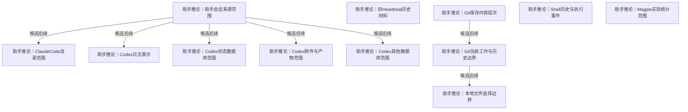

# 本地记录与既有历史

Claude、Codex、旧 Heartbeat、Git、文件、Shell 和 Magpie 的实际材料、替代范围及恢复检验。

[返回全景](../README.md) · [交互浏览](../index.html)

## 助手会话来源范围

**助手推论** · 把助手对话当成来源系统的一组材料：用户消息、工具输出、索引、父子关系、附件均可能有独立信息，不能由消息正文替代。

**Agent采用 · 当前**

候选：Claude Code 两处核心目录及补充材料、Codex 日志、状态与附件。

理由与代价：两种助手都是真实来源；延用已实现 Claude 核心目录能力，新增 Codex 日志、状态和产物，接受两者范围仍需分别列明。

启动或重审条件：Claude 补充材料先核实；Codex 首轮恢复完成后按窗口安排扩展。

候选可组合。Claude 与 Codex 是两种可同时收集的来源；此处只选来源，原样保存的程度在各自下游选择。

依据：

- [留最原始的一层](roots.md#n-760744617270b5ce)（选择依据）：保留来源交来的材料后再解释，此处明确来源交付层及取得是否改变内容。
- [保留采到的历史](roots.md#n-509f2d3467e7b121)（选择依据）：实际已采版本要保留，此处区分来源当前状态、来源历史和本次取得的版本。

依据材料：[.scratch/requirements/survey-assistant-sessions.md](../../../../requirements/survey-assistant-sessions.md)。真实输入与注入、工具输出、推理密文及父子会话结构均有样本。

### Claude Code 两处核心目录及补充材料 · 助手推荐

沿既有两处目录，再单列历史、文件备份与临时输出的候选范围。

收益：已有正式能力可作为第一条验证路线。

代价：核心目录外仍有未覆盖材料。

适用条件：Claude Code 是实际使用的来源。

继续展开：[ClaudeCode目录范围](#n-e1a2a790d5d446a9)

### Codex 日志、状态与附件 · 助手推荐

明文/压缩日志、索引、数据库和产物分别决定范围与取得方式。

收益：保住关系和外部内容。

代价：快照和压缩位置仍需新设计。

适用条件：Codex 是实际使用的来源。

继续展开：[Codex日志表示](#n-654ef3908ee1adec)、[Codex状态数据库范围](#n-bb8086babda89015)、[Codex附件与产物范围](#n-c8cf6296fafacb06)、[Codex其他数据库范围](#n-212a8d9d321fc8c3)

实现现状：Claude Code 两处核心目录与 Codex 日志、索引、state_5 整库快照和已选附件目录已实现；额外来源范围仍各自待核对。（[src/Orisumi.Capturing/ClaudeCodeSource.cs](../../../../../src/Orisumi.Capturing/ClaudeCodeSource.cs)、[src/Orisumi.Capturing/CodexSource.cs](../../../../../src/Orisumi.Capturing/CodexSource.cs)、[src/Docs/Orisumi.Docs/content/docs/model/sources.mdx](../../../../../src/Docs/Orisumi.Docs/content/docs/model/sources.mdx)）

审阅重点：按采用记录核对覆盖范围、接受的代价和实际证据；条件变化时沿触发条件重审。

可能需要回看：52 个下游节点（含所有候选路线）

[ClaudeCode目录范围](#n-e1a2a790d5d446a9)、[Codex其他数据库范围](#n-212a8d9d321fc8c3)、[Codex日志表示](#n-654ef3908ee1adec)、[Codex状态数据库范围](#n-bb8086babda89015)、[Codex附件与产物范围](#n-c8cf6296fafacb06)、[事件时间与顺序](capture.md#n-0843f43438c1c4a1)、[位置定位到哪里](records.md#n-d75a21e927a755bb)、[共享怎样授权](access.md#n-4b3c6032607d1b5c)、[分块策略与版本](storage.md#n-044919fef0bfc086)、[删除记录与回收](storage.md#n-0350116e746cba2c)、[压缩与存放表示](storage.md#n-d00cf82ac296b520)、[原件分单元和块两层](records.md#n-c2507b9e78d79f34)、[原件存成块](storage.md#n-1e55971a7ab3ff58)、[原样保存与一致性](records.md#n-49d755be3c14fe60)、[取得方式按来源形态选择](capture.md#n-6d6180cd980550cc)、[取得时间怎样记录](records.md#n-746612aae6ea6fde)、[取得权限与资源条件](capture.md#n-55c7589ea4cd33f0)、[各处原样都存](records.md#n-8e446efeb629f847)、[同步交换与提交](availability.md#n-da173cb6e04759f8)、[多副本删除与离线节点](availability.md#n-19ed3ea2239e62f9)、[完整内容的边界](records.md#n-26854bffbe13f18e)、[导出与恢复](storage.md#n-da66683208852205)、[屏幕观测粒度](sources-live.md#n-e5a27649574fb74b)、[接口与导出取得方式](capture.md#n-c68c6175d29abc5e)、[接口全量与增量](capture.md#n-76b9927e1c8393d5)、[数据库取得一致性](capture.md#n-cba810bb05a18834)、[文件变化取得策略](capture.md#n-6de65500ebbea77b)、[文件读取一致性](capture.md#n-a6463ad095322f24)、[新旧理解怎样评测](delivery.md#n-cbfb97254da427c8)、[时间含义怎样保留](understanding.md#n-e0bf0a291b892dad)、[来源原生增量怎样保存](storage.md#n-95be81155ce3d6b5)、[模型调用留下什么](understanding.md#n-97745ff5030f65f3)、[派生结果遇到删除或撤权](access.md#n-183194894919be77)、[浏览器事件传输](capture.md#n-b75cd5e6c6494099)、[浏览器回填怎样并行](capture.md#n-c1ef0a692ec80384)、[浏览器超大原响应怎样交付](capture.md#n-8dbe7245f6450587)、[浏览器页面内容范围](sources-live.md#n-a7ffdec9fe8bb5c3)、[理解版本怎样使用](understanding.md#n-be7944dd96e1f491)、[瞬时事件接收方式](capture.md#n-359653aed5ab9c59)、[离线与历史补取](capture.md#n-f116b26a22aa88eb)、[设备角色与离线工作](availability.md#n-e56d1b0735fb0084)、[读出引用到哪里](understanding.md#n-fe26af63a38ee976)、[调度频率与触发](capture.md#n-4804bedf60d73204)、[跨材料的取得时刻](capture.md#n-cc2fd44e41899000)、[连续媒体分段与编码](capture.md#n-84f109ff78f86572)、[连续录制怎样分段](capture.md#n-fd5e4f2373611f18)、[采集单次结果与保障边界](capture.md#n-5c39e84c8ee42507)、[采集启动与执行位置](capture.md#n-f47170f9f44e3fc5)、[采集幂等](storage.md#n-cbc00cff523393ab)、[采集设备怎样缓冲](availability.md#n-358b28d323bdbb8b)、[重复位置怎样归并](records.md#n-9034dc9f63983316)、[附件与依赖的收集边界](sources.md#n-128cbd6f1a6dfa45)

## ClaudeCode目录范围

**助手推论** · 当前已采 projects 与桌面索引目录。勘探还见到 history.jsonl、file-history 和临时子 Agent 输出，它们的信息范围与保留期不同。

**条件成立再做 · 下一步**

候选：把已发现的独立材料加入来源范围。

理由与代价：history.jsonl 和 file-history 已被发现，具有核心日志之外的信息；倾向纳入，但临时子 Agent 输出的持久副本和位置未证实，接受先勘探一次。

启动或重审条件：各取一份历史、备份及临时输出样本核对独有内容和生命周期；通过后扩范围，当前沿用 core 的已实现范围。

依据：

- [首先收集数据](roots.md#n-2c3dfbca22881d81)（选择依据）：先让材料存在并留下，此处展开取得材料的可执行方式。
- [尽量完整留下](roots.md#n-77e7f6f84727e69e)（选择依据）：默认尽量留下选定范围内可得的信息，此处比较哪些材料会留下或丢失及实际代价。

依据材料：[.scratch/requirements/survey-assistant-sessions.md](../../../../requirements/survey-assistant-sessions.md)。核心两处目录和三类补充材料均实际发现；清理原因未证实。

依据材料：[src/Docs/Orisumi.Docs/content/docs/model/sources.mdx#claude-code](../../../../../src/Docs/Orisumi.Docs/content/docs/model/sources.mdx#claude-code)。当前来源规则及验证范围。

### 沿用核心两处目录 · 助手推荐

按相对路径保留 projects 全部文件及桌面 sessions 索引。

收益：核心会话、附件、标题、rewind 与派生关系可恢复。

代价：漏掉目录外历史和改动备份。

适用条件：最小已实现路线；先用于验证。

继续展开：[文件变化取得策略](capture.md#n-6de65500ebbea77b)、[文件读取一致性](capture.md#n-a6463ad095322f24)

### 把已发现的独立材料加入来源范围 · 助手推荐

增加 history.jsonl、file-history，核对临时输出是否有持久副本后决定及时观测。

收益：留下旧输入和修改前文件。

代价：扩大范围；临时目录与凭据配置须用实际内容边界分清。

适用条件：推荐进一步勘探后扩展。

继续展开：[附件与依赖的收集边界](sources.md#n-128cbd6f1a6dfa45)、[瞬时事件接收方式](capture.md#n-359653aed5ab9c59)

分支终点：对三类补充材料分别取一个样本，与核心日志核对独有字段；观察一个子 Agent 输出从出现到结束的文件变化。

检验：列出每类独有材料、可补期限与重复关系；保留全部样本原文。

实现现状：ClaudeCodeSource 已实现两处核心目录，额外范围未实现。（[src/Orisumi.Capturing/ClaudeCodeSource.cs](../../../../../src/Orisumi.Capturing/ClaudeCodeSource.cs)、[tests/Orisumi.Capturing.Tests/ClaudeCodeSourceTests.cs](../../../../../tests/Orisumi.Capturing.Tests/ClaudeCodeSourceTests.cs)）

审阅重点：按采用记录核对覆盖范围、接受的代价和实际证据；条件变化时沿触发条件重审。

可能需要回看：25 个下游节点（含所有候选路线）

[事件时间与顺序](capture.md#n-0843f43438c1c4a1)、[共享怎样授权](access.md#n-4b3c6032607d1b5c)、[分块策略与版本](storage.md#n-044919fef0bfc086)、[删除记录与回收](storage.md#n-0350116e746cba2c)、[压缩与存放表示](storage.md#n-d00cf82ac296b520)、[原件存成块](storage.md#n-1e55971a7ab3ff58)、[各处原样都存](records.md#n-8e446efeb629f847)、[同步交换与提交](availability.md#n-da173cb6e04759f8)、[多副本删除与离线节点](availability.md#n-19ed3ea2239e62f9)、[导出与恢复](storage.md#n-da66683208852205)、[文件变化取得策略](capture.md#n-6de65500ebbea77b)、[文件读取一致性](capture.md#n-a6463ad095322f24)、[来源原生增量怎样保存](storage.md#n-95be81155ce3d6b5)、[派生结果遇到删除或撤权](access.md#n-183194894919be77)、[浏览器回填怎样并行](capture.md#n-c1ef0a692ec80384)、[瞬时事件接收方式](capture.md#n-359653aed5ab9c59)、[离线与历史补取](capture.md#n-f116b26a22aa88eb)、[设备角色与离线工作](availability.md#n-e56d1b0735fb0084)、[调度频率与触发](capture.md#n-4804bedf60d73204)、[采集单次结果与保障边界](capture.md#n-5c39e84c8ee42507)、[采集启动与执行位置](capture.md#n-f47170f9f44e3fc5)、[采集幂等](storage.md#n-cbc00cff523393ab)、[采集设备怎样缓冲](availability.md#n-358b28d323bdbb8b)、[重复位置怎样归并](records.md#n-9034dc9f63983316)、[附件与依赖的收集边界](sources.md#n-128cbd6f1a6dfa45)

## Codex日志表示

**助手推论** · 同一线程会跨多个 rollout，归档会搬动路径，旧 JSONL 会转成 Zstandard。文件名和索引路径不能代表全部可取得材料。

**Agent采用 · 当前**

候选：枚举两处日志并保留原字节。

理由与代价：两处目录全部 JSONL/JSONL.ZST 与完整索引按原字节留存，能恢复来源压缩表示；不为文本复用重写原件，接受两种编码物理复用较低。

启动或重审条件：样本覆盖跨 rollout、归档和压缩文件，并从源目录外恢复、解压；读出有需求再建可删解码缓存。

依据：

- [首先收集数据](roots.md#n-2c3dfbca22881d81)（选择依据）：先让材料存在并留下，此处展开取得材料的可执行方式。
- [尽量完整留下](roots.md#n-77e7f6f84727e69e)（选择依据）：默认尽量留下选定范围内可得的信息，此处比较哪些材料会留下或丢失及实际代价。

依据材料：[.scratch/requirements/survey-assistant-sessions.md](../../../../requirements/survey-assistant-sessions.md)。跨文件线程、路径失效与压缩实测。

依据材料：[.scratch/requirements/survey-codex-20261106.md](../../../../requirements/survey-codex-20261106.md)。2026-11-06 只读盘点的日志格式、state_5 模式/计数及附件目录体量；计数对应当时观察，不代表持续来源的当前总量。

依据材料：[src/Docs/Orisumi.Docs/content/docs/model/validation.mdx#codex-取得与恢复](../../../../../src/Docs/Orisumi.Docs/content/docs/model/validation.mdx#codex-%E5%8F%96%E5%BE%97%E4%B8%8E%E6%81%A2%E5%A4%8D)。本机真实日志取得后恢复，文件长度和哈希与保存清单一致；原始压缩字节保留。

### 枚举两处日志并保留原字节 · 助手推荐

sessions 与 archived_sessions 下现存 JSONL、JSONL.ZST 和完整标题索引均保存，时间筛选后置。

收益：压缩、分叉、未知记录与索引原貌可恢复。

代价：明文和压缩后的物理内容未必复用。

适用条件：推荐，符合原样保存。

继续展开：[文件变化取得策略](capture.md#n-6de65500ebbea77b)、[文件读取一致性](capture.md#n-a6463ad095322f24)

分支终点：取一个跨文件线程与一个压缩线程；采后脱离源目录解压、还原连续文件与标题索引。

检验：逐文件字节一致，坏压缩文件仍作为来源字节留下并在读出报错。

### 原压缩文件和解压副本都留 · 可选路线

原件保持原字节，另建可重建的解压读出。

收益：原貌与按行处理兼得。

代价：多一份派生数据和解码版本。

适用条件：实际读出成本支持保留缓存。

分支终点：解压产物标作读出并连回压缩原件，记录解码器与输入；存储是否保留缓存交下游决定。

检验：删掉解压读出仍能从压缩原件重建相同消息。

### 仅存解压后文本 · 与当前前提冲突

解压再存文本，抛弃来源压缩字节。

收益：按行读取直接。

代价：无法还原原压缩表示及损坏现象。

适用条件：需修改原样保存前提才可采用。

需要改变的前提：[留最原始的一层](roots.md#n-760744617270b5ce)

分支终点：本轮排除作为唯一原件；可作为读出路线。

检验：检查压缩输入的字节恢复要求无法成立。

### 只抽会话里的用户消息 · 与当前前提冲突

从 Codex 日志中只留下用户消息，过滤工具调用、注入和其他记录；这一保存方式与原样保留的根冲突。

收益：输出较小且适合直接看。

代价：丢掉以后重算和核验所需原文。

适用条件：需改变原样保存和先完整的前提才重新打开；同一约束也适用于 Claude 等助手会话。

需要改变的前提：[留最原始的一层](roots.md#n-760744617270b5ce)、[尽量完整留下](roots.md#n-77e7f6f84727e69e)

分支终点：本轮不把消息抽取设为原件采集路线，放到读出模块。

检验：采集恢复结果仍含来源交付的未知记录类型。

实现现状：两处会话目录及完整索引按原字节取得；JSONL 与 JSONL.ZST 原表示保留，实际保存与恢复已逐文件核对。（[src/Orisumi.Capturing/CodexSource.cs](../../../../../src/Orisumi.Capturing/CodexSource.cs)、[src/Orisumi.Raw/CaptureRecovery.cs](../../../../../src/Orisumi.Raw/CaptureRecovery.cs)、[src/Docs/Orisumi.Docs/content/docs/model/validation.mdx](../../../../../src/Docs/Orisumi.Docs/content/docs/model/validation.mdx)）

审阅重点：按采用记录核对覆盖范围、接受的代价和实际证据；条件变化时沿触发条件重审。

可能需要回看：15 个下游节点（含所有候选路线）

[位置定位到哪里](records.md#n-d75a21e927a755bb)、[同步交换与提交](availability.md#n-da173cb6e04759f8)、[多副本删除与离线节点](availability.md#n-19ed3ea2239e62f9)、[文件变化取得策略](capture.md#n-6de65500ebbea77b)、[文件读取一致性](capture.md#n-a6463ad095322f24)、[新旧理解怎样评测](delivery.md#n-cbfb97254da427c8)、[模型调用留下什么](understanding.md#n-97745ff5030f65f3)、[理解版本怎样使用](understanding.md#n-be7944dd96e1f491)、[离线与历史补取](capture.md#n-f116b26a22aa88eb)、[设备角色与离线工作](availability.md#n-e56d1b0735fb0084)、[读出引用到哪里](understanding.md#n-fe26af63a38ee976)、[调度频率与触发](capture.md#n-4804bedf60d73204)、[采集单次结果与保障边界](capture.md#n-5c39e84c8ee42507)、[采集启动与执行位置](capture.md#n-f47170f9f44e3fc5)、[采集设备怎样缓冲](availability.md#n-358b28d323bdbb8b)

## Codex状态数据库范围

**助手推论** · state_5 两表之外已发现项目、目录、分组、工作树和PR关联；该库的表示方式在此选择，其他数据库范围单独采用。

**Agent采用 · 当前**

候选：状态库一致快照。

理由与代价：state_5 已有两表之外的项目、分组和关联，约 4.1 MiB，整库快照保住模式及类型且减少导出契约；接受快照复用量暂未知。

启动或重审条件：以 WAL 中已提交未 checkpoint 的记录验证在线备份独立可读；新 schema 自动随快照保存。

依据：

- [首先收集数据](roots.md#n-2c3dfbca22881d81)（选择依据）：先让材料存在并留下，此处展开取得材料的可执行方式。
- [尽量完整留下](roots.md#n-77e7f6f84727e69e)（选择依据）：默认尽量留下选定范围内可得的信息，此处比较哪些材料会留下或丢失及实际代价。

依据材料：[.scratch/requirements/survey-codex-20261106.md](../../../../requirements/survey-codex-20261106.md)。2026-11-06 只读盘点的日志格式、state_5 模式/计数及附件目录体量；计数对应当时观察，不代表持续来源的当前总量。

依据材料：[.scratch/requirements/survey-assistant-sessions.md](../../../../requirements/survey-assistant-sessions.md)。其他数据库体量与投影判断来自 11 月 3 日样本。

依据材料：[src/Docs/Orisumi.Docs/content/docs/model/validation.mdx#codex-取得与恢复](../../../../../src/Docs/Orisumi.Docs/content/docs/model/validation.mdx#codex-%E5%8F%96%E5%BE%97%E4%B8%8E%E6%81%A2%E5%A4%8D)。本机 state_5 取得 Online Backup 快照；恢复库有 17 张表，quick_check 返回 ok。

### 状态库一致快照 · 助手推荐

保留 state_5 全部表、模式和字段类型，通过数据库能力取得。

收益：未来新增字段和当前其他关系一起保存；本轮核对主库约 4.1 MiB。

代价：要有快照取得和内部定位能力，复用量待测。

适用条件：推荐；当前体量和独有信息支持。

继续展开：[数据库取得一致性](capture.md#n-cba810bb05a18834)、[跨材料的取得时刻](capture.md#n-cc2fd44e41899000)

### 全部表及模式逻辑导出 · 可选路线

在一致读事务中逐表导出全部列，另存模式。

收益：可逐行比较且与物理布局解耦。

代价：需定义 BLOB、类型、无主键排序、空值及导出编码。

适用条件：逻辑增量有实测收益且愿意维护导出契约。

继续展开：[数据库取得一致性](capture.md#n-cba810bb05a18834)

分支终点：用含 BLOB、无主键和空值的库往返导出恢复，比较两次相同逻辑内容的字节稳定性。

检验：字段类型、行数、BLOB 和模式可重建；未知表也被保留。

### 延续 threads 与父子边两表 · 可选路线

仅保存已有设计指定的两表。

收益：实现小且输出稳定。

代价：已知项目、分组和关联记录遗漏。

适用条件：只有明确缩小来源范围后才适合。

分支终点：在范围中逐项排除其他已发现信息；本轮推荐完整路线。

检验：样本显示哪些用户可见关系无法由两表恢复。

实现现状：state_5.sqlite 通过 SQLite online backup 保存完整结构与类型；实际恢复库有17张表且quick_check通过，其他八个数据库按独立范围决定取得。（[src/Orisumi.Capturing/CodexSource.cs](../../../../../src/Orisumi.Capturing/CodexSource.cs)、[src/Orisumi.Capturing/SqliteSnapshotReader.cs](../../../../../src/Orisumi.Capturing/SqliteSnapshotReader.cs)、[src/Docs/Orisumi.Docs/content/docs/model/validation.mdx](../../../../../src/Docs/Orisumi.Docs/content/docs/model/validation.mdx)）

审阅重点：建议 state_5 一致整库快照；相比两表导出，保住已知项目、分组与工作树等关系。其他数据库另查。

可能需要回看：9 个下游节点（含所有候选路线）

[位置定位到哪里](records.md#n-d75a21e927a755bb)、[取得时间怎样记录](records.md#n-746612aae6ea6fde)、[数据库取得一致性](capture.md#n-cba810bb05a18834)、[新旧理解怎样评测](delivery.md#n-cbfb97254da427c8)、[时间含义怎样保留](understanding.md#n-e0bf0a291b892dad)、[模型调用留下什么](understanding.md#n-97745ff5030f65f3)、[理解版本怎样使用](understanding.md#n-be7944dd96e1f491)、[读出引用到哪里](understanding.md#n-fe26af63a38ee976)、[跨材料的取得时刻](capture.md#n-cc2fd44e41899000)

## Codex附件与产物范围

**助手推论** · 附件、生成图片、可视化、听写、自动化，以及语音连续和桌面全局状态文件共同保存已盘点的文件材料；目录混合产物和支持文件，重建关系后续验证。

**Agent采用 · 当前**

候选：整体保存已盘点的文件材料。

理由与代价：已盘点的目录和文件含真实产物、语音及未发送草稿；先完整保存来源交付表示，接受混合支持文件的体量。worktree-backups另行勘探，独立凭据文件不在明确清单内。

启动或重审条件：所选文件离开来源后逐字节恢复；实际成本成问题或新增形态时再评估范围与可重建关系。

依据：

- [首先收集数据](roots.md#n-2c3dfbca22881d81)（选择依据）：先让材料存在并留下，此处展开取得材料的可执行方式。
- [尽量完整留下](roots.md#n-77e7f6f84727e69e)（选择依据）：默认尽量留下选定范围内可得的信息，此处比较哪些材料会留下或丢失及实际代价。

依据材料：[.scratch/requirements/survey-codex-20261106.md](../../../../requirements/survey-codex-20261106.md)。2026-11-06 只读盘点的日志格式、state_5 模式/计数及附件目录体量；计数对应当时观察，不代表持续来源的当前总量。

依据材料：[src/Docs/Orisumi.Docs/content/docs/model/validation.mdx#codex-取得与恢复](../../../../../src/Docs/Orisumi.Docs/content/docs/model/validation.mdx#codex-%E5%8F%96%E5%BE%97%E4%B8%8E%E6%81%A2%E5%A4%8D)。真实采集覆盖所选附件和产物目录，普通文件字节与符号链接目标分别恢复核对。

### 整体保存已盘点的文件材料 · 助手推荐

完整保留附件、图片、可视化、听写和自动化目录，以及语音连续与桌面全局状态原文件，分别记录路径出处。

收益：最早留住后来可能清理的产物和支持文件。

代价：可视化含约245MiB支持文件；全局状态混合草稿与桌面设置，按完整原文件保存。

适用条件：推荐先留底、再以实际成本决定是否筛选。

继续展开：[附件与依赖的收集边界](sources.md#n-128cbd6f1a6dfa45)、[文件变化取得策略](capture.md#n-6de65500ebbea77b)

### 先加文本与图片，继续勘探可视化 · 可选路线

attachments 与 generated_images 入范围；可视化先单独完整样本勘探。

收益：核心外部材料明确、接入快。

代价：这段时间未采可视化可能消失。

适用条件：分步实施且明确这项覆盖缺口。

分支终点：选一份图表或交互产物，解析会话显式引用，列出离线打开需要的 HTML、脚本、资源及可重新安装依赖。

检验：在空目录和断网条件打开样本；缺失依赖和远端请求逐项登记。

### 只收显式引用的产物 · 可选路线

根据确认过的关联字段选产物文件。

收益：减少纯工具依赖。

代价：关联格式若不全会漏掉产物；解析承担范围责任。

适用条件：完成关联覆盖勘探后。

继续展开：[附件与依赖的收集边界](sources.md#n-128cbd6f1a6dfa45)

实现现状：既有附件与产物已通过本机和Linux恢复；新增听写、自动化、语音连续与全局状态文件已随两轮2,021文件/142链接的本机完整恢复核对，新增范围的外部副本另验。（[src/Orisumi.Capturing/CodexSource.cs](../../../../../src/Orisumi.Capturing/CodexSource.cs)、[src/Orisumi.Raw/CaptureRecovery.cs](../../../../../src/Orisumi.Raw/CaptureRecovery.cs)、[src/Docs/Orisumi.Docs/content/docs/model/validation.mdx](../../../../../src/Docs/Orisumi.Docs/content/docs/model/validation.mdx)）

审阅重点：按采用记录核对覆盖范围、接受的代价和实际证据；条件变化时沿触发条件重审。

可能需要回看：22 个下游节点（含所有候选路线）

[共享怎样授权](access.md#n-4b3c6032607d1b5c)、[分块策略与版本](storage.md#n-044919fef0bfc086)、[删除记录与回收](storage.md#n-0350116e746cba2c)、[压缩与存放表示](storage.md#n-d00cf82ac296b520)、[原件存成块](storage.md#n-1e55971a7ab3ff58)、[各处原样都存](records.md#n-8e446efeb629f847)、[同步交换与提交](availability.md#n-da173cb6e04759f8)、[多副本删除与离线节点](availability.md#n-19ed3ea2239e62f9)、[导出与恢复](storage.md#n-da66683208852205)、[文件变化取得策略](capture.md#n-6de65500ebbea77b)、[文件读取一致性](capture.md#n-a6463ad095322f24)、[来源原生增量怎样保存](storage.md#n-95be81155ce3d6b5)、[派生结果遇到删除或撤权](access.md#n-183194894919be77)、[离线与历史补取](capture.md#n-f116b26a22aa88eb)、[设备角色与离线工作](availability.md#n-e56d1b0735fb0084)、[调度频率与触发](capture.md#n-4804bedf60d73204)、[采集单次结果与保障边界](capture.md#n-5c39e84c8ee42507)、[采集启动与执行位置](capture.md#n-f47170f9f44e3fc5)、[采集幂等](storage.md#n-cbc00cff523393ab)、[采集设备怎样缓冲](availability.md#n-358b28d323bdbb8b)、[重复位置怎样归并](records.md#n-9034dc9f63983316)、[附件与依赖的收集边界](sources.md#n-128cbd6f1a6dfa45)

## 旧Heartbeat历史材料

**助手推论** · 旧库保存本人的活动、设备、应用身份与缺口，也包含其他所有者。采用本人历史及关联的同一只读快照原生文本导出，再交现有文件采集保存。

**Agent采用 · 当前**

候选：本人数据及关联表的一致导出。

理由与代价：本人一天快照与关联已验证，原生文本保持全部已确认类型且降低二进制布局依赖。接受样本20.27%正文增长，以一次完整历史导出先留下资料；全本人关联表独立保留，避免只沿某天事实漏取。

启动或重审条件：所有者和关联闭包、同一快照、模式及原字节往返逐项通过后才认定完整。新增类型、持续修订需求或实际整轮成本出现时重审；其他表另行勘探。

依据：

- [尽量收集一切](roots.md#n-c3c6e7607f2c9805)（选择依据）：凡关于个人且可取得或观测的材料均可候选，此处明确实际覆盖范围。
- [留最原始的一层](roots.md#n-760744617270b5ce)（选择依据）：保留来源交来的材料后再解释，此处明确来源交付层及取得是否改变内容。
- [出处一起保存](roots.md#n-2ce85769c25073e7)（选择依据）：材料需连同直接知道的取得事实保存，此处确定可证明的来源与取得条件。

依据材料：[.scratch/requirements/survey-heartbeat.md](../../../../requirements/survey-heartbeat.md)。实际本人一天的10表69,972行与74约束已独立恢复；text COPY往返与来源binary值全部一致。

依据材料：[src/Docs/Orisumi.Docs/content/docs/model/heartbeat.mdx](../../../../../src/Docs/Orisumi.Docs/content/docs/model/heartbeat.mdx)。全本人设备/主体/流和三事实历史、必要共享应用、模式及两层出处已取得，并完成受限独立恢复。

依据材料：[src/Docs/Orisumi.Docs/content/docs/model/adr/0007-native-postgresql-export.mdx](../../../../../src/Docs/Orisumi.Docs/content/docs/model/adr/0007-native-postgresql-export.mdx)。接受文本样本增加20.27%的正文，保留来源原生格式与恢复条件；当前不引入永久数据库采集器。

依据材料：[src/Docs/Orisumi.Docs/content/docs/model/validation.mdx#旧-heartbeat-完整历史](../../../../../src/Docs/Orisumi.Docs/content/docs/model/validation.mdx#%E6%97%A7-heartbeat-%E5%AE%8C%E6%95%B4%E5%8E%86%E5%8F%B2)。全本人关联独立留存，共享应用仅取引用；COPY正文约961MB，经原件保存后独立恢复全部原值。

### 本人数据及关联表的一致导出 · 助手推荐

用同一只读事务取得本人的全部可得历史、身份、设备、流与现存缺口。

收益：保留现有原始行及覆盖事实，避免原先时间范围筛选遗漏。

代价：需要明确跨表筛选、类型和排序；查不到已丢弃事件。

适用条件：以后重采仍可能有修订。

继续展开：[数据库取得一致性](capture.md#n-cba810bb05a18834)、[离线与历史补取](capture.md#n-f116b26a22aa88eb)

分支终点：用本人一天的时段、键鼠、缺口及关联行做导洞；脱离旧服务恢复查询，随后扩全历史。

检验：只出现本人设备；表行数、主键、时间原值与采集查询吻合；已有缺口仍可查看。

### 服务提供本人数据归档 · 可选路线

由现有服务或管理员提供范围准确的导出文件，Orisumi 采归档。

收益：数据库读取职责可交给来源侧。

代价：归档格式与及时性由来源能力决定。

适用条件：已有可用导出且能保留全部字段。

继续展开：[接口与导出取得方式](capture.md#n-c68c6175d29abc5e)

分支终点：检查现服务是否有可用的本人导出；若没有，保留直接只读事务路线。

检验：与一天直接查询的字段和关联数对照，列出差异。

### 把服务器整库复制当作个人来源 · 与当前前提冲突

直接采全库。

收益：可保全库结构。

代价：已知会纳入另一人的数据，扩大用户来源范围与授权对象。

适用条件：仅在新授权和明确数据归属后另议。

分支终点：当前个人来源接入按本人范围取得，不执行全库归档。

检验：导洞校验其他主体的行未进入个人材料。

实现现状：本人现存历史10表3,748,506行已在同一只读快照导出，经现有files来源保存53文件；禁止原导出与IP访问的环境中独立PG恢复、十表原字节及74约束核对通过。当前为一次历史取得，持续更新另按实际需要决定。（[src/Docs/Orisumi.Docs/content/docs/model/heartbeat.mdx](../../../../../src/Docs/Orisumi.Docs/content/docs/model/heartbeat.mdx)、[src/Docs/Orisumi.Docs/content/docs/model/validation.mdx#旧-heartbeat-完整历史](../../../../../src/Docs/Orisumi.Docs/content/docs/model/validation.mdx#%E6%97%A7-heartbeat-%E5%AE%8C%E6%95%B4%E5%8E%86%E5%8F%B2)、[.scratch/requirements/survey-heartbeat.md](../../../../requirements/survey-heartbeat.md)）

审阅重点：按采用记录核对覆盖范围、接受的代价和实际证据；条件变化时沿触发条件重审。

可能需要回看：43 个下游节点（含所有候选路线）

[事件时间与顺序](capture.md#n-0843f43438c1c4a1)、[位置定位到哪里](records.md#n-d75a21e927a755bb)、[共享怎样授权](access.md#n-4b3c6032607d1b5c)、[分块策略与版本](storage.md#n-044919fef0bfc086)、[删除记录与回收](storage.md#n-0350116e746cba2c)、[压缩与存放表示](storage.md#n-d00cf82ac296b520)、[原件存成块](storage.md#n-1e55971a7ab3ff58)、[取得时间怎样记录](records.md#n-746612aae6ea6fde)、[取得权限与资源条件](capture.md#n-55c7589ea4cd33f0)、[各处原样都存](records.md#n-8e446efeb629f847)、[同步交换与提交](availability.md#n-da173cb6e04759f8)、[多副本删除与离线节点](availability.md#n-19ed3ea2239e62f9)、[导出与恢复](storage.md#n-da66683208852205)、[屏幕观测粒度](sources-live.md#n-e5a27649574fb74b)、[接口与导出取得方式](capture.md#n-c68c6175d29abc5e)、[接口全量与增量](capture.md#n-76b9927e1c8393d5)、[数据库取得一致性](capture.md#n-cba810bb05a18834)、[文件变化取得策略](capture.md#n-6de65500ebbea77b)、[文件读取一致性](capture.md#n-a6463ad095322f24)、[新旧理解怎样评测](delivery.md#n-cbfb97254da427c8)、[时间含义怎样保留](understanding.md#n-e0bf0a291b892dad)、[来源原生增量怎样保存](storage.md#n-95be81155ce3d6b5)、[模型调用留下什么](understanding.md#n-97745ff5030f65f3)、[派生结果遇到删除或撤权](access.md#n-183194894919be77)、[浏览器事件传输](capture.md#n-b75cd5e6c6494099)、[浏览器回填怎样并行](capture.md#n-c1ef0a692ec80384)、[浏览器超大原响应怎样交付](capture.md#n-8dbe7245f6450587)、[浏览器页面内容范围](sources-live.md#n-a7ffdec9fe8bb5c3)、[理解版本怎样使用](understanding.md#n-be7944dd96e1f491)、[瞬时事件接收方式](capture.md#n-359653aed5ab9c59)、[离线与历史补取](capture.md#n-f116b26a22aa88eb)、[设备角色与离线工作](availability.md#n-e56d1b0735fb0084)、[读出引用到哪里](understanding.md#n-fe26af63a38ee976)、[调度频率与触发](capture.md#n-4804bedf60d73204)、[跨材料的取得时刻](capture.md#n-cc2fd44e41899000)、[连续媒体分段与编码](capture.md#n-84f109ff78f86572)、[连续录制怎样分段](capture.md#n-fd5e4f2373611f18)、[采集单次结果与保障边界](capture.md#n-5c39e84c8ee42507)、[采集启动与执行位置](capture.md#n-f47170f9f44e3fc5)、[采集幂等](storage.md#n-cbc00cff523393ab)、[采集设备怎样缓冲](availability.md#n-358b28d323bdbb8b)、[重复位置怎样归并](records.md#n-9034dc9f63983316)、[附件与依赖的收集边界](sources.md#n-128cbd6f1a6dfa45)

## Git保存内容层次

**助手推论** · bundle保存引用可达的Git对象与版本正文，HEAD符号关系和配置另存取得事实；这些材料共同表达本次实际拿到的范围。

**Agent采用 · 当前**

候选：提交引用及可达对象归档。

理由与代价：A/B离开来源后分别恢复26与12个对象、7与2个提交版本，证明bundle路线保住历史正文；符号关系及配置独立记录，外部对象另列。

启动或重审条件：真实仓库运行成本、特殊对象格式/存储、外部依赖或未提交状态需求变化时重审；完整性由独立恢复与字节核对支持。

依据：

- [首先收集数据](roots.md#n-2c3dfbca22881d81)（选择依据）：先让材料存在并留下，此处展开取得材料的可执行方式。
- [尽量完整留下](roots.md#n-77e7f6f84727e69e)（选择依据）：默认尽量留下选定范围内可得的信息，此处比较哪些材料会留下或丢失及实际代价。

依据材料：[.scratch/requirements/survey-local.md](../../../../requirements/survey-local.md)。32 仓库速记，只证明已有提交。

依据材料：[https://git-scm.com/docs/git-bundle](https://git-scm.com/docs/git-bundle)。官方支持 objects/refs 的完整或增量 bundle；未据此声称工作区等被包含。

依据材料：[.scratch/requirements/survey-git.md](../../../../requirements/survey-git.md)。独立夹具A/B逐对象、逐版本恢复；HEAD与符号关系、最新stash/旧reflog、元数据竞态、LFS/子模块边界均留原样本。

依据材料：[src/Docs/Orisumi.Docs/content/docs/model/git.mdx](../../../../../src/Docs/Orisumi.Docs/content/docs/model/git.mdx)。显式仓库的bundle、分次命令原输出与取得条件；采集根身份沿用原件，特殊范围按实际结果说明。

依据材料：[src/Docs/Orisumi.Docs/content/docs/model/validation.mdx#git-历史](../../../../../src/Docs/Orisumi.Docs/content/docs/model/validation.mdx#git-%E5%8E%86%E5%8F%B2)。真实两仓库各采两轮，独立恢复禁止来源目录与网络，全部可达对象正文SHA-256一致；完整性与取消另有红→绿行为证据。

依据材料：[.scratch/requirements/survey-git-working.md](../../../../requirements/survey-git-working.md)。工作区/index/HEAD原字节、旧stash与不可达对象、多worktree已完成合成恢复勘探；实际两仓只读成本盘点，ignored并非可丢弃依据。

### 提交引用及可达对象归档 · 助手推荐

保留可取得 refs 和所需 commit/tree/blob 对象，优先试自包含 bundle；把取得时的引用状态一起存。

收益：来源仓库消失后仍可读历史正文。

代价：体量更大；未提交内容、LFS 实体和子模块须另查。

适用条件：当前Git路线，先显式指定仓库，自动发现另按证据安排。

继续展开：[Git当前工作与历史边界](#n-0654de3735dd2271)、[文件变化取得策略](capture.md#n-6de65500ebbea77b)

分支终点：合成A/B和真实两仓库独立恢复已通过；每轮空库verify后mirror clone+fsck，真实包损坏及头部悬空分别拒绝。

检验：不访问原仓库即可检出所选历史；bundle verify 通过，外部缺失单独列出。

### 沿用提交原文和统计 · 可选路线

存提交对象原文、远端、仓库路径与文件改动统计。

收益：小且便于做活动时间线。

代价：不能恢复树和文件正文。

适用条件：明确只需 Git 活动证据、文件正文由其他来源完整保存。

分支终点：把采集范围写成提交元数据，验证依赖的文件来源是否真的保留所需每个版本。

检验：试读一个历史文件，报告只能获得哈希还是有实际字节。

### 原样保存仓库工作区和 Git 元数据目录 · 可选路线

将实际文件系统形态整体保存，保留配置、reflog 和未提交内容候选。

收益：可能保存 bundle 外的状态。

代价：运行中多文件一致性、共享 worktree、alternates 和对象打包需核查。

适用条件：这些额外状态已明确需要且快照能力可行。

继续展开：[文件读取一致性](capture.md#n-a6463ad095322f24)、[Git当前工作与历史边界](#n-0654de3735dd2271)

分支终点：盘点 common git dir、worktree、alternates、LFS 与子模块实际位置，用文件系统快照或停写副本做恢复实验。

检验：每个依赖都可在离开原目录后解析，裸递归副本不因通过文件校验就被称一致仓库。

实现现状：显式仓库GitCollector与CLI已实现；12条行为测试、真实qstack/Orisumi各两轮独立恢复通过，分别核对30/23936对象。单线程bundle的重复取得只新增出处；Orisumi/qstack两个日常任务已启用，本轮更新后均产生成功采集记录。 工作状态扩展已完成勘探，生产范围仍为引用可达历史；bundle加index缺暂存blob、patch缺untracked/ignored均有实际反例。（[src/Orisumi.Capturing/GitCollector.cs](../../../../../src/Orisumi.Capturing/GitCollector.cs)、[tests/Orisumi.Capturing.Tests/GitCollectorTests.cs](../../../../../tests/Orisumi.Capturing.Tests/GitCollectorTests.cs)、[src/Docs/Orisumi.Docs/content/docs/model/git.mdx](../../../../../src/Docs/Orisumi.Docs/content/docs/model/git.mdx)、[src/Docs/Orisumi.Docs/content/docs/model/validation.mdx#git-历史](../../../../../src/Docs/Orisumi.Docs/content/docs/model/validation.mdx#git-%E5%8E%86%E5%8F%B2)、[.scratch/requirements/survey-git-working.md](../../../../requirements/survey-git-working.md)）

审阅重点：按采用记录核对覆盖范围、接受的代价和实际证据；条件变化时沿触发条件重审。

可能需要回看：22 个下游节点（含所有候选路线）

[Git当前工作与历史边界](#n-0654de3735dd2271)、[位置定位到哪里](records.md#n-d75a21e927a755bb)、[取得时间怎样记录](records.md#n-746612aae6ea6fde)、[取得权限与资源条件](capture.md#n-55c7589ea4cd33f0)、[同步交换与提交](availability.md#n-da173cb6e04759f8)、[多副本删除与离线节点](availability.md#n-19ed3ea2239e62f9)、[数据库取得一致性](capture.md#n-cba810bb05a18834)、[文件变化取得策略](capture.md#n-6de65500ebbea77b)、[文件读取一致性](capture.md#n-a6463ad095322f24)、[新旧理解怎样评测](delivery.md#n-cbfb97254da427c8)、[时间含义怎样保留](understanding.md#n-e0bf0a291b892dad)、[本地文件选择边界](#n-8448d9854b79d7b9)、[模型调用留下什么](understanding.md#n-97745ff5030f65f3)、[理解版本怎样使用](understanding.md#n-be7944dd96e1f491)、[离线与历史补取](capture.md#n-f116b26a22aa88eb)、[设备角色与离线工作](availability.md#n-e56d1b0735fb0084)、[读出引用到哪里](understanding.md#n-fe26af63a38ee976)、[调度频率与触发](capture.md#n-4804bedf60d73204)、[跨材料的取得时刻](capture.md#n-cc2fd44e41899000)、[采集单次结果与保障边界](capture.md#n-5c39e84c8ee42507)、[采集启动与执行位置](capture.md#n-f47170f9f44e3fc5)、[采集设备怎样缓冲](availability.md#n-358b28d323bdbb8b)

## Git当前工作与历史边界

**助手推论** · 分支、工作区改动、暂存、stash 与最终提交表达不同状态；“提交持久”也依赖对象仍可达或未被清理。

**Agent采用 · 当前**

候选：先保存HEAD、refs与可达对象。

理由与代价：--all实测覆盖HEAD、refs和最新stash可达对象，改引用后A仍可恢复；旧reflog、index、工作区及外部实体各自有保存窗口，保留明确范围。

启动或重审条件：未提交变化或旧reflog材料出现实际保存需求时，勘探独立文件/短期历史路线；多worktree与特殊对象库另验。

依据：

- [保留采到的历史](roots.md#n-509f2d3467e7b121)（选择依据）：实际已采版本要保留，此处区分来源当前状态、来源历史和本次取得的版本。
- [尽量采全变化](roots.md#n-cc33c5b227746d72)（选择依据）：尽量取每次可取得变化，此处需验证来源暴露的变化粒度和取得窗口。

依据材料：[https://git-scm.com/docs/git-bundle](https://git-scm.com/docs/git-bundle)。bundle 覆盖所选引用及对象，额外状态需另行取证。

依据材料：[.scratch/requirements/survey-git.md](../../../../requirements/survey-git.md)。独立夹具A/B逐对象、逐版本恢复；HEAD与符号关系、最新stash/旧reflog、元数据竞态、LFS/子模块边界均留原样本。

依据材料：[src/Docs/Orisumi.Docs/content/docs/model/git.mdx](../../../../../src/Docs/Orisumi.Docs/content/docs/model/git.mdx)。显式仓库的bundle、分次命令原输出与取得条件；采集根身份沿用原件，特殊范围按实际结果说明。

依据材料：[src/Docs/Orisumi.Docs/content/docs/model/validation.mdx#git-历史](../../../../../src/Docs/Orisumi.Docs/content/docs/model/validation.mdx#git-%E5%8E%86%E5%8F%B2)。真实两仓库各采两轮，独立恢复禁止来源目录与网络，全部可达对象正文SHA-256一致；完整性与取消另有红→绿行为证据。

依据材料：[.scratch/requirements/survey-git-working.md](../../../../requirements/survey-git-working.md)。工作区/index/HEAD原字节、旧stash与不可达对象、多worktree已完成合成恢复勘探；实际两仓只读成本盘点，ignored并非可丢弃依据。

### 先保存HEAD、refs与可达对象 · 助手推荐

每轮由Git枚举HEAD和refs并输出bundle，另存分次取得的符号关系与配置；包含最新stash可达对象。

收益：起点清楚且容易验证。

代价：未提交改动和被清理前未取得的对象不在其中。

适用条件：推荐为第一条 Git 路线。

继续展开：[离线与历史补取](capture.md#n-f116b26a22aa88eb)

分支终点：合成A/B和真实两仓库独立恢复已通过；每轮空库verify后mirror clone+fsck，真实包损坏及头部悬空分别拒绝。

检验：恢复 A/B 两次 refs 与正文；不能用当前 git log 的结果推断完整过去。

### 提交历史加工作区、暂存与短期历史 · 可选路线

提交历史之外，原工作文件、index/共享index、日志与依赖对象分别保存。合成恢复已证实这些材料各自必要，完整目录与明确选取范围继续比较。

收益：能留下 commit 之前的修改过程。

代价：Heartbeat当前目录约22.55 GB，ignored包含独有样本与派生内容；正文读取、编码与连续变化成本待测。工作区和元数据分次读取保留时间窗。

适用条件：对一个明确仓库和范围接成产品单轮，再实测首次与连续取得成本。

继续展开：[本地文件选择边界](#n-8448d9854b79d7b9)、[文件变化取得策略](capture.md#n-6de65500ebbea77b)

分支终点：勘探已完成；把已验证的原工作字节、index/日志/状态与对象依赖接入单轮原件，从产品恢复输出重建。候选比较与范围缺口见勘探记录。

检验：来源不可读时恢复五种正文、旧stash、split index、冲突与两worktree；缺共享index或暂存blob必须失败，单独测ignored材料实际读取成本。

实现现状：显式仓库GitCollector与CLI已实现；12条行为测试、真实qstack/Orisumi各两轮独立恢复通过，分别核对30/23936对象。单线程bundle的重复取得只新增出处；Orisumi/qstack两个日常任务已启用，本轮更新后均产生成功采集记录。 工作状态扩展已完成勘探，生产范围仍为引用可达历史；bundle加index缺暂存blob、patch缺untracked/ignored均有实际反例。（[src/Orisumi.Capturing/GitCollector.cs](../../../../../src/Orisumi.Capturing/GitCollector.cs)、[tests/Orisumi.Capturing.Tests/GitCollectorTests.cs](../../../../../tests/Orisumi.Capturing.Tests/GitCollectorTests.cs)、[src/Docs/Orisumi.Docs/content/docs/model/git.mdx](../../../../../src/Docs/Orisumi.Docs/content/docs/model/git.mdx)、[src/Docs/Orisumi.Docs/content/docs/model/validation.mdx#git-历史](../../../../../src/Docs/Orisumi.Docs/content/docs/model/validation.mdx#git-%E5%8E%86%E5%8F%B2)、[.scratch/requirements/survey-git-working.md](../../../../requirements/survey-git-working.md)）

审阅重点：按采用记录核对覆盖范围、接受的代价和实际证据；条件变化时沿触发条件重审。

可能需要回看：21 个下游节点（含所有候选路线）

[位置定位到哪里](records.md#n-d75a21e927a755bb)、[取得时间怎样记录](records.md#n-746612aae6ea6fde)、[取得权限与资源条件](capture.md#n-55c7589ea4cd33f0)、[同步交换与提交](availability.md#n-da173cb6e04759f8)、[多副本删除与离线节点](availability.md#n-19ed3ea2239e62f9)、[数据库取得一致性](capture.md#n-cba810bb05a18834)、[文件变化取得策略](capture.md#n-6de65500ebbea77b)、[文件读取一致性](capture.md#n-a6463ad095322f24)、[新旧理解怎样评测](delivery.md#n-cbfb97254da427c8)、[时间含义怎样保留](understanding.md#n-e0bf0a291b892dad)、[本地文件选择边界](#n-8448d9854b79d7b9)、[模型调用留下什么](understanding.md#n-97745ff5030f65f3)、[理解版本怎样使用](understanding.md#n-be7944dd96e1f491)、[离线与历史补取](capture.md#n-f116b26a22aa88eb)、[设备角色与离线工作](availability.md#n-e56d1b0735fb0084)、[读出引用到哪里](understanding.md#n-fe26af63a38ee976)、[调度频率与触发](capture.md#n-4804bedf60d73204)、[跨材料的取得时刻](capture.md#n-cc2fd44e41899000)、[采集单次结果与保障边界](capture.md#n-5c39e84c8ee42507)、[采集启动与执行位置](capture.md#n-f47170f9f44e3fc5)、[采集设备怎样缓冲](availability.md#n-358b28d323bdbb8b)

## 本地文件选择边界

**助手推论** · 文稿和下载已有真实文件；目录、符号链接、云端占位和可变化的文件元数据会影响“收了整个目录”的含义。

**条件成立再做 · 以后**

候选：明确根目录与材料类别后原样枚举。

理由与代价：明确来源根和类别能解释采到什么；整 home 混有运行库和云占位，不能用普通文件枚举保证完整，接受逐来源接入。

启动或重审条件：一个普通目录、包目录、符号链接和云占位样本核对可读字节与遗漏，再登记实际范围。

依据：

- [首先收集数据](roots.md#n-2c3dfbca22881d81)（选择依据）：先让材料存在并留下，此处展开取得材料的可执行方式。
- [尽量完整留下](roots.md#n-77e7f6f84727e69e)（选择依据）：默认尽量留下选定范围内可得的信息，此处比较哪些材料会留下或丢失及实际代价。

依据材料：[.scratch/requirements/survey-local.md](../../../../requirements/survey-local.md)。下载、文稿、桌面实测位置与体量。

依据材料：[src/Docs/Orisumi.Docs/content/docs/model/file-capture.mdx](../../../../../src/Docs/Orisumi.Docs/content/docs/model/file-capture.mdx)。当前普通文件、跳过符号链接和存储目录规则。

### 明确根目录与材料类别后原样枚举 · 助手推荐

按来源目录保存现存普通文件及相对路径；声明符号链接、包目录和云占位的处理。

收益：范围可核对，能复用当前文件采集器。

代价：仅当前实现会跳过链接，不能自动获得未下载字节。

适用条件：推荐从实际目录清单展开。

继续展开：[文件读取一致性](capture.md#n-a6463ad095322f24)、[文件变化取得策略](capture.md#n-6de65500ebbea77b)

分支终点：盘点一个下载目录、一个包目录、一处符号链接和一个云占位；比较枚举与实际可读文件。

检验：未取得内容逐项有原因；采集库自身不会被再次采入。

### 扫描整个用户目录 · 可选路线

把用户目录作为范围，再具体处理受保护位置和运行中数据库。

收益：发现未知散落材料。

代价：容易混入凭据、缓存、数据库碎片和巨大工具目录，不能用普通文件复制宣称语义完整。

适用条件：需明确材料范围并接受全盘盘点投入。

继续展开：[取得权限与资源条件](capture.md#n-55c7589ea4cd33f0)、[数据库取得一致性](capture.md#n-cba810bb05a18834)

分支终点：只做目录类别与体量盘点，区分来源材料、凭据、可重建缓存与复合库；逐类选择正式范围。

检验：来源清单能解释每一类为何收，以及不能直接复制的类型。

实现现状：通用 files 已实现普通文件字节与符号链接目标的扫描保存；云占位和完整文件元数据尚未确定。（[src/Orisumi.Capturing/Collector.cs](../../../../../src/Orisumi.Capturing/Collector.cs)、[src/Docs/Orisumi.Docs/content/docs/model/file-capture.mdx](../../../../../src/Docs/Orisumi.Docs/content/docs/model/file-capture.mdx)）

审阅重点：按采用记录核对覆盖范围、接受的代价和实际证据；条件变化时沿触发条件重审。

可能需要回看：20 个下游节点（含所有候选路线）

[位置定位到哪里](records.md#n-d75a21e927a755bb)、[取得时间怎样记录](records.md#n-746612aae6ea6fde)、[取得权限与资源条件](capture.md#n-55c7589ea4cd33f0)、[同步交换与提交](availability.md#n-da173cb6e04759f8)、[多副本删除与离线节点](availability.md#n-19ed3ea2239e62f9)、[数据库取得一致性](capture.md#n-cba810bb05a18834)、[文件变化取得策略](capture.md#n-6de65500ebbea77b)、[文件读取一致性](capture.md#n-a6463ad095322f24)、[新旧理解怎样评测](delivery.md#n-cbfb97254da427c8)、[时间含义怎样保留](understanding.md#n-e0bf0a291b892dad)、[模型调用留下什么](understanding.md#n-97745ff5030f65f3)、[理解版本怎样使用](understanding.md#n-be7944dd96e1f491)、[离线与历史补取](capture.md#n-f116b26a22aa88eb)、[设备角色与离线工作](availability.md#n-e56d1b0735fb0084)、[读出引用到哪里](understanding.md#n-fe26af63a38ee976)、[调度频率与触发](capture.md#n-4804bedf60d73204)、[跨材料的取得时刻](capture.md#n-cc2fd44e41899000)、[采集单次结果与保障边界](capture.md#n-5c39e84c8ee42507)、[采集启动与执行位置](capture.md#n-f47170f9f44e3fc5)、[采集设备怎样缓冲](availability.md#n-358b28d323bdbb8b)

## Shell历史与执行事件

**助手推论** · zsh 历史前后有无时间格式不同，没有 cwd 和退出码；它与助手的命令日志重合但不等同。

**条件成立再做 · 下一步**

候选：先采现有历史文件。

理由与代价：已有 shell 历史可原样保存且取得成本低；hooks 会改变各 shell 运行环境，先留现有材料，接受 cwd、退出码和输出缺失。

启动或重审条件：在测试 shell 核对多行命令运行中与退出后的落盘时机，再接真实历史文件；需要执行级事实时另测 hooks。

候选可组合。已有历史和新增执行观测可以一起做，前者留过去材料，后者补今后执行上下文。

依据：

- [首先收集数据](roots.md#n-2c3dfbca22881d81)（选择依据）：先让材料存在并留下，此处展开取得材料的可执行方式。
- [尽量完整留下](roots.md#n-77e7f6f84727e69e)（选择依据）：默认尽量留下选定范围内可得的信息，此处比较哪些材料会留下或丢失及实际代价。

依据材料：[.scratch/requirements/survey-local.md](../../../../requirements/survey-local.md)。1907 行 zsh 历史与缺少 cwd、退出码。

依据材料：[.scratch/requirements/survey-assistant-sessions.md](../../../../requirements/survey-assistant-sessions.md)。助手工具日志含命令、输出与退出状态。

### 先采现有历史文件 · 助手推荐

原样保存 zsh/bash 历史，保留无时间的旧行。

收益：立即留住目前已存在的输入。

代价：不是完整执行记录，也不含输出。

适用条件：推荐先保住现成材料。

继续展开：[文件变化取得策略](capture.md#n-6de65500ebbea77b)

分支终点：在单独测试 shell 中执行多行命令并结束会话，比较运行时与退出后历史文件变化。

检验：说明何时落盘、哪些命令未记及无时间行的范围，不补造时间和 cwd。

### 新增命令开始结束观测 · 可选路线

另采命令、cwd、时间与可取得退出状态，输出是否采另行测试。

收益：增加执行上下文与未落盘历史。

代价：需在实际 shell 中安装观测，别名、管道、子 shell 和交互应用有边界。

适用条件：取得能力或范围尚未测清时，先取得一个可核验样本。

继续展开：[瞬时事件接收方式](capture.md#n-359653aed5ab9c59)

分支终点：用测试 shell 覆盖成功/失败、管道、交互、多行及后台命令，原样记录 hook 可见参数。

检验：对照已知命令清单说明覆盖和漏项，不能把 hook 事件直接当全部终端字节。

实现现状：本轮仅展开决策，尚未实现此来源路线。

审阅重点：按采用记录核对覆盖范围、接受的代价和实际证据；条件变化时沿触发条件重审。

可能需要回看：13 个下游节点（含所有候选路线）

[事件时间与顺序](capture.md#n-0843f43438c1c4a1)、[同步交换与提交](availability.md#n-da173cb6e04759f8)、[多副本删除与离线节点](availability.md#n-19ed3ea2239e62f9)、[文件变化取得策略](capture.md#n-6de65500ebbea77b)、[文件读取一致性](capture.md#n-a6463ad095322f24)、[浏览器回填怎样并行](capture.md#n-c1ef0a692ec80384)、[瞬时事件接收方式](capture.md#n-359653aed5ab9c59)、[离线与历史补取](capture.md#n-f116b26a22aa88eb)、[设备角色与离线工作](availability.md#n-e56d1b0735fb0084)、[调度频率与触发](capture.md#n-4804bedf60d73204)、[采集单次结果与保障边界](capture.md#n-5c39e84c8ee42507)、[采集启动与执行位置](capture.md#n-f47170f9f44e3fc5)、[采集设备怎样缓冲](availability.md#n-358b28d323bdbb8b)

## Magpie实际统计范围

**助手推论** · 已见 quota-history 和余额变化；usage.jsonl 样本只有模型列表探测请求，不能把它称为实际会话 Token 总账。

**条件成立再做 · 下一步**

候选：保存实际存在的额度与请求记录。

理由与代价：已见额度和请求记录可留，不能据模型列表探测样本宣称完整 Token 总账；接受统计语义有限，实际调用追踪后置。

启动或重审条件：各取额度、余额和请求样本核对字段与时间；明确需要真实调用统计时再定位现版持久记录。

候选可组合。保存已有额度/探测记录与查找实际请求统计出处可以并行；后者未查明不阻挡前者。

依据：

- [首先收集数据](roots.md#n-2c3dfbca22881d81)（选择依据）：先让材料存在并留下，此处展开取得材料的可执行方式。
- [尽量完整留下](roots.md#n-77e7f6f84727e69e)（选择依据）：默认尽量留下选定范围内可得的信息，此处比较哪些材料会留下或丢失及实际代价。

依据材料：[.scratch/requirements/survey-local.md](../../../../requirements/survey-local.md)。Magpie 的实际 33 行 probe、额度点与待查项。

### 保存实际存在的额度与请求记录 · 助手推荐

收 usage、quota-history、quotas、balance-history 等已核实数据文件，并保留其原意。

收益：先获得额度变化和实际记录的请求。

代价：现有样本不支持完整 Token 统计。

适用条件：推荐原样取得已知部分。

继续展开：[文件变化取得策略](capture.md#n-6de65500ebbea77b)

分支终点：用原样样本读回 provider、窗口和采样时间，展示与助手会话 usage 的差异。

检验：probe 请求不会被计成用户对话，未记录的 Token 显示为未知。

### 追查实际请求统计出处 · 可选路线

查现版 Magpie 的官方说明/本地格式与一次可控请求前后变化，定位持久记录或观测入口。

收益：能决定是否应新增请求观测。

代价：可能只有额度采样，且凭据文件不属于统计材料。

适用条件：取得能力或范围尚未测清时，先取得一个可核验样本。

继续展开：[接口与导出取得方式](capture.md#n-c68c6175d29abc5e)、[瞬时事件接收方式](capture.md#n-359653aed5ab9c59)

分支终点：对现版程序先查看帮助和数据目录元信息，再做可控请求的前后观察；需要实际发请求时单独执行授权流程。

检验：能指出 Token 字段对应哪个真实请求；若找不到，结论是能力未查明。

实现现状：本轮仅展开决策，尚未实现此来源路线。

审阅重点：按采用记录核对覆盖范围、接受的代价和实际证据；条件变化时沿触发条件重审。

可能需要回看：39 个下游节点（含所有候选路线）

[事件时间与顺序](capture.md#n-0843f43438c1c4a1)、[位置定位到哪里](records.md#n-d75a21e927a755bb)、[共享怎样授权](access.md#n-4b3c6032607d1b5c)、[分块策略与版本](storage.md#n-044919fef0bfc086)、[删除记录与回收](storage.md#n-0350116e746cba2c)、[压缩与存放表示](storage.md#n-d00cf82ac296b520)、[原件存成块](storage.md#n-1e55971a7ab3ff58)、[取得权限与资源条件](capture.md#n-55c7589ea4cd33f0)、[各处原样都存](records.md#n-8e446efeb629f847)、[同步交换与提交](availability.md#n-da173cb6e04759f8)、[多副本删除与离线节点](availability.md#n-19ed3ea2239e62f9)、[导出与恢复](storage.md#n-da66683208852205)、[屏幕观测粒度](sources-live.md#n-e5a27649574fb74b)、[接口与导出取得方式](capture.md#n-c68c6175d29abc5e)、[接口全量与增量](capture.md#n-76b9927e1c8393d5)、[文件变化取得策略](capture.md#n-6de65500ebbea77b)、[文件读取一致性](capture.md#n-a6463ad095322f24)、[新旧理解怎样评测](delivery.md#n-cbfb97254da427c8)、[来源原生增量怎样保存](storage.md#n-95be81155ce3d6b5)、[模型调用留下什么](understanding.md#n-97745ff5030f65f3)、[派生结果遇到删除或撤权](access.md#n-183194894919be77)、[浏览器事件传输](capture.md#n-b75cd5e6c6494099)、[浏览器回填怎样并行](capture.md#n-c1ef0a692ec80384)、[浏览器超大原响应怎样交付](capture.md#n-8dbe7245f6450587)、[浏览器页面内容范围](sources-live.md#n-a7ffdec9fe8bb5c3)、[理解版本怎样使用](understanding.md#n-be7944dd96e1f491)、[瞬时事件接收方式](capture.md#n-359653aed5ab9c59)、[离线与历史补取](capture.md#n-f116b26a22aa88eb)、[设备角色与离线工作](availability.md#n-e56d1b0735fb0084)、[读出引用到哪里](understanding.md#n-fe26af63a38ee976)、[调度频率与触发](capture.md#n-4804bedf60d73204)、[连续媒体分段与编码](capture.md#n-84f109ff78f86572)、[连续录制怎样分段](capture.md#n-fd5e4f2373611f18)、[采集单次结果与保障边界](capture.md#n-5c39e84c8ee42507)、[采集启动与执行位置](capture.md#n-f47170f9f44e3fc5)、[采集幂等](storage.md#n-cbc00cff523393ab)、[采集设备怎样缓冲](availability.md#n-358b28d323bdbb8b)、[重复位置怎样归并](records.md#n-9034dc9f63983316)、[附件与依赖的收集边界](sources.md#n-128cbd6f1a6dfa45)

## Codex其他数据库范围

**助手推论** · state_5 之外已盘点八个数据库：运行日志、目标、历史、两个桌面库、队列、记忆与摘要。滚动日志及现存日志文件名未覆盖的历史线程支持先保存整库；后续再检验重建关系。

**Agent采用 · 当前**

候选：直接保留可取得的其他整库。

理由与代价：实际存在滚动运行日志、目标和历史等材料；尚未证明它们可由现存日志完整重建。先整库留存，接受历史库约1.29GB的逻辑体积；扩大后的真实第二轮存储新增约7.53MB。

启动或重审条件：固定范围按路径列明，每库独立一致。出现新的库或实际成本问题时重新勘探；当前空表不作为未来排除理由。

依据：

- [首先收集数据](roots.md#n-2c3dfbca22881d81)（选择依据）：先让材料存在并留下，此处展开取得材料的可执行方式。
- [尽量完整留下](roots.md#n-77e7f6f84727e69e)（选择依据）：默认尽量留下选定范围内可得的信息，此处比较哪些材料会留下或丢失及实际代价。

依据材料：[.scratch/requirements/survey-codex-20261106.md](../../../../requirements/survey-codex-20261106.md)。八个额外数据库均取得实际一致样本；历史库有53个线程ID未匹配当前日志文件名，此项不证明其内容全部独有。

依据材料：[src/Docs/Orisumi.Docs/content/docs/model/validation.mdx#扩展数据库草稿与语音材料](../../../../../src/Docs/Orisumi.Docs/content/docs/model/validation.mdx#%E6%89%A9%E5%B1%95%E6%95%B0%E6%8D%AE%E5%BA%93%E8%8D%89%E7%A8%BF%E4%B8%8E%E8%AF%AD%E9%9F%B3%E6%9D%90%E6%96%99)。两轮真实采集各含九份SQLite快照，全部独立可读；禁止读取来源目录时产品仍成功恢复。

### 先核验其他库的独有信息 · 可选路线

先核对每个其他数据库与已有日志的内容关系；根据真实独有信息再选择整库或所需原始材料。

收益：不把库名当成可丢依据。

代价：额外体量可能远大于状态库。

适用条件：取得能力或范围尚未测清时，先取得一个可核验样本。

继续展开：[取得方式按来源形态选择](capture.md#n-6d6180cd980550cc)

分支终点：对每库取模式、版本与少量样本，与日志对照；区分来源交付的独有运行事实和可完全重建投影。

检验：若认定可重建，用固定输入实测重建覆盖；仅凭表名或旧推论不能排除。

### 直接保留可取得的其他整库 · 助手推荐

在明确个人材料范围后，对可读取的其他数据库逐库取得一致副本；以后再判断哪些内容能从其他原件重建。

收益：能先留下可能被清理的运行事实与未知字段。

代价：体量可能明显大于 state_5，逐库读取权限、写入方式和一致性仍要核对。

适用条件：来源正在清理或不愿等独有性分析；先测真实空间与取得代价。

继续展开：[数据库取得一致性](capture.md#n-cba810bb05a18834)、[取得权限与资源条件](capture.md#n-55c7589ea4cd33f0)

分支终点：枚举其他库的用途、模式和体量，选一个滚动日志库和一个投影库各做最小一致快照；原样保留取得结果和版本。

检验：快照能独立打开；实际含哪些独有字段及已知可重建部分列清；不可读库明确标缺口，不以裸主文件复制代替快照。

实现现状：八个新增库使用固定可选路径与SQLite online backup，每轮重新检查，存在但不可读仍记缺口。真实两轮九库恢复通过；更新日常程序后采到的九库和新增文件也完成独立恢复。（[src/Orisumi.Capturing/CodexSource.cs](../../../../../src/Orisumi.Capturing/CodexSource.cs)、[src/Orisumi.Capturing/Collector.cs](../../../../../src/Orisumi.Capturing/Collector.cs)、[tests/Orisumi.Capturing.Tests/CodexSourceTests.cs](../../../../../tests/Orisumi.Capturing.Tests/CodexSourceTests.cs)、[src/Docs/Orisumi.Docs/content/docs/model/validation.mdx](../../../../../src/Docs/Orisumi.Docs/content/docs/model/validation.mdx)）

审阅重点：判断是否先核验其他库的独有信息，还是先保住可取得整库；这是独立于 state_5 保存方式的范围取舍。

可能需要回看：47 个下游节点（含所有候选路线）

[事件时间与顺序](capture.md#n-0843f43438c1c4a1)、[位置定位到哪里](records.md#n-d75a21e927a755bb)、[共享怎样授权](access.md#n-4b3c6032607d1b5c)、[分块策略与版本](storage.md#n-044919fef0bfc086)、[删除记录与回收](storage.md#n-0350116e746cba2c)、[压缩与存放表示](storage.md#n-d00cf82ac296b520)、[原件分单元和块两层](records.md#n-c2507b9e78d79f34)、[原件存成块](storage.md#n-1e55971a7ab3ff58)、[原样保存与一致性](records.md#n-49d755be3c14fe60)、[取得方式按来源形态选择](capture.md#n-6d6180cd980550cc)、[取得时间怎样记录](records.md#n-746612aae6ea6fde)、[取得权限与资源条件](capture.md#n-55c7589ea4cd33f0)、[各处原样都存](records.md#n-8e446efeb629f847)、[同步交换与提交](availability.md#n-da173cb6e04759f8)、[多副本删除与离线节点](availability.md#n-19ed3ea2239e62f9)、[完整内容的边界](records.md#n-26854bffbe13f18e)、[导出与恢复](storage.md#n-da66683208852205)、[屏幕观测粒度](sources-live.md#n-e5a27649574fb74b)、[接口与导出取得方式](capture.md#n-c68c6175d29abc5e)、[接口全量与增量](capture.md#n-76b9927e1c8393d5)、[数据库取得一致性](capture.md#n-cba810bb05a18834)、[文件变化取得策略](capture.md#n-6de65500ebbea77b)、[文件读取一致性](capture.md#n-a6463ad095322f24)、[新旧理解怎样评测](delivery.md#n-cbfb97254da427c8)、[时间含义怎样保留](understanding.md#n-e0bf0a291b892dad)、[来源原生增量怎样保存](storage.md#n-95be81155ce3d6b5)、[模型调用留下什么](understanding.md#n-97745ff5030f65f3)、[派生结果遇到删除或撤权](access.md#n-183194894919be77)、[浏览器事件传输](capture.md#n-b75cd5e6c6494099)、[浏览器回填怎样并行](capture.md#n-c1ef0a692ec80384)、[浏览器超大原响应怎样交付](capture.md#n-8dbe7245f6450587)、[浏览器页面内容范围](sources-live.md#n-a7ffdec9fe8bb5c3)、[理解版本怎样使用](understanding.md#n-be7944dd96e1f491)、[瞬时事件接收方式](capture.md#n-359653aed5ab9c59)、[离线与历史补取](capture.md#n-f116b26a22aa88eb)、[设备角色与离线工作](availability.md#n-e56d1b0735fb0084)、[读出引用到哪里](understanding.md#n-fe26af63a38ee976)、[调度频率与触发](capture.md#n-4804bedf60d73204)、[跨材料的取得时刻](capture.md#n-cc2fd44e41899000)、[连续媒体分段与编码](capture.md#n-84f109ff78f86572)、[连续录制怎样分段](capture.md#n-fd5e4f2373611f18)、[采集单次结果与保障边界](capture.md#n-5c39e84c8ee42507)、[采集启动与执行位置](capture.md#n-f47170f9f44e3fc5)、[采集幂等](storage.md#n-cbc00cff523393ab)、[采集设备怎样缓冲](availability.md#n-358b28d323bdbb8b)、[重复位置怎样归并](records.md#n-9034dc9f63983316)、[附件与依赖的收集边界](sources.md#n-128cbd6f1a6dfa45)

