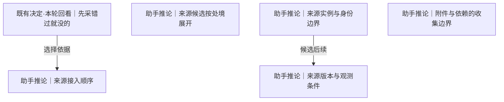

# 来源范围与接入次序

确认来源实例、选择下一条导洞、界定附件与版本条件；全部路线是候选，用户已确认的根另列。

[返回全景](../README.md) · [交互浏览](../index.html)

## 先采错过就没的

**既有决定·本轮回看** · 既有顺序偏向不可补回的观测；本轮同时比较丢失窗口与实际接入成本，具体开发先后仍待选择。

依据：

- [有的数据错过就没了](conditions.md#n-199bd2fb464f74ce)（选择依据）：未观测的瞬时活动可能无法补回，构成排序依据。

依据材料：[src/Docs/Orisumi.Docs/content/docs/requirements/belief.mdx#先采错过就没的](../../../../../src/Docs/Orisumi.Docs/content/docs/requirements/belief.mdx#%E5%85%88%E9%87%87%E9%94%99%E8%BF%87%E5%B0%B1%E6%B2%A1%E7%9A%84)。沿用既有需求的稳定名字；当前适用范围与替代方案在下游问题中重审。

可能需要回看：46 个下游节点（含所有候选路线）

[事件时间与顺序](capture.md#n-0843f43438c1c4a1)、[位置定位到哪里](records.md#n-d75a21e927a755bb)、[共享怎样授权](access.md#n-4b3c6032607d1b5c)、[分块策略与版本](storage.md#n-044919fef0bfc086)、[删除记录与回收](storage.md#n-0350116e746cba2c)、[压缩与存放表示](storage.md#n-d00cf82ac296b520)、[原件分单元和块两层](records.md#n-c2507b9e78d79f34)、[原件存成块](storage.md#n-1e55971a7ab3ff58)、[原样保存与一致性](records.md#n-49d755be3c14fe60)、[取得方式按来源形态选择](capture.md#n-6d6180cd980550cc)、[取得时间怎样记录](records.md#n-746612aae6ea6fde)、[取得权限与资源条件](capture.md#n-55c7589ea4cd33f0)、[各处原样都存](records.md#n-8e446efeb629f847)、[同步交换与提交](availability.md#n-da173cb6e04759f8)、[多副本删除与离线节点](availability.md#n-19ed3ea2239e62f9)、[完整内容的边界](records.md#n-26854bffbe13f18e)、[导出与恢复](storage.md#n-da66683208852205)、[屏幕观测粒度](sources-live.md#n-e5a27649574fb74b)、[接口与导出取得方式](capture.md#n-c68c6175d29abc5e)、[接口全量与增量](capture.md#n-76b9927e1c8393d5)、[数据库取得一致性](capture.md#n-cba810bb05a18834)、[文件变化取得策略](capture.md#n-6de65500ebbea77b)、[文件读取一致性](capture.md#n-a6463ad095322f24)、[新旧理解怎样评测](delivery.md#n-cbfb97254da427c8)、[时间含义怎样保留](understanding.md#n-e0bf0a291b892dad)、[来源原生增量怎样保存](storage.md#n-95be81155ce3d6b5)、[来源接入顺序](#n-821855273f39bc59)、[模型调用留下什么](understanding.md#n-97745ff5030f65f3)、[派生结果遇到删除或撤权](access.md#n-183194894919be77)、[浏览器事件传输](capture.md#n-b75cd5e6c6494099)、[浏览器页面内容范围](sources-live.md#n-a7ffdec9fe8bb5c3)、[理解版本怎样使用](understanding.md#n-be7944dd96e1f491)、[瞬时事件接收方式](capture.md#n-359653aed5ab9c59)、[离线与历史补取](capture.md#n-f116b26a22aa88eb)、[设备角色与离线工作](availability.md#n-e56d1b0735fb0084)、[读出引用到哪里](understanding.md#n-fe26af63a38ee976)、[调度频率与触发](capture.md#n-4804bedf60d73204)、[跨材料的取得时刻](capture.md#n-cc2fd44e41899000)、[连续媒体分段与编码](capture.md#n-84f109ff78f86572)、[连续录制怎样分段](capture.md#n-fd5e4f2373611f18)、[采集单次结果与保障边界](capture.md#n-5c39e84c8ee42507)、[采集启动与执行位置](capture.md#n-f47170f9f44e3fc5)、[采集幂等](storage.md#n-cbc00cff523393ab)、[采集设备怎样缓冲](availability.md#n-358b28d323bdbb8b)、[重复位置怎样归并](records.md#n-9034dc9f63983316)、[附件与依赖的收集边界](#n-128cbd6f1a6dfa45)

## 来源候选按处境展开

**助手推论** · 同一段对话可以同时留下本地日志、附件和屏幕画面。先逐项进入清单中的来源，再共享文件、数据库、接口、事件、媒体的下游问题；这些分支可以组合。

**Agent采用 · 当前**

候选：已有记录、瞬时观测。

理由与代价：先保住已知会清理的会话材料，随后补前台活动这一不可补回缺口；媒体和手机外设保留条件性分支，接受尚未观测的时段无法追回。

启动或重审条件：Codex、外部副本和 macOS 手动前台观测已通过当前范围的验收；媒体、外设和其他平台按实际设备、来源损失窗口与负载样本重审。

候选可组合。四个分支是可同时进入的来源范围；选中某一分支不排除其他分支，各自继续确定具体材料和取得方式。

依据：

- [尽量收集一切](roots.md#n-c3c6e7607f2c9805)（选择依据）：凡关于个人且可取得或观测的材料均可候选，此处明确实际覆盖范围。
- [数据所处的情况](roots.md#n-b450eb729c7db69e)（选择依据）：补回机会取决于材料是否已记录及何时消失，此处按真实处境选择取得方式。

依据材料：[.scratch/requirements/survey.md](../../../../requirements/survey.md)。来源清单列入候选；列入不等于已具备取得能力。

### 已有记录 · 助手推荐

查看现存文件、数据库、接口和导出中实际可取得的材料。

收益：能先保住已有历史。

代价：不同来源仍需核对正文和关联信息。

适用条件：来源已经留下记录。

继续展开：[助手会话来源范围](sources-local.md#n-48c68baae38d62c6)、[旧Heartbeat历史材料](sources-local.md#n-32da8b7037cad0ce)、[Git保存内容层次](sources-local.md#n-4b833bed1e02c780)、[本地文件选择边界](sources-local.md#n-8448d9854b79d7b9)、[Shell历史与执行事件](sources-local.md#n-118a4b0d856abce8)、[Magpie实际统计范围](sources-local.md#n-50f8d69c2eb8779a)、[即时通信取得路径](sources-services.md#n-ba0ab57a2e6cc230)、[自述笔记与语音备忘录](sources-services.md#n-cb83ef0ee8e5fb1a)、[网页AI对话取得路径](sources-services.md#n-0a2683066e8d303e)、[收藏夹内容范围](sources-services.md#n-585bf03f3064852a)、[观看历史取得范围](sources-services.md#n-8919d7670c9b28bc)、[日历与待办取得范围](sources-services.md#n-07a8001bf589f81f)、[邮件取得范围](sources-services.md#n-9d1e8d5b919786ae)、[听歌记录取得范围](sources-services.md#n-c28b5bf691b86cb8)、[消费账单取得范围](sources-services.md#n-092e0cb48561c63b)

### 瞬时观测 · 助手推荐

在应用活动、键鼠、浏览器、系统状态与剪贴板发生时记录。

收益：补上从未被其他系统留下的事实。

代价：需要设备上运行、权限和具体观测定义。

适用条件：错过后无法从其他记录补回。

继续展开：[前台应用与键鼠观测](sources-live.md#n-356bb4ec11f181f1)、[浏览器观测层次](sources-live.md#n-bba0514698b64e45)、[系统状态观测](sources-live.md#n-4f3376baa1dbe8cf)、[剪贴板观测范围](sources-live.md#n-618e04ed24bb7e60)、[VRChat实时与历史](sources-live.md#n-2eb015571c56fd7e)

### 连续画面与声音 · 助手推荐

把屏幕、麦克风或系统音频作为新的来源，先测保留信息与实际体量。

收益：保留后续 OCR、ASR 和多模态理解的材料。

代价：编码、耗电、磁盘和观测粒度都要测。

适用条件：用户愿意选入这种观测形态。

继续展开：[屏幕观测粒度](sources-live.md#n-e5a27649574fb74b)、[录音观测范围](sources-live.md#n-97b5d1da3ef7cad3)、[连续媒体分段与编码](capture.md#n-84f109ff78f86572)

### 手机与外设 · 助手推荐

按手机系统和实际硬件分别勘探可取得的历史或实时输出。

收益：覆盖电脑之外的生活材料。

代价：权限、设备条件和导出能力尚未核实。

适用条件：来源清单中尚无真实样本。

继续展开：[手机来源分项勘探](sources-live.md#n-fa86213d600d0954)、[硬件传感数据取得](sources-live.md#n-403c19b83fbf57ee)

实现现状：Claude Code 与 Codex 现有材料已采集并可恢复；macOS 手动前台应用观测已通过 22 次真实切换和 49 条原件恢复。其他来源按各自勘探终点推进。（[src/Orisumi.Capturing/ClaudeCodeSource.cs](../../../../../src/Orisumi.Capturing/ClaudeCodeSource.cs)、[src/Orisumi.Capturing/CodexSource.cs](../../../../../src/Orisumi.Capturing/CodexSource.cs)、[src/Orisumi.Capturing/ForegroundCollector.cs](../../../../../src/Orisumi.Capturing/ForegroundCollector.cs)）

审阅重点：按采用记录核对覆盖范围、接受的代价和实际证据；条件变化时沿触发条件重审。

可能需要回看：80 个下游节点（含所有候选路线）

[ClaudeCode目录范围](sources-local.md#n-e1a2a790d5d446a9)、[Codex其他数据库范围](sources-local.md#n-212a8d9d321fc8c3)、[Codex日志表示](sources-local.md#n-654ef3908ee1adec)、[Codex状态数据库范围](sources-local.md#n-bb8086babda89015)、[Codex附件与产物范围](sources-local.md#n-c8cf6296fafacb06)、[Git保存内容层次](sources-local.md#n-4b833bed1e02c780)、[Git当前工作与历史边界](sources-local.md#n-0654de3735dd2271)、[Magpie实际统计范围](sources-local.md#n-50f8d69c2eb8779a)、[Shell历史与执行事件](sources-local.md#n-118a4b0d856abce8)、[VRChat实时与历史](sources-live.md#n-2eb015571c56fd7e)、[事件时间与顺序](capture.md#n-0843f43438c1c4a1)、[位置定位到哪里](records.md#n-d75a21e927a755bb)、[共享怎样授权](access.md#n-4b3c6032607d1b5c)、[分块策略与版本](storage.md#n-044919fef0bfc086)、[删除记录与回收](storage.md#n-0350116e746cba2c)、[前台应用与键鼠观测](sources-live.md#n-356bb4ec11f181f1)、[剪贴板观测范围](sources-live.md#n-618e04ed24bb7e60)、[助手会话来源范围](sources-local.md#n-48c68baae38d62c6)、[即时通信取得路径](sources-services.md#n-ba0ab57a2e6cc230)、[压缩与存放表示](storage.md#n-d00cf82ac296b520)、[原件分单元和块两层](records.md#n-c2507b9e78d79f34)、[原件存成块](storage.md#n-1e55971a7ab3ff58)、[原样保存与一致性](records.md#n-49d755be3c14fe60)、[取得方式按来源形态选择](capture.md#n-6d6180cd980550cc)、[取得时间怎样记录](records.md#n-746612aae6ea6fde)、[取得权限与资源条件](capture.md#n-55c7589ea4cd33f0)、[各处原样都存](records.md#n-8e446efeb629f847)、[同步交换与提交](availability.md#n-da173cb6e04759f8)、[听歌记录取得范围](sources-services.md#n-c28b5bf691b86cb8)、[多副本删除与离线节点](availability.md#n-19ed3ea2239e62f9)、[完整内容的边界](records.md#n-26854bffbe13f18e)、[导出与恢复](storage.md#n-da66683208852205)、[屏幕观测粒度](sources-live.md#n-e5a27649574fb74b)、[录音观测范围](sources-live.md#n-97b5d1da3ef7cad3)、[手机来源分项勘探](sources-live.md#n-fa86213d600d0954)、[接口与导出取得方式](capture.md#n-c68c6175d29abc5e)、[接口全量与增量](capture.md#n-76b9927e1c8393d5)、[收藏夹内容范围](sources-services.md#n-585bf03f3064852a)、[数据库取得一致性](capture.md#n-cba810bb05a18834)、[文件变化取得策略](capture.md#n-6de65500ebbea77b)、[文件读取一致性](capture.md#n-a6463ad095322f24)、[新旧理解怎样评测](delivery.md#n-cbfb97254da427c8)、[日历与待办取得范围](sources-services.md#n-07a8001bf589f81f)、[旧Heartbeat历史材料](sources-local.md#n-32da8b7037cad0ce)、[时间含义怎样保留](understanding.md#n-e0bf0a291b892dad)、[本地文件选择边界](sources-local.md#n-8448d9854b79d7b9)、[来源原生增量怎样保存](storage.md#n-95be81155ce3d6b5)、[来源版本与观测条件](#n-a4f8682d76dcd71d)、[模型调用留下什么](understanding.md#n-97745ff5030f65f3)、[派生结果遇到删除或撤权](access.md#n-183194894919be77)、[浏览器事件传输](capture.md#n-b75cd5e6c6494099)、[浏览器媒体与网络观测](sources-live.md#n-e5f6dc441264494e)、[浏览器持久记录取得](sources-live.md#n-0a1e75558e92bd10)、[浏览器焦点与标签观测](sources-live.md#n-6a613b885484430f)、[浏览器观测层次](sources-live.md#n-bba0514698b64e45)、[浏览器页面内容范围](sources-live.md#n-a7ffdec9fe8bb5c3)、[消费账单取得范围](sources-services.md#n-092e0cb48561c63b)、[理解版本怎样使用](understanding.md#n-be7944dd96e1f491)、[瞬时事件接收方式](capture.md#n-359653aed5ab9c59)、[硬件传感数据取得](sources-live.md#n-403c19b83fbf57ee)、[离线与历史补取](capture.md#n-f116b26a22aa88eb)、[系统状态观测](sources-live.md#n-4f3376baa1dbe8cf)、[网页AI对话取得路径](sources-services.md#n-0a2683066e8d303e)、[自述笔记与语音备忘录](sources-services.md#n-cb83ef0ee8e5fb1a)、[观看历史取得范围](sources-services.md#n-8919d7670c9b28bc)、[记下采集器版本](records.md#n-b260468ee1981b5f)、[设备角色与离线工作](availability.md#n-e56d1b0735fb0084)、[读出引用到哪里](understanding.md#n-fe26af63a38ee976)、[调度频率与触发](capture.md#n-4804bedf60d73204)、[跨材料的取得时刻](capture.md#n-cc2fd44e41899000)、[输入内容是否观测](sources-live.md#n-f3ba2a41f71f6997)、[连续媒体分段与编码](capture.md#n-84f109ff78f86572)、[连续录制怎样分段](capture.md#n-fd5e4f2373611f18)、[邮件取得范围](sources-services.md#n-9d1e8d5b919786ae)、[采集单次结果与保障边界](capture.md#n-5c39e84c8ee42507)、[采集启动与执行位置](capture.md#n-f47170f9f44e3fc5)、[采集幂等](storage.md#n-cbc00cff523393ab)、[采集设备怎样缓冲](availability.md#n-358b28d323bdbb8b)、[重复位置怎样归并](records.md#n-9034dc9f63983316)、[附件与依赖的收集边界](#n-128cbd6f1a6dfa45)

## 来源实例与身份边界

**助手推论** · Chrome 与 Edge、两个浏览器 Profile、同一应用在两台电脑上的安装都能产生不同记录；一人一个来源名不足以分辨取得位置。

**Agent采用 · 当前**

候选：从一个实例端到端开始。

理由与代价：当前 Mac 上一个 Codex 实例已有真实盘点，适合验证取得到恢复；先扩大到所有实例会放大未经验证的边界，接受其他实例暂未覆盖。

启动或重审条件：首实例原件、出处与独立恢复通过后，枚举其他实际实例再逐一接入。

依据：

- [尽量收集一切](roots.md#n-c3c6e7607f2c9805)（选择依据）：凡关于个人且可取得或观测的材料均可候选，此处明确实际覆盖范围。
- [出处一起保存](roots.md#n-2ce85769c25073e7)（选择依据）：材料需连同直接知道的取得事实保存，此处确定可证明的来源与取得条件。

依据材料：[.scratch/requirements/survey-local.md](../../../../requirements/survey-local.md)。本机存在多个浏览器和 IM 数据位置。

依据材料：[.scratch/requirements/survey-heartbeat.md](../../../../requirements/survey-heartbeat.md)。多设备和跨平台应用身份，另一人的设备也在旧库中。

### 本轮覆盖已枚举的多个实例 · 助手推荐

先用一个实例确认取得与读回，再在本轮扩到已枚举的设备、账号和安装位置，逐项记覆盖情况。

收益：能发现漏装扩展、漏扫目录及多账号差异。

代价：需要维护实际实例清单。

适用条件：推荐作为每个来源勘探的起点。

继续展开：[来源版本与观测条件](#n-a4f8682d76dcd71d)、[取得权限与资源条件](capture.md#n-55c7589ea4cd33f0)

### 从一个实例端到端开始 · 助手推荐

先选当前最容易取得的实例跑通保存和恢复，再逐个扩展并标明其余未覆盖。

收益：接入问题集中且可核验。

代价：这段时间其余实例的瞬时活动会错过。

适用条件：首次接一种新形态，之后再铺开。

分支终点：选择一台设备、一个账号或 Profile，保存一份原件及出处，在隔离目录中读回；随后把同类其他实例加入待接清单。

检验：验收报告能列出本次覆盖和未覆盖的实例；不把一台设备的结果外推成全部来源已采。

实现现状：当前来源以 source、host、origin 和保存路径区分取得；Codex 已验证一个本机实例，前台另记运行 UUID。其他账号与实例尚未接入。（[src/Orisumi.Raw/Records.cs](../../../../../src/Orisumi.Raw/Records.cs)、[src/Orisumi.Capturing/CodexSource.cs](../../../../../src/Orisumi.Capturing/CodexSource.cs)、[src/Orisumi.Capturing/Native/Foreground.swift](../../../../../src/Orisumi.Capturing/Native/Foreground.swift)）

审阅重点：按采用记录核对覆盖范围、接受的代价和实际证据；条件变化时沿触发条件重审。

可能需要回看：24 个下游节点（含所有候选路线）

[位置定位到哪里](records.md#n-d75a21e927a755bb)、[位置用采集记录的名字](records.md#n-17f75f43a19b2bcb)、[共享怎样授权](access.md#n-4b3c6032607d1b5c)、[内容取得与来源身份](records.md#n-15c7ee1513e29577)、[分块策略与版本](storage.md#n-044919fef0bfc086)、[删除记录与回收](storage.md#n-0350116e746cba2c)、[压缩与存放表示](storage.md#n-d00cf82ac296b520)、[原件存成块](storage.md#n-1e55971a7ab3ff58)、[取得权限与资源条件](capture.md#n-55c7589ea4cd33f0)、[各处原样都存](records.md#n-8e446efeb629f847)、[多副本删除与离线节点](availability.md#n-19ed3ea2239e62f9)、[导出与恢复](storage.md#n-da66683208852205)、[新旧理解怎样评测](delivery.md#n-cbfb97254da427c8)、[来源原生增量怎样保存](storage.md#n-95be81155ce3d6b5)、[来源标识怎样保留](records.md#n-35c210bea72e9af7)、[来源版本与观测条件](#n-a4f8682d76dcd71d)、[模型调用留下什么](understanding.md#n-97745ff5030f65f3)、[派生结果遇到删除或撤权](access.md#n-183194894919be77)、[理解版本怎样使用](understanding.md#n-be7944dd96e1f491)、[记下采集器版本](records.md#n-b260468ee1981b5f)、[读出引用到哪里](understanding.md#n-fe26af63a38ee976)、[身份对应怎样形成](understanding.md#n-3dd56ca36a38bda1)、[采集幂等](storage.md#n-cbc00cff523393ab)、[重复位置怎样归并](records.md#n-9034dc9f63983316)

## 来源接入顺序

**助手推论** · 应用切换晚一天接入就少一天历史；Codex 日志容易先保存，旧库则可能在设备退役时失去。推荐综合丢失窗口、接入成本和已知价值决定下一条导洞。

**Agent采用 · 当前**

候选：丢失窗口与接入成本共同排序。

理由与代价：Codex 现存日志会归档压缩且取得成本清楚，先保存收益确定；接着验证前台事件，兼顾永久缺口，接受排序随证据改变。

启动或重审条件：来源出现清理期限、设备退役或新的低成本瞬时接口证据时重新排序。

依据：

- [数据所处的情况](roots.md#n-b450eb729c7db69e)（选择依据）：补回机会取决于材料是否已记录及何时消失，此处按真实处境选择取得方式。
- [尽量采全变化](roots.md#n-cc33c5b227746d72)（选择依据）：尽量取每次可取得变化，此处需验证来源暴露的变化粒度和取得窗口。
- [先采错过就没的](#n-e4cd3dc0553aa56f)（选择依据）：原有排序偏好提供一个尺度，还要共同比较来源窗口和接入成本。

依据材料：[.scratch/requirements/survey.md](../../../../requirements/survey.md)。原建议按瞬时优先；本轮根决定要求同时比较成本。

依据材料：[.scratch/requirements/survey-assistant-sessions.md](../../../../requirements/survey-assistant-sessions.md)。已有日志也发生删除、压缩和迁移。

依据材料：[src/Docs/Orisumi.Docs/content/docs/model/validation.mdx#前台观测](../../../../../src/Docs/Orisumi.Docs/content/docs/model/validation.mdx#%E5%89%8D%E5%8F%B0%E8%A7%82%E6%B5%8B)。当前 macOS 图形用户会话手动观察：7 次约 1 秒切换与 15 次约 0.2 秒切换全部取得；22 条激活、22 条失活分别与测试应用自身回调的身份及顺序一致。49 条原件全部恢复并核对哈希、长度、LF 和出处；同应用 4 次切窗、1 次改标题期间无新增应用级通知。

### 丢失窗口与接入成本共同排序 · 助手推荐

把易取得的现存材料先留底，同时为补不回的观测挑一条小导洞。

收益：兼顾立即保存和难以补回的材料。

代价：需要对每个来源估计窗口与投入，估计可修正。

适用条件：推荐；窗口未知先用样本查清。

继续展开：[取得方式按来源形态选择](capture.md#n-6d6180cd980550cc)、[离线与历史补取](capture.md#n-f116b26a22aa88eb)

### 仅按不可补回程度排序 · 可选路线

先做瞬时观测，再做现有文件与接口。

收益：最早开始积累未来历史。

代价：复杂设备接入可能使易保存且正在清理的日志继续流失。

适用条件：瞬时导洞成本已清楚且足够低。

分支终点：先选一种平台上的前台事件；现有材料至少另存当前可取得副本，再扩大实时观测。

检验：比较一周内新增可保存的覆盖与延期来源的已知保留期。

### 仅先做低成本现成记录 · 可选路线

先接 Claude、Codex、文件和可导出数据，实时观测后排。

收益：很快形成真实可恢复的材料。

代价：延期期间的未记录事件无法追补。

适用条件：近期实施资源不足，愿意接受这段时间的观测缺口。

分支终点：给延期观测记具体未开始日期与原因，在下一条来源接入时重新比较。

检验：延期列表显式列出哪些时段永远补不回，不能称全量历史。

实现现状：已完成 Codex 本机取得恢复及外部异机副本，随后完成 macOS 手动前台观测的受控切换、应用内操作边界与原件恢复；其他来源按实际损失窗口继续排序。（[src/Orisumi.Capturing/CodexSource.cs](../../../../../src/Orisumi.Capturing/CodexSource.cs)、[src/Orisumi.Capturing/ForegroundCollector.cs](../../../../../src/Orisumi.Capturing/ForegroundCollector.cs)、[src/Docs/Orisumi.Docs/content/docs/model/validation.mdx](../../../../../src/Docs/Orisumi.Docs/content/docs/model/validation.mdx)、[src/Docs/Orisumi.Docs/content/docs/model/validation.mdx#前台观测](../../../../../src/Docs/Orisumi.Docs/content/docs/model/validation.mdx#%E5%89%8D%E5%8F%B0%E8%A7%82%E6%B5%8B)）

审阅重点：建议现存易取得材料先留底，同时为一条不可补回的观测做小导洞。决定下一项投入在哪里。

可能需要回看：45 个下游节点（含所有候选路线）

[事件时间与顺序](capture.md#n-0843f43438c1c4a1)、[位置定位到哪里](records.md#n-d75a21e927a755bb)、[共享怎样授权](access.md#n-4b3c6032607d1b5c)、[分块策略与版本](storage.md#n-044919fef0bfc086)、[删除记录与回收](storage.md#n-0350116e746cba2c)、[压缩与存放表示](storage.md#n-d00cf82ac296b520)、[原件分单元和块两层](records.md#n-c2507b9e78d79f34)、[原件存成块](storage.md#n-1e55971a7ab3ff58)、[原样保存与一致性](records.md#n-49d755be3c14fe60)、[取得方式按来源形态选择](capture.md#n-6d6180cd980550cc)、[取得时间怎样记录](records.md#n-746612aae6ea6fde)、[取得权限与资源条件](capture.md#n-55c7589ea4cd33f0)、[各处原样都存](records.md#n-8e446efeb629f847)、[同步交换与提交](availability.md#n-da173cb6e04759f8)、[多副本删除与离线节点](availability.md#n-19ed3ea2239e62f9)、[完整内容的边界](records.md#n-26854bffbe13f18e)、[导出与恢复](storage.md#n-da66683208852205)、[屏幕观测粒度](sources-live.md#n-e5a27649574fb74b)、[接口与导出取得方式](capture.md#n-c68c6175d29abc5e)、[接口全量与增量](capture.md#n-76b9927e1c8393d5)、[数据库取得一致性](capture.md#n-cba810bb05a18834)、[文件变化取得策略](capture.md#n-6de65500ebbea77b)、[文件读取一致性](capture.md#n-a6463ad095322f24)、[新旧理解怎样评测](delivery.md#n-cbfb97254da427c8)、[时间含义怎样保留](understanding.md#n-e0bf0a291b892dad)、[来源原生增量怎样保存](storage.md#n-95be81155ce3d6b5)、[模型调用留下什么](understanding.md#n-97745ff5030f65f3)、[派生结果遇到删除或撤权](access.md#n-183194894919be77)、[浏览器事件传输](capture.md#n-b75cd5e6c6494099)、[浏览器页面内容范围](sources-live.md#n-a7ffdec9fe8bb5c3)、[理解版本怎样使用](understanding.md#n-be7944dd96e1f491)、[瞬时事件接收方式](capture.md#n-359653aed5ab9c59)、[离线与历史补取](capture.md#n-f116b26a22aa88eb)、[设备角色与离线工作](availability.md#n-e56d1b0735fb0084)、[读出引用到哪里](understanding.md#n-fe26af63a38ee976)、[调度频率与触发](capture.md#n-4804bedf60d73204)、[跨材料的取得时刻](capture.md#n-cc2fd44e41899000)、[连续媒体分段与编码](capture.md#n-84f109ff78f86572)、[连续录制怎样分段](capture.md#n-fd5e4f2373611f18)、[采集单次结果与保障边界](capture.md#n-5c39e84c8ee42507)、[采集启动与执行位置](capture.md#n-f47170f9f44e3fc5)、[采集幂等](storage.md#n-cbc00cff523393ab)、[采集设备怎样缓冲](availability.md#n-358b28d323bdbb8b)、[重复位置怎样归并](records.md#n-9034dc9f63983316)、[附件与依赖的收集边界](#n-128cbd6f1a6dfa45)

## 附件与依赖的收集边界

**助手推论** · 日志里写着一张图的本地路径，留下路径与留下图片是两种结果；同一目录还可能带可重建的工具依赖。

**Agent采用 · 当前**

候选：来源定义的目录及关联材料一起收。

理由与代价：已知附件和产物目录有真实文件，整目录留存避免靠未验证关联字段筛掉材料；接受包含可重建依赖的空间成本。

启动或重审条件：明确附件字段出现目录外引用时，用十条样本核对再考虑 follow；当前不递归跟随普通文本中的路径。

依据：

- [留最原始的一层](roots.md#n-760744617270b5ce)（选择依据）：保留来源交来的材料后再解释，此处明确来源交付层及取得是否改变内容。
- [尽量完整留下](roots.md#n-77e7f6f84727e69e)（选择依据）：默认尽量留下选定范围内可得的信息，此处比较哪些材料会留下或丢失及实际代价。
- [出处一起保存](roots.md#n-2ce85769c25073e7)（选择依据）：材料需连同直接知道的取得事实保存，此处确定可证明的来源与取得条件。

依据材料：[.scratch/requirements/survey-assistant-sessions.md](../../../../requirements/survey-assistant-sessions.md)。两家会话均有外部工具结果、图片或长文本。

依据材料：[.scratch/requirements/survey-codex-20261106.md](../../../../requirements/survey-codex-20261106.md)。2026-11-06 只读盘点的日志格式、state_5 模式/计数及附件目录体量；计数对应当时观察，不代表持续来源的当前总量。

### 来源定义的目录及关联材料一起收 · 助手推荐

先收来源已知的正文、索引、附件、产物目录；记录关联原文。

收益：来源消失后仍可能恢复完整交互。

代价：目录可能混有依赖，需要实际盘点。

适用条件：推荐；存在明确附件目录或清单。

分支终点：选一份引用外部图片/长文本的记录，列出已知目录，采完移开来源副本再读回正文与附件。

检验：附件字节能恢复，引用关系仍可解释；只剩路径的情况列成缺口。

### 已知目录加显式引用补取 · 可选路线

先收来源定义的正文/索引/附件目录，再解析已核实的附件字段补取目录外材料；每条显式引用分别记成功或无法取得。

收益：可覆盖目录外的实际材料。

代价：解析器、远端期限和递归边界成为采集规则。

适用条件：来源能提供可信附件关系而非任意文本路径。

分支终点：先盘点已知目录，再用样本核对显式附件字段、URL 有效期、循环引用与目录外内容，确定额外跟随哪些关系。

检验：十条含附件样本中，每条列出引用、可取内容和失效条件；工具工作目录等路径不会自动扩成整个磁盘。

### 只留主体文件 · 可选路线

保留会话或列表正文，外部附件仅留地址。

收益：取得简单且范围小。

代价：源附件删除后无法恢复内容。

适用条件：仅当用户把附件明确排出此来源范围才选。

分支终点：在来源范围正文写清只含主体和引用，附件交给独立来源。

检验：恢复试验报告附件可用依赖何处，不能把仅留链接称完整收集。

实现现状：Codex 已整体采集 attachments、generated_images、visualizations，包含可重建依赖；普通文件与符号链接目标分别恢复，不递归跟随正文路径。（[src/Orisumi.Capturing/CodexSource.cs](../../../../../src/Orisumi.Capturing/CodexSource.cs)、[src/Orisumi.Raw/CaptureRecovery.cs](../../../../../src/Orisumi.Raw/CaptureRecovery.cs)、[src/Docs/Orisumi.Docs/content/docs/model/validation.mdx](../../../../../src/Docs/Orisumi.Docs/content/docs/model/validation.mdx)）

审阅重点：正文路径与附件实体分别验收；需要确定同一来源包含哪些实际目录与依赖。

可能需要回看：12 个下游节点（含所有候选路线）

[共享怎样授权](access.md#n-4b3c6032607d1b5c)、[分块策略与版本](storage.md#n-044919fef0bfc086)、[删除记录与回收](storage.md#n-0350116e746cba2c)、[压缩与存放表示](storage.md#n-d00cf82ac296b520)、[原件存成块](storage.md#n-1e55971a7ab3ff58)、[各处原样都存](records.md#n-8e446efeb629f847)、[多副本删除与离线节点](availability.md#n-19ed3ea2239e62f9)、[导出与恢复](storage.md#n-da66683208852205)、[来源原生增量怎样保存](storage.md#n-95be81155ce3d6b5)、[派生结果遇到删除或撤权](access.md#n-183194894919be77)、[采集幂等](storage.md#n-cbc00cff523393ab)、[重复位置怎样归并](records.md#n-9034dc9f63983316)

## 来源版本与观测条件

**助手推论** · 同一字段曾用修订号或时间戳，同一会话日志可能经历迁移；保留来源原文中的版本，与采集器版本及直接可见的运行条件。

**Agent采用 · 当前**

候选：记录直接取得的版本与条件。

理由与代价：保存采集器身份、设备、配置位置及取得方式，来源声明留在原件中；仅内嵌版本解释不了采集行为变化，接受无法取得的版本为未知。

启动或重审条件：接新来源或采集器改变读取方式时核对可直接取得的版本字段。

依据：

- [出处一起保存](roots.md#n-2ce85769c25073e7)（选择依据）：材料需连同直接知道的取得事实保存，此处确定可证明的来源与取得条件。
- [留最原始的一层](roots.md#n-760744617270b5ce)（选择依据）：保留来源交来的材料后再解释，此处明确来源交付层及取得是否改变内容。

依据材料：[.scratch/requirements/survey-heartbeat.md](../../../../requirements/survey-heartbeat.md)。Revision、键码和平台字段曾改变。

依据材料：[.scratch/requirements/survey-assistant-sessions.md](../../../../requirements/survey-assistant-sessions.md)。Codex 版本跨度，迁移重写仅为推论。

依据材料：[src/Docs/Orisumi.Docs/content/docs/requirements/belief.mdx#记下采集器版本](../../../../../src/Docs/Orisumi.Docs/content/docs/requirements/belief.mdx#%E8%AE%B0%E4%B8%8B%E9%87%87%E9%9B%86%E5%99%A8%E7%89%88%E6%9C%AC)。既有决定，本轮未逐条重审。

依据材料：[src/Docs/Orisumi.Docs/content/docs/model/validation.mdx#前台观测](../../../../../src/Docs/Orisumi.Docs/content/docs/model/validation.mdx#%E5%89%8D%E5%8F%B0%E8%A7%82%E6%B5%8B)。当前 macOS 图形用户会话手动观察：7 次约 1 秒切换与 15 次约 0.2 秒切换全部取得；22 条激活、22 条失活分别与测试应用自身回调的身份及顺序一致。49 条原件全部恢复并核对哈希、长度、LF 和出处；同应用 4 次切窗、1 次改标题期间无新增应用级通知。

### 记录直接取得的版本与条件 · 助手推荐

来源自身版本原样留在材料里，另记采集器版本、设备位置、取得方式及接口/数据库版本可见值。

收益：以后解释格式变化有可核查依据。

代价：部分版本无法取得，必须标明未知。

适用条件：推荐；只记录本轮直接知道的事实。

分支终点：为每种来源列可直接得到的版本位置，未提供时记未提供；不从文件名猜软件版本。

检验：用两个版本或两种字段格式的样本恢复，能分别指出来源声明与采集器声明。

### 仅保留来源内嵌版本 · 可选路线

只留文件自身版本字段，采集器版本不作为出处。

收益：出处字段较少。

代价：无法区分采集器行为改变和来源格式改变。

适用条件：需要重审既有记下采集器版本的依据。

分支终点：列出一次采集器升级后对取得内容的差异，验证来源内嵌字段是否足以解释。

检验：若差异不能从原文判断，则重新采用独立取得条件。

实现现状：采集根保存 collector、host、origin、时间窗口；清单保存 method。前台 started 保存 OS 与订阅项，观察行保存格式和运行身份；不可得来源版本保持空值。（[src/Orisumi.Raw/Records.cs](../../../../../src/Orisumi.Raw/Records.cs)、[src/Orisumi.Capturing/Native/Foreground.swift](../../../../../src/Orisumi.Capturing/Native/Foreground.swift)、[src/Docs/Orisumi.Docs/content/docs/model/foreground.mdx](../../../../../src/Docs/Orisumi.Docs/content/docs/model/foreground.mdx)）

审阅重点：按采用记录核对覆盖范围、接受的代价和实际证据；条件变化时沿触发条件重审。

可能需要回看：1 个下游节点（含所有候选路线）

[记下采集器版本](records.md#n-b260468ee1981b5f)

