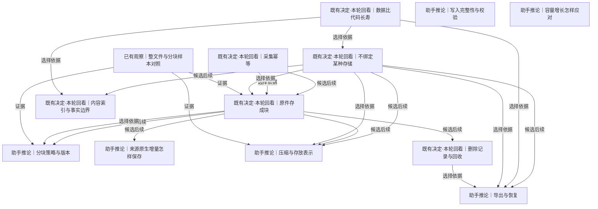

# 存储与生命周期

比较整文件、固定块、内容定义块和来源原生增量；分开决定压缩、索引、校验、保留、删除及导出恢复。

[返回全景](../README.md) · [交互浏览](../index.html)

## 数据比代码长寿

**既有决定·本轮回看** · 长期保存的材料需要在当前Orisumi代码消失或重写后仍能辨认出处、解码和恢复；这项目标不能直接推出某个存储产品。

依据：

- [以十年为尺度](roots.md#n-06933e934f4d562b)（推导）：材料保存周期可能长于一次软件实现。
- [留下观测重算理解](understanding.md#n-77f980be4039dd0a)（推导）：未来重算仍需要读到历史材料。

依据材料：[src/Docs/Orisumi.Docs/content/docs/requirements/belief.mdx#数据比代码长寿](../../../../../src/Docs/Orisumi.Docs/content/docs/requirements/belief.mdx#%E6%95%B0%E6%8D%AE%E6%AF%94%E4%BB%A3%E7%A0%81%E9%95%BF%E5%AF%BF)。既有长期目标，具体可携带格式与导出恢复在下游比较。

可能需要回看：25 个下游节点（含所有候选路线）

[不绑定某种存储](#n-9e024cb39c60031e)、[位置定位到哪里](records.md#n-d75a21e927a755bb)、[保存地是否需要加密封装](availability.md#n-5d0b7394b458d05a)、[共享怎样授权](access.md#n-4b3c6032607d1b5c)、[内容索引与事实边界](#n-52a4e60764c152e9)、[分块策略与版本](#n-044919fef0bfc086)、[删除记录与回收](#n-0350116e746cba2c)、[压缩与存放表示](#n-d00cf82ac296b520)、[原件分单元和块两层](records.md#n-c2507b9e78d79f34)、[原件存成块](#n-1e55971a7ab3ff58)、[同步交换与提交](availability.md#n-da173cb6e04759f8)、[多副本删除与离线节点](availability.md#n-19ed3ea2239e62f9)、[多处都有一份](availability.md#n-ae9194edde188509)、[导出与恢复](#n-da66683208852205)、[新旧理解怎样评测](delivery.md#n-cbfb97254da427c8)、[来源原生增量怎样保存](#n-95be81155ce3d6b5)、[模型调用留下什么](understanding.md#n-97745ff5030f65f3)、[派生结果遇到删除或撤权](access.md#n-183194894919be77)、[理解版本怎样使用](understanding.md#n-be7944dd96e1f491)、[网状拓扑和完整节点](availability.md#n-561838d4e083830d)、[设备角色与离线工作](availability.md#n-e56d1b0735fb0084)、[读出引用到哪里](understanding.md#n-fe26af63a38ee976)、[连接信任与访问边界](availability.md#n-ca03d6309f6b9fd6)、[采集设备怎样缓冲](availability.md#n-358b28d323bdbb8b)、[长期恢复怎样验证](delivery.md#n-254f30d6e194be24)

## 不绑定某种存储

**既有决定·本轮回看** · 从本地目录搬到对象存储或数据库时，怎样保证内容、出处、历史与删除语义一起带走？

**Agent采用 · 当前**

候选：独立描述的对象与记录格式。

理由与代价：现有对象与记录格式可形成独立恢复边界，避免引入新承载数据库事务作为事实；接受需补全格式、引用及编码说明。

启动或重审条件：首段独立读者从干净目录读完整保存集；未来换承载位置时复跑同样恢复证据。

依据：

- [数据比代码长寿](#n-de48cd5fab039fea)（选择依据）：可读性与可恢复性要跨越存储产品变化。

依据材料：[src/Docs/Orisumi.Docs/content/docs/model/raw.mdx](../../../../../src/Docs/Orisumi.Docs/content/docs/model/raw.mdx)。现有设计与格式是需回看的选择，不自动成为本轮用户确认。

### 独立描述的对象与记录格式 · 助手推荐

内容与记录用明确版本的可移植编码；目录、对象存储或数据库只是承载它们，索引可重建。

收益：离开当前程序仍可按说明拼接和校验；接入介质不改逻辑身份。

代价：格式、引用及删除规则要形成完整说明，不能只有zstd工具。

适用条件：多次重写和长期保存是目标时。

继续展开：[压缩与存放表示](#n-d00cf82ac296b520)、[导出与恢复](#n-da66683208852205)、[内容索引与事实边界](#n-52a4e60764c152e9)

### 存储产品承载事实，完整导出做边界 · 可选路线

以数据库记录/事务保存原件与出处，约定可独立恢复的导出格式和导出节奏。

收益：事务、索引和查询集中，应用实现可简化。

代价：产品版本和导出流程成为恢复依赖；只导业务表会漏大对象、历史或删除事实。

适用条件：数据库提供实际收益，且独立导出已验证时。

分支终点：把同一材料、历史、失败和删除示例写入候选数据库，导出后在没有原数据库的环境恢复。

检验：对象字节、取得事实与所有仍保留版本一致，不能靠原服务中的隐藏状态。

实现现状：IBlockStore 与目录块编码已实现；raw export/restore 提供单采集取回，外部完整副本已由独立 Python 读者在 Linux 恢复。其他承载后端尚未实现。（[src/Orisumi.Raw/IBlockStore.cs](../../../../../src/Orisumi.Raw/IBlockStore.cs)、[src/Orisumi.Raw/DirectoryBlockStore.cs](../../../../../src/Orisumi.Raw/DirectoryBlockStore.cs)、[src/Orisumi.Raw/CaptureRecovery.cs](../../../../../src/Orisumi.Raw/CaptureRecovery.cs)、[src/Docs/Orisumi.Docs/content/docs/model/validation.mdx](../../../../../src/Docs/Orisumi.Docs/content/docs/model/validation.mdx)）

审阅重点：可替换存储靠明确可恢复边界；不必先建所有适配器，也不能把接口本身当可携带证明。

可能需要回看：16 个下游节点（含所有候选路线）

[位置定位到哪里](records.md#n-d75a21e927a755bb)、[共享怎样授权](access.md#n-4b3c6032607d1b5c)、[内容索引与事实边界](#n-52a4e60764c152e9)、[分块策略与版本](#n-044919fef0bfc086)、[删除记录与回收](#n-0350116e746cba2c)、[压缩与存放表示](#n-d00cf82ac296b520)、[原件分单元和块两层](records.md#n-c2507b9e78d79f34)、[原件存成块](#n-1e55971a7ab3ff58)、[多副本删除与离线节点](availability.md#n-19ed3ea2239e62f9)、[导出与恢复](#n-da66683208852205)、[新旧理解怎样评测](delivery.md#n-cbfb97254da427c8)、[来源原生增量怎样保存](#n-95be81155ce3d6b5)、[模型调用留下什么](understanding.md#n-97745ff5030f65f3)、[派生结果遇到删除或撤权](access.md#n-183194894919be77)、[理解版本怎样使用](understanding.md#n-be7944dd96e1f491)、[读出引用到哪里](understanding.md#n-fe26af63a38ee976)

## 采集幂等

**既有决定·本轮回看** · 同一份内容重复采集时可以复用已有字节，但两次采集的时间和结果仍可不同；追加发生后新旧版本都应可读。

**Agent采用 · 当前**

候选：复用相同字节，保留取得记录。

理由与代价：复用物理字节并保留本轮时间、结果和出处符合已确认历史目标；独立快照包重复成本更高，接受局部变化仍有尾块与清单成本。

启动或重审条件：相同集重采和单文件追加对照，核对内容复用与取得次数分离。

依据：

- [保留采到的历史](roots.md#n-509f2d3467e7b121)（选择依据）：相同/变化版本需要区别，内容复用不能覆盖旧版本。
- [各处原样都存](records.md#n-8e446efeb629f847)（选择依据）：出处与物理字节份数分别决定。

依据材料：[src/Docs/Orisumi.Docs/content/docs/model/validation.mdx#整文件与分块对照](../../../../../src/Docs/Orisumi.Docs/content/docs/model/validation.mdx#%E6%95%B4%E6%96%87%E4%BB%B6%E4%B8%8E%E5%88%86%E5%9D%97%E5%AF%B9%E7%85%A7)。静态两次完全相同捕获，三种粒度都可做到第二次新增内容为零。

### 复用相同字节，保留取得记录 · 助手推荐

完整文件或物理块按内容相等复用；重复运行仍保留本轮取得事实。

收益：重复取得不会重复整份内容，同时可以知道何时确实采过。

代价：历史局部变化的额外开销仍由复用粒度决定。

适用条件：当前大量重复扫描与历史保留。

继续展开：[原件存成块](#n-1e55971a7ab3ff58)

### 每轮保存独立快照包 · 可选路线

每轮内容自足，不要求Orisumi内部消除字节重复；必要时外部归档系统去重。

收益：实现和单次搬走较直接。

代价：重复内容和历史成本增长，外部去重不能抹去出处。

适用条件：数据小、频率低或外部系统已能处理重复时。

分支终点：以真实运行周期算一年存储量；只有成本和恢复步骤可接受时采用。

检验：保留十次相同取得和十次变化版本，核对数量、出处及恢复成本。

实现现状：块与清单复用已实现；重复采集写根；新增块统计包含清单但不含根，不能直接当全部磁盘新增。（[src/Orisumi.Raw/CaptureWriter.cs](../../../../../src/Orisumi.Raw/CaptureWriter.cs)、[src/Orisumi.Raw/DirectoryBlockStore.cs](../../../../../src/Orisumi.Raw/DirectoryBlockStore.cs)）

审阅重点：将“相同内容复用”与“追加只存新增字节”分开，后者是各算法的有条件性能。

可能需要回看：9 个下游节点（含所有候选路线）

[共享怎样授权](access.md#n-4b3c6032607d1b5c)、[分块策略与版本](#n-044919fef0bfc086)、[删除记录与回收](#n-0350116e746cba2c)、[压缩与存放表示](#n-d00cf82ac296b520)、[原件存成块](#n-1e55971a7ab3ff58)、[多副本删除与离线节点](availability.md#n-19ed3ea2239e62f9)、[导出与恢复](#n-da66683208852205)、[来源原生增量怎样保存](#n-95be81155ce3d6b5)、[派生结果遇到删除或撤权](access.md#n-183194894919be77)

## 原件存成块

**既有决定·本轮回看** · 保存十个大日志历史版本时，整文件、固定块和内容定义块都能恢复原样，空间与复杂度不同；当前用户目标没有唯一指定其中之一。

**Agent采用 · 当前**

候选：内容定义块复用。

理由与代价：当前 CDC 已实现并适合日志连续版本，替换会分散首段收集价值；接受静态集不一定优于完整对象及尾块重写。

启动或重审条件：只有真实连续版本占用或读取成本成为问题，才用同一组材料比较 whole-file、fixed 与原生增量。

依据：

- [采集幂等](#n-cbc00cff523393ab)（选择依据）：重复字节可以复用，但复用粒度仍需选择。
- [保留采到的历史](roots.md#n-509f2d3467e7b121)（选择依据）：多版本局部重复可能使分块有价值。
- [不绑定某种存储](#n-9e024cb39c60031e)（选择依据）：逻辑材料与物理表示分开，路线可用恢复实验比较。
- [整文件与分块样本对照](#n-3d409be394226c3e)（证据）：静态、追加、中插、重压缩和小文件分别支持不同条件，不能推广为唯一方案。

依据材料：[src/Docs/Orisumi.Docs/content/docs/model/validation.mdx#整文件与分块对照](../../../../../src/Docs/Orisumi.Docs/content/docs/model/validation.mdx#%E6%95%B4%E6%96%87%E4%BB%B6%E4%B8%8E%E5%88%86%E5%9D%97%E5%AF%B9%E7%85%A7)。同codec静态与十版本回放覆盖整文件/固定块/实际CDC，并拆开去重与压缩收益。

### 内容定义块复用 · 助手推荐

当前文件历史继续以已实现CDC保存完整材料和块顺序；以实际版本变化样本决定是否值得用于其他来源。

收益：本次大日志历史与中插回放显著减少重复内容，已有实现可用。

代价：切块、清单、共享引用和尾块重写有成本；静态集压缩后比整文件更大。

适用条件：大文件经常局部追加/修改、中插或跨文件重合显著时；静态收藏应回看。

继续展开：[分块策略与版本](#n-044919fef0bfc086)、[压缩与存放表示](#n-d00cf82ac296b520)、[删除记录与回收](#n-0350116e746cba2c)

### 完整内容按哈希复用 · 可选路线

每个不同的完整文件/响应保存一个对象，完全相同内容不再写；每次取得另有记录。

收益：结构简单，长压缩上下文在本静态集更省；恢复不依赖块顺序。

代价：每个变化版本要保存整份编码内容，不能复用只差尾部的旧版本。

适用条件：主要是静态附件、小文件、低频版本，或压缩优势抵消重复成本时。

分支终点：以同一实际来源连续版本做完整内容对象方案，保留相同出处与历史，测压缩后内容和元数据。

检验：所有版本逐字节恢复；按真实变化频率而非静态单次样本决定总成本。

### 固定大小块复用 · 可选路线

按固定字节数切分，哈希复用相同块，保留尾块与顺序。

收益：规则简单；追加日志能复用已满前缀，本次重压缩样本优于CDC。

代价：中部插入使后续边界错位；尾块仍反复保存。

适用条件：追加居多、修改对齐或固定布局，且测量胜出时。

继续展开：[分块策略与版本](#n-044919fef0bfc086)

### 来源原生增量 · 可选路线

来源已经交来变化事件/版本对象时保留其原始序列与恢复依赖。

收益：可能更细覆盖变化，并省下全量反复读取。

代价：必须证明事件完整与可恢复；不能凭记录ID假定能重建原件。

适用条件：来源原生提供增量和明确基线时。

继续展开：[来源原生增量怎样保存](#n-95be81155ce3d6b5)

实现现状：当前所有完整输入统一用orisumi-cdc-1；小于256KiB自然只有一块。没有整文件/固定块模式开关。（[src/Orisumi.Raw/Chunker.cs](../../../../../src/Orisumi.Raw/Chunker.cs)、[src/Orisumi.Raw/CaptureWriter.cs](../../../../../src/Orisumi.Raw/CaptureWriter.cs)）

审阅重点：当前大日志沿用已实现 CDC；本轮样本中静态集整文件更省，中插回放 CDC 更省。选择按真实历史复用还是统一简单形式。

可能需要回看：8 个下游节点（含所有候选路线）

[共享怎样授权](access.md#n-4b3c6032607d1b5c)、[分块策略与版本](#n-044919fef0bfc086)、[删除记录与回收](#n-0350116e746cba2c)、[压缩与存放表示](#n-d00cf82ac296b520)、[多副本删除与离线节点](availability.md#n-19ed3ea2239e62f9)、[导出与恢复](#n-da66683208852205)、[来源原生增量怎样保存](#n-95be81155ce3d6b5)、[派生结果遇到删除或撤权](access.md#n-183194894919be77)

## 分块策略与版本

**助手推论** · 追加到一个181 KB日志，每版都是一个新块；33 MB日志可复用已封闭前缀，但尾块重新写。固定块和CDC也会因样本变化互有胜负。

**Agent采用 · 当前**

候选：保留当前有版本CDC。

理由与代价：沿当前有版本参数和固定 Gear 表保持格式简单且读回只依赖清单；接受参数非全局最优。

启动或重审条件：新来源出现实测瓶颈后，以真实版本及内容/清单占用分解做离线对照，再决定重调。

依据：

- [原件存成块](#n-1e55971a7ab3ff58)（选择依据）：若选择分块，需要明确切法、参数与读回契约。
- [整文件与分块样本对照](#n-3d409be394226c3e)（证据）：静态、追加、中插、重压缩和小文件分别支持不同条件，不能推广为唯一方案。

依据材料：[src/Docs/Orisumi.Docs/content/docs/model/validation.mdx#整文件与分块对照](../../../../../src/Docs/Orisumi.Docs/content/docs/model/validation.mdx#%E6%95%B4%E6%96%87%E4%BB%B6%E4%B8%8E%E5%88%86%E5%9D%97%E5%AF%B9%E7%85%A7)。大日志CDC累计唯一原文比最后完整文件多4,943,888字节，小日志三策略相同。

### 保留当前有版本CDC · 助手推荐

使用现有256KiB/1MiB/4MiB参数与固定Gear表；清单记顺序，读回不运行切块器。

收益：已实现、真实回放验证；重切参数不影响按旧清单恢复。

代价：参数不是全局最优，换算法/参数可能降低跨版本边界复用。

适用条件：当前大文件变化样本支持收益，尚无调参证据时。

分支终点：保留切块版本和确定性测试；新版本以新材料写入，旧材料按旧清单读取。

检验：切块器不可用或写入版本不同，旧文件仍能拼接并核对完整哈希；不承诺跨版本完全无共享或必有共享。

### 固定1MiB等简单边界 · 可选路线

不用滚动内容哈希，按确定长度切开。

收益：容易说明与实现；对追加模式有良好复用。

代价：中部插入回放显示大量后续块变化；块大小仍需权衡。

适用条件：真实工作负载主要是追加或对齐修改。

分支终点：在同一来源真实版本上对固定256KiB/1MiB/4MiB与现有CDC比较内容、元数据和读取成本。

检验：用同压缩器及元数据口径，包含中插、追加、重压缩，报告收益与反例。

### 按证据调整CDC或分来源参数 · 条件成立后再做

仅在成本成为实际问题且样本显示瓶颈时更改参数或分来源策略。

收益：有机会减少尾块重写或小对象成本。

代价：增加策略与格式版本，过早调参可能只拟合样本。

适用条件：真实长期占用或传输成本已成为问题。

分支终点：先积累具代表性的连续版本及占用分解，再用离线对照决定是否改变参数。

检验：改善目标指标且保留相同字节、出处和版本；没有明确收益就保持现状。

实现现状：Chunker的固定向量、追加及中插测试存在；本轮还使用实际C#采集器做真实字节回放。（[src/Orisumi.Raw/Chunker.cs](../../../../../src/Orisumi.Raw/Chunker.cs)、[tests/Orisumi.Raw.Tests/ChunkerTests.cs](../../../../../tests/Orisumi.Raw.Tests/ChunkerTests.cs)）

审阅重点：参数和算法应作为实测选择；当前文档“每次只多末尾块”需附尾块/小文件条件。

## 来源原生增量怎样保存

**助手推论** · 数据库变化流、Git对象或版本API可能直接提供增量；只有能说明基线、顺序与缺口时，才能把它作为完整保存路线。

**Agent采用 · 当前**

候选：继续保存可取得完整快照。

理由与代价：Codex 已知快照和完整文件可核对，尚无完整可重放变化流证据；接受重复读取及未暴露中间版本缺失。

启动或重审条件：接 Git 时采用对象闭包路线；其他来源只有基线、序号、删改与断线恢复验证通过后才选原生变化链。

依据：

- [原样保存与一致性](records.md#n-49d755be3c14fe60)（选择依据）：先知道取得的是何种原始对象。
- [保留采到的历史](roots.md#n-509f2d3467e7b121)（选择依据）：所有已采变化要可保留和回读。
- [尽量采全变化](roots.md#n-cc33c5b227746d72)（选择依据）：来源提供变化历史时应评估其覆盖。

依据材料：[src/Docs/Orisumi.Docs/content/docs/model/raw.mdx](../../../../../src/Docs/Orisumi.Docs/content/docs/model/raw.mdx)。现有设计与格式是需回看的选择，不自动成为本轮用户确认。

### 基线加原生变化记录 · 可选路线

保留完整基线、原始事件、序号/游标与来源格式，按需生成某时刻状态。

收益：减少全量快照重复，能够呈现变化过程。

代价：链中缺事件、模式变化或基线丢失会影响后续恢复；必须保存依赖闭包。

适用条件：来源能提供稳定完整的变化协议时。

分支终点：挑一种真实数据库/版本API：获取基线与一段修改/删除事件，断开后恢复游标，再重建多个时点与实际快照比对。

检验：字段和版本恢复一致，游标过期/缺事件能被识别并重新取得基线；记录具体可取得粒度。

### 保留来源不可变对象及引用 · 可选路线

例如Git来源按原生不可变对象与引用保存，沿对象关系保存目标范围所需依赖。

收益：复用来源已经设计的历史结构。

代价：仅有提交元数据不等于仓库可恢复；范围需要明确包含哪些树、文件、引用及外部对象。

适用条件：用户目标包含这些对象，且来源原生格式适合携带时。

分支终点：用一个含分支、删除提交引用和附件关系的仓库，列现有采集范围与完整恢复所需对象差异。

检验：按已确认范围独立恢复并校验；不把只采commit原文说成完整仓库备份。

### 继续保存可取得完整快照 · 助手推荐

增量能力未证明前，用来源支持的快照/导出保存每次实际取得状态，内容可再物理去重。

收益：恢复简单，不必先建设变化流协议。

代价：可能重复读取，也不能补回来源不提供的中间版本。

适用条件：增量来源尚未勘探或只需保存当前可取得材料时。

分支终点：下一新来源先用一个可核验快照端到端留存，再按勘探结果比较增量。

检验：明确记录采到哪些版本、两次快照之间哪些状态未知；不宣称已覆盖所有变化。

实现现状：当前文件、SQLite 快照与前台观察行均按完整内容保存；来源提供的增量包、父状态和重建依赖尚未正式接入。（[src/Docs/Orisumi.Docs/content/docs/model/sources.mdx](../../../../../src/Docs/Orisumi.Docs/content/docs/model/sources.mdx)、[src/Orisumi.Raw/CaptureWriter.cs](../../../../../src/Orisumi.Raw/CaptureWriter.cs)）

审阅重点：来源增量是有条件替代，不是把应用层差分算法冒充原始变化事实。

## 压缩与存放表示

**助手推论** · 586.5 MB静态材料变成149.0 MB主要是压缩，不能当成分块去重收益。压缩层还要保证原压缩文件自身能逐字节恢复。

**Agent采用 · 当前**

候选：逐内容对象使用标准无损编码。

理由与代价：沿现有标准无损对象编码可显著缩小文本，同时恢复来源压缩文件原字节；接受跨对象压缩上下文丢失。

启动或重审条件：独立读者验证普通字节、原 zstd 魔数及不变小样本；真实小对象开销成为问题再比较 pack。

依据：

- [不绑定某种存储](#n-9e024cb39c60031e)（选择依据）：编码要能独立识别与解码。
- [留最原始的一层](roots.md#n-760744617270b5ce)（选择依据）：无损存放表示必须恢复原始取得字节。
- [整文件与分块样本对照](#n-3d409be394226c3e)（证据）：静态、追加、中插、重压缩和小文件分别支持不同条件，不能推广为唯一方案。

依据材料：[src/Docs/Orisumi.Docs/content/docs/model/validation.mdx#整文件与分块对照](../../../../../src/Docs/Orisumi.Docs/content/docs/model/validation.mdx#%E6%95%B4%E6%96%87%E4%BB%B6%E4%B8%8E%E5%88%86%E5%9D%97%E5%AF%B9%E7%85%A7)。统一Python zstd3重新编码三种内容切法，实际CDC编码字节总量与重新编码一致。

### 逐内容对象使用标准无损编码 · 助手推荐

保留当前zstd level3与不变小则原文的规则，内容名按解码后原字节计算；编码识别契约明确。

收益：单对象可独立解码与校验，已实现；压缩不改变逻辑身份。

代价：跨对象压缩上下文被截断；魔数消歧规则必须完整说明。

适用条件：当前目录对象和独立传输。

分支终点：保留编码说明与哈希规则；输出一个不依赖Orisumi的解码/重组样例。

检验：原文以zstd魔数开头、不可压缩二进制、来源本已压缩三类都逐字节还原。

### 内容对象不压缩 · 可选路线

直接保存原字节，哈希名与清单仍可使用。

收益：编码层最简单，随机读取更直接。

代价：本样本大量文本会占更多空间；已压缩媒体收益可能不同。

适用条件：压缩收益低、读取延迟或外部压缩已承担工作时。

分支终点：对真实媒体/压缩文件比较编码前后字节与读取耗时。

检验：用该来源数据证实省下的CPU或简化收益值得额外空间。

### 打包多个对象再压缩 · 可选路线

把小对象装入可索引包，记录每个对象的边界、哈希与包位置。

收益：可减少小文件分配和请求开销，可能改善压缩上下文。

代价：局部读取、回收、损坏隔离和包重写更复杂。

适用条件：小对象或对象存储请求开销已成为实际问题时。

分支终点：用真实小对象集比较独立对象与包的实际分配、请求数、随机读及删除重写。

检验：包损坏范围可界定；每对象仍能独立校验并完整导出，收益超过索引维护成本。

实现现状：BlockCodec使用ZstdSharp level3；魔数前缀原文强制压缩避免歧义；块读出核对SHA-256。（[src/Orisumi.Raw/BlockCodec.cs](../../../../../src/Orisumi.Raw/BlockCodec.cs)、[src/Orisumi.Raw/DirectoryBlockStore.cs](../../../../../src/Orisumi.Raw/DirectoryBlockStore.cs)）

审阅重点：压缩、去重与文件系统开销要分开报；压缩级别变化无需改变内容身份。

## 内容索引与事实边界

**既有决定·本轮回看** · 原件字节、出处、历史清单和主动删除事实丢了不能凭索引补回；文件列表、查询数据库和统计可以从完整事实重新建立。

**Agent采用 · 当前**

候选：内容与记录为事实，索引可重建。

理由与代价：原件、清单和取得/删除记录共同组成恢复事实，索引只加速查询；接受无索引列举较慢。

启动或重审条件：清空派生索引后仍列出并恢复全部保留记录；任何新索引必须明确能从哪些长期材料重建。

依据：

- [数据比代码长寿](#n-de48cd5fab039fea)（选择依据）：事实集合要能在实现替换后恢复。
- [采集记录与文件清单](records.md#n-1d8f2faf261d23a6)（选择依据）：材料与取得关系一起构成恢复所需内容。

依据材料：[src/Docs/Orisumi.Docs/content/docs/model/raw.mdx](../../../../../src/Docs/Orisumi.Docs/content/docs/model/raw.mdx)。现有设计与格式是需回看的选择，不自动成为本轮用户确认。

### 内容与记录为事实，索引可重建 · 助手推荐

权威集合包含内容、清单、取得/删除记录及必要格式说明；索引和查询表从这套集合生成。

收益：重建与后端替换清楚，防止只备份内容却丢出处。

代价：无索引时列举可能慢，需定义新索引的重建边界。

适用条件：当前独立对象路线。

分支终点：先把读取所需事实清单写全，再按实际查询增加最小索引。

检验：删掉派生索引后，仍能重建全部保留采集与出处；不把索引丢失误当数据丢失。

### 数据库事务作为事实边界 · 可选路线

原字节与取得/版本/删除关系都由数据库持久化，导出包含完整事务一致视图。

收益：关系查询与事务提交直接。

代价：数据库备份/导出成为必要恢复路径，不能只重建“投影库”。

适用条件：数据库成为原件正式承载，且完整导出经过验证时。

分支终点：用同一组取得、共享内容与删除示例比较数据库事务方案和独立记录方案。

检验：移除应用后凭导出重建每个保留版本与出处，丢失索引不影响事实。

实现现状：当前列举遍历records并排除删除目标，内容与清单在blocks；尚无独立索引或投影库。（[src/Orisumi.Raw/RawStore.cs](../../../../../src/Orisumi.Raw/RawStore.cs)、[src/Orisumi.Raw/Records.cs](../../../../../src/Orisumi.Raw/Records.cs)）

审阅重点：“块是唯一事实”应具体指哪些记录和内容都被包含；数据库是否仅放投影由这一边界决定。

## 写入完整性与校验

**助手推论** · 中途退出的一轮，已保存字节可以存在，但不应让完整采集记录指向尚未保存内容；这与建立监控告警平台是两件事。

**Agent采用 · 当前**

候选：先写依赖，最后发布记录。

理由与代价：先完整发布内容和清单，再发布根；已有对象保持原样，多个写者只有一个新增。接受进程级可见性和完整断电耐久性需要分别验证。

启动或重审条件：派生存储在写内容、清单和根前后终止进程，验证可见根闭包与哈希；真实断电保证有需求再专项测试。

依据：

- [留最原始的一层](roots.md#n-760744617270b5ce)（选择依据）：保存后需要核对仍是取得字节。
- [采集保障先从简](roots.md#n-ffb6c54f0390b4e1)（约束）：当前只讨论局部读写契约，不由此扩成内置运行保障。
- [采集记录与文件清单](records.md#n-1d8f2faf261d23a6)（选择依据）：根的可见性代表一次取得结果可以被读取。

依据材料：[src/Docs/Orisumi.Docs/content/docs/model/raw.mdx](../../../../../src/Docs/Orisumi.Docs/content/docs/model/raw.mdx)。现有设计与格式是需回看的选择，不自动成为本轮用户确认。

依据材料：[src/Docs/Orisumi.Docs/content/docs/model/validation.mdx#并发发布](../../../../../src/Docs/Orisumi.Docs/content/docs/model/validation.mdx#%E5%B9%B6%E5%8F%91%E5%8F%91%E5%B8%83)。多写者争用在旧实现复现重复 Added；原子不覆盖发布后，40 次块/记录竞争均只有一个新增，60 份恢复通过，其中40次发生在其他写者仍运行时。

### 先写依赖，最后发布记录 · 助手推荐

内容和清单完成后才发布根；读出验证哈希；中断留下未引用对象由后续明确回收规则处理。

收益：局部协议简单，可避免正常取消发布半份根。

代价：文件系统需要支持原子发布；断电耐久性仍取决于数据与目录持久化，当前可见性验证不证明断电保证。

适用条件：独立对象存储路线。

分支终点：在专用派生样本存储对写内容、清单、根前后逐点终止进程；必要时另做真实断电/系统崩溃实验。

检验：每个可见根所有引用可读且校验通过；孤儿对象可识别；明确进程取消与断电验证的区别。

### 承载存储提供原子事务 · 可选路线

在数据库或具备提交协议的存储中将内容与可见记录放入一致事务边界。

收益：可以使用存储的持久性语义，简化应用恢复状态。

代价：事务体积、后端依赖和导出一致性需要实际测量。

适用条件：候选存储有已验证事务能力且确实降低复杂度时。

分支终点：以包含大内容、失败和重试的一轮验证事务提交/中断。

检验：提交后依赖齐全，未提交记录不可见，重试不会丢失此前历史。

实现现状：对象先写完同目录临时文件，再原子不覆盖发布，内容和清单先于采集根。macOS/Linux 使用 link，Windows 使用移动接口；并发唯一新增与运行中恢复已在本机验证，断电与其他平台写入另测。（[src/Orisumi.Raw/StoreFile.cs](../../../../../src/Orisumi.Raw/StoreFile.cs)、[src/Orisumi.Raw/CaptureWriter.cs](../../../../../src/Orisumi.Raw/CaptureWriter.cs)、[tests/Orisumi.Raw.Tests/BlockStoreTests.cs](../../../../../tests/Orisumi.Raw.Tests/BlockStoreTests.cs)、[tests/Orisumi.Raw.Tests/StoreFileTests.cs](../../../../../tests/Orisumi.Raw.Tests/StoreFileTests.cs)、[src/Docs/Orisumi.Docs/content/docs/model/validation.mdx#并发发布](../../../../../src/Docs/Orisumi.Docs/content/docs/model/validation.mdx#%E5%B9%B6%E5%8F%91%E5%8F%91%E5%B8%83)）

审阅重点：当前只补清楚本地持久化承诺和检验范围；不顺带建设探活、自动补采或告警。

可能需要回看：1 个下游节点（含所有候选路线）

[同步交换与提交](availability.md#n-da173cb6e04759f8)

## 删除记录与回收

**既有决定·本轮回看** · 来源删除笔记不影响已采历史；用户主动从Orisumi删除是另一动作。同一内容被两次采集引用，删一次取得不等于内容从所有地方消失。

**Agent采用 · 当前**

候选：只记录删除，物理回收暂缓。

理由与代价：当前已有逻辑删除而无完整物理回收，首段保留其真实边界；接受空间未释放及字节仍在，不以此执行任何实际删除。

启动或重审条件：用户提出删除/回收需求时，先预览目标、共享引用和可回收范围；仅在获准原件删除范围内实施。

依据：

- [保留采到的历史](roots.md#n-509f2d3467e7b121)（约束）：来源删除不是本库删除授权。
- [各处原样都存](records.md#n-8e446efeb629f847)（选择依据）：共享内容有多个独立引用。
- [出处一起保存](roots.md#n-2ce85769c25073e7)（选择依据）：删除范围需要能对应具体取得或材料。

依据材料：[src/Docs/Orisumi.Docs/content/docs/model/raw.mdx](../../../../../src/Docs/Orisumi.Docs/content/docs/model/raw.mdx)。现有设计与格式是需回看的选择，不自动成为本轮用户确认。

### 显式删除指定取得，按引用回收 · 助手推荐

用户选择采集记录后写删除事实，隐藏其取得；保留其他有效引用，只有无引用对象才可回收。

收益：与当前格式接近，范围和共享关系清楚。

代价：删除整个采集粒度较粗；当前只隐藏记录，内容未物理回收。

适用条件：当前CLI明确删除一次采集时。

继续展开：[多副本删除与离线节点](availability.md#n-19ed3ea2239e62f9)

分支终点：先在派生样本显示删除预览：受影响记录、仍共享内容和可回收字节；按授权范围写删除再回收。

检验：两采集共享块，删其一仍可读另一；删最后引用才回收；写入中的对象不被误删。

### 按材料或指定版本删除 · 可选路线

用户明确选择某来源对象、路径范围、时间或版本，先展开为具体取得引用集合，再记录删除范围。

收益：更贴近误采一份文件或删除某段材料的需求。

代价：范围规则与跨来源身份推断可能误伤；部分清单保留方式需新格式。

适用条件：出现真实细粒度删除需求时。

分支终点：用重命名、跨路径复制、共享块和部分失败四例生成删除预览，并设计保留项的新记录表示。

检验：用户可看到到底哪些原始取得失效；未选材料可逐字节恢复，不能用猜测身份静默扩大范围。

### 只记录删除，物理回收暂缓 · 可选路线

先表达用户不再使用某取得的意图，保留物理对象直到实现并验证回收。

收益：当前实现可用，避免错误GC。

代价：不满足物理擦除诉求，也不能宣称空间已释放。

适用条件：用户当前只需从查看/读出排除，且知晓字节仍存在时。

分支终点：命令结果明确返回逻辑删除状态与物理内容仍在的事实。

检验：原始对象仍在时不显示“已彻底删除”，未来GC只处理授权范围。

### 跟随来源删除和覆盖旧版本 · 与当前前提冲突

来源删或改时同步删去旧采集历史。

收益：只保留当前状态，空间小。

代价：违背已确认保留采到历史的默认选择。

适用条件：只有改变历史保留前提才重新开放。

需要改变的前提：[保留采到的历史](roots.md#n-509f2d3467e7b121)

分支终点：来源删改仅改变后续采到的状态，已采历史继续保存。

检验：来源先A后B再删除，A/B仍能读。

实现现状：RawStore.Delete写DeletionRecord，Captures过滤目标；原根与块仍在磁盘，未做GC、拒收或跨节点传播。（[src/Orisumi.Raw/RawStore.cs](../../../../../src/Orisumi.Raw/RawStore.cs)、[src/Orisumi.Raw/Records.cs](../../../../../src/Orisumi.Raw/Records.cs)、[tests/Orisumi.Raw.Tests/RawStoreTests.cs](../../../../../tests/Orisumi.Raw.Tests/RawStoreTests.cs)）

审阅重点：主动删除的授权范围与物理回收分开；当前实现不等于文档所写完整擦除与传播。

可能需要回看：4 个下游节点（含所有候选路线）

[共享怎样授权](access.md#n-4b3c6032607d1b5c)、[多副本删除与离线节点](availability.md#n-19ed3ea2239e62f9)、[导出与恢复](#n-da66683208852205)、[派生结果遇到删除或撤权](access.md#n-183194894919be77)

## 导出与恢复

**助手推论** · 十年后没有当前Orisumi程序，只得到一份保存目录，仍应能列出保留的取得记录、出处和所有版本，再恢复原始文件。

**Agent采用 · 当前**

候选：导出完整记录与内容闭包。

理由与代价：完整根、清单、内容闭包与删除事实加格式说明才足以离开当前程序恢复；接受闭包遍历和独立读者的必要成本。

启动或重审条件：以两次版本、重复附件、部分失败及测试删除记录组成样本，在空目录只靠保存集和说明恢复。

依据：

- [数据比代码长寿](#n-de48cd5fab039fea)（选择依据）：可独立恢复是长期可读性的实际检验。
- [不绑定某种存储](#n-9e024cb39c60031e)（选择依据）：换存储须带走完整事实。
- [删除记录与回收](#n-0350116e746cba2c)（选择依据）：导出需要明示保留集合，避免把已删除内容意外复活。

依据材料：[src/Docs/Orisumi.Docs/content/docs/model/validation.mdx#整文件与分块对照](../../../../../src/Docs/Orisumi.Docs/content/docs/model/validation.mdx#%E6%95%B4%E6%96%87%E4%BB%B6%E4%B8%8E%E5%88%86%E5%9D%97%E5%AF%B9%E7%85%A7)。脚本不用Orisumi读取接口独立解码现有对象，验证完整清单与文件哈希；尚未验证产品导出流程。

依据材料：[src/Docs/Orisumi.Docs/content/docs/model/validation.mdx#codex-取得与恢复](../../../../../src/Docs/Orisumi.Docs/content/docs/model/validation.mdx#codex-%E5%8F%96%E5%BE%97%E4%B8%8E%E6%81%A2%E5%A4%8D)。整轮恢复及单文件导出与清单长度/哈希一致，另用独立 Python 程序核对。

依据材料：[src/Docs/Orisumi.Docs/content/docs/model/validation.mdx#外部副本](../../../../../src/Docs/Orisumi.Docs/content/docs/model/validation.mdx#%E5%A4%96%E9%83%A8%E5%89%AF%E6%9C%AC)。一次手动 Linux 异机复制与独立恢复通过，含并发新增、删除、缺块与损坏样例；定时备份和长期运行尚未配置。

### 导出完整记录与内容闭包 · 助手推荐

导出格式说明、根/清单/内容对象与必要删除事实；附校验总表和独立重组示例。

收益：保留历史和出处，方便迁往不同承载介质。

代价：闭包遍历和导出时一致性需要实现；只有块文件不够。

适用条件：完整迁移、备份恢复和长期封存。

分支终点：从派生样本导出包含相同内容、变化版本、失败和主动删除的包；在空目录仅凭说明和标准库重建。

检验：每个保留材料哈希一致，出处和历史关系完整，删除项不作为有效采集复活。

### 原样文件加逐份出处旁记 · 可选路线

把每次保留材料恢复成来源文件，旁记保存取得记录、原生ID与历史映射。

收益：人和通用工具容易直接查看，离开对象格式更直观。

代价：共享内容展开占空间；路径冲突和多版本命名需明确。

适用条件：向其他工具交接或希望最少重组依赖时。

分支终点：导出两个同名不同来源文件与一个多版本日志，再从旁记读回身份关系。

检验：没有覆盖同名文件；每份原字节与对应出处一一可核验。

### 只保留承载系统快照 · 可选路线

备份数据库或目录快照并保留对应恢复工具版本。

收益：操作简单，可作为日常恢复副本。

代价：长期仍依赖旧工具和系统语义，不单独满足独立可读目标。

适用条件：已验证可恢复的短期运维备份，长期另有开放导出时。

分支终点：定期在空环境恢复一次承载快照，同时保留独立导出路线。

检验：实际恢复后校验材料与记录；不能只凭备份任务成功当恢复成功。

实现现状：raw restore 恢复单轮材料、根和清单，raw export 导出单件并核对哈希。外部完整保存集保留全部记录与删除事实，已在 Linux 脱离 Orisumi 独立恢复。（[src/Orisumi.Raw/CaptureRecovery.cs](../../../../../src/Orisumi.Raw/CaptureRecovery.cs)、[src/Orisumi.Cli/Program.cs](../../../../../src/Orisumi.Cli/Program.cs)、[src/Docs/Orisumi.Docs/content/docs/model/validation.mdx](../../../../../src/Docs/Orisumi.Docs/content/docs/model/validation.mdx)）

审阅重点：恢复演示要脱离原存储和当前索引；zstd与SHA-256只解决解码和校验的一部分。

可能需要回看：1 个下游节点（含所有候选路线）

[共享怎样授权](access.md#n-4b3c6032607d1b5c)

## 容量增长怎样应对

**助手推论** · 当前已选先完整保存；以后磁盘成本真的成为问题，再比较无损压缩/复用、换介质以及有信息损失的保留策略。

**Agent采用 · 当前**

候选：继续保留，成本问题出现再决策。

理由与代价：继续保留所有实际采得版本与出处，当前没有实测成本足以支持删历史；接受存储随时间增长。

启动或重审条件：容量或费用出现真实问题时带内容/历史/元数据分解比较无损复用、换介质和有损策略。

依据：

- [尽量完整留下](roots.md#n-77e7f6f84727e69e)（约束）：用户已将预算机制的启用放到实际成本问题出现时。
- [保留采到的历史](roots.md#n-509f2d3467e7b121)（约束）：默认保留实际采得版本。

依据材料：[src/Docs/Orisumi.Docs/content/docs/model/raw.mdx](../../../../../src/Docs/Orisumi.Docs/content/docs/model/raw.mdx)。现有设计与格式是需回看的选择，不自动成为本轮用户确认。

### 继续保留，成本问题出现再决策 · 助手推荐

当前保留全部采得版本，报告内容/历史/元数据占用；先用本轮可验证的无损表示比较。

收益：保持未来用途开放，不提前丢弃历史。

代价：占用会增长，需要接受当前实际成本。

适用条件：成本尚未成为明确问题的当前阶段。

分支终点：真实容量/费用超出可接受范围时，带占用分解进入一次保留策略决策。

检验：能说明大头来自新内容、历史重复、压缩、元数据还是副本，再列每条节省方式的信息损失。

### 当前就按期限或预算删历史 · 与当前前提冲突

提前给来源设置固定保留期、抽样或仅留最后版本。

收益：存储增长可控。

代价：丢掉已经采到的历史，违背先完整保存的当前取舍。

适用条件：实际成本出现并由用户重新选择损失范围后再开放。

需要改变的前提：[尽量完整留下](roots.md#n-77e7f6f84727e69e)、[保留采到的历史](roots.md#n-509f2d3467e7b121)

分支终点：当前不添加自动过期与抽样删除规则。

检验：来源历史在用户未另行决策前不被预算机制静默移除。

实现现状：当前没有自动期限保留或容量预算策略。（[src/Orisumi.Raw/RawStore.cs](../../../../../src/Orisumi.Raw/RawStore.cs)）

审阅重点：本轮不设计预算政策，留下可据实际成本重新判断的入口。

## 整文件与分块样本对照

**已有观察** · 同一zstd level3编码、只计去重后内容体积（十进制MB）：静态1271文件586.507MB，整文件/固定1MiB/当前CDC分别127.222/154.180/149.032；大日志10个不同前缀版本55.586/17.284/16.323；小于256KiB日志0.303/0.303/0.303；重压缩前缀54.647/22.027/26.644；中部插入102.466/82.143/17.063。不含元数据与文件系统开销。后四项是保存的真实日志字节构造的回放，并非真实历史。

依据：

- [保留采到的历史](roots.md#n-509f2d3467e7b121)（约束）：以多版本恢复与成本作为对照问题。
- [留最原始的一层](roots.md#n-760744617270b5ce)（约束）：每条路线都必须恢复当次取得原字节。

依据材料：[src/Docs/Orisumi.Docs/content/docs/model/validation.mdx#整文件与分块对照](../../../../../src/Docs/Orisumi.Docs/content/docs/model/validation.mdx#%E6%95%B4%E6%96%87%E4%BB%B6%E4%B8%8E%E5%88%86%E5%9D%97%E5%AF%B9%E7%85%A7)。完整表格、口径、脚本与限制。

依据材料：[src/Docs/Orisumi.Docs/content/docs/model/validation.mdx#整文件与分块对照](../../../../../src/Docs/Orisumi.Docs/content/docs/model/validation.mdx#%E6%95%B4%E6%96%87%E4%BB%B6%E4%B8%8E%E5%88%86%E5%9D%97%E5%AF%B9%E7%85%A7)。主结果。实际C#清单给CDC边界，各块/清单/文件哈希及每轮原字节恢复通过。

可能需要回看：9 个下游节点（含所有候选路线）

[共享怎样授权](access.md#n-4b3c6032607d1b5c)、[分块策略与版本](#n-044919fef0bfc086)、[删除记录与回收](#n-0350116e746cba2c)、[压缩与存放表示](#n-d00cf82ac296b520)、[原件存成块](#n-1e55971a7ab3ff58)、[多副本删除与离线节点](availability.md#n-19ed3ea2239e62f9)、[导出与恢复](#n-da66683208852205)、[来源原生增量怎样保存](#n-95be81155ce3d6b5)、[派生结果遇到删除或撤权](access.md#n-183194894919be77)

