# 整理、身份与理解

原件之后怎样解析、关联、检索与形成可追溯且可替换的理解。

[返回全景](../README.md) · [交互浏览](../index.html)

```mermaid
flowchart TD
  n_77f980be4039dd0a["既有决定·本轮回看｜留下观测重算理解"]
  n_299861624af1def3["既有决定·本轮回看｜理解能追溯来源"]
  n_5261a78fdee82c0f["既有决定·本轮回看｜身份事后读出"]
  n_ceb36910cb6e88ef["既有决定·本轮回看｜模型读出存成不可变记录"]
  n_0a185e82d7e59da2["既有决定·本轮回看｜投影库只放投影"]
  n_922a57e91c6742aa["助手推论｜整理何时计算"]
  n_84f3f41f467386f7["助手推论｜读取哪些历史"]
  n_9b5d1c252325594d["助手推论｜程序和模型怎样分工"]
  n_fe26af63a38ee976["助手推论｜读出引用到哪里"]
  n_97745ff5030f65f3["助手推论｜模型调用留下什么"]
  n_be7944dd96e1f491["助手推论｜理解版本怎样使用"]
  n_3dd56ca36a38bda1["助手推论｜身份对应怎样形成"]
  n_68f660987b59d242["助手推论｜重复材料怎样呈现"]
  n_e0bf0a291b892dad["助手推论｜时间含义怎样保留"]
  n_99d2d4d1188e8e92["助手推论｜缺口怎样呈现"]
  n_d34b5c062cf781c5["助手推论｜基本读出怎样重写"]
  n_929aa0a735a703a6["助手推论｜投影库怎样选择"]
  n_f3ee89d07892466b["助手推论｜索引怎样增长"]
  n_77f980be4039dd0a -->|选择依据| n_299861624af1def3
  n_299861624af1def3 -->|选择依据| n_ceb36910cb6e88ef
  n_77f980be4039dd0a -->|选择依据| n_ceb36910cb6e88ef
  n_77f980be4039dd0a -->|选择依据| n_0a185e82d7e59da2
  n_922a57e91c6742aa -->|候选后续| n_84f3f41f467386f7
  n_922a57e91c6742aa -->|候选后续| n_fe26af63a38ee976
  n_922a57e91c6742aa -->|候选后续| n_9b5d1c252325594d
  n_922a57e91c6742aa -->|候选后续| n_929aa0a735a703a6
  n_922a57e91c6742aa -->|候选后续| n_f3ee89d07892466b
  n_84f3f41f467386f7 -->|候选后续| n_68f660987b59d242
  n_84f3f41f467386f7 -->|候选后续| n_e0bf0a291b892dad
  n_77f980be4039dd0a -->|选择依据| n_9b5d1c252325594d
  n_9b5d1c252325594d -->|候选后续| n_97745ff5030f65f3
  n_9b5d1c252325594d -->|候选后续| n_3dd56ca36a38bda1
  n_9b5d1c252325594d -->|候选后续| n_d34b5c062cf781c5
  n_299861624af1def3 -->|约束| n_fe26af63a38ee976
  n_fe26af63a38ee976 -->|候选后续| n_97745ff5030f65f3
  n_ceb36910cb6e88ef -->|选择依据| n_97745ff5030f65f3
  n_299861624af1def3 -->|约束| n_97745ff5030f65f3
  n_97745ff5030f65f3 -->|候选后续| n_be7944dd96e1f491
  n_ceb36910cb6e88ef -->|选择依据| n_be7944dd96e1f491
  n_299861624af1def3 -->|约束| n_be7944dd96e1f491
  n_5261a78fdee82c0f -->|约束| n_3dd56ca36a38bda1
  n_3dd56ca36a38bda1 -->|候选后续| n_97745ff5030f65f3
  n_d34b5c062cf781c5 -->|候选后续| n_e0bf0a291b892dad
  n_d34b5c062cf781c5 -->|候选后续| n_99d2d4d1188e8e92
  n_0a185e82d7e59da2 -->|选择依据| n_929aa0a735a703a6
  n_0a185e82d7e59da2 -->|约束| n_f3ee89d07892466b
  click n_77f980be4039dd0a href "#n-77f980be4039dd0a"
  click n_299861624af1def3 href "#n-299861624af1def3"
  click n_5261a78fdee82c0f href "#n-5261a78fdee82c0f"
  click n_ceb36910cb6e88ef href "#n-ceb36910cb6e88ef"
  click n_0a185e82d7e59da2 href "#n-0a185e82d7e59da2"
  click n_922a57e91c6742aa href "#n-922a57e91c6742aa"
  click n_84f3f41f467386f7 href "#n-84f3f41f467386f7"
  click n_9b5d1c252325594d href "#n-9b5d1c252325594d"
  click n_fe26af63a38ee976 href "#n-fe26af63a38ee976"
  click n_97745ff5030f65f3 href "#n-97745ff5030f65f3"
  click n_be7944dd96e1f491 href "#n-be7944dd96e1f491"
  click n_3dd56ca36a38bda1 href "#n-3dd56ca36a38bda1"
  click n_68f660987b59d242 href "#n-68f660987b59d242"
  click n_e0bf0a291b892dad href "#n-e0bf0a291b892dad"
  click n_99d2d4d1188e8e92 href "#n-99d2d4d1188e8e92"
  click n_d34b5c062cf781c5 href "#n-d34b5c062cf781c5"
  click n_929aa0a735a703a6 href "#n-929aa0a735a703a6"
  click n_f3ee89d07892466b href "#n-f3ee89d07892466b"
```

## 留下观测重算理解

**既有决定·本轮回看** · 既有方向：原件长期保留，理解可随读法更新。新根已确认整理后置；是否做某种理解及何时做继续选择。

依据：

- [留最原始的一层](roots.md#n-760744617270b5ce)（约束）：原样材料支持后续多种解释
- [模型越来越强](conditions.md#n-8cda5b6eb0b65f2e)（推导）：解释可能改进，支持重读但不保证当次调用能重现

依据材料：[src/Docs/Orisumi.Docs/content/docs/requirements/belief.mdx](../../../../../src/Docs/Orisumi.Docs/content/docs/requirements/belief.mdx)。留下观测重算理解

依据材料：[.scratch/orisumi-roots/confirmations.md](../../../confirmations.md)。本轮原样保存、整理和理解之后做

可能需要回看：40 个下游节点（含所有候选路线）

[不绑定某种存储](storage.md#n-9e024cb39c60031e)、[位置定位到哪里](records.md#n-d75a21e927a755bb)、[位置用采集记录的名字](records.md#n-17f75f43a19b2bcb)、[保存地是否需要加密封装](availability.md#n-5d0b7394b458d05a)、[共享怎样授权](access.md#n-4b3c6032607d1b5c)、[内容索引与事实边界](storage.md#n-52a4e60764c152e9)、[分块策略与版本](storage.md#n-044919fef0bfc086)、[删除记录与回收](storage.md#n-0350116e746cba2c)、[压缩与存放表示](storage.md#n-d00cf82ac296b520)、[原件分单元和块两层](records.md#n-c2507b9e78d79f34)、[原件存成块](storage.md#n-1e55971a7ab3ff58)、[同步交换与提交](availability.md#n-da173cb6e04759f8)、[后续读取怎样验收](delivery.md#n-9e39e29694bbe145)、[基本读出怎样重写](#n-d34b5c062cf781c5)、[多副本删除与离线节点](availability.md#n-19ed3ea2239e62f9)、[多处都有一份](availability.md#n-ae9194edde188509)、[导出与恢复](storage.md#n-da66683208852205)、[投影库只放投影](#n-0a185e82d7e59da2)、[投影库怎样选择](#n-929aa0a735a703a6)、[数据比代码长寿](storage.md#n-de48cd5fab039fea)、[新旧理解怎样评测](delivery.md#n-cbfb97254da427c8)、[时间含义怎样保留](#n-e0bf0a291b892dad)、[来源原生增量怎样保存](storage.md#n-95be81155ce3d6b5)、[查询输出怎样组织](access.md#n-83096b85d1cbe387)、[模型读出存成不可变记录](#n-ceb36910cb6e88ef)、[模型调用留下什么](#n-97745ff5030f65f3)、[派生结果遇到删除或撤权](access.md#n-183194894919be77)、[理解版本怎样使用](#n-be7944dd96e1f491)、[理解能追溯来源](#n-299861624af1def3)、[程序和模型怎样分工](#n-9b5d1c252325594d)、[索引怎样增长](#n-f3ee89d07892466b)、[缺口怎样呈现](#n-99d2d4d1188e8e92)、[网状拓扑和完整节点](availability.md#n-561838d4e083830d)、[设备角色与离线工作](availability.md#n-e56d1b0735fb0084)、[读出引用到哪里](#n-fe26af63a38ee976)、[身份对应怎样形成](#n-3dd56ca36a38bda1)、[连接信任与访问边界](availability.md#n-ca03d6309f6b9fd6)、[采集设备怎样缓冲](availability.md#n-358b28d323bdbb8b)、[重复位置怎样归并](records.md#n-9034dc9f63983316)、[长期恢复怎样验证](delivery.md#n-254f30d6e194be24)

## 理解能追溯来源

**既有决定·本轮回看** · 既有方向：某条理解可查输入材料和当次模型调用。追溯当次产物与重新运行得到新结果是两件事。

依据：

- [留下观测重算理解](#n-77f980be4039dd0a)（选择依据）：理解可以改变，检查其依据需要保留引用

依据材料：[src/Docs/Orisumi.Docs/content/docs/requirements/belief.mdx](../../../../../src/Docs/Orisumi.Docs/content/docs/requirements/belief.mdx)。理解能追溯来源：不要求随机推理原样重现

可能需要回看：20 个下游节点（含所有候选路线）

[位置定位到哪里](records.md#n-d75a21e927a755bb)、[位置用采集记录的名字](records.md#n-17f75f43a19b2bcb)、[共享怎样授权](access.md#n-4b3c6032607d1b5c)、[分块策略与版本](storage.md#n-044919fef0bfc086)、[删除记录与回收](storage.md#n-0350116e746cba2c)、[压缩与存放表示](storage.md#n-d00cf82ac296b520)、[原件分单元和块两层](records.md#n-c2507b9e78d79f34)、[原件存成块](storage.md#n-1e55971a7ab3ff58)、[后续读取怎样验收](delivery.md#n-9e39e29694bbe145)、[多副本删除与离线节点](availability.md#n-19ed3ea2239e62f9)、[导出与恢复](storage.md#n-da66683208852205)、[新旧理解怎样评测](delivery.md#n-cbfb97254da427c8)、[来源原生增量怎样保存](storage.md#n-95be81155ce3d6b5)、[查询输出怎样组织](access.md#n-83096b85d1cbe387)、[模型读出存成不可变记录](#n-ceb36910cb6e88ef)、[模型调用留下什么](#n-97745ff5030f65f3)、[派生结果遇到删除或撤权](access.md#n-183194894919be77)、[理解版本怎样使用](#n-be7944dd96e1f491)、[读出引用到哪里](#n-fe26af63a38ee976)、[重复位置怎样归并](records.md#n-9034dc9f63983316)

## 身份事后读出

**既有决定·本轮回看** · 既有方向：来源中的名字、ID先照实留下；跨来源是否同一个人、应用或事件，在后续形成可修正的对应。

依据：

- [留最原始的一层](roots.md#n-760744617270b5ce)（约束）：来源原名先保存
- [一个东西有多个名字](conditions.md#n-f8edb5f34401fec3)（选择依据）：跨来源身份无法仅凭同名决定

依据材料：[src/Docs/Orisumi.Docs/content/docs/requirements/belief.mdx](../../../../../src/Docs/Orisumi.Docs/content/docs/requirements/belief.mdx)。身份事后读出

依据材料：[.scratch/requirements/survey-assistant-sessions.md](../../../../requirements/survey-assistant-sessions.md)。应用身份、父子会话和复制历史需多个字段辨认

可能需要回看：5 个下游节点（含所有候选路线）

[新旧理解怎样评测](delivery.md#n-cbfb97254da427c8)、[模型调用留下什么](#n-97745ff5030f65f3)、[理解版本怎样使用](#n-be7944dd96e1f491)、[身份对应怎样形成](#n-3dd56ca36a38bda1)、[阅读视图怎样组织](access.md#n-45c1a653f0eb56ac)

## 模型读出存成不可变记录

**既有决定·本轮回看** · 既有ADR0004：程序结果各节点重算；模型调用保存读法、输入位置、产物和trace，同步多版记录。记录、同步和投影选版仍未实现。

依据：

- [理解能追溯来源](#n-299861624af1def3)（选择依据）：检查那一次理解需要保留当次证据
- [留下观测重算理解](#n-77f980be4039dd0a)（选择依据）：新理解能并存，旧理解可检查

依据材料：[src/Docs/Orisumi.Docs/content/docs/model/adr/0004-model-readings-as-records.mdx](../../../../../src/Docs/Orisumi.Docs/content/docs/model/adr/0004-model-readings-as-records.mdx)。完整既有决定；本轮重新比较保存范围和计算位置

可能需要回看：3 个下游节点（含所有候选路线）

[新旧理解怎样评测](delivery.md#n-cbfb97254da427c8)、[模型调用留下什么](#n-97745ff5030f65f3)、[理解版本怎样使用](#n-be7944dd96e1f491)

## 投影库只放投影

**既有决定·本轮回看** · 既有ADR0005将两项选择放在一起：数据库可从原件与模型记录重建；完整节点PostgreSQL、其他节点SQLite。后者当时由用户选定，本轮列为既有决定回看。

依据：

- [留下观测重算理解](#n-77f980be4039dd0a)（选择依据）：可重建结果与长期材料分工

依据材料：[src/Docs/Orisumi.Docs/content/docs/model/adr/0005-projection-databases.mdx](../../../../../src/Docs/Orisumi.Docs/content/docs/model/adr/0005-projection-databases.mdx)。双数据库与EF Core是既有具体选择，尚未实现

可能需要回看：2 个下游节点（含所有候选路线）

[投影库怎样选择](#n-929aa0a735a703a6)、[索引怎样增长](#n-f3ee89d07892466b)

## 整理何时计算

**助手推论** · 例如先原样留下会话日志，半年后首次要找一段讨论。可一直只存材料、查询时读，或预先维护读出；采集成功不依赖整理成功。

**Agent采用 · 当前**

候选：先只留下材料。

理由与代价：首段只做保存、列出、取回和独立恢复，避免解析或模型失败阻止收集；接受首次检索时另建读法。

启动或重审条件：实际开始确定性查询时按所需材料做需求解析/缓存；重复使用证明收益后再预计算。

依据：

- [首先收集数据](roots.md#n-2c3dfbca22881d81)（约束）：采集本身有价值
- [留最原始的一层](roots.md#n-760744617270b5ce)（约束）：整理在原件落存之后

依据材料：[.scratch/orisumi-roots/confirmations.md](../../../confirmations.md)。首先收集、用途开放与原样保存

依据材料：[src/Docs/Orisumi.Docs/content/docs/model/readings.mdx](../../../../../src/Docs/Orisumi.Docs/content/docs/model/readings.mdx)。程序和模型两类读出

### 先只留下材料 · 助手推荐

当前先交付保存、列出和取回，读出等出现使用需求再接。

收益：尽早保住会消失的来源。

代价：第一次使用需要补建读法。

适用条件：第一阶段默认；取回与出处能独立验证。

继续展开：[读取哪些历史](#n-84f3f41f467386f7)、[读出引用到哪里](#n-fe26af63a38ee976)

分支终点：提供采集记录和原件取回入口，格式未知也能保存。

检验：来源副本消失后，仍可按采集找到各版本及取得出处。

### 需要时解析并缓存 · 可选路线

请求指定时间或材料后，运行所需解析，保留可失效的缓存。

收益：整理只服务实际访问范围。

代价：首次查询慢，需明确缓存读法与输入。

适用条件：已有查询请求但频率和读法变化快。

继续展开：[程序和模型怎样分工](#n-9b5d1c252325594d)、[投影库怎样选择](#n-929aa0a735a703a6)

分支终点：缓存键包含读法版本和输入集合；原件写入不等待缓存。

检验：删除缓存后同一输入重建一致；新输入不会误用旧缓存。

### 落存后后台预计算 · 可选路线

原件落存后异步生成常用读出和索引。

收益：重复查询更快。

代价：增加计算、调度与失效维护。

适用条件：实际查询等待已影响使用且读法稳定。

继续展开：[程序和模型怎样分工](#n-9b5d1c252325594d)、[索引怎样增长](#n-f3ee89d07892466b)

分支终点：先为一类读出维护处理进度和输入版本，失败仅影响这类查询。

检验：解析失败时采集继续，重跑后补齐且无重复。

实现现状：候选设计尚未实现；已删除导洞只作为历史验证材料。

审阅重点：比较各候选的收益与代价，并判断推荐路线及切换条件是否合适。

可能需要回看：13 个下游节点（含所有候选路线）

[基本读出怎样重写](#n-d34b5c062cf781c5)、[投影库怎样选择](#n-929aa0a735a703a6)、[新旧理解怎样评测](delivery.md#n-cbfb97254da427c8)、[时间含义怎样保留](#n-e0bf0a291b892dad)、[模型调用留下什么](#n-97745ff5030f65f3)、[理解版本怎样使用](#n-be7944dd96e1f491)、[程序和模型怎样分工](#n-9b5d1c252325594d)、[索引怎样增长](#n-f3ee89d07892466b)、[缺口怎样呈现](#n-99d2d4d1188e8e92)、[读出引用到哪里](#n-fe26af63a38ee976)、[读取哪些历史](#n-84f3f41f467386f7)、[身份对应怎样形成](#n-3dd56ca36a38bda1)、[重复材料怎样呈现](#n-68f660987b59d242)

## 读取哪些历史

**助手推论** · 同一日志先有A、后有B，来源删除后最新采集可能已看不到它。历史查询必须说清使用哪些采集与哪些版本。

**暂后置 · 以后**

候选：从所有已保存采集建立历史视图。

理由与代价：历史目标需要从所有保留采集建立读出，而不是只看最新状态；接受重复和版本关系要另验证。

启动或重审条件：第一个历史问题出现时，用 A/B/来源删除样本核对全部版本；特定快照作为查询筛选而非唯一读出。

依据：

- [保留采到的历史](roots.md#n-509f2d3467e7b121)（约束）：采到的旧版本要能用
- [出处一起保存](roots.md#n-2ce85769c25073e7)（约束）：读取结果关联实际采集

依据材料：[src/Docs/Orisumi.Docs/content/docs/model/readings.mdx](../../../../../src/Docs/Orisumi.Docs/content/docs/model/readings.mdx)。读出应读全部采集；旧导洞只读最新一次的局限

### 从所有已保存采集建立历史视图 · 助手推荐

读到各次实际留下的内容，重复出现可折叠展示但保留每处出处。

收益：覆盖已采到又消失的记录。

代价：需要识别重复与版本，材料缺失要显式返回。

适用条件：查询历史或变化过程的默认。

继续展开：[重复材料怎样呈现](#n-68f660987b59d242)、[时间含义怎样保留](#n-e0bf0a291b892dad)

分支终点：枚举指定来源所有可见采集，对来源版本和重复分别处理。

检验：A、B、删除三次采集后，能分别找到A和B并说明何时采到。

### 显式选择某次或某个时间的快照 · 可选路线

问当时留了什么时只读被选中的采集，界面标出快照范围。

收益：结果边界明确，适合复核和重放。

代价：单次快照无法代表全部历史。

适用条件：审查一次采集或比较指定两个时刻。

分支终点：查询接受采集引用或快照集合，输出范围。

检验：相同快照重复查询不混入之后新采集的内容。

### 只建当前状态视图 · 可选路线

最新可知状态单独成视图，原件历史仍可访问。

收益：查看目前材料较简单。

代价：来源缺失、移动和删除不能直接认作同一类变化。

适用条件：用户的问题明确是当前状态。

分支终点：展示来源及最近观测时间，历史入口仍能列出已采版本。

检验：删除源文件后，当前视图与历史视图返回不同但可解释的结果。

实现现状：候选设计尚未实现；已删除导洞只作为历史验证材料。

审阅重点：比较各候选的收益与代价，并判断推荐路线及切换条件是否合适。

可能需要回看：2 个下游节点（含所有候选路线）

[时间含义怎样保留](#n-e0bf0a291b892dad)、[重复材料怎样呈现](#n-68f660987b59d242)

## 程序和模型怎样分工

**助手推论** · 例如JSON中的用户标记由程序读取；讨论背后的动机由模型形成带依据的解释。能够解析结构不等于理解其含义。

**暂后置 · 以后**

候选：先只用确定性读法。

理由与代价：下一阶段先确定性读取已知字段和原文，把语义解释交给使用材料的 Agent；接受问答重复理解成本，暂不建模型处理管线。

启动或重审条件：确定性基准出现反复需要语义解释的失败题时，再以相同输入对照 layer/model 的质量和费用。

依据：

- [留下观测重算理解](#n-77f980be4039dd0a)（选择依据）：读取方法可以替换
- [模型服务可处理自己的数据](roots.md#n-a1f1391de7cc4e5c)（约束）：云端处理自己的材料可作为正常候选

依据材料：[.scratch/requirements/survey-assistant-sessions.md](../../../../requirements/survey-assistant-sessions.md)。人类输入、注入内容、继承历史有来源字段区别

依据材料：[src/Docs/Orisumi.Docs/content/docs/model/readings.mdx](../../../../../src/Docs/Orisumi.Docs/content/docs/model/readings.mdx)。已有said/timeline/coverage规则

依据材料：[.scratch/modeling/open.md](../../../../modeling/open.md)。模型读出形状仍待基准检验

### 结构由程序读，解释按需用模型 · 助手推荐

先保留来源字段与位置，再让模型处理需要语义判断的任务。

收益：程序可验证，模型集中处理语义难点。

代价：需为新格式定义小解析器和未知字段行为。

适用条件：格式有明确标记、解释有不确定性时默认。

继续展开：[模型调用留下什么](#n-97745ff5030f65f3)、[身份对应怎样形成](#n-3dd56ca36a38bda1)

分支终点：先实现人类文本提取；遇新类型保留未解析状态；模型输出分开标来源事实和推断。

检验：抽样原文能逐项核对提取；不认识的格式不会被猜成已知。

### 模型直接读取材料 · 可选路线

从原件按需选择输入，让模型提取、理解并给引用。

收益：新形态可先验证用途，减少先造通用结构。

代价：准确性、费用、长文本遗漏和重复运行结果需要测量。

适用条件：少量不规则来源或探索一种读法。

继续展开：[模型调用留下什么](#n-97745ff5030f65f3)、[新旧理解怎样评测](delivery.md#n-cbfb97254da427c8)

分支终点：选一组真实样本与人工参考，记录原文位置、模型输入输出、漏项和误判。

检验：与直接程序解析的可确定字段对照，列漏项而非仅看文本流畅。

### 先只用确定性读法 · 可选路线

提供全文、时间与已知结构查询，语义解释由使用它的Agent完成。

收益：读出简单，能够重建和逐条核对。

代价：每次问答都由Agent重复理解。

适用条件：五命令方式已经足够解决当下问题。

继续展开：[基本读出怎样重写](#n-d34b5c062cf781c5)、[新旧理解怎样评测](delivery.md#n-cbfb97254da427c8)

分支终点：复刻经样本验证的确定性读出，再重跑问答基准。

检验：比较答案证据、读取量和等待时间，记录哪些题确实需要额外理解。

实现现状：候选设计尚未实现；已删除导洞只作为历史验证材料。

审阅重点：比较各候选的收益与代价，并判断推荐路线及切换条件是否合适。

可能需要回看：7 个下游节点（含所有候选路线）

[基本读出怎样重写](#n-d34b5c062cf781c5)、[新旧理解怎样评测](delivery.md#n-cbfb97254da427c8)、[时间含义怎样保留](#n-e0bf0a291b892dad)、[模型调用留下什么](#n-97745ff5030f65f3)、[理解版本怎样使用](#n-be7944dd96e1f491)、[缺口怎样呈现](#n-99d2d4d1188e8e92)、[身份对应怎样形成](#n-3dd56ca36a38bda1)

## 读出引用到哪里

**助手推论** · 一条结论可能来自日志一行、数据库的一行记录、图片一块区域或录音一段。共同目标是能够打开对应版本的材料，定位语法随来源形态决定。

**暂后置 · 以后**

候选：先引用整份原件。

理由与代价：首个读出可以精确指到取得与整件原文，适用于压缩日志和快照；接受大材料定位耗时。

启动或重审条件：一个读出确需内部位置时以文本或数据库样本增加 typed；转文本产物必须带父原件和转换方法。

依据：

- [理解能追溯来源](#n-299861624af1def3)（约束）：引用需让人和Agent实际复核
- [出处一起保存](roots.md#n-2ce85769c25073e7)（约束）：取得出处是定位的基础
- [位置定位到哪里](records.md#n-d75a21e927a755bb)（选择依据）：读出引用使用原件可恢复的位置；整件与内部位置的能力需对应。

依据材料：[src/Docs/Orisumi.Docs/content/docs/model/context.mdx](../../../../../src/Docs/Orisumi.Docs/content/docs/model/context.mdx)。现有around/raw依赖行位置

依据材料：[src/Docs/Orisumi.Docs/content/docs/model/raw.mdx](../../../../../src/Docs/Orisumi.Docs/content/docs/model/raw.mdx)。现有位置为采集、路径和行号

### 内容版本加来源内定位 · 助手推荐

文本用行或字节范围，表格用快照内键与行，媒体用时间或区域；同时指向父原件。

收益：引用可适应已收集的多种形态。

代价：每种新形态需验证定位与解码。

适用条件：进入该形态的读取能力时逐个增加。

分支终点：先以文本和一个数据库样本验证定位；解码输出引用原始压缩文件及解码方法。

检验：来源改写或搬家后，引用仍打开同一已保存版本；位置越界明确报错。

### 先引用整份原件 · 可选路线

结论先指向输入采集和文件，细定位随读法追加。

收益：可尽早提供可用追溯。

代价：大文件中复核成本高。

适用条件：第一阶段原件取回、尚无解析器或内容短小时。

分支终点：返回完整输入引用和能够读取的原件，不伪造行号。

检验：任何输出能取回全部依据；测量人工定位耗时决定细化优先级。

### 所有来源先转文本后引用 · 可选路线

引用提取文本中的段落，同时保留转换版本与父原件引用。

收益：检索接口统一。

代价：媒体细节可能在文本中丢失。

适用条件：OCR/ASR等文本视图已实际需要。

继续展开：[模型调用留下什么](#n-97745ff5030f65f3)

分支终点：转写文本作为派生结果，媒体仍保留；记录转换方法及媒体区间。

检验：原文与转写不一致时可播放或查看原件定位，不只返回转写。

实现现状：候选设计尚未实现；已删除导洞只作为历史验证材料。

审阅重点：比较各候选的收益与代价，并判断推荐路线及切换条件是否合适。

可能需要回看：3 个下游节点（含所有候选路线）

[新旧理解怎样评测](delivery.md#n-cbfb97254da427c8)、[模型调用留下什么](#n-97745ff5030f65f3)、[理解版本怎样使用](#n-be7944dd96e1f491)

## 模型调用留下什么

**助手推论** · 同一问题读两次结果不同，后来需要知道当时用了什么输入、得到什么结论。可重算不代表可恢复同一次模型响应。

**暂后置 · 以后**

候选：保留实际可取得的调用包。

理由与代价：正式模型读出若开始，应保留实际发送内容、工具往返和结果，才能解释同次输出；接受调用包的空间及版本成本。

启动或重审条件：确定一类需要系统模型处理的任务后，跑两次调用并核对可恢复的实际输入输出，不臆造未返回内部过程。

依据：

- [模型读出存成不可变记录](#n-ceb36910cb6e88ef)（选择依据）：既有ADR要求保存当次理解
- [理解能追溯来源](#n-299861624af1def3)（约束）：定位到实际调用而非仅模型名称
- [尽量完整留下](roots.md#n-77e7f6f84727e69e)（约束）：实际成本成为问题前优先留完整可取得材料
- [原样保存与一致性](records.md#n-49d755be3c14fe60)（选择依据）：模型调用只保存实际可取得的输入输出和调用事实，不虚构服务内部状态。

依据材料：[src/Docs/Orisumi.Docs/content/docs/model/adr/0004-model-readings-as-records.mdx](../../../../../src/Docs/Orisumi.Docs/content/docs/model/adr/0004-model-readings-as-records.mdx)。读法、输入、产物和trace

依据材料：[src/Docs/Orisumi.Docs/content/docs/requirements/belief.mdx](../../../../../src/Docs/Orisumi.Docs/content/docs/requirements/belief.mdx)。模型推理不要求原样重现

### 保留实际可取得的调用包 · 助手推荐

保存输入引用及实际发送内容、读法版本、模型标识、参数、输出、工具往返和运行元数据；来源不返回的内部过程记为不可得。

收益：能审查当次结果和输入选择。

代价：调用包也需存储、引用和共享控制。

适用条件：将模型结果作为可复用读出时默认。

继续展开：[理解版本怎样使用](#n-be7944dd96e1f491)

分支终点：用一类理解任务产生两次调用包，选版只改变当前视图，历史产物保留。

检验：断开模型服务仍能查看当次输入输出与依据；不声称保存服务未暴露的内部推理。

### 只留产物和方法摘要 · 可选路线

保存结果、输入引用、模型和提示词标识，不留完整调用过程。

收益：保留较简洁。

代价：难复核实际截断、工具输出与动态上下文。

适用条件：调用包体量或依赖确已成为问题，并接受较弱的当次追溯。

分支终点：对一组异常回答比较两种保存法，列哪些原因无法还原。

检验：凡丢掉的输入处理都在结果上明确为不可审查，不继续宣称完整trace。

### 把模型结果仅作临时答复 · 可选路线

这次提问结束后仅保留用户主动存下的结果，原件仍保留。

收益：没有长期维护理解库的负担。

代价：当次未保存的理解和费用不能恢复。

适用条件：探索性问答尚未承诺历史理解可追查。

分支终点：在调用入口明确临时结果范围，若进入正式读出改走调用包。

检验：查询历史读出不会把已丢弃的答复当成可复核记录。

实现现状：候选设计尚未实现；已删除导洞只作为历史验证材料。

审阅重点：比较各候选的收益与代价，并判断推荐路线及切换条件是否合适。

可能需要回看：2 个下游节点（含所有候选路线）

[新旧理解怎样评测](delivery.md#n-cbfb97254da427c8)、[理解版本怎样使用](#n-be7944dd96e1f491)

## 理解版本怎样使用

**助手推论** · 模型把同一个应用两次认成不同产品，或人纠正一次身份关联。历史说法、当前使用的说法及人工纠正要分别可见。

**暂后置 · 以后**

候选：版本并存，显式采用一版。

理由与代价：正式理解版本并存并显式采用，可避免最新模型输出自动覆盖事实判断；接受少量选版和纠正记录维护。

启动或重审条件：首次存在两版正式理解或人工纠正时，验证当前选择可重建、纠正长期保存及旧版可打开。

依据：

- [模型读出存成不可变记录](#n-ceb36910cb6e88ef)（选择依据）：保留多次产物
- [理解能追溯来源](#n-299861624af1def3)（约束）：选择依据与原产物均可复核

依据材料：[src/Docs/Orisumi.Docs/content/docs/model/readings.mdx](../../../../../src/Docs/Orisumi.Docs/content/docs/model/readings.mdx)。同一问题并存几版，当前用哪版由投影决定

依据材料：[.scratch/requirements/belief.md](../../../../requirements/belief.md)。如何比较新旧理解尚未定

### 版本并存，显式采用一版 · 助手推荐

按任务和输入范围保留各版，人工或明确策略选择当前版；纠正作为有出处的新记录。

收益：不会把重算自动等同于改善。

代价：需要少量选版和纠正语义。

适用条件：理解会被重复使用或影响身份合并时默认。

继续展开：[新旧理解怎样评测](delivery.md#n-cbfb97254da427c8)

分支终点：当前选择可重建，记录选中对象与理由；用户纠正不能仅存在可删投影里。

检验：重建投影后仍用原选择；撤回错误对应后能重新展示原始分支。

### 同任务自动用最新成功版本 · 可选路线

新产物通过明确基本校验后替换当前展示，旧版仍可切回。

收益：减少日常选择操作。

代价：最新模型可能退步，错误更快扩散。

适用条件：低影响摘要、输出容易复核且比较成本高。

继续展开：[新旧理解怎样评测](delivery.md#n-cbfb97254da427c8)

分支终点：限定同任务和输入范围，保留回看入口及版本说明。

检验：刻意造一份更差的新结果，能发现差异并切回；评测报告是否被自动误选。

### 同时呈现不同解释 · 可选路线

展示若干相互冲突的说法与各自依据。

收益：适合本来就存在不确定性的经历。

代价：阅读负担更大，不能假装矛盾已解。

适用条件：证据确实不足以唯一决定。

分支终点：对冲突字段展示支持与反证、输入覆盖范围。

检验：两版不同结论都能点到原文，不把多数票当作来源事实。

实现现状：候选设计尚未实现；已删除导洞只作为历史验证材料。

审阅重点：比较各候选的收益与代价，并判断推荐路线及切换条件是否合适。

可能需要回看：1 个下游节点（含所有候选路线）

[新旧理解怎样评测](delivery.md#n-cbfb97254da427c8)

## 身份对应怎样形成

**助手推论** · 同一个应用换包名、同一会话被复制，或一个同名的人出现在两处，都需要区分来源身份与跨来源对应。

**暂后置 · 以后**

候选：先来源标识，再有证据的对应。

理由与代价：来源 ID 和明确关联字段先成立，跨来源推断另带证据与适用时段；接受对象暂不合并的噪声。

启动或重审条件：以父子会话和应用别名样本分别核对直接关联与推断，加入同名不同对象反例。

依据：

- [身份事后读出](#n-5261a78fdee82c0f)（约束）：对应关系是后续解释
- [一个东西有多个名字](conditions.md#n-f8edb5f34401fec3)（证据）：同名不等于同一对象
- [来源标识怎样保留](records.md#n-35c210bea72e9af7)（选择依据）：读出保留原生标识的来源命名空间，跨来源同一性另有证据。

依据材料：[.scratch/requirements/survey-assistant-sessions.md](../../../../requirements/survey-assistant-sessions.md)。父子会话标记、uuid、继承标记和rewind关系

依据材料：[.scratch/requirements/survey-heartbeat.md](../../../../requirements/survey-heartbeat.md)。应用身份原名及别名

### 先来源标识，再有证据的对应 · 助手推荐

保留来源命名空间内的ID；明确关联字段直接对应，推断关联另带支持、反证和适用时间。

收益：错误对应可以拆开，引用不跟着改。

代价：暂时会看到多个尚未合并的名字。

适用条件：默认；跨来源证据逐步增加。

分支终点：以会话父子关系和两个应用别名作样本，分别记录直接字段与推断。

检验：同名不同人不自动合并；修正对应不改写原件引用。

### 模型提出关联候选 · 可选路线

模型结合上下文输出候选对应及引用，可供人或明确规则采用。

收益：可处理来源没有显式关系的情况。

代价：需要防误合并并保留不确定性。

适用条件：重复检索因别名割裂已影响使用。

继续展开：[模型调用留下什么](#n-97745ff5030f65f3)

分支终点：比较有标注的同一/不同对象样本，记录误合并与漏合并。

检验：含同名不同人、改名、共享账号的样本均有可解释结果。

### 人维护少量对应 · 可选路线

用户为常用对象补充别名、拆分和有效时间。

收益：适合少数关键对象，判断有明确负责方。

代价：覆盖依赖人的投入。

适用条件：关键对象较少或误合并成本高。

分支终点：保存人工对应为长期输入，带作者、时间和原材料引用。

检验：删除所有投影后人工对应仍可恢复，并能撤回一条错误关联。

实现现状：候选设计尚未实现；已删除导洞只作为历史验证材料。

审阅重点：比较各候选的收益与代价，并判断推荐路线及切换条件是否合适。

可能需要回看：3 个下游节点（含所有候选路线）

[新旧理解怎样评测](delivery.md#n-cbfb97254da427c8)、[模型调用留下什么](#n-97745ff5030f65f3)、[理解版本怎样使用](#n-be7944dd96e1f491)

## 重复材料怎样呈现

**助手推论** · 一条用户消息可能在父会话、子会话和重采版本中出现。字节相同、来源复制、意义相近分别处理。

**暂后置 · 以后**

候选：有复制证据才默认折叠。

理由与代价：有稳定 ID 或继承证据才折叠，能减少复制噪声而保留真实不同事件；接受不能证明重复时并列。

启动或重审条件：在 said 等读出重写时，用复制历史、同文本不同 ID 和不同版本验证映射及全部出处展开。

依据：

- [保留采到的历史](roots.md#n-509f2d3467e7b121)（约束）：历史内容与出处全部留下
- [留最原始的一层](roots.md#n-760744617270b5ce)（约束）：语义折叠发生在视图
- [一件事散在多处](conditions.md#n-c7f6551688fc3ac5)（证据）：重复也可能携带不同上下文

依据材料：[src/Docs/Orisumi.Docs/content/docs/model/readings.mdx](../../../../../src/Docs/Orisumi.Docs/content/docs/model/readings.mdx)。Claude uuid去重、Codex继承消息与同线程重复规则

依据材料：[.scratch/requirements/survey-assistant-sessions.md](../../../../requirements/survey-assistant-sessions.md)。rewind与子Agent复制的实测形态

### 有复制证据才默认折叠 · 助手推荐

同来源稳定ID或明确继承标记支持折叠，入口可展开全部出现位置；变化版本分开。

收益：少看重复，又保留复制上下文。

代价：规则按来源验证，无法确定的先并列。

适用条件：人说的话与检索结果默认。

分支终点：先对固定样本建立出现记录到展示条目的多对一映射。

检验：一条复制消息显示一次并列出全部出处；同样文字的两次真实输入仍各自存在。

### 每次出现都显示 · 可选路线

按采集或来源顺序查看所有出现。

收益：最容易复核采集与复制过程。

代价：历史重采造成阅读噪声。

适用条件：原件审计、比较来源行为。

分支终点：结果注明采集、来源对象和内容版本，支持按出现筛选。

检验：重采三次同一内容能看到三次取得事实。

### 相近内容分组展示 · 可选路线

相似表达放到一个可展开的主题组，成员仍独立引用。

收益：适合跨平台重复导入和同义讨论。

代价：相似度有误判，摘要可能抹去区别。

适用条件：确定性折叠后仍有明显检索噪声。

分支终点：先离线评测相似组，组内显示差异、时间和出处。

检验：包含相反结论的近似文本不得被抹成同一事实；可展开原件验证。

实现现状：候选设计尚未实现；已删除导洞只作为历史验证材料。

审阅重点：比较各候选的收益与代价，并判断推荐路线及切换条件是否合适。

## 时间含义怎样保留

**助手推论** · 来源发生时间、文件修改时间、采到的时间不同；跨时区的同一天与两台机器并行活动也不同。

**暂后置 · 以后**

候选：保留时间含义与精度。

理由与代价：读出需区分事件、文件和取得时间并保留精度/时区，否则日期问题容易误归属；接受未知时间影响排序。

启动或重审条件：第一个时间查询用缺时区、并行设备和跨天样本，检查半开区间及显示时区。

依据：

- [出处一起保存](roots.md#n-2ce85769c25073e7)（约束）：采集时间不能代替来源时间
- [保留采到的历史](roots.md#n-509f2d3467e7b121)（约束）：事后取得也要定位历史
- [取得时间怎样记录](records.md#n-746612aae6ea6fde)（选择依据）：取得时段、来源事件时间与推断时间分别进入查询。

依据材料：[src/Docs/Orisumi.Docs/content/docs/model/readings.mdx](../../../../../src/Docs/Orisumi.Docs/content/docs/model/readings.mdx)。原件时间原样保留，读出UTC，显示时转换

依据材料：[.scratch/requirements/survey-assistant-sessions.md](../../../../requirements/survey-assistant-sessions.md)。文件名本地时间与内容UTC的区别

依据材料：[.scratch/modeling/benchmark.md](../../../../modeling/benchmark.md)。A5、B4、B6考多设备、前台与人的活动区别

### 保留时间含义与精度 · 助手推荐

原始值留在原件；读出保留可解析的时间点、来源时区/偏移、精度和类型，未知就未知；查询显式时区与区间。

收益：减少按日期切分和作者时间误用。

代价：时间不完整时排序需呈现局限。

适用条件：跨来源查询的默认。

分支终点：先支持事件时间、采集时间和不明时区三类样本；半开区间且显示所用时区。

检验：跨午夜与夏令时样本不漏不重；源时钟偏差不被静默纠正。

### 先只按采集时间浏览 · 可选路线

第一阶段列表按取得时刻排序，来源发生时间作为原文。

收益：不依赖来源时间解释就能取回。

代价：无法回答过去哪天发生了什么。

适用条件：原件管理阶段。

分支终点：列表明确标采集时间，进入内容后才显示来源时间。

检验：一份十年前导入的日志不会被宣称今天发生。

### 估计时间另成读出 · 可选路线

根据上下文或设备偏差推断时间，保留区间及推断依据。

收益：能连接不完整时间线。

代价：估计可能错，不能覆盖原值。

适用条件：有实际问题需要跨设备细粒度排序。

分支终点：在有可靠对照的样本上估计偏差并比较误差范围。

检验：显示估计区间与原始时间，不能把重叠事件强排成精确因果。

实现现状：候选设计尚未实现；已删除导洞只作为历史验证材料。

审阅重点：比较各候选的收益与代价，并判断推荐路线及切换条件是否合适。

## 缺口怎样呈现

**助手推论** · 一段时间没有消息可能是无人操作、来源未接入、尚未解析或取得失败。已有内容覆盖不能证明这一段完整。

**Agent采用 · 当前**

候选：只列采集与保存结果。

理由与代价：先列每轮取得、成功范围和失败原因，符合收集验收且证据直接；接受当前不计算精细时间覆盖。

启动或重审条件：确定性来源视图开始时再选 known，细分未接入/未解析/来源明确缺失；完整性水位须有来源协议证明。

依据：

- [采集保障先从简](roots.md#n-ffb6c54f0390b4e1)（约束）：回答缺口不要求内建监控体系
- [出处一起保存](roots.md#n-2ce85769c25073e7)（选择依据）：利用已记录的单次取得事实
- [采集会丢数据](conditions.md#n-5de3cb593b5de6a7)（证据）：没有记录不能等同于没有活动

依据材料：[src/Docs/Orisumi.Docs/content/docs/model/readings.mdx](../../../../../src/Docs/Orisumi.Docs/content/docs/model/readings.mdx)。旧coverage按30分钟拼接有数据时段

依据材料：[.scratch/modeling/benchmark.md](../../../../modeling/benchmark.md)。A3/A7与两天缺失来源

依据材料：[src/Orisumi.Cli/Program.cs](../../../../../src/Orisumi.Cli/Program.cs)。现有采集列表能显示失败与部分完成

### 显示已知范围与未知原因 · 助手推荐

区分已保存内容、来源明确丢失、单次采集失败、未接入、尚未解析；未知原因保留未知。

收益：Agent能约束结论而不依赖持续监控。

代价：不能保证发现所有缺口。

适用条件：有上下文查询时默认。

分支终点：sources返回输入范围和来源已知缺口；30分钟拼接仅标有数据分布。

检验：故意删一段样本与模拟无人操作，答案都不把无记录直接认作无人活动。

### 只列采集与保存结果 · 可选路线

先不计算时间覆盖，直接列各次取得与失败。

收益：第一阶段实现小且事实清楚。

代价：Agent要自行分析细时间缺口。

适用条件：原件收集阶段。

分支终点：保留失败原因与部分成功范围，原件能逐一访问。

检验：部分成功采集不会显示为全部成功，也不宣称整个时间段完整。

### 引入已证明的完整性水位 · 可选路线

来源协议有连续序号或完整历史窗口时，才声明某范围已取齐。

收益：可对特定来源作更强回答。

代价：多数来源未必具备证明条件。

适用条件：具体来源勘探确有可核验的连续性契约。

分支终点：勘探分页、乱序、迟到、重放和源清理行为，再定义范围水位。

检验：插入断页和迟到事件时，系统暂停完整性声明直至补齐。

实现现状：候选设计尚未实现；已删除导洞只作为历史验证材料。

审阅重点：比较各候选的收益与代价，并判断推荐路线及切换条件是否合适。

## 基本读出怎样重写

**助手推论** · 旧导洞的said/timeline/coverage验证过一组问题。新实现需从当前原件重新建立读法，不能把旧代码当现成能力。

**暂后置 · 以后**

候选：逐个重写最小读出。

理由与代价：后续按真实问题逐个重写 said、timeline、sources，直接沿已验证样本字段；接受体验逐步形成，不先统一为人的活动。

启动或重审条件：Codex 原件独立恢复完成且进入读取阶段后，从人类文本提取和一个基准题端到端开始。

依据：

- [留最原始的一层](roots.md#n-760744617270b5ce)（约束）：解析建立在已保存内容之上
- [一件事散在多处](conditions.md#n-c7f6551688fc3ac5)（证据）：多来源要保留各自语义

依据材料：[src/Docs/Orisumi.Docs/content/docs/model/readings.mdx](../../../../../src/Docs/Orisumi.Docs/content/docs/model/readings.mdx)。said字段、时间线7类、30分钟会话分段、10分钟键鼠聚合和coverage规则

依据材料：[src/Docs/Orisumi.Docs/content/docs/model/context.mdx](../../../../../src/Docs/Orisumi.Docs/content/docs/model/context.mdx)。五命令设计与删除导洞声明

### 逐个重写最小读出 · 助手推荐

先人说的话，再时间线，再来源范围；每种读出只解释有样本支持的字段。

收益：每步能对照原件，避免先造统一活动模型。

代价：跨来源完整体验逐步形成。

适用条件：后续开始使用材料时推荐。

继续展开：[时间含义怎样保留](#n-e0bf0a291b892dad)、[缺口怎样呈现](#n-99d2d4d1188e8e92)

分支终点：said验证human/user.text和继承标记；timeline同时呈现前台、输入和会话；提交保留作者；聚合窗口可追溯。

检验：人工核对复制消息和注入上下文；前台时长不输出为实际投入时长；Git他人提交不归给本人。

### 先提供通用原文检索 · 可选路线

按来源、采集、路径和文本匹配，语义归纳由读者完成。

收益：较少解析器也能使用新材料。

代价：结果长，Agent需更多读原文。

适用条件：来源种类多、特定视图价值尚未测量。

分支终点：在保留出处的全文结果上实现定位前后文。

检验：同一基准对比直接检索与三种读出，记录漏答和读取量。

### 先统一为人的活动模型 · 可选路线

把多来源先合成活动段和主题，再供所有视图使用。

收益：若成功可让时长与日程查询简洁。

代价：前台、输入、会话与本人活动差异大，当前证据不足。

适用条件：实际场景确需活动分段，并有人工判定样本后。

分支终点：用A5/B4/B6和新增带实地记录的样本比较分段；明确无法观测时段。

检验：活动时长误差及误归属达到用户认可才作为默认视图。

实现现状：候选设计尚未实现；已删除导洞只作为历史验证材料。

审阅重点：比较各候选的收益与代价，并判断推荐路线及切换条件是否合适。

可能需要回看：2 个下游节点（含所有候选路线）

[时间含义怎样保留](#n-e0bf0a291b892dad)、[缺口怎样呈现](#n-99d2d4d1188e8e92)

## 投影库怎样选择

**助手推论** · 能从长期材料重建是数据职责；用哪种数据库是部署、查询和重建成本的选择。现有双数据库决定可以保留，也可在新根下重新选择。

**条件成立再做 · 以后**

候选：第一次读出先用单一本地投影。

理由与代价：第一类读出先验证单 SQLite 投影，避免一开始承担两套查询维护；接受未来服务并发可能重选。

启动或重审条件：用两天基准和增长历史实测全文、时间、分页与全量重建；真实远端并发需求出现再比较 central/dual。

依据：

- [投影库只放投影](#n-0a185e82d7e59da2)（选择依据）：分开可重建性与数据库品牌
- [首先收集数据](roots.md#n-2c3dfbca22881d81)（约束）：采集无需等双数据库查询层

依据材料：[src/Docs/Orisumi.Docs/content/docs/model/adr/0005-projection-databases.mdx](../../../../../src/Docs/Orisumi.Docs/content/docs/model/adr/0005-projection-databases.mdx)。用户曾选择完整节点PostgreSQL、其他节点SQLite；当前未实现

依据材料：[src/Docs/Orisumi.Docs/content/docs/model/nodes.mdx](../../../../../src/Docs/Orisumi.Docs/content/docs/model/nodes.mdx)。多节点读取是后续设计

### 第一次读出先用单一本地投影 · 助手推荐

先以SQLite候选跑真实查询和全量重建，原件格式不依赖数据库。

收益：一套查询行为，容易在本机验证。

代价：多人并发或远程服务可能要重选。

适用条件：首个正式读出主要本机使用；这是对既有双库选择的新建议。

分支终点：以两天基准和逐步增大的历史样本测全文、时间范围、重建；核对所需功能当前支持情况。

检验：列出查询延迟、重建时间、空间及缺失功能，失败时有可执行替代。

### 沿用完整节点PostgreSQL及本地SQLite · 可选路线

服务端和本地查询使用同一行为约定，各自维护投影。

收益：服务节点与离线设备可各取所需。

代价：两套查询差异和验证成本从一开始存在。

适用条件：明确需要完整服务节点和本地离线查询；或本轮保留既有决定。

分支终点：同一组真实样本运行两库契约测试，验证排序、分页、文本与时间查询。

检验：两端返回相同范围和证据；只支持一端的功能有明确客户端行为。

### 先以单一服务端投影提供查询 · 可选路线

设备上传原件或把查询交给长期在线节点，统一一套数据库。

收益：集中计算和查询较简单。

代价：网络不可用时跨设备查询受限。

适用条件：主要入口已是服务端且离线读取不是当前需要。

分支终点：先验证断网时原件采集继续，本机取回与远程查询边界清楚。

检验：断网不会卡住采集；远程不可用明确报范围而不返回假空结果。

实现现状：候选设计尚未实现；已删除导洞只作为历史验证材料。

审阅重点：比较各候选的收益与代价，并判断推荐路线及切换条件是否合适。

## 索引怎样增长

**助手推论** · 查明确词句、找大意相近的讨论、沿人或项目关系追溯，需要的索引不同。先依据查询效果增加索引，长期材料不由索引倒逼裁剪。

**暂后置 · 以后**

候选：先结构和全文，再按缺题加索引。

理由与代价：先结构字段和全文支持明确词句，语义或关系索引只针对实际漏题增加；接受不同措辞召回初期不足。

启动或重审条件：同一真实题集比较顺序扫描与全文；有可核实的召回缺口后才测嵌入或关系索引。

依据：

- [投影库只放投影](#n-0a185e82d7e59da2)（约束）：索引是可重建投影
- [首先收集数据](roots.md#n-2c3dfbca22881d81)（约束）：索引不是收集准入条件

依据材料：[src/Docs/Orisumi.Docs/content/docs/model/context.mdx](../../../../../src/Docs/Orisumi.Docs/content/docs/model/context.mdx)。当前设计有时间、来源与grep查询

依据材料：[.scratch/modeling/benchmark.md](../../../../modeling/benchmark.md)。事实检索、跨天演变、缺口等不同问题

### 先结构和全文，再按缺题加索引 · 助手推荐

最初来源/时间/身份原名过滤加全文；需要时增加向量或关联索引。

收益：每增加一层都能用失败题验证收益。

代价：语义表达不同的内容可能暂时搜不到。

适用条件：推荐默认。

分支终点：同一测试集比较顺序扫描、字段索引、全文和可选语义检索；测结果召回与引用。

检验：不只比较速度，还报告漏掉的关键依据和重建代价。

### 从一开始建语义索引 · 可选路线

保存嵌入读法和输入片段引用，语义检索可与关键词并用。

收益：适合记得大意而忘了词句的查询。

代价：模型变化需重建，分段错误会影响召回。

适用条件：实际使用以模糊回忆为主且样本显示全文不足。

分支终点：用不同措辞问题和反例测召回，结果回到原件再阅读。

检验：查询同义/反义/同名词，能显示检索依据并避免摘要被当原文。

### 优先建立关系索引 · 可选路线

把有依据的对应和事件关系索引成可遍历结构；数据库是否用图产品另测。

收益：沿对象关系探索方便。

代价：关系抽取和错误传播成本，尚无图数据库的必要证据。

适用条件：跨关系查询已频繁且普通查询表达/性能确有问题。

分支终点：先用现有投影表达同一组关系查询，与图产品候选比较可解释性和运维代价。

检验：沿两跳找到的每条边都能展开证据；错误边撤回后相关结果重建。

实现现状：候选设计尚未实现；已删除导洞只作为历史验证材料。

审阅重点：比较各候选的收益与代价，并判断推荐路线及切换条件是否合适。
