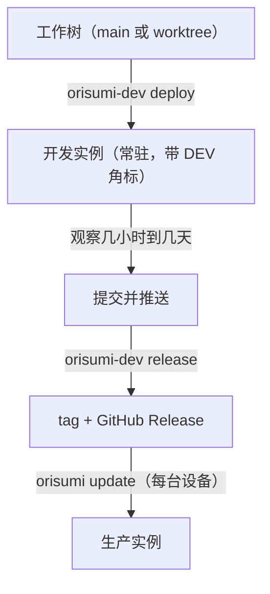
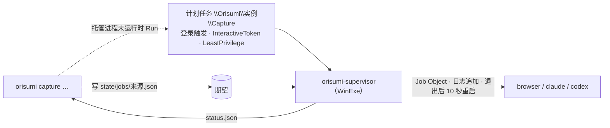

生产只装正式发布；开发实例常驻运行工作树的构建，是生产前的验证。开发实例的数据随时可删，只有生产数据要保留。



生产只在 `update` 时改变；`orisumi-dev` 的任何命令都不写生产。

## 实例

实例是带 `instance.json`（如 `{"name":"prod"}`）的存储目录，数据、运行状态和装好的程序都在里面，结构见[存储](../overview/storage.mdx#目录)。macOS 上的两个实例约定如下。

| | 生产 | 开发 |
| --- | --- | --- |
| 目录 | `~/Library/Application Support/Orisumi` | `~/Library/Application Support/Orisumi-dev` |
| 名字 | `prod` | `dev` |
| 命令 | `orisumi`（链接在 `~/.local/bin`） | `orisumi-dev` |
| app | `Orisumi`，bundle ID `dev.orisumi` | `Orisumi Dev`，bundle ID `dev.orisumi.canary`，带 DEV 角标 |
| LaunchAgent | `dev.orisumi.prod.*` | `dev.orisumi.dev.*` |
| 浏览器接收端端口 | 47810 | 47811 |
| 程序来源 | `update` 装正式发布 | `deploy` 装工作树构建 |

- LaunchAgent 是采集器 `dev.orisumi.<名字>.capture.<来源>` 和 GUI `dev.orisumi.<名字>.app`。测试用的其他名字，端口取 47900 加名字的 FNV-1a 哈希模 100，不建命令链接。
- 程序没给 `--store` 时，从自己所在目录往上找 `instance.json`，找不到就报错。不回落到生产目录，也不读环境变量：LaunchAgent 拉起的进程不继承环境变量。

## 平台

| | macOS | Windows |
| --- | --- | --- |
| 构建目标 | `osx-arm64`，已在开发实例验证 NativeAOT | `win-x64`，已在开发实例验证 NativeAOT |
| 宿主命令 | 查询、采集管理、采集器命令转发、安装与更新 | 同 macOS；`update` 和生产实例待阶段 4 |
| 桌面集成 | 系统采集器、launchd 托管、菜单栏和签名发布 | 系统采集器、计划任务加托管进程（见 [Windows 托管](#windows-托管)）、托盘（见 [GUI](#gui)）；发布见 [Windows 客户端](./windows.mdx) |

根目录的 `Directory.Build.props` 按目标运行时标识（RID）选择源文件。例如 `dotnet build Host/Cli -r win-x64` 编入各项目的 `Platforms/Windows/`，而 `-r osx-arm64` 编入 `Platforms/MacOS/`。省略 `-r` 时取本机 SDK 的 RID。CA1416 按目标平台检查 API，用错平台会构建失败。只属于一个平台的整个程序也按这条规则放：`Host/Platforms/<平台>/`。

主机标识和存储路径在 `Shared/Core`，打开文件的身份在 `Shared/Capture`。安装、启停和部署通过 `Shared/Desktop` 的 `ICollectorJobs` 查询和修改托管状态：macOS 实现读写 plist、调用 launchd，Windows 实现见 [Windows 托管](#windows-托管)。`Shared/Core/Platforms.cs` 决定哪些采集器属于构建目标：`macos`、`windows` 只属于同名平台，其余来源两边都编译。查询其他设备的库不受这条规则限制。

## 组件与版本

组件是宿主（`Orisumi.app`，含 CLI 和 GUI）和 `Collectors/` 下的每个目录，不用登记。组件的标识是它输入文件的 git tree 哈希：

- 输入包括组件目录（宿主是 `Host/`）、按目标 RID 从组件的根项目（宿主是 CLI，Windows 上加托管进程）求得的递归项目引用目录，以及路径上的各级 `Directory.Build.props` 和 `Directory.Build.targets`。计算时排除 `Tests/`、`test/` 和另一平台的实现目录。只有宿主组件引用 `Shared/Desktop`，因此单改 launchd 托管代码只会改变宿主标识。
- 用临时 index 对输入 `git add -A` 再 `git write-tree` 得出：包括未提交和未跟踪的文件，不碰暂存区，不建提交。同样的内容提交后标识不变，开发时验证的就是之后发布的那份。工具链不计入。
- 程序版本是 `dev+<标识>` 或 `<发布版本>+<标识>`，即 `describe` 和运行记录里的 `collector_version`。组件没变就不重装，版本可以停在更早的发布。

构建产出发布目录：`manifest.json`（版本、实例、平台、来源提交与分支和工作树是否干净、各组件的标识与版本与文件 SHA-256、各来源的库结构），`host/Orisumi.app` 和 `collectors/<来源>/`。要求零警告，并用 `describe` 核对版本；浏览器另含 `extension/`，macOS 采集器另含 Swift 助手。

## 开发部署

```sh
orisumi-dev deploy [组件…]
```

构建工作树，装进开发实例。部署结束时，若 launchd 没有加载该实例的任何采集任务，就执行 `capture start`。不要求提交。先算各组件标识，和开发实例装着的相同就不构建；都没变时只记下当前来源。实测：没有改动约 8 秒，改一个采集器约 20 秒，全部构建约 100 秒。两个检出先后部署，后者覆盖前者：开发实例只验证一份代码。

`orisumi-dev reset` 停掉开发采集，删掉它的 `observations/`、`state/`、`logs/`，保留装好的程序；只接受开发实例。

## 发布

```sh
orisumi-dev release [版本]
```

1. 只在 `main`、工作树干净、`HEAD` 等于 `origin/main` 时运行：tag 建在 GitHub 上，提交要先推送。版本不给时取最新 `v5.*` tag 的第二位加一，没有时为 `5.0.0`；tag 已存在就拒绝。
2. 构建全部组件。每个组件的标识必须等于开发实例装着的，否则拒绝：发出的代码一定在开发实例里跑过。打印开发实例的安装时间和 `capture status`，不设门槛，也没有强制开关。
3. 和上一个发布清单比较库结构，规则见[数据库结构](../capture/index.mdx#数据库结构)。不兼容就列出每处并拒绝。
4. 打包 `orisumi-<版本>-osx-arm64.tar.gz`，清单加上包名和 SHA-256 存成 `orisumi-<版本>-osx-arm64.json`，`gh release create` 上传两者，说明里列出各组件相对上一版是否改变。

不用 CI：签名证书只在本机。签名和 `gh` 的登录都在登录钥匙串里，SSH 会话读不到；远程运行 `deploy`、`release` 要放进图形会话（如一次性的 LaunchAgent）。

## 更新

```sh
orisumi update [版本] [--from <目录>]
```

只用于生产。从 GitHub Release（不给版本取最新）或 `--from` 指定的本地目录读清单；各组件标识都和已装的相同就结束。否则下载包、核对 SHA-256 和包内清单，核对宿主签名证书的 SHA-256，用 `VACUUM INTO` 把生产库拍到 `backups/<旧版本>/`（v5 之前为 `pre-v5`，保留最近两份），再按[安装](#安装与启停)只替换和重启变了的组件。结构只增不改，所以装回旧版本也安全。不自动更新。

v5 之前装的生产没有 `update`，第一次用新版宿主更新：

```sh
curl -LO https://github.com/shenxianovo/Orisumi/releases/download/v5.0.0/orisumi-5.0.0-osx-arm64.tar.gz
curl -LO https://github.com/shenxianovo/Orisumi/releases/download/v5.0.0/orisumi-5.0.0-osx-arm64.json
mkdir v5 && tar -xf orisumi-5.0.0-osx-arm64.tar.gz -C v5
v5/host/Orisumi.app/Contents/MacOS/orisumi --store ~/Library/Application\ Support/Orisumi update 5.0.0 --from .
```

## 安装与启停

`orisumi install <发布目录>` 先核对清单（平台、目标实例、文件 SHA-256、宿主签名和 bundle ID），再把标识变了的组件从临时目录原子换入。启动范围取决于安装前 launchd 已加载哪些任务。

| 变动 | 安装后的行为 |
| --- | --- |
| 只更新宿主 | 启动或重启 GUI，各采集器及其 `launch` 代理继续运行 |
| 更新已有采集器 | 原先已加载的按新 `describe` 参数重启，已停用的保持停止 |
| 新增采集器 | 实例原先有任一采集任务已加载时启动 |

组件和启动配置全部应用成功后才替换 `app/manifest.json`。中途失败会换回旧组件，恢复已动过的启动配置和加载状态。安装也会写入生产命令链接、GUI 的登录项，以及浏览器扩展的 `config.json`（实例名和端口）和扩展名后缀 `(<名字>)`。

`capture start` 用各采集器 `describe` 给出的参数，把它们装成 LaunchAgent 并启动；已在运行的先停掉。`capture` 命令只管采集器，不动 GUI。所有 LaunchAgent 都标明属于实例的 bundle ID，系统设置的「登录项」里列在对应 app 下。它们在登录时启动，退出后 10 秒重启。`capture stop` 停掉并删除它们，每次运行以 `completed` 结束。日志在 `logs/<来源>.{out,err}.log`。

`capture status [--json]` 显示实例版本（发布版本，或开发的分支、提交和是否干净）和各组件版本，并给每个采集器一个健康状态：`stopped`（装了但没加载）、`attention`（有问题代码：`not_installed`、`not_running`、`run_failed`，或运行中却超过 5 分钟没确认的 `stale`）或 `ok`。读取失败只计数，不影响健康：AX 超时这类短暂失败每小时都有。`--json` 另含最近 5 次运行和最近 10 条读取失败。

## Windows 托管

Windows 没有 launchd。每个实例一个计划任务和一个常驻托管进程 `orisumi-supervisor.exe`（宿主组件的一部分，与 `orisumi.exe` 同目录），由它拉起所有采集器：



| 方面 | 做法 |
| --- | --- |
| 期望与实际 | CLI 只写 `state/jobs/<来源>.json`（命令、日志路径、采集器版本）；托管进程按文件收敛，文件通知只触发，另每 2 秒核对，结果写进 `state/jobs/status.json`。托管进程持有 `state/locks/supervisor.lock`，CLI 用它判断托管进程是否存活 |
| 启动 | 登录时由计划任务启动。CLI 也只经计划任务启动托管进程，所以从 SSH 部署时它也在桌面会话、不提权。任务失败重启 `PT1M` |
| 子进程 | 放进 `KILL_ON_JOB_CLOSE` 的 Job Object，托管进程退出时随之结束；内容变化就先停后启；退出后距上次启动不少于 10 秒再启 |
| 停止 | 后台进程收不到 SIGTERM：每个进程监听 `Local\Orisumi.Stop.<pid>`，托管进程置位后等 30 秒，超时强杀。`Local\` 按会话隔离，只能在同一会话里置位。注销、关机时托管进程停掉所有子进程 |
| 结束 | 期望全部删除后托管进程退出，CLI 删除任务和空的 `\Orisumi\<实例>` 文件夹 |
| 任务操作 | 用 Task Scheduler COM，按 HRESULT 判断，不解析 `schtasks` 的输出：它按界面语言输出（桌面会话是中文，SSH 是英文）。任务和文件夹给当前用户完全控制，不提权也能删 |

安装与 macOS 的差别：Windows 没有原子交换目录，运行中的程序所在目录可以改名，程序文件删不掉。换入组件时旧目录移到 `app\.retired\`，下次安装删掉已没有程序在运行的；宿主更新后托管进程继续运行旧程序，直到它下次重启。解包用系统的 `tar.exe`，不校验签名。

## 签名与权限

- 两个实例的 app 都用钥匙串里名为 `Orisumi Development` 的代码签名证书签名；发布用 Mac mini 上那张（SHA-256 `ABE1CF8B…`，导出 p12 备份，换构建机器时导入同一张），`update` 核对它的 SHA-256。采集器不签名。
- 没有证书就建一个：钥匙串访问 › 证书助理 › 创建证书，身份类型选「自签名根证书」，证书类型选「代码签名」。构建要求 `security find-identity -v -p codesigning` 能列出它；若只在去掉 `-v` 时出现并标着 `CSSMERR_TP_NOT_TRUSTED`，在钥匙串访问里把这张证书的「信任 › 代码签名」设为「始终信任」（要输登录密码，SSH 里做不了，SSH 会话也用不了登录钥匙串签名）。
- 这两个 bundle ID 的程序都不得 ad-hoc 签名：macOS 会作废已经给出的权限。不要运行 app 包里没有正确签名的程序，macOS 会弹出「已损坏」并拦下。
- LaunchAgent 运行的是 `Orisumi.app/Contents/MacOS/orisumi launch -- <采集器命令>`：它把采集器作为子进程拉起，转发停止信号，以采集器的退出码退出。macOS 按发起进程所属的 app 判断系统权限：`Contents/MacOS/` 下的任何程序都算这个 app，它拉起的采集器也继承，所以采集器换版本不用重新授权。嵌套在 app 里、自带 bundle ID 的助手 app 不继承，所以 CLI 和 GUI 放在同一个 `Contents/MacOS/`。
- 首次安装后，在系统设置 › 隐私与安全性 › 辅助功能里加入 `<实例目录>/app/host/Orisumi.app` 并打开（列表不会自动出现它，把 app 拖进去）。两个实例各授权一次；授权跟 bundle ID 和证书走，重装和重签都保留，两者互不影响（macOS 27 实测）。有辅助功能就能监听键盘和鼠标，「输入监控」里不需要条目。缺权限时 macOS 采集只停用对应通道。

## Chrome 扩展

两个实例的扩展各装在自己的 `app/collectors/browser/extension`，同一个 Chrome 里都要加载。Chrome 给未打包扩展的 ID，是加载路径 SHA-256 的前 32 位十六进制，`0-f` 依次映射为 `a-p`；接收端按路径算出 ID 来核对来源。Windows 上先把盘符转成大写，再按 UTF-16LE 计算。路径固定，所以只在第一次手动加载，而且必须加载打印出的那条路径：接收端展开了符号链接，Chrome 不展开，从链接路径加载会得到另一个 ID。在 Chrome 扩展页打开开发者模式，加载这个目录；`orisumi-dev deploy` 第一次装上浏览器采集器时打印路径和预期 ID。之后扩展连上接收端时报告自己的版本，和接收端不同就自己重新加载，见[浏览器](../capture/sources/browser.mdx)。

## GUI

菜单栏图标是吉祥物：彩色表示都在采集，带黄点表示有来源需要注意，变灰表示已停止或读不到状态；开发 app 旁边多一个 DEV 标签。窗口里有今天各来源在本机的运行时段（其他设备的副本不画）、来源汇总，以及每个来源的通道状态、最近运行和读取失败。GUI 不含采集逻辑、不读库：状态来自 `capture status --json`，时段和通道来自 `capture coverage`，启停调用 `capture start` / `capture stop`。它从自己所在的 app 找到旁边的 `orisumi` 和所属实例。退出 GUI 不影响采集。

Windows 上是托盘程序 `orisumi-app.exe`（`Host/Platforms/Windows/App`），规则同上，暂时没有窗口：

- 图标同菜单栏；非生产实例在左上角加靛蓝的 D，变灰时也看得清。悬停显示实例、总状态，以及放得下的需要注意的来源。
- 左右键都弹出菜单：实例、总状态、每个来源一行、启动或重启、停止（先确认）、打开日志目录、退出。启停进行中，总状态显示正在启动或停止。
- 状态每 30 秒、打开菜单时和系统唤醒后读一次，启停完成后重读。从 `<存储>\app\host\` 找 CLI 和实例，从检出运行时用 `--cli`、`--store` 指定。
- 安装时注册计划任务 `\Orisumi\<实例>\App`（登录触发、`InteractiveToken`、不提权、不失败重启），任务没在运行就启动一次，从 SSH 安装也出现在桌面会话里。宿主更新后，托盘读到的宿主版本和自己不同，就启动新装的程序再退出。
- 不并进托管进程：采集器在 `KILL_ON_JOB_CLOSE` 的 Job Object 里，托盘退出、崩溃或更新都会连带停掉采集。

改界面时可以不部署：

```sh
swift run --package-path Host/Platforms/MacOS/App OrisumiApp --cli "$HOME/Library/Application Support/Orisumi-dev/app/host/Orisumi.app/Contents/MacOS/orisumi" --store "$HOME/Library/Application Support/Orisumi-dev"
```

`--cli`、`--store` 指定要读的宿主和实例。

用 `ORISUMI_SNAPSHOTS=<目录> swift test --package-path Host/Platforms/MacOS/App --filter SnapshotTests` 把窗口（浅色、深色）、菜单栏图标和开发 app 图标渲染成 PNG 来看；不设这个变量时这组测试跳过。窗口会在屏幕上短暂出现，测试截的是它自己的窗口，不需要屏幕录制权限。再设 `ORISUMI_SNAPSHOT_DATA=<目录>` 会多渲染一组真实数据，目录里放 `capture status --json` 和 `capture coverage …` 的输出，分别存成 `status.json`、`coverage.json`。图标原图在仓库根目录 `Assets/`；构建从 `Host/Platforms/MacOS/App/Icon/AppIcon.png` 生成 app 图标和菜单栏用的 `Mascot.png`，开发 app 的图标由 `OrisumiApp --badge-icon` 加上角标。
