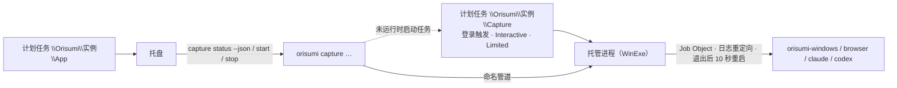

本页是计划。已实现的部分见[平台](./release.mdx#平台)，各阶段完成后把结论移到对应页面并删掉这里的条目。

## 目标机器

2026-11-27 在 `windows-pc`（tailnet）上核实：

| 项 | 值 |
| --- | --- |
| 系统 | Windows 11 Pro 23H2（22631），Lenovo 82YA，时区 China Standard Time |
| 睡眠 | 只有 S3，没有现代待机（S0） |
| 工具链 | .NET SDK 11.0.100、VS 2026 Community 和 VS 2022/2019 C++ 工具（NativeAOT 需要）、Git、gh；Node.js 22.19，低于 `Docs/package.json` 要求的 24.14 |
| 来源 | Chrome、Edge；Claude Code 和 Codex 装在 Windows 本机，`~\.claude`、`~\.codex` 存在 |
| SSH | 落在 session 0，带管理员令牌；用户桌面是 session 1 |
| 计划任务 | 从 SSH 注册的 `Interactive`、`Limited` 任务跑在 session 1，不提权 |
| 浏览器端口 | 不提权的进程可以用 `HttpListener` 监听 `http://127.0.0.1:<端口>/`，接收端不用改 |

## 托管

Windows 没有 launchd。每个实例一个常驻托管进程，管理所有采集器：

- 不为每个采集器建计划任务：任务失败重启间隔最短 1 分钟，结束任务是强杀，拿不到采集器的 PID，也不重定向输出。
- 期望状态写在 `state/jobs/<来源>.json`，`ICollectorJobs.Set` 写入后经命名管道让托管进程应用；`Inspect` 只读文件和管道，不拉起托管进程。
- 停止：Windows 上后台进程收不到 SIGTERM。每个进程监听命名事件 `Local\Orisumi.Stop.<pid>`，托管进程置位后等待退出，超时再强杀。注销、关机时托管进程和系统采集器处理 `WM_QUERYENDSESSION`，让运行以 `completed` 结束。
- 从 SSH 部署时，CLI 通过计划任务启动托管进程，进程因此落在桌面会话里。
- 托盘退出不影响采集。

## 安装与更新

| 和 macOS 的差别 | 做法 |
| --- | --- |
| 运行中程序所在的目录不能替换 | 先停掉有变化且在运行的采集器，再换目录，然后按新 `describe` 启动；未变化的不停 |
| 宿主替换自己 | 同卷内允许重命名运行中的 exe：旧文件移到 `app/.retired/`，下次安装时清理 |
| 命令链接 | 链接后 `AppContext.BaseDirectory` 指向链接所在目录，找不到实例；改为把生产实例的宿主目录加进用户 `PATH` |
| 签名 | 不做 Authenticode；`update` 只核对 GitHub Release 清单里的 SHA-256 |
| 发布包 | NativeAOT 不能从 macOS 交叉编译，Windows 包在 Windows PC 上构建 |

发布可以只发一个平台。`orisumi-dev release` 在标签已存在时追加本平台的包（要求标签指向同一提交）；结构兼容检查与上一个含本平台清单的发布比较；`update` 取最新一个含本平台包的发布。

## 系统采集器

新来源 `Collectors/Windows`（`orisumi-windows`），单个 C# NativeAOT 进程直接调用 Win32 和 COM（`LibraryImport`、`GeneratedComInterface`），不需要 macOS 那样的助手进程。一条线程跑隐藏顶层窗口的消息循环（广播消息不发给 message-only 窗口），比较后交给写入线程。

库结构独立：应用身份是 exe 路径和商店应用的 AUMID，键码是 `vk_code` 和 `scan_code`。语义相同的表和视图沿用 macOS 的名字，`day` 按同样的方式读。

| 事实 | API | 取数 |
| --- | --- | --- |
| 前台应用、焦点窗口、标题 | `SetWinEventHook`（`EVENT_SYSTEM_FOREGROUND`、`EVENT_OBJECT_NAMECHANGE`），`QueryFullProcessImageNameW`；`ApplicationFrameHost` 下找真实进程 | 通知，60 秒核对 |
| 摆出来的应用 | 可见、非工具窗口、未隐藏（`DWMWA_CLOAKED`）的顶层窗口所属进程，加进入过前台的 | 读现值 |
| 按键、鼠标按钮、离开 | Raw Input（`RIDEV_INPUTSINK`），和 macOS 一样记每次按键和点击；不用低级钩子，它回调超时会被系统摘掉 | 通知；读不到时用 `GetLastInputInfo` |
| 锁屏、会话 | `WTSRegisterSessionNotification`，初值 `WTSQuerySessionInformation` | 通知 |
| 显示器休眠 | `RegisterPowerSettingNotification(GUID_CONSOLE_DISPLAY_STATE)`，注册时送初值 | 通知 |
| 系统睡眠 | `WM_POWERBROADCAST`，加 `PowerRegisterSuspendResumeNotification` | 通知 |
| 时区、时钟 | `WM_SETTINGCHANGE`、`WM_TIMECHANGE`，时区记 IANA ID；单调时钟 `QueryInterruptTime` | 通知 |
| 音频、摄像头（后做） | WASAPI 会话；`CapabilityAccessManager\ConsentStore` 的使用时间 | 读现值 |

提权窗口在前台时，不提权的进程可能收不到输入、读不到标题，按“读不到”记 NULL，待真机确认范围。

## 托盘

C# NativeAOT 的 WinExe，用 `Shell_NotifyIconW` 和原生菜单：总状态、各采集器状态、启停、打开日志、退出。图标规则和 macOS 菜单栏相同。窗口（今天的时间线）以后再定技术。

## 阶段

| 阶段 | 内容 | 验收 |
| --- | --- | --- |
| 0 | Windows 检出、Node 升级、去掉 `Tests/` 里写死的 `SupportedOSPlatform("macos")`、`orisumi-dev check` 在 Windows 跑通 | `check` 全部通过；`HostIdentity` 读出 SMBIOS UUID `6EE135AE-06B7-11EE-8C92-088FC3FA62F2` |
| 1 | 托管、停止事件、Windows 安装、命令转发、`deploy`；Claude、Codex、浏览器上线 | 从 SSH `deploy` 后采集器在 session 1 运行；强杀后 10 秒内恢复；`capture stop` 写 `completed`；更新一个采集器时其余 PID 不变；Chrome 扩展连上 |
| 2 | `Collectors/Windows`，`day` 读 Windows | 开发实例跑一两天，导出到 Mac 后 `day` 读出两台设备 |
| 3 | 托盘 | 状态、启停正确；重启 `explorer.exe` 后图标恢复 |
| 4 | Windows 发布与生产实例 | 发布、安装、`update` 一次 |
| 5 | 音频和摄像头 | 只增不改地加表 |

## 已知要改的代码

| 位置 | 问题 |
| --- | --- |
| `Host/Cli/InstallCommand.cs` | 先换目录再重启采集器 |
| `Shared/Platform/ChromeExtension.cs` | 按 UTF-8 算扩展 ID；Chromium 在 Windows 上按 UTF-16 算并把盘符转大写，待加载扩展时核对 |
| `Tools/Dev/ComponentIdentity.cs` | Windows 宿主的标识包含 `Host/App.MacOS` |
| `Shared/Platform/Platforms/Windows/RunProcess.cs` | 只监听 SIGTERM，后台进程收不到 |
| `Host/Cli/Day/` | 只有 macOS 读出；Chrome 按 bundle ID 识别；默认时区 ID 在 Windows 上不是 IANA |
