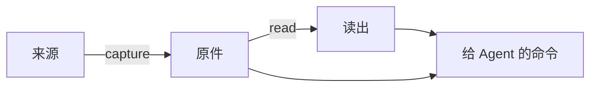

导洞是第三版打通的第一条完整路径：挑几个形态差别大的来源，从原始数据一直通到 Agent 能回答关于这个人的问题，跑通以后再扩展到别的来源。导洞接了四个来源，分三类形态：

- Claude Code 和 Codex 的会话：一次会话散在日志、索引和数据库好几处。
- 旧 Heartbeat 采下的前台、浏览器、键鼠和 VRChat 时段：瞬时的，错过就没有了。
- Git 提交：持久的，任何时候都能补。

路径分三步，每步一个概念：



- [原件](./raw.mdx)：从来源拿到的最原始的一层，原样存下，附一份采集记录。
- [读出](./readings.mdx)：从原件算出来的东西，随时可以删掉重算。
- [给 Agent 的命令](./context.mdx)：Agent 只通过五个命令拿上下文，每行输出都指回原件里的位置。

四个来源各自存下什么，见[四个来源怎么采](./sources.mdx)。

## 程序

Orisumi 是一个单独的程序，代码在 `src/Orisumi`。开发时经 `orisumi run` 转发运行，`run` 后面的参数原样交给它：

```sh
orisumi run capture codex --from 2026-10-30 --to 2026-11-03
orisumi run read
orisumi run context sources
```

## 存储

数据放在本地目录 `.local/orisumi/`，由 `orisumi run` 通过环境变量 `ORISUMI_STORE` 交给程序；直接运行程序时默认放在 `~/.orisumi`。

```text
.local/orisumi/
  raw/<来源>/<采集 id>/        原件和 capture.json
  readings/<读出>/<读出 id>/   items.jsonl 和 reading.json
```

采集 id 和读出 id 都是开始的 UTC 时间，例如 `20261103T143521Z`。存下的全是普通文件：复制来的原文件、JSON 和 JSON Lines。

依据：

- [不绑定某种存储](../requirements/belief.mdx#不绑定某种存储)：文件任何程序都能读，换存储时原样搬走。
- [数据比代码长寿](../requirements/belief.mdx#数据比代码长寿)：读这些文件不依赖 Orisumi 今天的代码。

## 导洞之后

导洞里每个来源一次性采一段时间，读出只用程序读法。身份读出、增量采集、定期采集和模型读出在导洞跑通之后，按 Agent 答题的结果再加。
