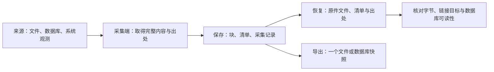

当前先把选定来源的材料和出处留下，并验证离开来源后仍能恢复。例如采一轮 Codex：日志和附件按字节取得，SQLite 通过 online backup 取得一致快照；它们连同出处写进一份采集记录，再按这份记录恢复到新目录。



- **来源**：交来原始材料的应用、文件、数据库或观测接口。各来源的实际保存范围单独声明。
- **采集端**：按来源取得完整内容，同时记录本次直接知道的出处；当前由本机命令运行。
- [原件](./raw.mdx)：原始内容与取得事实，存成按内容寻址的块、清单和采集记录。不同路径或不同时间取得的相同内容，各有出处。
- **恢复**：从保存内容还原普通文件、数据库快照和链接目标，连同记录与清单一起交给后续使用者。

依据：

- [留最原始的一层](../requirements/belief.mdx#留最原始的一层)：取得的内容先按来源形态保存，整理与理解在后面进行。
- [原件存成块](../requirements/belief.mdx#原件存成块)、[数据比代码长寿](../requirements/belief.mdx#数据比代码长寿)：存储复用相同字节，恢复依赖保存事实与公开格式。
- [理解能追溯来源](../requirements/belief.mdx#理解能追溯来源)：后续结论能回到具体一次取得的材料。

这一节记录 Agent 在用户授权自主选择与实现的范围内采用的方案。授权与逐项确认分别记录；用户确认的起点见[需求](../requirements/index.mdx)。当前格式与取舍写在[决定](./adr/0001-two-layer-chunking.mdx)里，技术参照见[参照](./prior-art.mdx)。

[副本与节点](./nodes.mdx)记录已验证的手动异机备份路线；[前台应用观测](./foreground.mdx)记录新的瞬时来源与其覆盖限制。[读出](./readings.mdx)和[给 Agent 的命令](./context.mdx)按实际使用需要展开，当前采集与恢复可以独立交付。

## 第一条导洞

导洞是第三版打通的第一条完整路径：挑几个形态差别大的来源，从原始数据一直通到 Agent 能回答关于这个人的问题。导洞接了四个来源，分三类形态：

- Claude Code 和 Codex 的会话：一次会话散在日志、索引和数据库好几处。
- 旧 Heartbeat 采下的前台、浏览器、键鼠和 VRChat 时段：瞬时的，错过就没有了。
- Git 提交：持久的，任何时候都能补。

Agent 在导洞中用五个上下文命令回答了测量基准的全部题目。这些结果帮助识别后续读取需求；正式读取会按实际问题逐项选择。四个来源的保存范围与当前接入状态见[来源怎么采](./sources.mdx)。

## 代码

| 项目 | 内容 |
| --- | --- |
| `src/Orisumi.Raw` | 块、切块器、采集记录、文件清单、删除记录、位置，以及原件恢复和导出 |
| `src/Orisumi.Capturing` | 文件读取、SQLite 快照、符号链接、Claude Code 和 Codex 规则，以及 macOS 前台观察与逐行保存 |
| `src/Orisumi.Cli` | 采集、查看原件、恢复和导出的命令 |
| `tests/Orisumi.Raw.Tests` | 原件格式、恢复、校验和取消 |
| `tests/Orisumi.Capturing.Tests` | 来源选择、读取、快照、部分完成和自动采集循环 |

开发时经 `orisumi run` 转发运行命令行，`run` 后面的参数原样交给它：

```sh
orisumi run capture codex --once
orisumi run capture claude-code
orisumi run capture foreground --duration 10
orisumi run raw list
orisumi run raw show <采集>
orisumi run raw restore <采集> <新目录>
orisumi run raw export <采集> state_5.sqlite <新文件>
orisumi run raw line <位置>
orisumi run raw delete <采集> --reason <原因>
```

例如，`capture codex --once` 从本机取得一轮日志、索引、数据库快照和附件；从输出或 `raw list` 取得采集名字，再用 `raw restore` 将这轮保存下来的材料恢复到新目录。恢复目录里有采集记录、文件清单和材料文件，见[恢复与导出](./raw.mdx#恢复与导出)。

`capture claude-code` 采集 Claude Code 会话文件及桌面索引；`capture codex` 的默认目录是 `~/.codex`，可用 `--home` 覆盖。各来源的目录和保存范围见[来源说明](./sources.mdx)。任意目录可用 `capture files <目录>`。

三种采集命令启动后立即采一轮，然后默认每轮完成后等待 300 秒继续采；`--once` 采一轮后退出，`--interval` 和 `--retries` 调整周期与读取重试次数，见[文件采集](./file-capture.mdx)。`<采集>` 是采集记录的名字或它的唯一前缀。查看原件的命令可以在另一个终端运行。

前台入口在 macOS 持续接收系统观测，每行立即保存；`--duration` 限定运行秒数，省略时持续到 Ctrl+C，见[前台应用观测](./foreground.mdx)。

数据放在本地目录 `.local/orisumi/`，由 `orisumi run` 通过环境变量 `ORISUMI_STORE` 交给程序；直接运行程序时默认放在 `~/.orisumi`。

```text
.local/orisumi/
  config.json                          写入用哪一版切块器
  blocks/<名字前两位>/sha256-<十六进制>   原件和文件清单切成的块
  records/<名字前两位>/sha256-<十六进制>  采集记录的根和删除记录
```

## 实现到哪了

已经实现：[原件](./raw.mdx)的块、切块器 `orisumi-cdc-1`、采集记录、文件清单、删除记录、位置的解析和显示；[共用采集器](./file-capture.mdx)的定期运行、单轮采集和部分完成记录；[Claude Code](./sources.mdx#claude-code) 与 [Codex](./sources.mdx#codex) 来源接入；原件查看、整轮恢复和单文件导出。

[外部副本](./validation.mdx#外部副本)已用真实保存集完成 Linux 异机独立恢复。macOS [前台观测](./foreground.mdx)已接入：初始查询、22 次受控应用切换、即时保存、停止与恢复均通过核对；同应用切窗和改标题期间没有新增应用级通知，见[验收](./validation.mdx#前台观测)。

当前后续顺序与条件：

- 当前手动应用级观察可用。按材料损失窗口安排其他来源；连续使用形成需要时，再测一天的通知量、写入成本，以及睡眠与会话变化的实际组合。
- 当前副本按需手动复制并校验。持续采集或备份频率形成实际需要时，再安排登录启动和外部定时备份；跨设备查询或复制问题出现后再评估应用内节点。
- 进入读取阶段时，从人亲手输入的文本和一个真实问题开始，逐项实现[确定性读出](./readings.mdx)。
- 读出有实际查询需求时先试单 SQLite 投影；模型处理、界面、共享和远端入口各按明确任务验证。
- 单次结果保存在采集记录并输出。当前持续探活暂缓，实际需要发现采集停止时再接简单外部检查。
