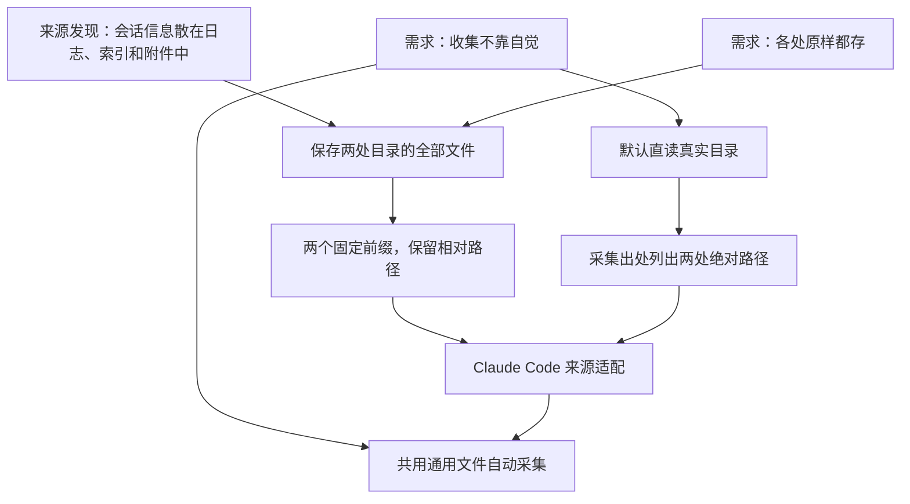

这一页记录各来源的保存范围，以及后续来源的验证条件。Claude Code 和 Codex 使用[共用采集器](./file-capture.mdx)；macOS 前台使用[实时观察入口](./foreground.mdx)；[浏览器](./browser.mdx)由扩展取得标签与窗口观测，再交给本机原件接收器；[Git](./git.mdx)保存引用可达对象及分次取得的出处。旧 Heartbeat 的导出路线仍待验证。存下的东西、采集记录和恢复方式见[原件](./raw.mdx)。

## macOS 前台应用

`orisumi run capture foreground` 保存 AppKit 的初始前台查询及实际收到的激活、失活、睡眠唤醒和用户会话通知。每条观察立即独立写成原件；`--duration <秒>` 限定运行时间，省略时持续到 Ctrl+C。

保存的是通知名称、实际对象的公开属性和取得条件，没有窗口标题、键鼠或输入文字。格式、运行要求、失败行为与当前平台验收限制见[前台应用观测](./foreground.mdx)。应用切换与人的注意力分别解释。

## 浏览器

MV3 扩展保存 `tabs` 和 `windows` 的回调参数、初始状态查询、激活后的标签查询，以及取得时刻和来源环境。回调中的 URL、query、fragment、标题和后台标签属性保持原样；窗口内 active、窗口焦点和系统前台分别表达。

来源名为 `browser`。扩展先写本地暂存，本机接收器将每个 Native Messaging payload 单独保存，发布根后回执；扩展收到匹配回执后移除暂存。接收程序退出期间的短暂事件因此可以补送，Worker 未取得或未成功暂存的内容仍有缺口。范围、身份、原件字节边界和安装方式见[浏览器观测](./browser.mdx)。

## Claude Code

### 保存范围

`orisumi run capture claude-code` 直接读取本机两处目录，普通文件按原始字节保存，符号链接保存目标原字符串，保留各自的相对路径：

- `projects/`：来自 `~/.claude/projects/`，包含主会话日志、子 Agent 日志、`tool-results/`、图片和记忆等文件。
- `desktop-sessions/`：来自 `~/Library/Application Support/Claude/claude-code-sessions/`，包含桌面应用的会话索引文件。

来源名为 `claude-code`，采集身份仍是采集记录根的内容哈希。文件用采集记录及其保存路径定位，例子是 `projects/<项目>/<会话>.jsonl`。日志里的来源版本和消息身份随原始字节保存，由读出解释。

### 来源目录与出处

启动立即采一轮，之后默认每轮结束等待 300 秒再采。`--once` 采一轮后退出，`--interval` 和 `--retries` 分别设置等待秒数与本轮读取重试次数，语义见[文件采集](./file-capture.mdx)。

`--projects` 和 `--desktop-sessions` 可以分别覆盖两处目录，例如采集事先另存的副本：

```sh
orisumi run capture claude-code \
  --projects .local/benchmark/claude-code/projects \
  --desktop-sessions .local/benchmark/claude-code/desktop-sessions
```

默认直读真实目录，让自动采集直接跟随来源变化；路径覆盖让副本使用同一条采集路径。两个固定前缀保持日志和索引各自的相对路径，也让两处同名文件各有位置。

采集记录的 `origin` 是两行文字，写出本轮配置的两处绝对路径：

```text
projects: <会话文件目录的绝对路径>
desktop-sessions: <桌面会话索引目录的绝对路径>
```

每个文件的 `origin` 仍是实际读取的绝对路径。某处目录缺失或某个文件读不到时，已采到的文件照常保存，缺口按[部分完成的规则](./file-capture.mdx#结果和失败)记入采集记录。

### 决策依据与验证

箭头表示上游需求或来源发现对下游选择的支持和约束。目录及路径映射由 `Orisumi.Capturing/ClaudeCodeSource.cs` 实现；扫描、读取和重采由共用的 `Collector` 实现。



`ClaudeCodeSourceTests` 通过实际采集和读回验证两处文件的路径、出处与字节保持原样，覆盖子 Agent、二进制附件和同名文件；重采验证文件块复用，目录缺失验证另一处的文件仍能保存。读取与周期循环的行为由 `CollectorTests` 和 `StableFileReaderTests` 验证。

依据：

- [一件事散在多处](../requirements/belief.mdx#一件事散在多处)、[各处原样都存](../requirements/belief.mdx#各处原样都存)：勘探发现会话的标题、归档、rewind 和派生关系只记在桌面应用的索引里，两处都存才留得住这些关系。
- [存下的也会消失](../requirements/belief.mdx#存下的也会消失)：Claude Code 按保留期删掉旧会话，所以要用的那段先另存一份。
- [收集不靠自觉](../requirements/belief.mdx#收集不靠自觉)、[能补的也定期采](../requirements/belief.mdx#能补的也定期采)：直接从真实目录启动自动采集。

## Codex

### 采集与恢复

```sh
orisumi run capture codex --once
orisumi run raw show <采集>
orisumi run raw restore <采集> <新目录>
```

`capture codex` 默认从 `~/.codex` 采集，`--home <目录>` 可以指定另一份来源。省略 `--once` 时启动后立即采一轮，之后每轮结束默认等待 300 秒。`--interval`、`--retries` 和部分完成规则与其他来源共用。

来源名是 `codex`，采集身份是根的内容哈希。采集根的 `origin` 是本轮 Codex 目录的绝对路径；每份材料的 `origin` 是它自己的绝对路径，清单中的保存路径保留相对 Codex 目录的位置。

### 保存范围

| 保存路径 | 取得内容 |
| --- | --- |
| `sessions/`、`archived_sessions/` | 递归选择 `.jsonl` 与 `.jsonl.zst`，整份文件按字节保存 |
| `session_index.jsonl` | 完整文件，包括追加的线程标题记录 |
| `state_5.sqlite` | 主状态库的完整 SQLite online backup 快照 |
| `thread_history_1.sqlite` | 完整历史库，包括消息、实时内容、回合与投影进度 |
| `logs_2.sqlite`、`goals_1.sqlite` | 运行日志与目标状态，各自取得整库快照 |
| `queue_1.sqlite`、`memories_1.sqlite` | 队列与记忆状态，各自取得整库快照；空表同样按实际状态保留 |
| `sqlite/codex.db`、`sqlite/codex-dev.db` | 桌面时间线、自动化与本地目录，两处原路径各自保留 |
| `sqlite/codex-thread-summaries-dev.db` | 已存在的摘要库整库快照 |
| `realtime-voice-continuity.json` | 语音连续对话文件原字节 |
| `.codex-global-state.json` | 桌面全局状态原文件，包括当前草稿与文档映射 |
| `dictation-history/` | 全部听写 JSON、音频 chunk 与同目录其他文件原字节 |
| `automations/` | 自动化目录全部文件，包括定义与附属状态 |
| `attachments/` | 全部文件，例如长文本附件 |
| `generated_images/` | 全部文件，例如生成的图片 |
| `visualizations/` | 全部文件，包括页面及其本地脚本等资源 |

每轮按这份范围重新枚举材料。日志按路径和扩展名选择，内容与记录时间由后续读出解释；未知记录类型、末尾半行、子 Agent 和续接文件里的重复内容都随文件保存。`.jsonl.zst` 保留压缩文件的原始字节，损坏的压缩文件也照存。

`sessions/`、`session_index.jsonl` 和 `state_5.sqlite` 是必需输入，缺失时记入本轮失败说明。其余列出的固定输入可以不存在；所有候选位置保留在来源定义中，每轮重新检查，常驻开始后新出现的文件也会进入下一轮。只有系统明确报告不存在时跳过，存在但不可读、类型不符或数据库损坏仍记缺口。本轮没有取得某份可选材料，不代表该数据库有零行；零行需要实际快照证明。选中范围内的符号链接按[链接规则](./file-capture.mdx#符号链接)保存。

### 数据库与时间窗口

数据库快照包含所有表、索引及值，来源增加的未知表也随库保存。SQLite 把主文件和 WAL 中参与这份一致状态的已提交数据纳入快照，每份恢复数据库都可以单文件独立打开。采集器取得整库快照，清单记 `method: sqlite-online-backup`；数据库内容的含义交给读出解释。

采集记录用 `capturedAt` 和 `completedAt` 记这一轮的起止时间。每份数据库快照内部一致；不同数据库、日志、索引、音频和附件各自在这个窗口中取得，它们之间可能对应不同时间。必需数据库缺失，或数据库损坏、锁定后重试仍失败时，已经采到的日志和附件照常写入清单，缺口记在 `failure` 中。

历史库有投影结构，但本次发现53个投影线程ID没有当前同名日志文件，其中部分仍有消息及回合内容。这没有证明那些内容全部独有，却足以说明可重建性尚未成立，因此历史库先完整留下。运行日志的最早可见时间也随观察向前移动，按现存范围定期取得。

语音、听写、自动化定义和桌面草稿保持各自文件原形态。是否与日志或数据库重合，由后续读出核对；采集不因文件看起来像缓存或派生结果就假定可以重新生成。`auth.json` 和其他独立凭据文件不在这份明确来源范围内。

每个 rollout 的 `session_meta` 记着写它的 Codex 版本。

### 依据与验证

`CodexSource` 声明来源范围和取得方式，`Collector` 共用扫描、记录与循环，`SqliteSnapshotReader` 取得数据库快照。`CodexSourceTests` 覆盖来源消失后的读回、压缩及损坏的日志、附件、未知表、数据库缺失和部分完成；`SqliteSnapshotReaderTests` 覆盖 WAL、并发提交的一致状态、锁定和临时文件清理。整轮恢复与单文件导出由 `CaptureRecoveryTests` 验证。

依据：

- [一件事散在多处](../requirements/belief.mdx#一件事散在多处)：勘探发现 Codex 的日志里没有标题，标题、归档和父子关系都在日志外面。
- [各处原样都存](../requirements/belief.mdx#各处原样都存)、[留最原始的一层](../requirements/belief.mdx#留最原始的一层)：日志、索引、数据库和附件各自保存，后续读出再解释它们的关系。
- [格式随版本变化](../requirements/belief.mdx#格式随版本变化)：版本在每个文件里，读的时候按它分辨格式。

## 旧 Heartbeat

旧库的本人完整历史已完成一次取得：10表共3,748,506行，在同一只读快照中导出原生 COPY 文本、模式与出处，再由既有文件采集保存。恢复到独立数据库后，全部表值原字节与74个约束通过核对；具体范围与条件见[旧 Heartbeat 历史](./heartbeat.mdx)。

已知材料包括：

| 已知记录 | 内容 |
| --- | --- |
| 时段 | 前台、浏览器、VRChat |
| 事件 | 键鼠事件，只有按键位置 |
| 丢失记录 | 哪段没有采到及其原因 |
| 设备、主体、数据流 | 本人记录所需的关联信息 |
| 应用身份和应用 | 时段中用到的应用身份与名称 |

样本保留实际查询、取得时间、数据库位置和可取得的模式版本。确定性排序只服务相同查询结果的重复取得，类型与值的恢复另行核对。

依据：

- [留最原始的一层](../requirements/belief.mdx#留最原始的一层)：勘探发现库里的行就是现在能拿到的最原始的一层。
- [采集会丢数据](../requirements/belief.mdx#采集会丢数据)：勘探发现库里记着几周的丢失，丢失记录和时段一起采。
- [一个东西有多个名字](../requirements/belief.mdx#一个东西有多个名字)：应用身份原样存下，跨平台的对应留给身份读出。

## Git

`orisumi run capture git <仓库目录> --once` 保存本轮 `--all` 枚举的 HEAD、refs 及可达对象为 bundle，同时保存 Git 版本、参数、位置、命令原输出和时间。持续运行在每轮结束后等待 300 秒再采；位置由调用方明确提供。

最新 stash 的可达对象随引用保存，旧 reflog、index 和未提交工作区另有范围。LFS pointer 与子模块 gitlink 可随主仓库取得，其外部正文分别勘探。bundle 头是本份归档的引用事实；当前分支、符号关系和 local 配置按各自观测时间保存。完整格式、失败留证与独立恢复见 [Git 历史采集](./git.mdx)。

依据：

- [有的数据错过就没了](../requirements/belief.mdx#有的数据错过就没了)：Git 可以读取仍存在的历史对象；保存后再改引用，也能恢复已经取得的版本。
- [留最原始的一层](../requirements/belief.mdx#留最原始的一层)：Git 对象和引用保留版本正文，改动统计可以在读出时生成。
