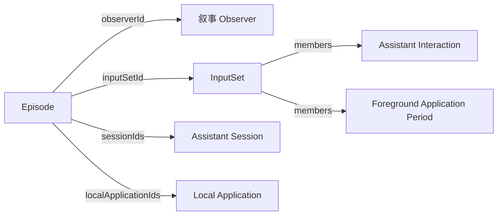

叙事 Observer 读一天的记录，写下这一天做了哪几件事。例如它读到上午的几个 Claude Code 和 Codex 会话都在讨论 Observer 与 Runtime，就写下一件事“重新审视 Observer 与 Runtime 的模型”，摘要写做了什么、得出了什么，再列出这几个会话。Web 控制台请求写某一天时它才工作，边写边把每件事推给页面，见 [API · 叙事](../../api/narrative.mdx)。

它由 API 进程托管，理由见 [ADR · 叙事](../../adr/narrative.mdx)。

<ObserverStructure node="NARRATIVE" />

## 业务类型 [#types]

| 业务类型 | 用途 | 资源名 |
| --- | --- | --- |
| [Episode](./episode.mdx) | 观测：一天中的一件事 | `episodes` |

## 程序实例 [#instance]

- 每个部署一个叙事 Observer，由 API 进程托管。它的 `thingId` 由后端在第一次启动时生成并保存，之后一直沿用，见 [OBSERVER-4](../../core/model/observer.mdx#observer-4)。
- API 进程启动时，它声明用到的业务类型，写入自己的[描述](../../core/model/common-types.mdx#observer-descriptions)。程序版本或模型型号变化时，写入新的描述。
- 同一时刻只写一个日期范围。另一个请求的范围和正在写的重叠时，后端拒绝它。

## 处理 [#processing]

收到写某一天的请求后，叙事 Observer 读这一天的记录，见 [API · Reading](../../api/reading.mdx)：

1. 读取事实时间在这一天的助手交互，按会话分组。每个会话取当前的名字、产品、工作目录，以及用户说的话（`actor` 为 `user` 的消息），每句取前 240 个字符。
2. 读取事实时间在这一天的前台应用时段，取本机应用、读到的名称和时段。
3. 读取这一天当前理解中的几件事，以及用户对它们写下的否定。
4. 把这些内容交给模型，模型逐件写出这一天的几件事。

### 模型 [#model]

叙事 Observer 调用 OpenAI 的 Responses API，以流式方式读取回答。模型每行写一件事，内容是一个 JSON 对象：

| 字段 | 内容 |
| --- | --- |
| `start`、`end` | 这件事的时段，`HH:MM`，按请求的时区 |
| `title` | 一句短语，写在做什么，像日记的小标题 |
| `summary` | 一到两句，写做了什么、得出了什么，用第二人称 |
| `sessionIds` | 属于这件事的会话，必须是发送给模型的会话 |
| `localApplicationIds` | 这段时间在前台的本机应用，必须是发送给模型的本机应用 |

提示词要求：一天写 3 到 7 件事，按开始时间排列；每个会话只归入一件事；被否定的事不再写出。

叙事 Observer 每读到完整的一行，就校验它，再推给请求方。时段不在这一天，或引用了没有发送的会话和本机应用时，这一行不推送，也不写入。

### 失败 [#failures]

| 情况 | 处理 |
| --- | --- |
| 没有配置 API Key | 请求返回 `503`，`code` 为 `narrative_unavailable` |
| 这一天没有助手交互，也没有前台应用时段 | 不调用模型，返回 `0` 件事 |
| 模型的请求失败、超时，或者校验后一件事都没有 | 推送失败，不写入 |
| 写入被拒绝 | 推送失败；已经推送的几件事不保存 |

请求方中途断开时，叙事 Observer 照样写完并写入。

### 配置 [#configuration]

| 配置 | 来源 | 含义 |
| --- | --- | --- |
| `OPENAI_API_KEY` | API 进程的环境变量 | OpenAI 的 API Key |
| `NARRATIVE_MODEL` | API 进程的环境变量 | 调用的模型，省略时为 `gpt-6.1-terra` |

## 事实时间 [#fact-time]

每件事的 `startAt` 和 `endAt` 是模型写出的时段，`timeZone` 是请求的时区，见 [Episode · 事实时间](./episode.mdx#fact-time)。

## 写入 [#submission]

全部写完后，叙事 Observer 用一次写入保存这几件事：

| 字段 | 内容 |
| --- | --- |
| `formation` | `inferred` |
| `content` | 标题、摘要、会话和本机应用 |
| `inputs` | 实际发送给模型的 Observation：用户说的话所在的助手交互、前台应用时段、名字，以及读到的否定 |

这一天原来有当前理解中的几件事时，新的一批用 `replaces` 替换它们，见 [OBSERVATION-18](../../core/model/observation.mdx#observation-18)。用户确认过的不受影响，见 [REVIEW-7](../../core/model/review.mdx#review-7)。

## 实现 [#implementation]

业务代码在后端的 API 进程中，用 .NET 编写，使用 OpenAI 的 Responses API。

## 待定 [#open]

- 今天的记录还在增加，几件事是否自动重写。
- 一天的记录很多时，只发送一部分。
