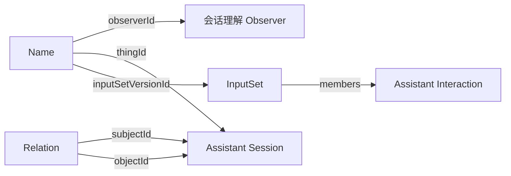

会话理解 Observer 读助手会话中用户说的话，给没有标题的会话起名字，并找出它和附近会话的关系。例如一个 Codex 会话里，用户只说了“你看看 Claude Code 这个会话 Observer 与 Runtime 建模，把它剩下的做完吧”：它给这个会话起名“接续 Observer 与 Runtime 建模”，再写一条关系，说这个会话继续了 Claude Code 的那个会话。这是[模型形成理解](../../core/rules/understanding.mdx)的一个实例。

它是一个安装包，在服务器上由 [Runtime](../../hosting/server.mdx) 运行。

<ObserverStructure node="SESSION_UNDERSTANDING" />

## 业务类型 [#types]

| 业务类型 | 用途 | 资源名 |
| --- | --- | --- |
| [Session Understanding Observer](./session-understanding-observer.mdx) | 程序实例的描述 | `session-understanding-observers` |
| [Name](../../core/rules/understanding.mdx#name) | 观测：模型给会话起的名字 | `names` |
| [Relation](../../core/rules/understanding.mdx#relation) | 观测：两个会话之间的关系 | `relations` |

## 程序实例 [#instance]

- 每个部署运行一个会话理解 Observer：它的安装包在清单中声明 `scope` 为 `deployment`，见 [Management · 每个部署一个实例](../../hosting/management.mdx#singleton)。
- 程序实例的 EntityId 由 Runtime 保存，第一次安装时生成，之后一直沿用，见 [OBSERVER-4](../../core/model/observer.mdx#observer-4)。
- 启动时，它声明用到的业务类型，写入自己的描述。程序版本或模型型号变化时，描述形成新版本。
- 轮次由它自己安排，同一时刻只有一轮，上一轮结束后等待一个间隔再开始下一轮。

## 处理 [#processing]

会话理解 Observer 默认每 300 秒运行一轮，读取后端已保存的数据，见 [API · Reading](../../api/reading.mdx)：

1. 读取全部助手会话和它们当前的名字。
2. 待处理的会话同时满足：在当前理解中没有名字；最后一次交互在 30 分钟以前，所以会话已经停下；至少有一句用户说的话。
3. 逐个处理，每处理完一个再处理下一个。

处理一个会话时，它收集：

| 内容 | 例子 |
| --- | --- |
| 产品和工作目录 | Codex、`Heartbeat` |
| 用户说的话，按时间排列，最多 20 句，每句取前 240 个字符 | “你看看 Claude Code 这个会话……” |
| 附近的会话：前后 24 小时内有交互的会话，每个写出 EntityId、产品、当前的名字和用户说的第一句 | Claude Code 的“Observer 与 Runtime 建模” |
| 这个会话被否定过的名字和关系 | 不叫“重启项目栈” |

接着把这些内容交给模型，按模型的结果写入。

### 模型 [#model]

会话理解 Observer 调用 OpenAI 的 Responses API，型号由[配置](#configuration)给出，记在 Observer 的描述中。请求用结构化输出限定回答的格式：

| 字段 | 内容 |
| --- | --- |
| `name` | 会话的名字，像会话标题，不超过 16 个字 |
| `relations` | 和附近会话的关系，每条写对方的 EntityId、`predicate` 和一句理由。`predicate` 是简短的动词短语，例如“继续了”“讨论同一件事”。只写证据明确的关系 |

回答中的会话不在附近会话中，或名字为空时，这个会话不写入，下一轮重试。被否定过的名字和关系，它跳过不写，见 [UNDERSTANDING-7](../../core/rules/understanding.mdx#understanding-7)。

### 失败 [#failures]

失败作为采集诊断写入标准错误，由托管方报告，见 [OBSERVER-8](../../core/model/observer.mdx#observer-8)。

| 情况 | 处理 |
| --- | --- |
| 没有配置 API Key | 写入自己的描述，不调用模型，每轮报告诊断 |
| 助手交互的业务类型还没有声明 | 这一轮没有会话 |
| 模型的请求失败、超时，或回答不符合格式 | 这个会话不写入，下一轮重试 |
| 读取时后端不可用 | 结束这一轮，下一轮重试 |
| 写入被拒绝或后端不可用 | 报告诊断，跳过这个会话，下一轮重试 |

### 配置 [#configuration]

| 配置 | 来源 | 含义 |
| --- | --- | --- |
| `OPENAI_API_KEY` | Runtime 的环境变量 | OpenAI 的 API Key |
| `model` | 设置 | 调用的 OpenAI 模型，省略时为 `gpt-6.1-terra` |
| `intervalSeconds` | 设置 | 两轮之间的间隔，默认 300 |
| `idleMinutes` | 设置 | 最后一次交互之后多久算会话已经停下，默认 30 |

## 写入 [#submission]

会话理解 Observer 使用 [.NET 的 SDK](../../api/sdk.mdx#dotnet)，直接写给后端，同步得到结果，见 [API · 两个地址](../../api/writing.mdx#endpoints)。下一个会话的附近会话要用到这次起的名字。

每个会话的结果用一次写入保存：

| 观测 | 内容 |
| --- | --- |
| Name | `thingId` 是这个会话，`name` 是模型起的名字 |
| Relation | 每条关系一份，`subjectId` 是这个会话，`objectId` 是对方，`text` 是理由 |

它们的 `formation` 都是 `inferred`，事实时间都是 `null`，`inputs` 是用户说的话所在的助手交互、附近会话的名字和第一句所在的版本，以及读到的否定。

## 实现 [#implementation]

业务代码在 `src/Observers/Orisumi.Observer.SessionUnderstanding/`，用 .NET 编写，使用 .NET SDK，发布为 `linux-x64` 等服务器平台的安装包。

## 待定 [#open]

- 会话停下后又继续时，是否重起名字。
- 来源后来给出标题时，模型起的名字是否取代。
