Orisumi 是一个以 10 到 20 年计的长期项目。这一页记录它的发心，以及从发心和对现实的判断推出的需求。

陈述分三级：

- 立场：选定的出发点。
- 假设：对现实世界的判断，现实变了就要回看。图中用虚线框。前两条是对世界的判断，其余几条来自对真实数据来源的勘探。
- 推论：从上层推出的结论。

每条陈述的名字就是它的 ID，推论后面写明依据。一条陈述被推翻时，沿着图的箭头往下，所有能到达的陈述都要重新考虑。点图中的陈述可以跳到它的说明。

```mermaid
flowchart TD
  observe["了解一个人靠观测"]
  user["用户是任何人"]
  share["数据可以给别人看"]
  decades["以十年为尺度"]
  models["模型越来越强"]
  loss["数据大多会流失"]
  transient["有的数据错过就没了"]
  dropped["采集会丢数据"]
  formats["格式随版本变化"]
  names["一个东西有多个名字"]
  scattered["一件事散在多处"]
  vanish["存下的也会消失"]

  collect["尽量收集一切"]
  observationFirst["留下观测重算理解"]
  durable["数据比代码长寿"]
  storage["不绑定某种存储"]
  context["只提供上下文"]
  rawest["留最原始的一层"]
  effortless["收集不靠自觉"]
  views["同一份数据多种视图"]
  trace["理解能追溯来源"]
  isolation["给别人看要隔离"]
  transientFirst["先采错过就没的"]
  version["记下采集器版本"]
  identity["身份事后读出"]
  everywhere["各处原样都存"]
  revisit["能补的也定期采"]

  observe --> collect
  loss --> collect
  models --> observationFirst
  observationFirst --> durable
  decades --> durable
  durable --> storage
  observe --> context
  observationFirst --> rawest
  collect --> effortless
  context --> views
  observationFirst --> trace
  share --> isolation
  collect --> transientFirst
  transient --> transientFirst
  rawest --> version
  formats --> version
  observationFirst --> identity
  names --> identity
  rawest --> everywhere
  scattered --> everywhere
  effortless --> revisit
  vanish --> revisit

  classDef hypothesis stroke-dasharray: 5 5
  class models,loss,transient,dropped,formats,names,scattered,vanish hypothesis

  click observe href "#了解一个人靠观测"
  click user href "#用户是任何人"
  click share href "#数据可以给别人看"
  click decades href "#以十年为尺度"
  click models href "#模型越来越强"
  click loss href "#数据大多会流失"
  click transient href "#有的数据错过就没了"
  click dropped href "#采集会丢数据"
  click formats href "#格式随版本变化"
  click names href "#一个东西有多个名字"
  click scattered href "#一件事散在多处"
  click vanish href "#存下的也会消失"
  click collect href "#尽量收集一切"
  click observationFirst href "#留下观测重算理解"
  click durable href "#数据比代码长寿"
  click storage href "#不绑定某种存储"
  click context href "#只提供上下文"
  click rawest href "#留最原始的一层"
  click effortless href "#收集不靠自觉"
  click views href "#同一份数据多种视图"
  click trace href "#理解能追溯来源"
  click isolation href "#给别人看要隔离"
  click transientFirst href "#先采错过就没的"
  click version href "#记下采集器版本"
  click identity href "#身份事后读出"
  click everywhere href "#各处原样都存"
  click revisit href "#能补的也定期采"
```

## 立场

### 了解一个人靠观测

任何智能要了解一个人，缺的是对这个人的观测。现在读这些数据的是 Agent，以后不管出现什么新的智能形式，它们缺的都是这个人的数据：一个对他的观测集合。没有观测，就没法了解这个人。

### 用户是任何人

用户是任何人，可以是我自己，也可以是别人。

### 数据可以给别人看

自己看自己的数据，全部都能看；交给外部模型服务处理也可以。有些数据会给别人看。

### 以十年为尺度

Orisumi 按 10 到 20 年来设计。找全局更好的方向，不为几个月或一次实现的方便牺牲长期设计。

## 假设

### 模型越来越强

模型能力会越来越强，同等智能水平的 token 成本会越来越低。今天存下的记录，会被未来更强的模型读懂。

### 数据大多会流失

人会产生很多数据。大多数都没了，少部分被大厂拿走，拿不回来。真正属于自己的很少。

### 有的数据错过就没了

有的数据转瞬即逝，例如前台在用什么应用、浏览器里在看什么、键鼠事件，没采到就没有了。有的数据事后还能拿到，例如 Git 提交、浏览器 90 天的历史、收藏夹。

### 采集会丢数据

采集程序会因为积压、溢出、重启丢掉数据，一丢可能就是几周。

### 格式随版本变化

同一个来源的格式会随采集程序或来源软件的版本变化，字段、编码和时间格式都会变。

### 一个东西有多个名字

同一个东西在不同来源、不同平台上有不同的名字，例如同一个应用在 Windows 上是进程名，在 Mac 上是 bundle id。靠采集拿不全它们之间的对应关系。

### 一件事散在多处

一件事的信息分散在好几处，同一条记录也会出现好几份。例如一次助手会话，日志、索引文件和数据库各存一部分，回退和子 Agent 还会把同一段记录复制进别的文件。

### 存下的也会消失

已经持久化的数据也会被清理、压缩或挪走，例如助手会话按保留期被删除、被压缩归档。

## 推论

### 尽量收集一切

尽可能收集一个人产生的所有数据，范围是任何能采集、能观测到的东西。没留下来的数据有四类，各有收集的途径：

- 从来没被记录：屏幕上看到的、线下说的话、当时的想法。只能自己采集。
- 平台记了、能导出。靠导入。
- 平台记了、导不出，例如推荐画像。只能采集自己这一侧看到的东西。
- 本地有过、后来散落丢失，例如旧手机的聊天记录。靠归拢。

依据：[了解一个人靠观测](#了解一个人靠观测)、[数据大多会流失](#数据大多会流失)。

### 留下观测重算理解

今天对数据做的理解，以后都会被更强、更便宜的模型重做。长期留下的是观测本身，理解随时可以重算。

依据：[模型越来越强](#模型越来越强)。

### 数据比代码长寿

数据比代码活得久。代码会过时、会被重写；读这些数据不依赖今天这份代码，Orisumi 重写多少次，以前采到的数据都还在、还读得懂。

依据：[留下观测重算理解](#留下观测重算理解)、[以十年为尺度](#以十年为尺度)。

### 不绑定某种存储

数据可以放在本地文件、对象存储、数据库等不同的存储里。换了存储，数据还在、还读得懂。

依据：[数据比代码长寿](#数据比代码长寿)。

### 只提供上下文

Orisumi 不做 Agent 框架，不替人行动，只给 Agent 提供关于这个人的上下文。为了提供上下文，Orisumi 自己也调用模型来整理和理解数据。

依据：[了解一个人靠观测](#了解一个人靠观测)。

### 留最原始的一层

留下能拿到的最原始的那一层。原始形式常常拿不到：采集桌面应用时，原始的字节流早就过去了，能拿到的只是系统事件告诉过你的东西；没录下来的声音也采集不到。

一件事可以有多层。录音可以只做 ASR、保留文本，这样原始语音就没了；也可以两者都留，这就有了层级关系。原始音频在，ASR 就能做无数遍。原件默认一直保留。

依据：[留下观测重算理解](#留下观测重算理解)。

### 收集不靠自觉

能自动采集的，人什么都不用做，数据就在攒。收集不依赖人的自觉。

依据：[尽量收集一切](#尽量收集一切)。

### 同一份数据多种视图

Agent 是首要读者。Orisumi 的每项能力都能不开界面、由 Agent 直接调用，界面只是其中一种查看方式。

Agent 理论上能读所有数据，原始数据也能读。人能读的，Agent 一定能读；Agent 能读的，人不一定能读。人要看的，例如应用时长、求和、均值，做成图表这类人可读的视图。人和 Agent 读的是同一份底层数据。

人自己讲述的东西也是一种视图：在 IM 里发给自己的消息、对 Claude Code 说的话、写进备忘录的内容，分别由各自的来源采集，只要知道是这个人自己写的，就能放在一起看。

依据：[只提供上下文](#只提供上下文)。

### 理解能追溯来源

觉得某条理解不对时，能知道它来自哪些数据、哪次模型调用，能看到当时的 trace。模型推理带随机性，不要求原样重现。

依据：[留下观测重算理解](#留下观测重算理解)。

### 给别人看要隔离

有些东西不想让别人看到，给别人看要有权限隔离。

依据：[数据可以给别人看](#数据可以给别人看)。

### 先采错过就没的

错过就没了的来源先采，事后能拿到的随时可以补。

依据：[尽量收集一切](#尽量收集一切)、[有的数据错过就没了](#有的数据错过就没了)。

### 记下采集器版本

原样保存数据时，记下是哪个版本的采集程序、从哪个版本的来源软件采的，以后才知道该怎么读。

依据：[留最原始的一层](#留最原始的一层)、[格式随版本变化](#格式随版本变化)。

### 身份事后读出

同一个东西的不同名字之间的对应关系，由事后读数据得出，可以借助模型。读出的结果随时可以重算。

依据：[留下观测重算理解](#留下观测重算理解)、[一个东西有多个名字](#一个东西有多个名字)。

### 各处原样都存

一件事散在几处的，几处都原样存下，复制出来的几份也照存，不在保存时去重。

依据：[留最原始的一层](#留最原始的一层)、[一件事散在多处](#一件事散在多处)。

### 能补的也定期采

事后能拿到的来源也要定期自动采，不等到想用的时候再去补。

依据：[收集不靠自觉](#收集不靠自觉)、[存下的也会消失](#存下的也会消失)。

## 怎样算满足

- 十年后问 Agent「我 2026 年 10 月在纠结什么」，它能从当时的记录答出来。对应[尽量收集一切](#尽量收集一切)、[留下观测重算理解](#留下观测重算理解)。
- 换一个全新的 Agent 产品，第一天就知道我最近在做什么，不用我重新解释。对应[了解一个人靠观测](#了解一个人靠观测)、[只提供上下文](#只提供上下文)。
- 换了更好的模型以后，用同一批数据重新生成理解，能看到新旧两版哪里不一样。对应[留下观测重算理解](#留下观测重算理解)。
- 觉得某条理解不对时，能点开它依据的数据和那次模型调用。对应[理解能追溯来源](#理解能追溯来源)。
- Orisumi 再重写几次，2026 年采到的数据都还在、还读得懂。对应[数据比代码长寿](#数据比代码长寿)。
- 能自动采集的，我什么都不用做，数据就在攒。对应[收集不靠自觉](#收集不靠自觉)。
