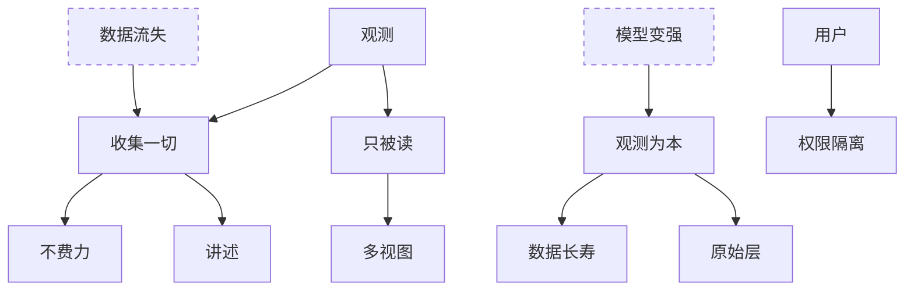

Orisumi 是一个以 10 到 20 年计的长期项目。这一页记录它的发心，以及从发心推出的需求。

陈述分三级：

- 公理：选定的出发点。
- 假设：对现实世界的判断，现实变了就要回看。图中用虚线框。
- 推论：从上层推出的结论。

每条陈述的名字就是它的 ID，推论后面写明依据。一条陈述被推翻时，沿着图的箭头往下，所有能到达的陈述都要重新考虑。点图中的陈述可以跳到它的说明。

## 公理

### 观测

任何智能要了解一个人，缺的是对这个人的观测。现在读这些数据的是 Agent，以后不管出现什么新的智能形式，它们缺的都是这个人的数据：一个对他的观测集合。没有观测，就没法了解这个人。

### 用户

用户是任何人，可以是我自己，也可以是别人。

## 假设

### 模型变强

模型能力会越来越强，同等智能水平的 token 成本会越来越低。今天存下的记录，会被未来更强的模型读懂。

### 数据流失

人会产生很多数据。大多数都没了，少部分被大厂拿走，拿不回来。真正属于自己的很少。

## 推论

### 收集一切

尽可能收集一个人产生的所有数据，范围是任何能采集、能观测到的东西。没留下来的数据有四类，各有收集的途径：

- 从来没被记录：屏幕上看到的、线下说的话、当时的想法。只能自己采集。
- 平台记了、能导出。靠导入。
- 平台记了、导不出，例如推荐画像。只能采集自己这一侧看到的东西。
- 本地有过、后来散落丢失，例如旧手机的聊天记录。靠归拢。

依据：[观测](#观测)、[数据流失](#数据流失)。

### 观测为本

今天对数据做的理解，以后都会被更强、更便宜的模型重做。长期留下的是观测本身，理解随时可以重算。

依据：[模型变强](#模型变强)。

### 数据长寿

数据比代码活得久。代码会过时、会被重写；读这些数据不依赖今天这份代码，Orisumi 重写多少次，以前采到的数据都还在、还读得懂。

依据：[观测为本](#观测为本)。

### 只被读

Orisumi 不做 Agent 框架，只给 Agent 提供关于这个人的 Context。

依据：[观测](#观测)。

### 原始层

留下能拿到的最原始的那一层。原始形式常常拿不到：采集桌面应用时，原始的字节流早就过去了，能拿到的只是系统事件告诉过你的东西；没录下来的声音也采集不到。

一件事可以有多层。录音可以只做 ASR、保留文本，这样原始语音就没了；也可以两者都留，这就有了层级关系。原始音频在，ASR 就能做无数遍。

依据：[观测为本](#观测为本)。

### 不费力

能自动采集的，人什么都不用做，数据就在攒。收集不依赖人的自觉。

依据：[收集一切](#收集一切)。

### 讲述

有的东西是人讲述出来的。

依据：[收集一切](#收集一切)。

### 多视图

Agent 理论上能读所有数据，原始数据也能读。人能读的，Agent 一定能读；Agent 能读的，人不一定能读。人要看的，例如应用时长、求和、均值，做成图表这类人可读的视图。人和 Agent 读的是同一份底层数据。

依据：[只被读](#只被读)。

### 权限隔离

自己看自己的数据，全部都能看；交给外部模型服务处理也可以。有些东西不想让别人看到，需要权限隔离。

依据：[用户](#用户)。

## 怎样算满足

- 十年后问 Agent「我 2026 年 10 月在纠结什么」，它能从当时的记录答出来。对应[收集一切](#收集一切)、[观测为本](#观测为本)。
- 换一个全新的 Agent 产品，第一天就知道我最近在做什么，不用我重新解释。对应[观测](#观测)、[只被读](#只被读)。
- Orisumi 再重写几次，2026 年采到的数据都还在、还读得懂。对应[数据长寿](#数据长寿)。
- 能自动采集的，我什么都不用做，数据就在攒。对应[不费力](#不费力)。
