Orisumi 是一个以 10 到 20 年计的长期项目。这一页记录它的发心，以及从发心和对现实的判断推出的需求。

陈述分三级：

- 立场：选定的出发点。
- 假设：对现实世界的判断，现实变了就要回看。图中用虚线框。前两条是对世界的判断，其余几条来自对真实数据来源的勘探。
- 推论：从上层推出的结论。

每条陈述的名字就是它的 ID，推论后面写明依据。一条陈述被推翻时，沿着图的箭头往下，所有能到达的陈述都要重新考虑。点图中的陈述可以跳到它的说明。

```mermaid
flowchart TD
  collectFirst["首先收集数据"]
  collect["尽量收集一切"]
  situations["数据所处的情况"]
  complete["尽量完整留下"]
  history["保留采到的历史"]
  changes["尽量采全变化"]
  rawest["留最原始的一层"]
  origin["出处一起保存"]
  simple["采集保障先从简"]
  modelService["模型服务可处理自己的数据"]
  observe["了解一个人靠观测"]
  user["用户是任何人"]
  share["数据可以给别人看"]
  decades["以十年为尺度"]
  models["模型越来越强"]
  loss["数据大多会流失"]
  transient["有的数据错过就没了"]
  dropped["采集会丢数据"]
  formats["格式随版本变化"]
  names["一个东西有多个名字"]
  scattered["一件事散在多处"]
  vanish["存下的也会消失"]
  observationFirst["留下观测重算理解"]
  durable["数据比代码长寿"]
  storage["不绑定某种存储"]
  context["只提供上下文"]
  effortless["收集不靠自觉"]
  views["同一份数据多种视图"]
  trace["理解能追溯来源"]
  isolation["给别人看要隔离"]
  transientFirst["先采错过就没的"]
  version["记下采集器版本"]
  identity["身份事后读出"]
  everywhere["各处原样都存"]
  revisit["能补的也定期采"]
  idempotent["采集幂等"]
  notify["采集失败要通知"]
  blocks["原件存成块"]
  replicas["多处都有一份"]

  models --> observationFirst
  rawest --> observationFirst
  observationFirst --> durable
  decades --> durable
  durable --> storage
  collectFirst --> context
  modelService --> context
  collect --> effortless
  context --> views
  observationFirst --> trace
  share --> isolation
  collect --> transientFirst
  situations --> transientFirst
  transient --> transientFirst
  rawest --> version
  formats --> version
  observationFirst --> identity
  names --> identity
  rawest --> everywhere
  complete --> everywhere
  origin --> everywhere
  scattered --> everywhere
  effortless --> revisit
  changes --> revisit
  vanish --> revisit
  revisit --> idempotent
  rawest --> idempotent
  history --> idempotent
  origin --> idempotent
  dropped --> notify
  origin --> notify
  simple --> notify
  idempotent --> blocks
  storage --> blocks
  observationFirst --> blocks
  durable --> replicas
  history --> replicas
  origin --> replicas
  vanish --> replicas

  classDef hypothesis stroke-dasharray: 5 5
  class models,loss,transient,dropped,formats,names,scattered,vanish hypothesis

  click collectFirst href "#首先收集数据"
  click collect href "#尽量收集一切"
  click situations href "#数据所处的情况"
  click complete href "#尽量完整留下"
  click history href "#保留采到的历史"
  click changes href "#尽量采全变化"
  click rawest href "#留最原始的一层"
  click origin href "#出处一起保存"
  click simple href "#采集保障先从简"
  click modelService href "#模型服务可处理自己的数据"
  click observe href "#了解一个人靠观测"
  click user href "#用户是任何人"
  click share href "#数据可以给别人看"
  click decades href "#以十年为尺度"
  click models href "#模型越来越强"
  click loss href "#数据大多会流失"
  click transient href "#有的数据错过就没了"
  click dropped href "#采集会丢数据"
  click formats href "#格式随版本变化"
  click names href "#一个东西有多个名字"
  click scattered href "#一件事散在多处"
  click vanish href "#存下的也会消失"
  click observationFirst href "#留下观测重算理解"
  click durable href "#数据比代码长寿"
  click storage href "#不绑定某种存储"
  click context href "#只提供上下文"
  click effortless href "#收集不靠自觉"
  click views href "#同一份数据多种视图"
  click trace href "#理解能追溯来源"
  click isolation href "#给别人看要隔离"
  click transientFirst href "#先采错过就没的"
  click version href "#记下采集器版本"
  click identity href "#身份事后读出"
  click everywhere href "#各处原样都存"
  click revisit href "#能补的也定期采"
  click idempotent href "#采集幂等"
  click notify href "#采集失败要通知"
  click blocks href "#原件存成块"
  click replicas href "#多处都有一份"
```

## 立场

### 首先收集数据

先收集关于人的数据，让数据存在并留下，未来的查询、理解和使用保持开放。

### 尽量收集一切

关于一个人、能够取得或观测到的数据都进入候选范围；具体来源按补回机会、取得成本等条件安排。

### 数据所处的情况

未记录的活动需要当时观测；会消失的记录需要及时取得保存；已有记录从来源取得。同一来源可处于多种情况。

### 尽量完整留下

在选定范围内先尽量完整留下信息，成本实际成为问题时再引入预算机制。

### 保留采到的历史

已采到的历史版本继续保存，即使原应用随后修改或删除内容。

### 尽量采全变化

对于有明确版本或变化事件的数据，尽量留下每次可取得的变化；取得粒度和方法按来源勘探。

### 留最原始的一层

取得的数据按来源交来的形态原样保存，整理和理解在之后进行。

### 出处一起保存

原样内容与当次直接知道的出处一起保存，包括来源、设备或位置、取得时间。跨来源关联的解释留给后续。

### 采集保障先从简

运行保障当前可以暂缓，或需要时做简单外部探活。内置缺口监测、恢复编排与告警体系暂缓建设。

### 模型服务可处理自己的数据

用户自己的数据可以交给外部模型服务处理；给其他人看另有权限边界。

### 了解一个人靠观测

任何智能要了解一个人，缺的是对这个人的观测。现在读这些数据的是 Agent，以后不管出现什么新的智能形式，它们缺的都是这个人的数据：一个对他的观测集合。没有观测，就没法了解这个人。

### 用户是任何人

用户是任何人，可以是我自己，也可以是别人。

### 数据可以给别人看

自己看自己的数据，全部都能看。有些数据会给别人看。

### 以十年为尺度

Orisumi 按 10 到 20 年来设计。找全局更好的方向，不为几个月或一次实现的方便牺牲长期设计。

## 假设

### 模型越来越强

模型能力会越来越强，同等智能水平的 token 成本会越来越低。今天存下的记录，会被未来更强的模型读懂。

### 数据大多会流失

人会产生很多数据。大多数都没了，少部分被大厂拿走，拿不回来。真正属于自己的很少。

### 有的数据错过就没了

有的数据转瞬即逝，例如前台在用什么应用、浏览器里在看什么、键鼠事件，没采到就没有了。有的数据事后还能拿到，例如 Git 提交、浏览器 90 天的历史、收藏夹。

### 采集会丢数据

采集程序会因为积压、溢出、重启丢掉数据，一丢可能就是几周。

### 格式随版本变化

同一个来源的格式会随采集程序或来源软件的版本变化，字段、编码和时间格式都会变。

### 一个东西有多个名字

同一个东西在不同来源、不同平台上有不同的名字，例如同一个应用在 Windows 上是进程名，在 Mac 上是 bundle id。靠采集拿不全它们之间的对应关系。

### 一件事散在多处

一件事的信息分散在好几处，同一条记录也会出现好几份。例如一次助手会话，日志、索引文件和数据库各存一部分，回退和子 Agent 还会把同一段记录复制进别的文件。

### 存下的也会消失

已经持久化的数据也会被清理、压缩或挪走，例如助手会话按保留期被删除、被压缩归档。

## 推论

### 留下观测重算理解

观测长期保留，整理和理解在保存之后进行。以后可以用新的读法和模型重新理解同一批材料。

依据：[模型越来越强](#模型越来越强)、[留最原始的一层](#留最原始的一层)。

### 数据比代码长寿

数据比代码活得久。代码会过时、会被重写；读这些数据不依赖今天这份代码，Orisumi 重写多少次，以前采到的数据都还在、还读得懂。

依据：[留下观测重算理解](#留下观测重算理解)、[以十年为尺度](#以十年为尺度)。

### 不绑定某种存储

数据可以放在本地文件、对象存储、数据库等不同的存储里。换了存储，数据还在、还读得懂。

依据：[数据比代码长寿](#数据比代码长寿)。

### 只提供上下文

留下的材料可供 Agent 查询、理解和使用。当前先让数据存在并留下，后续具体用途保持开放。

依据：[首先收集数据](#首先收集数据)、[模型服务可处理自己的数据](#模型服务可处理自己的数据)。

### 收集不靠自觉

能自动采集的，人什么都不用做，数据就在攒。收集不依赖人的自觉。

依据：[尽量收集一切](#尽量收集一切)。

### 同一份数据多种视图

Agent 是首要读者。Orisumi 的每项能力都能不开界面、由 Agent 直接调用，界面只是其中一种查看方式。

Agent 理论上能读所有数据，原始数据也能读。人能读的，Agent 一定能读；Agent 能读的，人不一定能读。人要看的，例如应用时长、求和、均值，做成图表这类人可读的视图。人和 Agent 读的是同一份底层数据。

人自己讲述的东西也是一种视图：在 IM 里发给自己的消息、对 Claude Code 说的话、写进备忘录的内容，分别由各自的来源采集，只要知道是这个人自己写的，就能放在一起看。

依据：[只提供上下文](#只提供上下文)。

### 理解能追溯来源

觉得某条理解不对时，能知道它来自哪些数据、哪次模型调用，能看到当时的 trace。模型推理带随机性，不要求原样重现。

依据：[留下观测重算理解](#留下观测重算理解)。

### 给别人看要隔离

有些东西不想让别人看到，给别人看要有权限隔离。

依据：[数据可以给别人看](#数据可以给别人看)。

### 先采错过就没的

来源接入先后结合错过后能否补回、丢失窗口和实际取得成本安排。未记录的活动需要当时观测；已有记录能补回多久，按来源实际保留情况判断。

依据：[尽量收集一切](#尽量收集一切)、[数据所处的情况](#数据所处的情况)、[有的数据错过就没了](#有的数据错过就没了)。

### 记下采集器版本

原样保存数据时，记下是哪个版本的采集程序、从哪个版本的来源软件采的，以后才知道该怎么读。

依据：[留最原始的一层](#留最原始的一层)、[格式随版本变化](#格式随版本变化)。

### 身份事后读出

同一个东西的不同名字之间的对应关系，由事后读数据得出，可以借助模型。读出的结果随时可以重算。

依据：[留下观测重算理解](#留下观测重算理解)、[一个东西有多个名字](#一个东西有多个名字)。

### 各处原样都存

一件事散在几处的，每处实际取得的内容与出处分别保留，复制出来的材料也照原样留下。跨来源合并和身份对应在后续读出时形成。

依据：[留最原始的一层](#留最原始的一层)、[尽量完整留下](#尽量完整留下)、[出处一起保存](#出处一起保存)、[一件事散在多处](#一件事散在多处)。

### 能补的也定期采

事后能拿到的来源也要定期自动取得，在其清理前保住可得内容。来源提供历史版本或变化记录时，按实际能力补取；频率和触发方式按保留窗口与取得成本确定。

依据：[收集不靠自觉](#收集不靠自觉)、[尽量采全变化](#尽量采全变化)、[存下的也会消失](#存下的也会消失)。

### 采集幂等

重复采集时，原内容和已经保存的历史继续可读，每次取得的时间、出处和结果分别可查。相同内容的复用方式与变化版本的实际开销由保存方案确定。

依据：[能补的也定期采](#能补的也定期采)、[留最原始的一层](#留最原始的一层)、[保留采到的历史](#保留采到的历史)、[出处一起保存](#出处一起保存)。

### 采集失败要通知

单次采集的成功、部分完成或失败结果需要可得，保留已取得材料，并能查到失败的时间与原因。需要主动反馈运行停止或结果过期时，可采用简单的外部探活；运行保障也可以暂缓，具体方式和启动时机按实际需要安排。

依据：[采集会丢数据](#采集会丢数据)、[出处一起保存](#出处一起保存)、[采集保障先从简](#采集保障先从简)。

### 原件存成块

原件存成按内容寻址的不可变块，块的名字就是它内容的哈希。大文件按内容切成块，小记录先成批再切。采集记录也存成块，写着什么时候、在哪台机器、由哪个采集程序、从哪里采的，由哪些块组成。

块是唯一的事实。块的索引、读出、目录树、查询用的数据库都是投影，随时可以从块重建。

主动删除需要留下对象、时间和原因。逻辑上停止展示与物理上清除内容分别说明；声称内容已被物理删除时，要实际清除相应保存位置中不再被其他保留记录引用的内容。读出引用的原件不可用时，如实表达依据已缺失。

依据：[采集幂等](#采集幂等)、[不绑定某种存储](#不绑定某种存储)、[留下观测重算理解](#留下观测重算理解)。

### 多处都有一份

长期保留的材料需要在多个位置留下恢复所需的内容、历史和出处。一处保存位置不可用时，仍能从别处恢复。

保存位置、复制方式和引入时机由具体方案确定；副本完整性用实际恢复验证。主动删除涉及哪些保存位置、逻辑记录和物理内容，按实际完成的范围说明。

依据：[数据比代码长寿](#数据比代码长寿)、[保留采到的历史](#保留采到的历史)、[出处一起保存](#出处一起保存)、[存下的也会消失](#存下的也会消失)。

## 怎样算满足

- 一份会话的原日志、附件和后来取得的变化版本，在来源不可用后仍能取回，并查到当时从哪里、何时取得。对应[首先收集数据](#首先收集数据)、[保留采到的历史](#保留采到的历史)、[出处一起保存](#出处一起保存)。
- 十年后问 Agent「我 2026 年 10 月在纠结什么」，它能从当时的记录答出来。对应[尽量收集一切](#尽量收集一切)、[留下观测重算理解](#留下观测重算理解)。
- 换一个全新的 Agent 产品，第一天就知道我最近在做什么，不用我重新解释。对应[了解一个人靠观测](#了解一个人靠观测)、[只提供上下文](#只提供上下文)。
- 换了更好的模型以后，用同一批数据重新生成理解，能看到新旧两版哪里不一样。对应[留下观测重算理解](#留下观测重算理解)。
- 觉得某条理解不对时，能点开它依据的数据和那次模型调用。对应[理解能追溯来源](#理解能追溯来源)。
- Orisumi 再重写几次，2026 年采到的数据都还在、还读得懂。对应[数据比代码长寿](#数据比代码长寿)。
- 能自动采集的，我什么都不用做，数据就在攒。对应[收集不靠自觉](#收集不靠自觉)。
- 一份会话日志反复取得后，实际采到的版本和每次出处都可查；部分失败时，已取得材料仍可恢复，失败结果可得。对应[采集幂等](#采集幂等)、[采集失败要通知](#采集失败要通知)。
- 一台电脑坏了，已完成异处保存的原件、历史和出处仍能从另一个位置恢复。对应[多处都有一份](#多处都有一份)。
- 在手机上，或者在一台没装 Orisumi 的电脑的浏览器里，能看到所有设备的读出。对应[同一份数据多种视图](#同一份数据多种视图)、[多处都有一份](#多处都有一份)。
