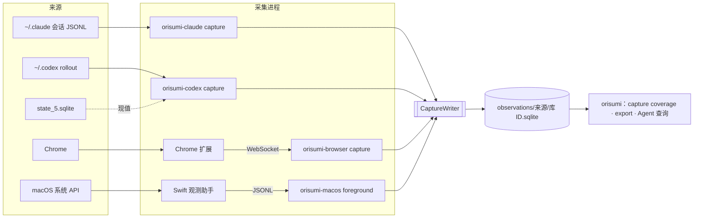
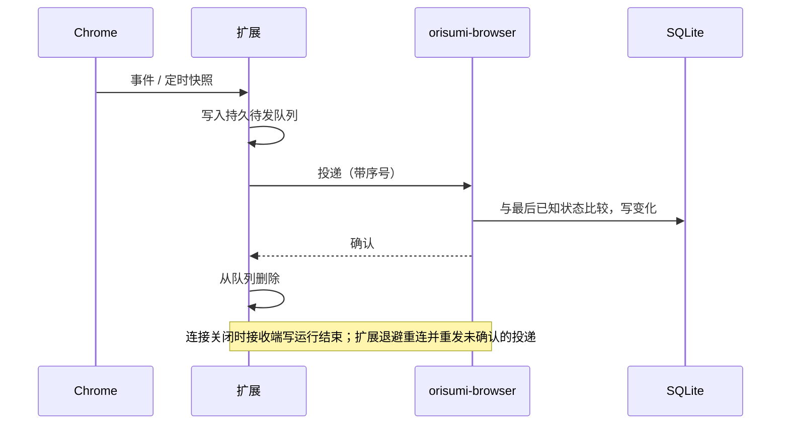

每个来源由自己的程序 `orisumi-<来源>` 采集、自己决定记什么，写进自己的 SQLite 库。宿主 `orisumi` 不引用任何采集器：它按各采集器 `describe` 给出的参数把它们装成 LaunchAgent，把 `orisumi <来源> …` 转给对应程序，并直接读各库做覆盖查询和导出；约定见[新增采集器](../capture/index.mdx#新增采集器)。各来源共享的只有“怎么安全地写”：单写入、运行记录、事务和进度，由 `Storage/CaptureWriter` 负责。写库只在 C# 里做；状态放在能可靠持有它的一方，见下文[各来源怎么走](#各来源怎么走)。

## 进程

| 进程 | 一次运行 | 取数 |
| --- | --- | --- |
| `orisumi-claude capture` | 进程生命期 | 回放会话日志 |
| `orisumi-codex capture` | 进程生命期 | 回放 rollout；名称、归档、置顶读现值 |
| `orisumi-browser capture` | 一条扩展连接，每个 Chrome 配置一条 | 通知加定时快照；历史回放 |
| `orisumi-macos foreground` 与 Swift 助手 | 进程生命期 | 通知加读现值 |

四个采集器都由 `capture start` 装成 LaunchAgent，经签名的 `Orisumi.app` 拉起以获得系统权限，见[安装与启停](../development/release.mdx#安装与启停)。

## 一轮写入

采集进程启动时创建 `CaptureWriter`：拿到该来源的单写入锁，记一行 `capture_runs` 和这次运行的主机观测。之后每一轮都是

1. 来源代码在同一个事务里写它的事实和读取游标；
2. `CaptureWriter` 把 `confirmed_until_utc_ms` 更新到这一轮，提交；
3. 失败就回滚这一轮，在 `capture_read_failures` 记下错误，运行继续。

进程正常退出时写运行的结束；崩溃时结束留空，`confirmed_until_utc_ms` 说明至少确认到了哪。写什么表、何时算一轮，各来源自己定，规则见[采集开发](../capture/index.mdx)。

## 各来源怎么走

**Claude、Codex**：监听来源目录，`Storage/JsonlReader` 从游标读新增的完整行，来源代码挑出事件和内容，与游标一起提交。通知只触发读取；Claude 每五分钟、Codex 每 60 秒再核对一次。

**macOS**：Swift 助手在内存里保留各通道的上一个值，只把变化连同观测时间写成 JSONL；`foreground` 按批入库。Swift 进程的生命期就是一次运行，内存里的状态在运行内可靠，所以比较留在 Swift。两边任一方退出，另一方随之结束运行。

**浏览器**：扩展会被 Chrome 随时停掉，状态不放在扩展里。扩展只转发事件和快照，接收端拿库里的最后已知状态比较：

历史访问由接收端告诉扩展下一段读哪，读取位置和访问记录在同一事务提交。

接收端常驻，在本实例的本机端口收扩展的 WebSocket 连接，只接受本实例扩展的 Origin（`chrome-extension://<扩展 ID>`）。它每 20 秒发一次心跳，没有投递时扩展的后台也不会被 Chrome 停掉。
